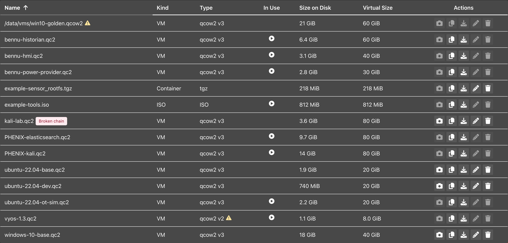
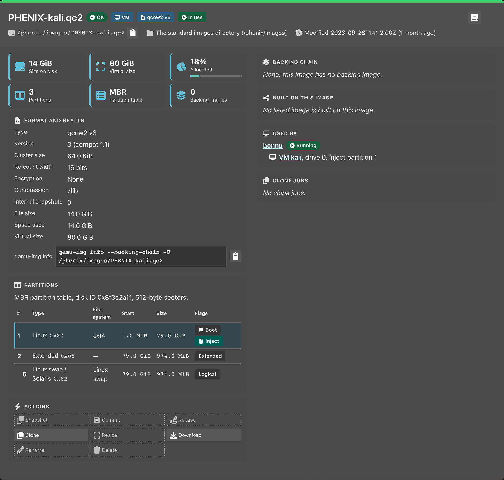
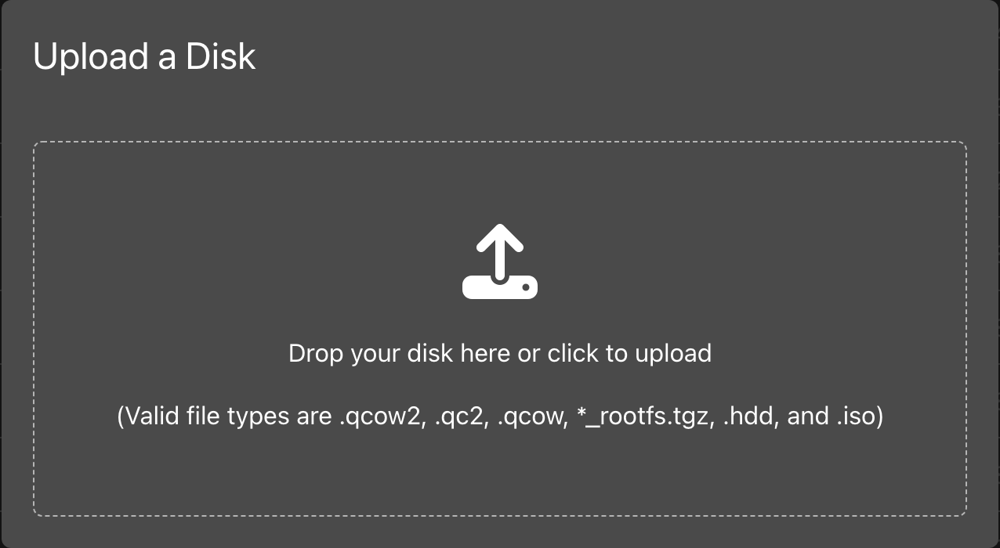

# Disks

The `Disks` tab lists the disk images phēnix knows about:

* the images with a known extension (`.qcow2`, `.qc2`, `.qcow`, `_rootfs.tgz`,
  `.hdd`, `.iso`) in the minimega files directory and the folders under it
  (see [Images in Folders](#images-in-folders))
* every image an experiment's topology names, wherever it is
* the images those are backed by

Each image is listed once, by its full path. Only the images your role may see
appear (see [Permissions](#permissions)).

{: width=800 .center}

Disk images are built from the command line. See
[Virtual Disk Images Management](image.md).

## Disk Totals

Above the table, level with the `Find a Disk` search box, the page counts the
listed images, how many of them are [in use](#in-use), and the sum of their
sizes on disk. The totals cover every image in the list, not only the ones the
search shows.

## The Disks Table

| Column | What it shows |
| :--- | :--- |
| `Name` | The image's path within the minimega files directory, such as `win/win10.qcow2`, or its full path with a warning icon when it is [outside that directory](#images-outside-the-files-directory). A `Broken chain` tag marks a [broken backing chain](#broken-backing-chains). |
| `Kind` | `VM`, `Container`, `ISO`, or `Unknown`. |
| `Type` | The image's format and version, such as `qcow2 v3` or `raw`. An icon marks an old version or a format problem, with the fix in its tooltip (see [Image Format Versions](#image-format-versions)). |
| `In Use` | An icon when a running VM holds the image open, with a tooltip naming the experiments. |
| `Size on Disk` | How much room the file takes now. |
| `Virtual Size` | How large the disk looks to the guest. |
| `Actions` | Buttons for the actions that can be run on the image. |

Every column but `Actions` sorts. The `Find a Disk` search box searches by the
path the `Name` column shows, so `win/` finds every image in the `win` folder.
Click a row to open the image's [details card](#the-details-card).

## The Details Card

Click a row to open the details card of its image. phēnix reads the image
again when the card opens, so the card shows more than the table. The URL
`/disks?disk=<full path>` opens the card of the image at that path.

{: width=800 .center}

The head shows the image's name and tags for its health, kind, type and use.
The color of the head agrees with the health tag:

| Tag | Color | What it means |
| :--- | :--- | :--- |
| `OK` | Green | phēnix found no problem. |
| `Warning` | Yellow | An old format version, a format phēnix does not check, an image outside the files directory, or a bad inject partition. |
| `Error` | Red | A broken backing chain, or an image that qemu refuses. |

Below the head are the full path, the location, the time of the last change,
and a `Problems` box that lists each problem. Then the card shows:

* tiles for the size on disk, the virtual size, the partitions, the partition
  table type and the number of backing images
* `Format and health`: the format, version and features of the image, and
  the fix for a format problem
* `Partitions`: one row per partition, with its number, type, file system,
  size and flags
* `Actions`: the row's actions, plus `Commit`, `Rebase` and `Resize`
* `Backing chain`: the images this image is built on
* `Built on this image`: the listed images built on this one
* `Used by`: each experiment that uses the image, with its VMs
* `Clone jobs`: the clones of the image that run now

The `Inject` flag marks the partition phēnix injects files into for a VM that
uses the image: the `inject_partition` of its first drive. The card warns when
that partition does not exist, or holds no file system phēnix can write to.

## In Use

An image counts as in use when a running VM holds its file open. A backing
image is not marked in use just because an image built on it is, so a base
image stays available for snapshots while VMs run off its children. The
`Used by` section of the [details card](#the-details-card) lists every
experiment whose topology names the image, running or stopped.

## Images in Folders

Images can sit in folders under the minimega files directory. A topology names
them by their path within it (`image: win/10/win10.qcow2`) or by their full
path. The list leaves out:

* hidden files and folders, and `lost+found`
* the `files`, `tmp` and `miniccc_responses` folders of an experiment, which
  the experiment's [Files](experiment-files.md) tab manages
* minimega's own `saved` folder and `transfer_*` files

Symlinked folders are not followed. An image the list leaves out is still
listed when a topology names it, but phēnix does not act on it.

## Images Outside the Files Directory

A topology can also name an image anywhere else phēnix can read it, such as
`/data/vms/win10.qcow2`. The list shows such an image by its full path, with a
warning icon whose tooltip reads:

> Outside the standard images directory (/phenix/images). minimega does not
> copy this image to other cluster nodes. On a multi-node cluster, every node
> that may run a VM with this image needs the same file at this path.

The same icon marks the image on the experiment pages. phēnix lists outside
images but does not change them: every action, `Download` included, is
disabled for them. To manage one from this tab, copy it into the minimega
files directory and point the topology at the copy.

In the Docker Compose setup, the phēnix and minimega containers share
`/phenix`, so a path outside `/phenix` needs the same mount in both
containers.

!!! warning
    With minimega's `-abssnapshot` flag, which the Docker Compose setup turns
    on, minimega cannot launch a snapshot VM from an image outside its files
    directory on a cluster of more than one node. Keep such images in the
    files directory.

## Permissions

The tab needs `list` on `disks`. A `disks` permission names an image by its
file name, such as `win10.qcow2`, so one name covers the files of that name
in every folder. A role sees an image outside the files directory only when
it may also `get` an experiment whose topology uses the image, or when the
image backs an image the role sees.

## Actions

The `Actions` column offers `Snapshot`, `Clone`, `Download`, `Rename` and
`Delete`. The details card offers the same actions and three more:

* `Snapshot`: creates a new image backed by this image
* `Commit`: commits the changes in this image to its backing image
* `Rebase`: moves the image onto a different backing image
* `Clone`: creates a copy of the disk file
* `Resize`: changes the virtual size of the disk
* `Download`: saves the image file to this computer
* `Rename`: gives the image a new name
* `Delete`: removes the image file

An action you cannot use stays visible but is disabled, and its tooltip says
why, such as `Cannot rename: the disk is in use by foo`. An image a running VM
holds open can only be cloned or downloaded. `Snapshot`, `Commit` and `Rebase`
apply to VM images only, and `Commit` needs a backing image to commit into.
Each action needs a permission on `disks`: `create` for `Snapshot` and
`Clone`, `update` for `Rebase`, `Rename` and `Resize` (and for `Commit`, on
both images), `get` for `Download`, and `delete` for `Delete`. `Rename` also
needs `create` on the new name, and `Rebase` also needs `get` on the new
backing image.

`Commit`, `Rebase` and `Resize` refuse an image whose backing chain leaves
the files directory, or has a vmdk, qed or external data file in it. An
unsafe `Rebase` does not check the chain.

`Snapshot`, `Clone` and `Rename` ask for a new name, relative to the image's
own folder. A snapshot is always a qcow2 image. `Clone` and `Rename` keep the
format of the image, so its extension decides the new name:

| Image extension | The new name can end in | Extension that phēnix adds |
|---|---|---|
| `.qcow2` or `.qc2` | `.qcow2` or `.qc2` | `.qcow2` |
| `.qcow` | `.qcow`, `.qcow2` or `.qc2` | `.qcow` |
| `.iso` | `.iso` | `.iso` |
| `.hdd` | `.hdd` | `.hdd` |
| `_rootfs.tgz` | `_rootfs.tgz` | `_rootfs.tgz` |

phēnix adds the extension of the third column to a name that has none, and
refuses a name with a different known extension. The folder must already
exist, and no action replaces an existing file. A name minimega uses must have
no white space or control characters, and none of `"`, `'`, `` ` ``, `\`,
`#`, `*`, `?`, `[`, `]`, `{`, `}`, `$`, or `,`.

!!! warning
    phēnix does not check whether other images are built on the one you
    rename or delete. Images backed by a renamed image must be rebased onto
    its new name, and images backed by a deleted one can no longer be used.
    Check the `Built on this image` section of the details card first.

### Cloning in the background

A clone copies the whole file, which can take minutes for a large image, so
`Clone` runs as a [background job](jobs.md). The dialog closes as soon as the
copy starts, and the [jobs menu](web-ui.md#background-jobs-menu) and the
`Clone jobs` section of the details card show its progress and can cancel it.
The new image appears in the list once the copy is complete.

## Uploading an Image

The upload button, right of the search box, needs `upload` on `disks`. It
opens `Upload a Disk`, where you can drop a file or click to pick one.

{: width=500 .center}

The dialog takes `.qcow2`, `.qc2`, `.qcow`, `*_rootfs.tgz`, `.hdd` and
`.iso` files. While an upload runs, the upload button shows its progress, and
closing the dialog does not stop the upload. Uploaded images land at the top
of the minimega files directory.

## Refreshing the List

The list reloads on its own when the minimega files directory, or a folder
under it, changes. Changes to images outside that directory show the next time
the list loads. The header's refresh button has the server inspect every image
again from scratch (see
[Page Freshness and Refresh](web-ui.md#page-freshness-and-refresh)). phēnix
inspects images with `qemu-img`, which the phēnix container image includes.
Without it, phēnix asks minimega instead, which lists fewer images.

## Broken Backing Chains

A VM cannot start from an image whose backing file is missing. The table shows
a `Broken chain` tag beside such an image, and the tag's tooltip names the
problem, for example `backing file /phenix/images/ro_kali.qc2 is missing`.
These are the causes:

* a file in the backing chain is missing
* the chain names one of its own images again (a loop)
* the chain has more than 64 images

In the details card, the `Backing chain` section shows a box for each backing
image, and a red box marked `(missing)` for the missing file. On the
experiment pages, a VM disk with a broken chain shows a red icon with a cross.
Before each start, phēnix checks the backing chain of each VM disk and refuses
the start when a file is missing (see
[Disk Check Before a Start](experiments.md#disk-check-before-a-start)).

To repair the image, do one of these steps:

1. Restore the missing backing file at the path that the tag names.
2. Point the image at a copy of the missing backing file. Use `Rebase` with
   `Change reference only` selected. A rebase without this option must read
   the missing file, so it fails.
3. Change the topology to use a different image.

## Image Format Versions

Before a start, phēnix also reads the format and version of each image in a
backing chain. qemu refuses some images, and some old formats can cause
problems:

| Image | What phēnix does |
| :--- | :--- |
| qcow2 version 3 (`compat=1.1`), raw | Starts the VM. |
| qcow2 version 2 (`compat=0.10`) | Starts the VM. `phenix doctor` warns. |
| qcow version 1 | Starts the VM with a warning. Some qemu builds cannot open this format. |
| qcow2 or qcow version 1 with the old AES encryption | Refuses the start. |
| qcow2 with LUKS encryption | Refuses the start. |
| qcow2 of a version later than 3, or with feature bits qemu does not know | Refuses the start. |
| qcow2 that qemu marked as corrupt | Refuses the start when the VM writes to the image (`snapshot: false`). Otherwise starts the VM with a warning. |
| qcow2 that qemu did not close cleanly | Starts the VM with a warning. |
| qcow2 with zstd compression or extended L2 entries | Starts the VM. `phenix doctor` warns when the local `qemu-img` is too old for them. |
| vmdk, qed, or qcow2 with an external data file | Starts the VM with a warning. phēnix does not check past this image. |

With `experiment.disk-check` set to `warn`, a refused start is a warning
instead. The `Type` column marks these images, and the details card gives the
fix command for each one. For the commands, see
[A Start Fails on an Image Format](troubleshooting.md#a-start-fails-on-an-image-format).

## Downloading an Image

`Download` confirms first, then downloads the image through the browser. The
server serves only images in the minimega files directory. An interrupted
download resumes from the browser's downloads list, as long as the image has
not changed, so stop a VM that writes to the image first. From a shell,
`curl -C -` resumes a download the same way:

```bash
curl -C - -o win.qc2 -H 'X-Phenix-Auth-Token: Bearer <token>' \
  'https://<phenix>/api/v1/disks/download?disk=win.qc2'
```

To verify a download, compare its `sha256sum` with the checksum the
[API](api.md#downloads) returns for the image.
