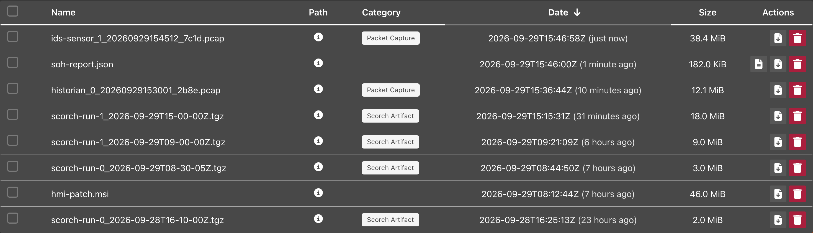
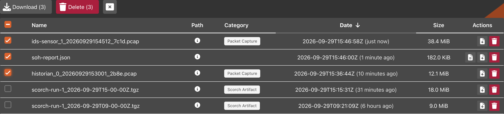
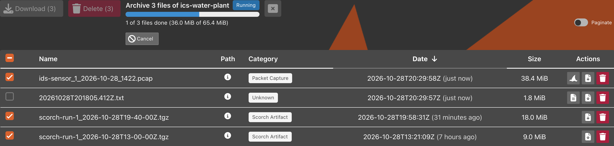

# Experiment Files

The `Files` tab of an experiment lists the files phēnix, its apps and SCORCH
wrote for that experiment, wherever on the cluster they were written. It is
the second tab of both the running and the stopped experiment page. Your role
needs `list` on `experiments/files` to see it. The files are kept in the
experiment's `files` folder in the minimega files directory, which the
[Disks](disks.md) tab leaves out, so manage the experiment's VM disk snapshots
here.

{: width=800 .center}

## Finding a File

The table has `Name`, `Path`, `Category`, `Date`, `Size` and `Actions`
columns. Hover over the `Path` icon for the file's full path on the phēnix
server. `Date` shows when the file last changed and how long ago that was (see
[Timestamps](web-ui.md#timestamps)). Click the `Name`, `Path`, `Date` or
`Size` heading to sort by it. `Path` sorts the paths from A to Z and ignores
case. The newest file is listed first.

phēnix categorizes each file by what it is and what wrote it: `Packet
Capture`, `Scorch Artifact`, `Filebeat`, `ELF Memory Snapshot`, `VM Memory
Snapshot`, `VM Disk Snapshot`, `Backing Image` or `Unknown`. The
`All Categories` dropdown left of the search box keeps only the files of one
category. The `Find a File` search box matches a file's name or its
categories, across every file of the experiment.

## Opening a File

Click a text file's name to read it in a viewer, without downloading it.
phēnix treats `.json`, `.jsonl`, `.log`, `.txt`, `.yaml` and `.yml` files as
text. `Exit` closes the viewer. A text file over 10 MiB is too large to view.
Download it instead.

Click a capture file's name (`.pcap`, `.pcapng` or `.cap`, optionally gzipped)
to open it in [WebShark](webshark.md#viewing-captures), when WebShark is
installed. Download any other kind of file to read it.

## Acting on One File

The buttons in a row's `Actions` column are icons. Hover over one for its
label. In order, they are:

* `Open in WebShark` for a capture file, or `view file` for a text file. A
  row of any other kind of file leaves that space empty.
* `download`, which downloads the file. An interrupted download resumes.
* `delete`, which asks you to confirm. Deleting a file removes it from every
  cluster node and cannot be undone.

The `delete` button appears only for a role with `delete` on
`experiments/files`. Among the default roles, those are `Global Admin` and
`Experiment Admin` (see [Roles](user-administration.md#roles)).

## Acting on Several Files

A role that may download or delete an experiment's files gets a checkbox on
each row, and one in the heading that checks every file the table shows.
Checking a file puts a toolbar above the table:

* `Download (N)` builds the checked files into one
  `<experiment name>-files.zip` archive in a [background job](jobs.md), then
  downloads it. The toolbar and the
  [jobs menu](web-ui.md#background-jobs-menu) show its progress. If you leave
  the page, download the archive from the jobs menu within the hour.
* `Delete (N)` asks you to confirm once, then deletes the checked files.
* The last button clears the selection.

{: width=800 .center}

{: width=800 .center}

A file the server cannot fetch is left out of the archive, and a file that
grows while the archive is built is cut at the size it had. The archive is
then named `<experiment name>-files-incomplete.zip`, its `MISSING.txt` lists
each such file, and it downloads only after you click
`Download incomplete archive` and confirm. When some of the checked files
cannot be deleted, phēnix deletes the others and reports the rest in one
summary.

!!! note
    One zip download holds at most 500 files and 2 GiB in total. A larger
    selection is refused before anything is sent.

!!! warning
    A `.pcap` file that a running capture is still writing cannot be viewed,
    downloaded or deleted. Stop the capture first, or watch it live in
    [WebShark](webshark.md#viewing-captures).

## Adding Files

phēnix and its apps write most of an experiment's files. To add your own, such
as an installer or a configuration file, upload it through the phēnix file
server. See
[Uploading Experiment Files from the phēnix Server](vms.md#uploading-experiment-files-from-the-phenix-server),
which also covers copying an uploaded file into a VM. Uploads appear in the
`Files` tab like any other file.

## From the Command Line Binary

The `phenix exp files` commands do the same as the `Files` tab (see
[phenix experiment](cli/experiment.md#phenix-experiment-files)). They run in
the `phenix` process. A file is its path relative to the experiment's `files`
folder, as `phenix exp files list` shows it.

```bash
# The packet captures larger than 1 MB
phenix exp files list <experiment name> --filter "packet and size > 1mb"

# Copy a file to the current folder
phenix exp files get <experiment name> captures/web_eth0.pcap -O web_eth0.pcap

# Print the SHA-256 checksum of a file
phenix exp files checksum <experiment name> captures/web_eth0.pcap

# Write several files to a local zip archive
phenix exp files archive <experiment name> web_eth0.pcap db_eth0.pcap -O captures.zip

# Delete files from every node
phenix exp files delete <experiment name> web_eth0.pcap
```

`--filter` takes the search syntax of the `Files` tab. `get` and `delete`
refuse a capture that minimega still writes. `archive` has the limits of the
`Files` tab archive. It writes the archive, names each file that it left out
in `MISSING.txt`, and then fails. Add `--dry-run` to `delete` to show the
files that it would delete.
