# Experiments

For experiments spanning multiple minimega hosts, see [GRE Mesh](gre-mesh.md)
to trunk experiment networks between hosts with `--use-gre-mesh`, including
the physical network MTU requirements.

## Listing Experiments

### Web UI

Click on the `Experiments` tab. This will display all available experiments that
the user has access to view or edit.

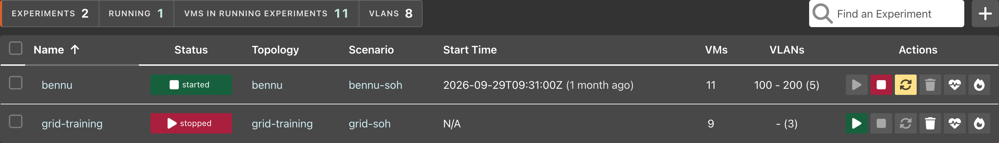{: width=800 .center}

Click a topology or scenario name to open it on the
[Configs](configuration.md#view-a-config) page. Besides start, stop, restart
and delete, the `Actions` column has shortcuts to the experiment's
[State of Health](state-of-health.md) and [SCORCH runs](scorch.md).

### Command Line

This will display a list of all available experiments:

```bash
phenix exp list
```

Add `-o json` or `-o yaml` for JSON or YAML output.

<br>

## Starting / Stopping Experiments

### Web UI

Click the `stopped` button (or the play button in the `Actions` column) to
start the experiment, and the `started` button (or the stop button) to stop
it. While the experiment starts or stops, a progress bar shows what step it's
on, such as `Launching VMs 12/40`.

| To | Click the status button | Or the button in the `Actions` column |
| :--- | :---: | :---: |
| Start a stopped experiment | {: width=120 } | {: width=228 } |
| Stop a running experiment | {: width=120 } | {: width=228 } |
| Restart a running experiment | | {: width=228 } |

The start dialog has the same options as `phenix exp start`: a dry run that
does everything except call minimega, treating minimega errors as warnings,
and a VLAN range for this start only. `Run the apps' running stage on its
schedule` (on by default) runs the `running` stage of each app that has
`runPeriodically` in the scenario, as a [background job](jobs.md) that ends
when the experiment stops.

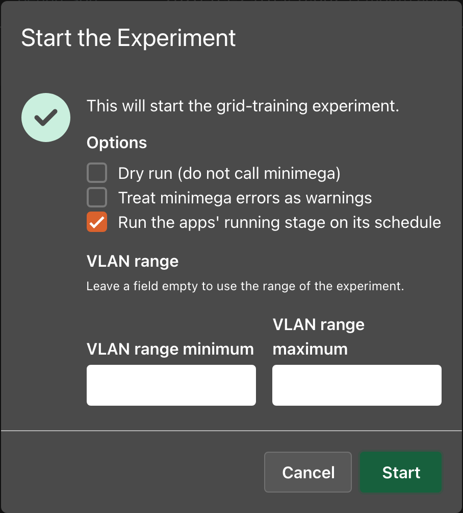{: width=500 .center}

The stop dialog has the same options as `phenix exp stop`. `Keep the
injection snapshots` keeps the VM disk snapshots that phēnix deletes after a
stop otherwise. `Force the stop` marks the experiment stopped even if minimega
cannot kill its VMs. A notice then tells you to clear those VMs in minimega
yourself.

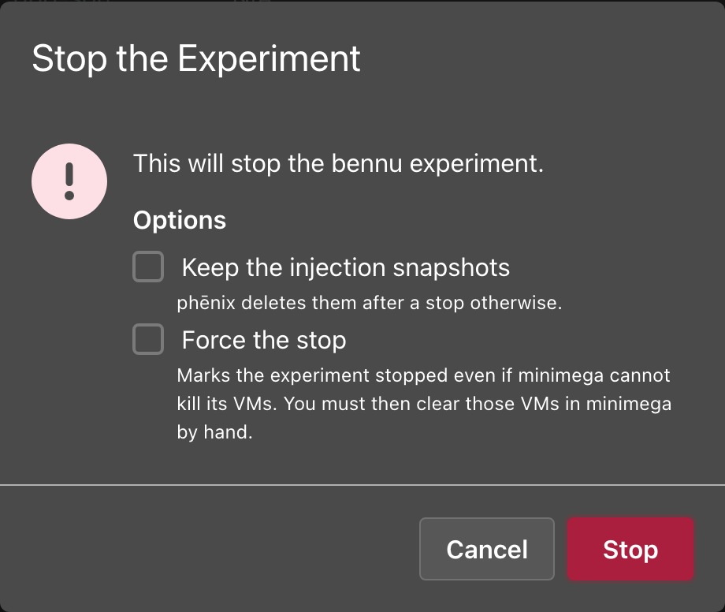{: width=460 .center}

The restart button stops the experiment and starts it again, as
`phenix exp restart` does. Its dialog has the stop options and the start
options, without the dry run. Before the stop, phēnix
[checks the disk images](#disk-check-before-a-start): a missing image refuses
the restart, and the experiment keeps running. If the start fails after the
stop, the experiment stays stopped. A restart needs the permissions to stop
and to start the experiment.

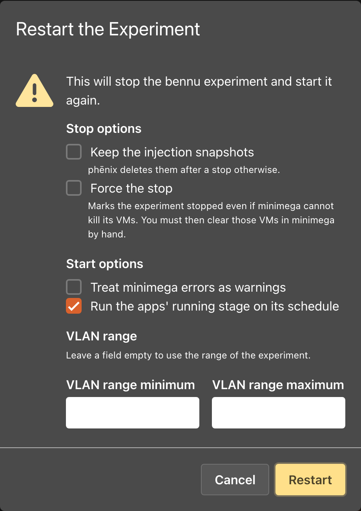{: width=460 .center}

To start, stop, restart or delete several experiments at once, check them in
the table, then click `Start`, `Stop`, `Restart` or `Delete` above the table. phēnix
tells you which experiments it will skip, and offers to retry any that fail.

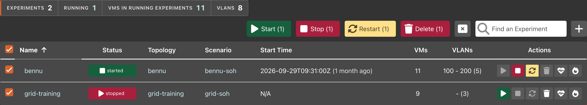{: width=800 .center}

### Command Line

```bash
phenix exp start <experiment-name>
```

Or ...

```bash
phenix exp stop <experiment-name>
```

Or ...

```bash
phenix exp restart <experiment-name>
```

Optionally, you can use the `--dry-run` flag to do everything except call out to
minimega. `--vlan-min` and `--vlan-max` set the VLAN range for just this
start.

While `phenix exp start` runs, the Experiments page of the web UI shows the
experiment as `starting` after a page refresh. phēnix refuses a second start of
the experiment until the first start ends.

The web UI also shows how far a start or a stop is: the phase, the step and the
percent that is done. While `phenix exp stop` runs, the page shows the
experiment as `stopping` after a page refresh.

After an experiment stops successfully, phēnix deletes the VM disk snapshots
created for file injection. To keep these snapshots for debugging, use
`--keep-injection-snapshots` or its `-K` shorthand:

```bash
phenix exp stop --keep-injection-snapshots <experiment-name>
```

`phenix exp restart` accepts this option too. In the Web-UI, the stop and
restart dialogs have it as `Keep the injection snapshots`.

If minimega can't kill the experiment's VMs (because it isn't answering, for
example), the stop fails and the experiment stays running. Try again once
minimega answers, or mark the experiment stopped anyway with `--force` (`-f`),
or `Force the stop` in the Web-UI, and clean up its leftover VMs in minimega
yourself:

```bash
phenix exp stop --force <experiment-name>
```

See the [`phenix experiment`](cli/experiment.md) CLI reference for every
subcommand and flag.

!!! note
    For a list of global flags supported across all `phenix` subcommands, see [Global Flags](settings.md#global-flags).

### Disk Check Before a Start

Before minimega launches any VMs, phēnix checks their disk images, on every
kind of start (Web-UI, command line, API, `phenix workflow apply`, and the
bulk `Start` and `Restart` of VMs). It follows each qcow2 image's backing
chain down to its base, and skips external VMs and VMs with
`do_not_boot: true`. A CD-ROM image (`advanced.cdrom`) or a drive image with
the `.iso` extension only needs to exist.

If a file is missing, a backing chain is broken, or qemu can't open an image
(an encrypted image, for example), the start is refused and the experiment
stays stopped. See [Broken Backing Chains](disks.md#broken-backing-chains) and
[Image Format Versions](disks.md#image-format-versions). The error names the
VM, disk and file:

```text
Error: unable to start the foo experiment: qemu cannot open 2 disks on 1 VM: 2 errors occurred:
    * VM host-01: disk kali.qc2: backing file /phenix/images/ro_kali.qc2 is missing
```

The Web-UI shows the same thing in an error message:

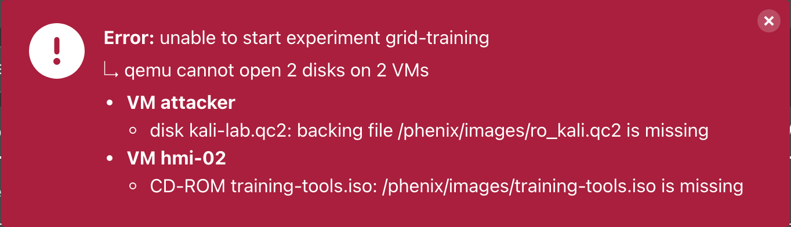{: width=600 .center}

An old or unusual image format, or a file phēnix can't read, only causes a
warning (in the server log for a start from the Web-UI or the API).

The [setting](settings.md#settings-reference) `experiment.disk-check` sets how
strict the check is: `error` (the default) refuses the start, `warn` starts
the experiment and turns each problem into a warning, and `off` skips the
check. `phenix exp start --dry-run` and `--treat-mm-errors-as-warnings` also
turn every problem into a warning.

phēnix only checks the files on the head node, so an image that only a compute
node has will usually refuse the start. Copy it to the head node, or set
`experiment.disk-check` to `warn`.

A restart runs the check before it stops the experiment, and refuses the
restart if the start would be refused. With a user app in the scenario, this
early check only warns, and the check at the start can still refuse it. The
bulk `Start` and `Restart` of VMs check only the selected VMs that minimega
launches again: a VM with a broken image fails, and the other VMs start.

### VLAN In Use at a Start

A start fails when minimega has given one of the experiment's pinned VLAN IDs
to another alias. In the Web-UI, the error has a `Show the conflict` link that
opens the [VLANs](vlans.md) page with the details of that ID.

## The Running Experiment Page

Click a running experiment's name to open its page, then click `Details` to
see a summary of the experiment and the `Apps` box, which shows the status of
each app and lets you [trigger app stages](#triggering-app-lifecycle-stages).
The stop and restart buttons next to the search box open the same dialogs as
the Experiments table.

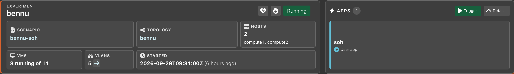{: width=800 .center}

## Create a New Experiment

### Web UI

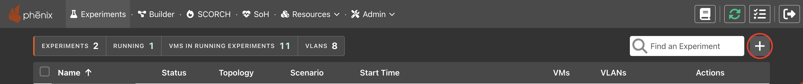{: width=800 .center}

Click the `+` button to the right of the filter field.

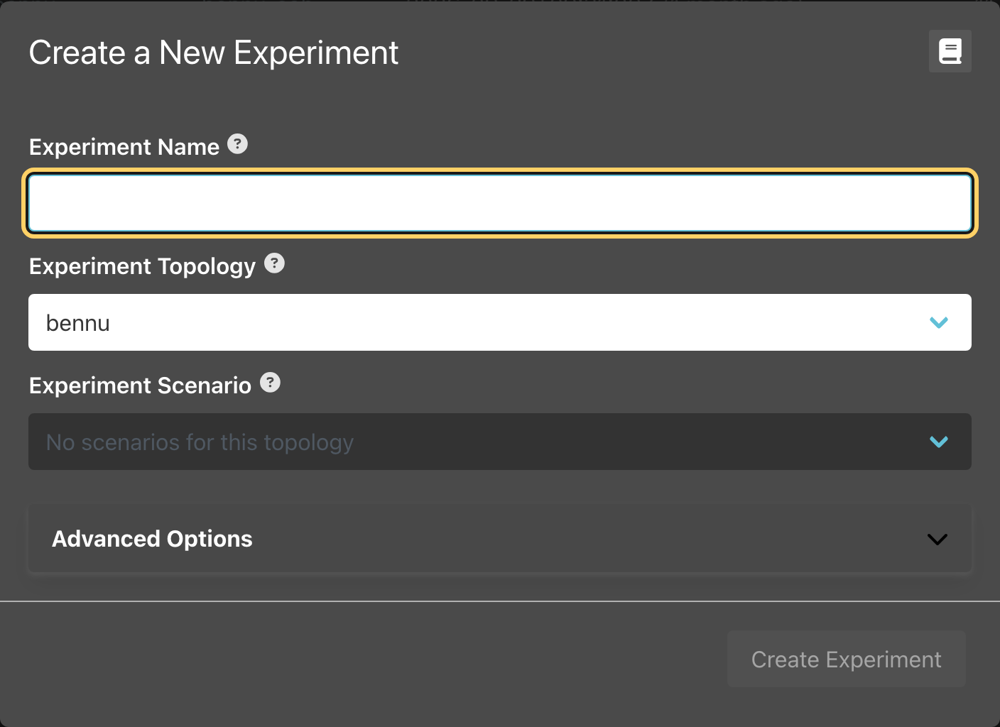{: width=600 .center}

Enter `Experiment Name` and `Experiment Topology`, the remaining selection are
optional. In this example, `bennu` is an example topology and is not included
by default. You will need to [create](configuration.md) your own topology(ies),
or draw and publish one, with its experiment, in the
[Builder](builder/publishing.md).

Click `Create Experiment`, or `Create and Start` to start it right away.

`Advanced Options` sets the `Deployment Mode` (`no-headnode`, `only-headnode`
or `all` cluster hosts), the `VLAN Range`, a
[workflow](workflow.md#branch-name) branch, and
[annotations](#adding-annotations). `Default Bridge Name` only shows when the
[bridge mode](bridge-mode.md) isn't `auto`.

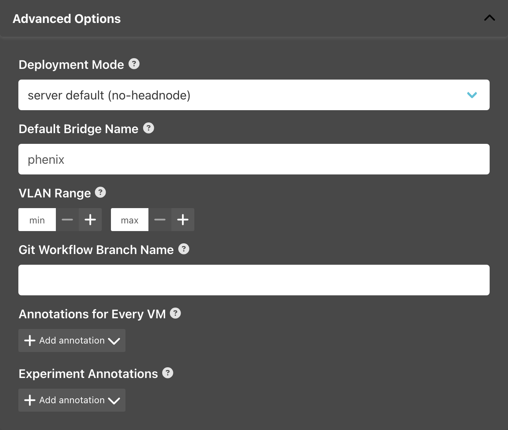{: width=500 .center}

#### Purely via the Web-UI (Uploading Topo/Scenario Files)

You can create an experiment entirely through the Web-UI using custom topology and scenario files without needing to use the CLI:

1. **Upload Configurations on the Configs Page**:
    * Navigate to the **Configs** page in the **Resources** menu.
    * Click the **Upload** button to upload your topology file (`.yaml`).
    * (Optional) Click **Upload** again to upload your scenario file (`.yaml`).
    * Verify that your uploaded configurations appear in the table (e.g., `topology/my-topology` and `scenario/my-scenario`).

2. **Create Experiment in Experiments Tab**:
    * Navigate to the **Experiments** tab.
    * Click the `+` button to open the creation dialog.
    * Enter an **Experiment Name**.
    * Select your uploaded topology from the **Experiment Topology** dropdown.
    * (Optional) Select your uploaded scenario from the **Experiment Scenario** dropdown.
    * Click **Create Experiment** to create the experiment.

### Command Line

You can create an experiment using either saved configuration names from the phēnix store or direct file paths to topology and scenario configuration files (`.yaml`).

```bash
# Using stored configuration names
phenix experiment create <experiment-name> -t <topology-name>
phenix experiment create <experiment-name> -t <topology-name> -s <scenario-name>

# Using direct file paths for topology and scenario
phenix experiment create <experiment-name> -t /path/to/topology.yaml
phenix experiment create <experiment-name> -t /path/to/topology.yaml -s /path/to/scenario.yaml

# Specifying a base directory and disabled apps
phenix experiment create <experiment-name> -t /path/to/topology.yaml -s /path/to/scenario.yaml -d </path/to/dir/> --disabled-apps "app1,app2"
```

An experiment can't be named `all`, `minimega` or `__phenix__` (in any letter
case), or `.` or `..`. From the Web-UI and the API, the base directory
(`spec.baseDir`) must be a folder in `<base-dir.phenix>/experiments`. The
command line has no such limit.

See [`phenix experiment create`](cli/experiment.md#phenix-experiment-create) in the CLI
reference for every flag.

### Adding Annotations

You can add annotations to an experiment when you create it, without editing
its topology or scenario:

| Annotations | Web-UI (`Advanced Options`) | Command line (repeatable) | API (`POST /experiments`) |
| :--- | :--- | :--- | :--- |
| On every VM | `Annotations for Every VM` | `--node-annotation key=value` | `node_annotations` |
| On the experiment | `Experiment Annotations` | `--annotation key=value` | `annotations` |

Annotations for every VM are node annotations that apps read, such as
[`phenix/default-apps`](apps.md#disable-default-apps-for-a-vm) and
[`phenix/startup-via-cc`](apps.md#c2-startup-script-delivery). They go into
the experiment's own copy of the topology, not the topology config. A VM that
already has the annotation keeps its own value, and
[external nodes](configuration.md#external-nodes) are skipped.

Experiment annotations go into the experiment's metadata for apps to read,
such as the `phenix.workflow/tags` pairs that SCORCH records with each run.
You can't set `topology` or `scenario`.

```bash
# For every VM, deliver startup scripts over C2 and create a port forward from 8080 to its port 80
phenix experiment create my-experiment -t my-topology \
  --node-annotation phenix/startup-via-cc=true \
  --node-annotation 'phenix/startup-autotunnel=["8080:80"]' \
  --annotation phenix.workflow/tags=team=red
```

In the Web-UI, `Add annotation` offers the annotations that phēnix's own apps
read, or a `Custom annotation` with any key and value.

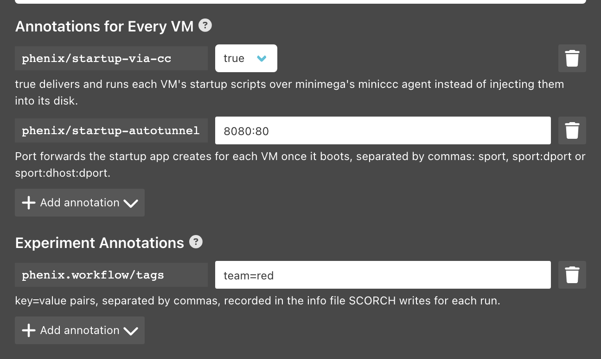{: width=600 .center}

In VM annotations, `true`, `false` and JSON lists or objects keep their type,
and phēnix rejects a value of the wrong type for an annotation its apps read.

To change one VM's annotations after the experiment is created, use the
`Annotations` section of its [details card](vms.md#vm-details-card).

## Deleting Experiments

### Web UI

The experiment must be stopped before it can be deleted; its trash can icon is
disabled while it runs. Click the trash can icon next to the experiment to
delete it.

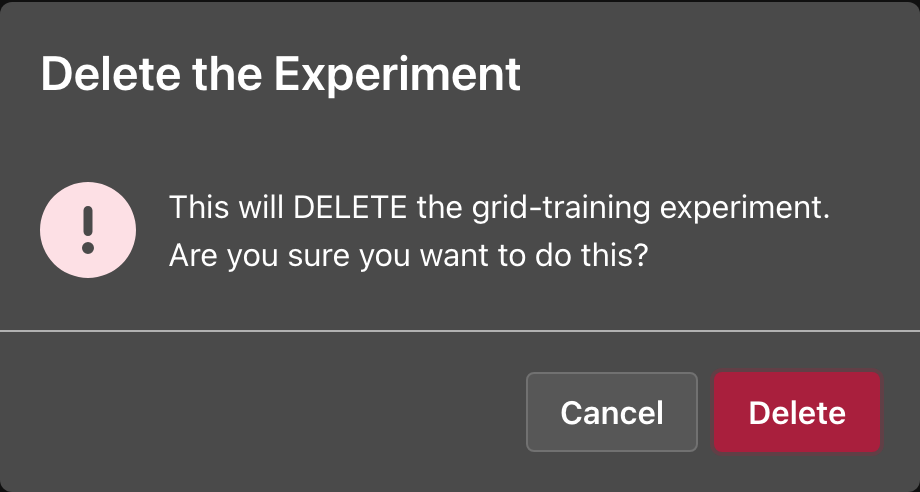{: width=500 .center}

### Command Line

An experiment must be stopped before it can be deleted:

```bash
phenix exp stop <experiment-name>
phenix exp delete <experiment-name>
```

Alternatively, the `-f`/`--force` flag can be used to automatically stop a
running experiment before deleting it, similar to `docker rm -f`, even when
minimega cannot kill its VMs, which are then left for you to clear by hand:

```bash
phenix exp delete -f <experiment-name>
```

Using `all` instead of a specific experiment name will delete all stopped
experiments (or, when combined with `--force`, all experiments regardless of
whether they are running).

A delete from the Web-UI or the API doesn't remove a base directory outside
`<base-dir.phenix>/experiments`. phēnix logs a warning instead.

See [`phenix experiment delete`](cli/experiment.md#phenix-experiment-delete) in the CLI
reference for every flag.

## Scheduling an Experiment

### Schedulers

A scheduler picks the cluster host for each VM of a stopped experiment and
writes its choices to the experiment's `schedules` section. At start,
minimega places any VM that has no host. Schedulers only run when you ask for one, or when a
user app does (exit code `101`). You can also set a single VM's host on the
Stopped Experiment page.

| Scheduler | What it does |
|---|---|
| `isolate-experiment` | Puts all VMs on one empty host (the first VM's host if it's empty, else the empty host with the most free memory). Replaces the hosts you set. |
| `round-robin` | Spreads the VMs that have no host evenly over the hosts. |
| `subnet-compute` | Keeps VMs whose first interface is on the same VLAN on the same host while it has free memory, and starts each new VLAN on the host with the least committed memory. |

`round-robin` and `subnet-compute` keep the hosts you set. To add your own
scheduler, put a program named `phenix-scheduler-<name>` on phēnix's `PATH`,
and phēnix runs it as the scheduler `<name>`.

### Web UI

The experiment must be stopped; click on the experiment name to enter the
Stopped Experiment component. Click the `Schedule` button to the right of the
start button. The menu tells how many VMs have a host, and lists the
schedulers of the server. Click a scheduler, then confirm. See
[Schedulers](#schedulers) for what each one does.

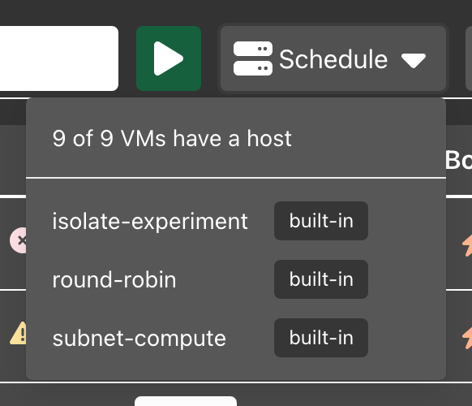{: width=400 .center}

### Command Line

The list of available schedules can be found by running the following command.

```bash
phenix experiment schedulers
```

Then apply the desired schedule with the following command.

```bash
phenix experiment schedule <experiment-name> <algorithm>
```

A user scheduler (`phenix-scheduler-<name>`) gets a JSON object on STDIN: the
experiment spec (`spec`) and the schedulable cluster hosts with their disk
usage (`hosts`). To see
this JSON, run the following command. The command stores nothing.

```bash
phenix util scheduler-json <experiment-name>
```

The REST API gives the same JSON at
`GET /api/v1/experiments/<experiment-name>/schedule/input`.

### Scheduling Limits

* A built-in scheduler must finish in 45 seconds. A user scheduler
  (`phenix-scheduler-<name>`) must finish in 2 minutes. If a scheduler does
  not finish in time, phēnix stops it and stores no schedule. The web UI and
  the REST API then show error 504.
* If the experiment changes or starts while phēnix schedules it, phēnix keeps
  that change and stores no schedule. The web UI and the REST API then show
  error 409. Schedule the experiment again.
* The web UI and the REST API lock the experiment while they schedule it. You
  cannot start or change the experiment until the schedule is complete.
* If the cluster has mesh peers and no peer answers, phēnix stores no
  schedule. The web UI and the REST API then show error 503. Make sure that
  minimega runs on the compute nodes, then schedule the experiment again.
* A schedule can have warnings. phēnix stores the schedule and shows each
  warning. The web UI shows them in a notice, `phenix experiment schedule`
  logs them, and the REST API puts them in `warnings`. A built-in scheduler
  gives a warning in these conditions:
    * A VM is set to a host that is not a schedulable cluster host.
      `round-robin` and `subnet-compute` keep that host.
      `isolate-experiment` puts the VM on a different host.
    * The VMs on a host need more memory or more CPUs than the host has.
      The warning gives the committed value and the available value.
* The capacity checks include the VMs that have `do_not_boot` set, because
  you can boot these VMs later.
* `subnet-compute` puts a VM that has no interfaces on the host that has the
  most VMs of the experiment. If that host does not have sufficient memory,
  it uses the next host.

## Triggering App Lifecycle Stages

You can manually trigger an app lifecycle stage for an experiment without
stopping and restarting it.

### Command Line

The `phenix exp trigger` command runs one app lifecycle stage on demand:

```bash
phenix exp trigger <experiment-name> <lifecycle> [<app-name> ...]
```

Where `<lifecycle>` is one of the following stages, or its shorthand:

* `configure` (or `config`)
* `pre-start` (or `pre`)
* `post-start` (or `post`)
* `running` (or `run`)
* `cleanup` (or `clean`)

Providing no app names triggers the stage for every app in the experiment. Use
`all` instead of an experiment name to trigger the stage in every experiment.
The `running` stage is skipped for experiments that are not running.

The stage runs in the command's own process, so press Ctrl+C to stop it.

**Examples:**

Trigger the running stage for all apps in an experiment:

```bash
phenix exp trigger my-experiment running
```

Trigger the running stage for a specific app:

```bash
phenix exp trigger my-experiment running soh
```

Trigger the configure stage for all experiments:

```bash
phenix exp trigger all configure
```

To stop triggers that `phenix ui` is running (from the Web-UI or the REST
API), use `--cancel`, with app names to stop only those. With no app names, it
also stops the scheduled runs of the `running` stage from a
[start](#starting-stopping-experiments).

```bash
phenix exp trigger my-experiment --cancel soh
```

### API

`POST /api/v1/experiments/<experiment-name>/trigger?apps=<app,...>&stage=<stage>`
runs one stage for the apps that `apps` names. The `stage` value is one of the
stage names above, or its shorthand. Without `stage`, the
request runs the `running` stage. The request returns before the apps run.
The `/ws` websocket reports the progress of each app. With `all` as the
experiment name, the stage runs in every experiment as a
[background job](jobs.md). `DELETE` on the same path cancels the triggers of
the apps in `apps`, or of all apps.

### Web UI

On a running experiment's page, click `Trigger` or an app tile in the Apps box
to open the `phēnix Apps` dialog. The page header is collapsed by default. To
see the Apps box, click `Details`. The browser keeps this choice. Select a stage in the `Stage` list. The default stage is
`running`. Select the apps, then click `Trigger Apps`. The `running` stage does
not offer the apps that phēnix runs itself, such as `ntp`. The dialog shows a
warning for each other stage, because the stage can change the running
experiment. The `configure` stage rewrites the experiment spec.

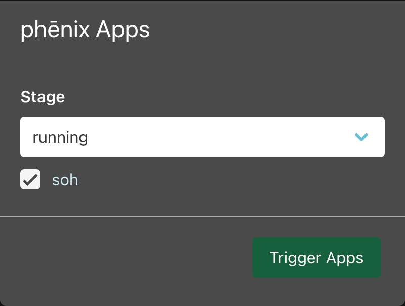{: width=400 .center}

### `trigger configure` vs. `reconfigure`

`phenix exp trigger configure` and `phenix experiment reconfigure` both re-run
the `configure` lifecycle stage, but they serve different purposes and are not
interchangeable:

| | `phenix exp trigger <experiment-name> configure` | `phenix experiment reconfigure` |
|---|---|---|
| Use case | Manually re-run a specific app's (or apps') configure hook on demand, e.g. for debugging | Re-apply configuration after editing an experiment's stored topology, scenario, or deployment settings |
| Targets specific apps | Yes, via `[<app-name> ...]` | No, always applies to every app |
| Validates the experiment config | No | Yes |
| Runs registered config hooks | No | Yes |
| Guards against running experiments | No | Yes (refuses to run if the experiment is running) |

Use `phenix experiment reconfigure` after changing an experiment's stored
settings. Use `phenix exp trigger <experiment-name> configure` for targeted, on-demand
re-invocation of one or more apps' configure hooks, such as when debugging an
app.

### Deprecated Command

The `phenix exp trigger-running` command, and its `trig` alias, are deprecated
and will be removed in a future release. Use `phenix exp trigger` instead.
The deprecated command:

```bash
phenix exp trigger-running my-experiment [<app-name> ...]
```

Is equivalent to:

```bash
phenix exp trigger my-experiment running [<app-name> ...]
```

The old argument order, `phenix exp trigger <lifecycle> <experiment-name>`, is
also deprecated (see [Deprecations](deprecations.md)).

## VLAN Aliases

Topologies refer to VLANs by alias, such as `MGMT` or `EXP-1`,
which is mapped by phēnix to a numerical VLAN ID.

### Web UI

On a stopped experiment, click the `VLAN IDs` button. The menu lists each
alias with its VLAN ID. Enter an ID from 1 to 4094, or 0 to let minimega
pick an ID when the experiment starts. Then click `Save VLAN IDs`.

Before saving, phēnix checks the IDs against the rest of the cluster and
lists any conflict, such as an ID that another experiment has pinned (see
[Conflict Check Before a Save](vlans.md#conflict-check-before-a-save)).

### Command Line

The `phenix vlan alias` command can list and change VLAN aliases.

```bash
# List VLAN aliases of every experiment
phenix vlan alias

# List VLAN aliases of a single experiment
phenix vlan alias <experiment-name>

# Print the VLAN ID of a specific alias for an experiment
phenix vlan alias <experiment-name> <alias-name>

# Pin the alias to a VLAN ID
phenix vlan alias <experiment-name> <alias-name> <vlan-id>

# Clear the pin, so minimega gives the alias an ID at the start
phenix vlan alias <experiment-name> <alias-name> --unpin
```

To pin or unpin an alias, the experiment must be stopped. phēnix refuses a pin
when another experiment or a minimega namespace already uses the ID, or when
minimega blacklists it. Add `--force` to pin it anyway. See [VLANs](vlans.md)
for the other `phenix vlan` commands.

For example, if the `MYVLAN` alias of `my-experiment` maps to VLAN 105:

```bash
$ phenix vlan alias my-experiment MYVLAN
105
```

A running experiment reports the VLAN IDs minimega assigned when it started. A
stopped experiment has no ID for an alias unless one was set explicitly, so
most alias lookups will fail until the experiment starts.

## Experiment Files

The `Files` tab of an experiment (running or stopped) lists the files that
phēnix, its apps and SCORCH wrote for it, wherever on the cluster they were
written. They live in the experiment's `files` folder in the minimega files
directory, which the [Disks](disks.md) page leaves out, so this is where you
manage the experiment's VM disk snapshots.

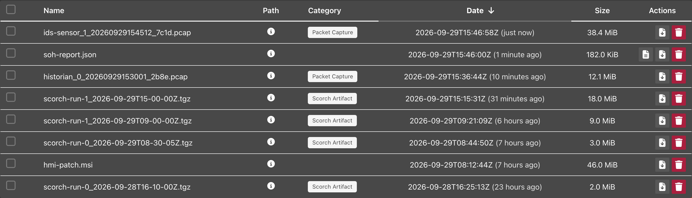{: width=800 .center}

### Finding a File

Use the `All Categories` dropdown to show one category, such as
`Packet Capture`, `Scorch Artifact` or `VM Disk Snapshot`, or the
`Find a File` box to search the names and categories of all the experiment's
files.

### Opening a File

Click a text file's name (`.json`, `.jsonl`, `.log`, `.txt`, `.yaml` or
`.yml`) to read it in the browser, up to 10 MiB. Click a capture file's name
(`.pcap`, `.pcapng` or `.cap`, optionally gzipped) to open it in
[WebShark](webshark.md#viewing-captures), if WebShark is installed. Download
anything else. An interrupted download resumes.

You can't view, download or delete a `.pcap` file that a running capture is
still writing. Stop the capture first, or watch it live in
[WebShark](webshark.md#viewing-captures).

### Acting on Several Files

Check some files (or the heading checkbox, for every file the table shows) to
get a toolbar above the table:

* `Download (N)` zips the checked files into `<experiment-name>-files.zip` as
  a [background job](jobs.md), then downloads it. If you leave the page, you
  can still download the archive from the
  [jobs menu](web-ui.md#background-jobs-menu) within the hour.
* `Delete (N)` deletes the checked files.

!!! warning
    Deleting a file removes it from every cluster node, and it can't be undone.

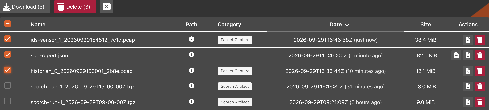{: width=800 .center}

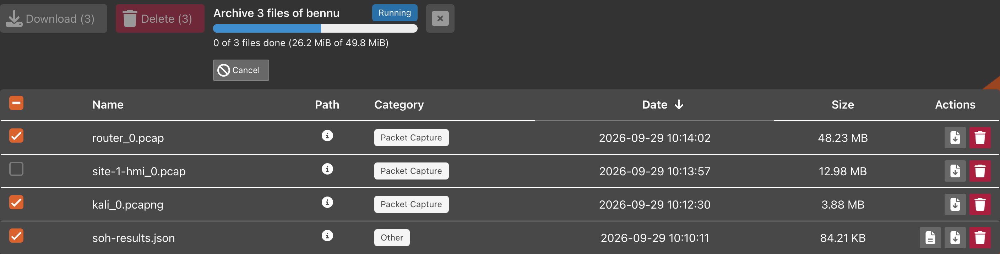{: width=800 .center}

One zip download holds at most 500 files and 2 GiB in total. A file the
server can't fetch is left out of the archive, and a file that grows while the
archive is built is cut at the size it had. The archive is then named
`<experiment-name>-files-incomplete.zip`, its `MISSING.txt` lists those
files, and it only downloads after you click `Download incomplete archive`.

### Adding Files

To add your own files, such as an installer or a config file, upload them
through the phēnix file server (see
[Uploading Experiment Files from the phēnix Server](vms.md#uploading-experiment-files-from-the-phenix-server),
which also covers copying them into a VM). They show up in the `Files` tab
like any other.

### Command Line

The `phenix exp files` commands do the same things as the `Files` tab (see
[phenix experiment files](cli/experiment.md#phenix-experiment-files)). A file
is named by its path relative to the experiment's `files` folder, as
`phenix exp files list` shows it.

```bash
# List the packet captures larger than 1 MB
phenix exp files list my-exp --filter "packet and size > 1mb"

# Copy a file to the current folder
phenix exp files get my-exp captures/web_eth0.pcap -O web_eth0.pcap

# Print the SHA-256 checksum of a file
phenix exp files checksum my-exp captures/web_eth0.pcap

# Write several files to a local zip archive
phenix exp files archive my-exp web_eth0.pcap db_eth0.pcap -O captures.zip

# Delete files from every node (add --dry-run to see what it would delete)
phenix exp files delete my-exp web_eth0.pcap
```

`--filter` takes the same search syntax as the `Files` tab (see
[phenix experiment files list](cli/experiment.md#phenix-experiment-files-list)).
`archive` has the same limits as the `Files` tab, and if it has to leave a
file out, it still writes the archive (with `MISSING.txt`) and then fails.

## Common Workflows

### 1. Basic Experiment Lifecycle

```bash
# 1. Create experiment from topology/scenario files
phenix exp create my-experiment -t /path/to/topology.yaml -s /path/to/scenario.yaml

# 2. Start the experiment
phenix exp start my-experiment

# 3. View status and inspect VMs
phenix exp list
phenix vm info my-experiment

# 4. Stop the experiment when testing finishes
phenix exp stop my-experiment

# 5. Delete the experiment
phenix exp delete my-experiment
```

### 2. Updating and Reconfiguring an Experiment

```bash
# Reconfigure a stopped experiment after modifying underlying configuration files
phenix exp reconfigure my-experiment
```

### 3. Dry-Run Deployment Testing

```bash
# Test experiment startup logic without deploying minimega VMs
phenix exp start my-experiment --dry-run
```

## See Also

* [phenix experiment](cli/experiment.md): every experiment command and flag.
* [phenix experiment files](cli/experiment.md#phenix-experiment-files): every files command and flag.
* [Experiment](configuration.md#experiment): the Experiment config.
* [VMs](vms.md): work with the VMs of a running experiment.
* [Troubleshooting](troubleshooting.md): what to do when a start fails.
* [Packet Captures](packet-captures.md): where the capture files come from.
* [Netflow](netflow.md): the recorded netflow captures.
