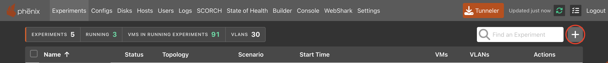
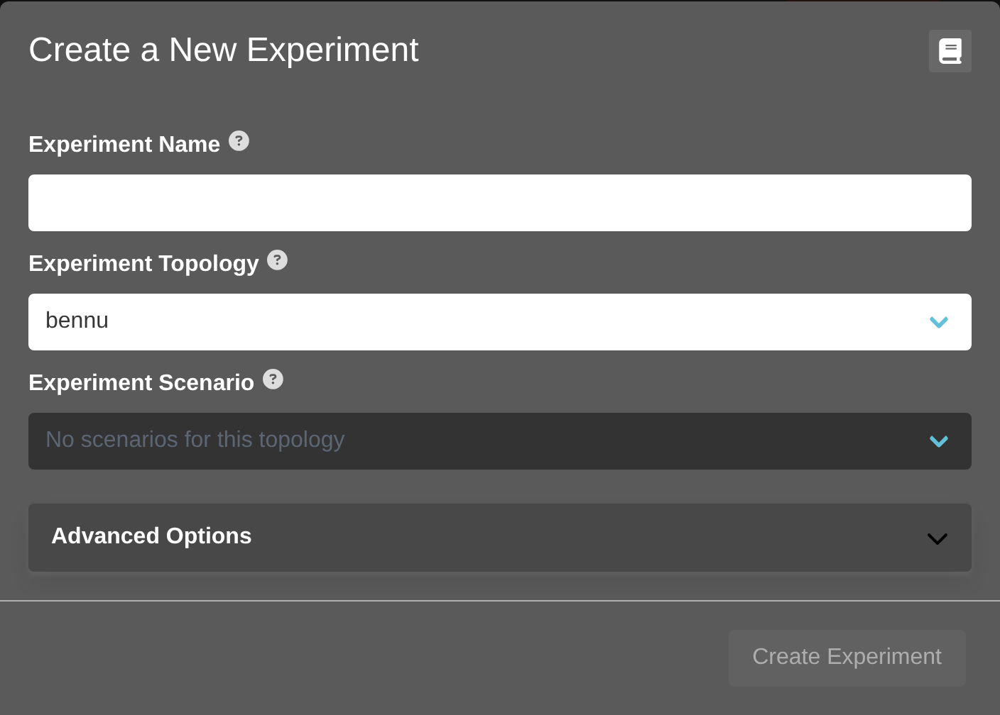
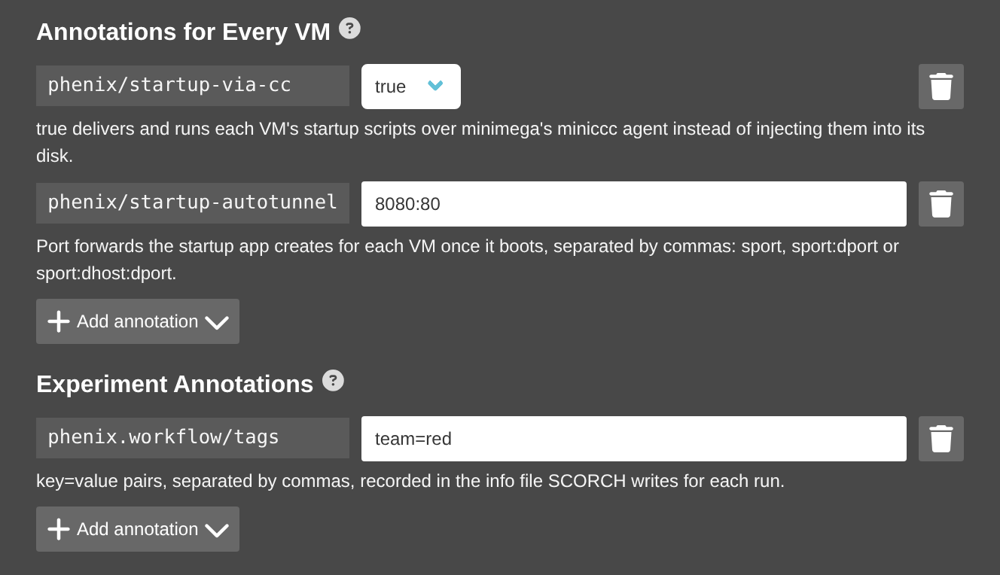
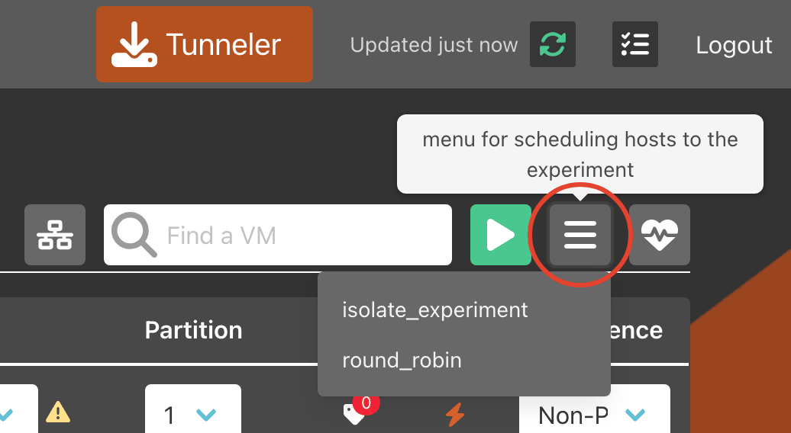
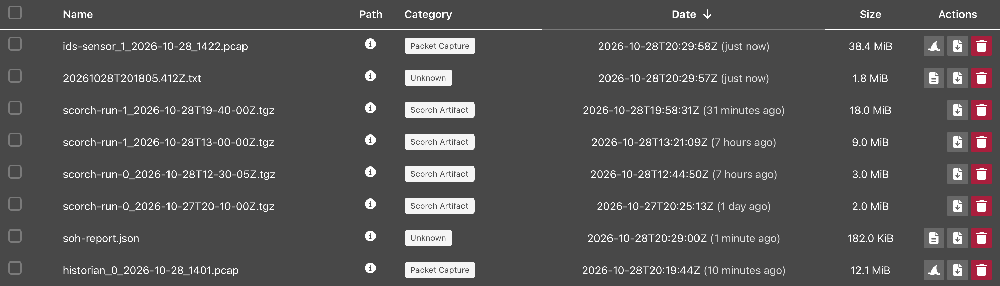
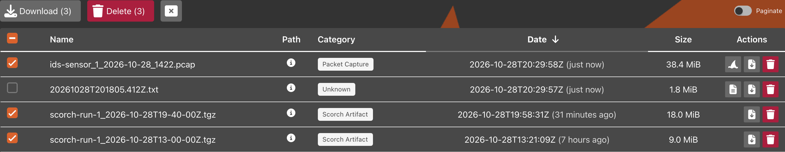
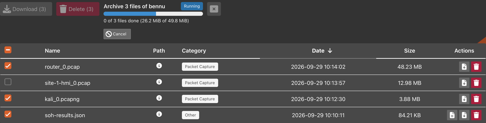

# Experiments

For experiments spanning multiple minimega hosts, see [GRE Mesh](gre-mesh.md)
to trunk experiment networks between hosts with `--use-gre-mesh`, including
the physical network MTU requirements.

## Listing Experiments

### From the Web-UI

Click on the `Experiments` tab. This will display all available experiments that
the user has access to view or edit.

The box at the top left counts the listed experiments, how many of them are
running, the `VMs in running experiments`, and the VLANs of all of them. The
VM count comes from the running experiments' topologies: it leaves out VMs
marked do not boot and external nodes, and counts a VM that was shut down or
has not started yet. The counts cover every listed experiment, not only those
the search shows.

Click a column heading to sort the table by it: `Name`, `Status`, `Topology`,
`Scenario`, `Start Time`, `VMs`, and `VLANs` can all be sorted on. `VLANs` sorts
by how many VLANs each experiment has, and experiments with the same number by
name. Experiments created or started somewhere else, such as from the command
line binary or a [workflow](workflow.md), appear in the list as they are
created or start, without reloading the page.

`Start Time` shows when the experiment started as phēnix recorded it, an
ISO 8601 timestamp with the server's UTC offset, followed by how long ago that
was, for example `2026-10-28T14:03:22-06:00 (3 hours ago)`, the same form as
`Last Updated` on the [Configs](configuration.md) page. The column sorts by
the actual time.

Click a name in the `Topology` or `Scenario` column to open that config in the
viewer on the [Configs](configuration.md#view-a-config) page, if your role may
view it.

Each row's `Actions` column holds the experiment's start and stop buttons, its
trash can, and, if your role may view the experiment, a heartbeat button that
opens its [State of Health](state-of-health.md) and a fire button that opens
its [SCORCH runs](scorch.md).

### From the Command Line Binary

This will display a list of all available experiments: it is run as a `root`
user.

```bash
phenix exp list
```

<br>

## Starting / Stopping Experiments

### From the Web-UI

Clicking the `stopped` button, or the green play button in the `Actions`
column, starts the experiment at once; clicking the `started` button, or the red
stop button, stops it after you confirm. The play or stop button spins while the
experiment starts or stops, and a progress bar shows the progress of starting
it. During the update to the experiment -- starting or stopping -- it will not
be accessible, and its status button, play, stop and trash can buttons are
disabled, with the reason in their tooltips. The play and stop buttons are also
gray and disabled when the experiment is already running or stopped, or when
your role may not start or stop it.

To start, stop or delete several experiments at once, check them in the
table's first column, or check its heading to check every experiment the search
shows. The toolbar that appears beside the search box has `Start`, `Stop` and
`Delete` buttons, each counting the checked experiments it can act on. One
confirmation names those it acts on and those it skips, such as a running
experiment for `Start` or one your role may not change, and one message sums up
how it went once they are done, offering to retry those that failed.

The bar's percentage counts every one of the experiment's VMs: those minimega
has queued to launch, or, once nothing is queued any more, those still
building, out of the VMs in the topology.

### From the Command Line Binary

```bash
phenix exp start <experiment name>
```

Or ...

```bash
phenix exp stop <experiment name>
```

Or ...

```bash
phenix exp restart <experiment name>
```

Optionally, you can use the `--dry-run` flag to do everything except call out to
minimega.

After an experiment stops successfully, phēnix deletes the VM disk snapshots
created for file injection. To keep these snapshots for debugging, use
`--keep-injection-snapshots` or its `-K` shorthand:

```bash
phenix exp stop --keep-injection-snapshots <experiment name>
```

Only `phenix exp stop` accepts this option. Stopping an experiment from the
Web-UI, or with `phenix exp restart`, always deletes the snapshots.

If minimega cannot kill an experiment's VMs, for example because it is not
answering, the stop fails and the experiment stays running, so you can stop it
again once minimega answers. To mark it stopped anyway, use `--force` or its
`-f` shorthand, then clear any of its VMs still in minimega by hand:

```bash
phenix exp stop --force <experiment name>
```

The Web-UI offers the same as a `Force Stop` confirmation after such a failed
stop, whether from the Experiments table (one experiment or a selection), the
experiment's page, or the SCORCH page, and the API as
`POST /api/v1/experiments/{name}/stop?force=true`. Until then, the experiment's
periodic apps keep running and its delayed VMs keep waiting to start.

The `phenix exp --help` command will output:

```text
Experiment management

Usage:
  phenix experiment [flags]
  phenix experiment [command]

Aliases:
  experiment, exp

Available Commands:
  apps            List of available apps to assign an experiment
  create          Create an experiment
  delete          Delete an experiment
  edit            Edit an experiment
  list            Display a table of available experiments
  reconfigure     Reconfigure an experiment
  restart         Restart an experiment
  schedule        Schedule an experiment
  schedulers      List of available schedulers to assign an experiment
  scorch          Start a Scorch run for experiment
  start           Start an experiment
  stop            Stop an experiment
  trigger         Trigger lifecycle stage for app(s) in experiment

Flags:
  -h, --help   help for experiment

Use "phenix experiment [command] --help" for more information about a command.
```

!!! note
    For a list of global flags supported across all `phenix` subcommands, see [Global Flags](settings.md#global-flags).

### Disk Check Before a Start

Before minimega launches a VM, phēnix checks the disk images and CD-ROM images
of the VMs that boot. Every start does this check: the Web-UI, the CLI, the
REST API, `phenix workflow apply`, and the bulk `Start` and `Restart` of VMs.
phēnix examines these files:

* Each `hardware.drives[].image` of a VM that is not external and does not
  have `do_not_boot: true`. phēnix follows the backing chain of a qcow2 image
  to its base. It reads only the image headers, and does not run `qemu-img`.
* The CD-ROM image of the VM (`advanced.cdrom`), and each drive image with the
  `.iso` extension. phēnix checks only that the file exists.

phēnix refuses the start when a file is missing, when a backing chain loops,
or when a chain has more than 64 images. The experiment stays stopped, and
phēnix sends no command to minimega. Pre-start apps run before the check. The
default `startup` app marks a VM `do_not_boot` when it cannot find the first
disk image of the VM. phēnix still checks that VM. The error names each VM,
each disk, and the missing file:

```text
Error: unable to start the foo experiment: 2 disks on 1 VM are missing or have a broken backing chain: 2 errors occurred:
    * VM host-01: disk kali.qc2: backing file /phenix/images/ro_kali.qc2 is missing
    * VM host-01: CD-ROM tools.iso: CD-ROM image /phenix/images/tools.iso is missing
```

The error lists at most 20 disks, then `and N more`. The Web-UI shows the
count, then each VM with a list of its disks and problems. It lists 10 disks,
and puts the others under `Show N more disks`, which opens with a click or the
keyboard. After a start of more than one experiment, or a bulk `Start` or
`Restart` of VMs, the summary shows each item that failed. Its problems are
under `Show N problems`, which is open when only one item failed. The REST API
answers `400` with the code
`broken_disks`. Its `details.disks` holds one object for each disk, with the
fields `vm`, `drive` (`disk` or `cdrom`), `image`, `path`, `missing`, and
`problem`. The error shows full paths to every user who can start the
experiment.

These problems do not refuse the start. phēnix shows each one as a warning:

* A vmdk or qed image, or a backing format other than qcow2 or raw. phēnix
  does not examine the chain past that image.
* A qcow2 image with an external data file, or a backing file with a protocol
  name, such as `nbd://` or `json:`.
* A file that phēnix cannot read, for example because of its permissions.
* A missing file that a cluster node other than the head node can have (see
  [Clusters](#clusters)).
* A check that does not complete in 20 seconds. The start continues, and the
  warning names each image that phēnix did not check.

The CLI shows the warnings. A start from the Web-UI or the REST API writes the
warnings only to the server log.

To change the check, use the `experiment.disk-check` setting (see
[Settings Reference](settings.md#settings-reference)):

| Value | Result |
| :--- | :--- |
| `error` (default) | A problem refuses the start. |
| `warn` | The experiment starts, and each problem is a warning. |
| `off` | phēnix does not check the images. |

With `phenix exp start --dry-run` or `--treat-mm-errors-as-warnings`, each
problem is a warning.

#### Clusters

phēnix examines only the files on the head node. A missing file has this
result:

| Case | Result |
| :--- | :--- |
| phēnix cannot see the minimega files directory, for example because phēnix and minimega run in different containers, or minimega did not give its directory | Warning |
| The VM boots from a snapshot (`snapshot: true`, the default). minimega makes the snapshot on the head node. | Error |
| The image is in the minimega files directory. minimega copies the image and its backing files from the head node to the other nodes. | Error |
| The image is outside the files directory, and the VM runs on the head node: `deploy-mode: only-headnode`, a schedule to the head node, or a cluster with only the head node | Error |
| The image is outside the files directory, and the VM can run on a different node | Warning |
| phēnix cannot get the cluster hosts from minimega | Warning |

phēnix does not examine the files on the other nodes. Thus a file that is in
the files directory of a compute node, but not on the head node, refuses the
start. Copy the file to the head node, or set `experiment.disk-check` to
`warn`. phēnix also keeps the list of cluster hosts for a short time, so it can
miss a node that joined the cluster recently.

#### Restarts

`phenix exp restart`, and a restart from `phenix workflow apply`, check the
disks before they stop the experiment. If the start would fail, phēnix refuses
the restart, and the experiment continues to run.

An app can change the disks of a VM before the start. Thus, when the scenario
has a user app (an app that is not a default app), the check before the stop
only shows warnings. The check before the start can still refuse the start.
Then the experiment stays stopped.

#### Bulk VM Actions

The bulk `Start` and `Restart` of VMs (`vms.action` jobs) do the same check for
the selected VMs that your role can start. phēnix checks only a VM that
minimega launches again: a VM in the `QUIT` or `ERROR` state, or a VM whose
state phēnix cannot get. A VM that is paused or running already has its images
open, so phēnix does not check it. A VM with a broken image fails at once, and
the job starts the other VMs. A start or restart of one VM from its own route
does not do this check.

## The Running Experiment Page

Click a running experiment's name to open its page. The card at the top left
names the experiment and shows, as labeled tiles, the scenario it was created
from (`Scenarios` when its apps also take configuration from other scenarios
through `fromScenario`, listed after its own), its topology, how many VMs and
VLANs it has (the `VMs` tile also says how many of them are running, such as
`18 running of 25`, once the VM table has loaded, and keeps that count current
as VMs start and stop), and when it started, as the `Start Time` column shows
it. When your role may read a scenario or topology config, its name opens it in
the Configs page's viewer. Beside the card's `Running` status, the heartbeat
button opens the experiment's [State of Health](state-of-health.md) and the fire
button its [SCORCH runs](scorch.md); both need `get` on the experiment.

The `Apps` box at the top right shows each of the experiment's apps as a tile,
laid out in as few even rows as fit; the tiles of a shorter last row widen to
fill it. Each tile says, in words
and with a colored edge, what the page last heard the app doing: `Running`,
`Last run succeeded`, `Last run failed`, or `Last run canceled`, or else
whether it is `Built-in` (`ntp`, `serial`, `startup`, `vrouter` and `scorch`,
which phēnix runs at each stage itself) or a `User app`. Click a user app's tile to open the trigger
dialog with that app checked, or `Trigger` to pick the apps yourself. `Trigger`
is grayed out, with the reason in its tooltip, when your role may not trigger
apps or the experiment has only built-in apps.

## Create a New Experiment

### From the Web-UI

{: width=800 .center}

Click the `+` button to the right of the filter field.

{: width=600 .center}

Enter `Experiment Name` and `Experiment Topology`, the remaining selection are
optional. In this example, `bennu` is an example topology and is not included
by default. You will need to [create](configuration.md) your own topology(ies).

Click `Create Experiment`, or `Create and Start` to start the experiment as
soon as it is created. The card stays open, its button spinning, until the
experiment is created; if that fails, the card shows why above its buttons and
keeps what you entered, so you can correct it and try again.

Each field's label is followed by a help icon: hover over or focus it to see
what the field does. The book button in the card's header opens this section of
the documentation.

Expand `Advanced Options` for the remaining settings:

* `Deployment Mode`: which cluster hosts run the experiment's VMs
  (`no-headnode`, `only-headnode`, or `all`), which defaults to the server's
  `--deploy-mode` setting.
* `Default Bridge Name`: see [Bridge Mode](bridge-mode.md).
* `VLAN Range`: the VLAN IDs minimega may give the experiment's VLANs.
* `Git Workflow Branch Name`: links the experiment to a
  [workflow](workflow.md#branch-name) branch.
* `Annotations for Every VM` and `Experiment Annotations`: see
  [Adding Annotations](#adding-annotations).

{: width=500 .center}

#### Purely via the Web-UI (Uploading Topo/Scenario Files)

You can create an experiment entirely through the Web-UI using custom topology and scenario files without needing to use the CLI:

1. **Upload Configurations in the Configs Tab**:
    * Navigate to the **Configs** tab.
    * Click the **Upload** button to upload your topology file (`.yaml`).
    * (Optional) Click **Upload** again to upload your scenario file (`.yaml`).
    * Verify that your uploaded configurations appear in the table (e.g., `topology/my-topology` and `scenario/my-scenario`).

2. **Create Experiment in Experiments Tab**:
    * Navigate to the **Experiments** tab.
    * Click the `+` button to open the creation dialog.
    * Enter an **Experiment Name**.
    * Select your uploaded topology from the **Experiment Topology** dropdown.
    * (Optional) Select your uploaded scenario from the **Experiment Scenario** dropdown.
    * Click **Create Experiment** to create the experiment.

### From the Command Line Binary

You can create an experiment using either saved configuration names from the phēnix store or direct file paths to topology and scenario configuration files (`.yaml`).

```bash
# Using stored configuration names
phenix experiment create <experiment name> -t <topology name>
phenix experiment create <experiment name> -t <topology name> -s <scenario name>

# Using direct file paths for topology and scenario
phenix experiment create <experiment name> -t /path/to/topology.yaml
phenix experiment create <experiment name> -t /path/to/topology.yaml -s /path/to/scenario.yaml

# Specifying a base directory and disabled apps
phenix experiment create <experiment name> -t /path/to/topology.yaml -s /path/to/scenario.yaml -d </path/to/dir/> --disabled-apps "app1,app2"

# Adding annotations to every VM and to the experiment (see Adding Annotations below)
phenix experiment create <experiment name> -t <topology name> --node-annotation phenix/startup-via-cc=true --annotation phenix.workflow/tags=team=red
```

The `phenix exp create --help` command will output:

```text
Create an experiment

  Used to create an experiment from existing configurations; can be a
  topology, or topology and scenario, or paths to topology/scenario
  configuration files (YAML or JSON). (Optional are the arguments for
  scenario or base directory.)

Usage:
  phenix experiment create <experiment name> [flags]

Examples:

  phenix experiment create <experiment name> -t <topology name or /path/to/filename>
  phenix experiment create <experiment name> -t <topology name or /path/to/filename> -s <scenario name or /path/to/filename>
  phenix experiment create <experiment name> -t <topology name or /path/to/filename> -s <scenario name or /path/to/filename> -d </path/to/dir/>
  phenix experiment create <experiment name> -t <topology name or /path/to/filename> -s <scenario name or /path/to/filename> --disabled-apps "app1,app2"
  phenix experiment create <experiment name> -t <topology name> --node-annotation phenix/default-apps=false --annotation phenix.workflow/tags=nightly

Flags:
      --annotation stringArray        Experiment annotation as key=value; may be repeated
  -d, --base-dir string               Base directory to use for experiment (optional)
  -b, --default-bridge string         Default bridge name to use for experiment (optional) (default "phenix")
      --disabled-apps strings         Comma separated list of apps to disable
  -h, --help                          help for create
      --node-annotation stringArray   Annotation for every VM as key=value; true, false and JSON lists or objects keep their type; may be repeated
  -s, --scenario string               Name of an existing scenario to use (optional)
  -t, --topology string               Name of an existing topology to use
      --vlan-max int                  VLAN pool maximum
      --vlan-min int                  VLAN pool minimum
```

### Adding Annotations

An experiment can be given annotations when it is created, without editing its
topology or scenario:

| Annotations | Web-UI (`Advanced Options`) | Command line (repeatable) | API (`POST /experiments`) |
| :--- | :--- | :--- | :--- |
| On every VM | `Annotations for Every VM` | `--node-annotation key=value` | `node_annotations` |
| On the experiment | `Experiment Annotations` | `--annotation key=value` | `annotations` |

**Annotations for every VM** are node annotations, which apps read from the
topology's nodes, such as
[`phenix/default-apps`](apps.md#disable-default-apps-for-a-vm) and
[`phenix/startup-via-cc`](apps.md#c2-startup-script-delivery). phēnix adds them
to every VM in the experiment's own copy of the topology, so the topology config
itself is unchanged. A VM that already has an annotation keeps its own value,
and [external nodes](configuration.md#external-nodes) are skipped.

**Experiment annotations** are added to the experiment's metadata annotations,
where apps can read them; for example, SCORCH records the `key=value` pairs of
`phenix.workflow/tags` in the info file it writes for each run. phēnix sets the
`topology` and `scenario` annotations itself and rejects them. In the Web-UI, the
`phenix.workflow/branch` annotation comes from the `Git Workflow Branch Name`
field, and an API request cannot give it both as an annotation and as
`workflow_branch`.

In the Web-UI, the `Add annotation` button under each list offers the
annotations phēnix's own apps read, each with a value input suited to it and a
description, or a `Custom annotation` with any key and value. On the command
line, and for a custom annotation in the Web-UI, a VM annotation's value `true`
or `false` becomes a boolean and a JSON list or object keeps that type; anything
else, numbers included, stays a string. Experiment annotations are always
strings. The API takes `node_annotations` as JSON values, keeping their types.
To change one VM's annotations after the experiment is created, use the
[Annotations](vms.md#annotations) section of its details card.

{: width=600 .center}

A value of the wrong type for an annotation the default apps read is rejected,
naming the annotation: `phenix/default-apps` must be `true` or `false`,
`phenix/startup-autotunnel` a list of port forwards, `phenix/startup-via-cc`
not blank, and `vrouter/vyos-password` and `vrouter/enable-ssh` strings.
Because `phenix/startup-autotunnel` creates port forwards, giving it in the
Web-UI or API requires a role that may create port forwards to every VM the
experiment deploys (external nodes excluded).

```bash
# For every VM, deliver startup scripts over C2 and create a port forward from 8080 to its port 80
phenix experiment create my-experiment -t my-topology \
  --node-annotation phenix/startup-via-cc=true \
  --node-annotation 'phenix/startup-autotunnel=["8080:80"]' \
  --annotation phenix.workflow/tags=team=red
```

The same request through the API:

```json
{
  "name": "my-experiment",
  "topology": "my-topology",
  "node_annotations": {
    "phenix/startup-via-cc": true,
    "phenix/startup-autotunnel": ["8080:80"]
  },
  "annotations": {
    "phenix.workflow/tags": "team=red"
  }
}
```

## Deleting Experiments

### From the Web-UI

The experiment must be stopped before it can be deleted; its trash can icon is
disabled while it runs. Click the trash can icon next to the experiment to
delete it. phēnix asks you to confirm first, and
only that experiment's own button spins while it is deleted, so the rest of the
table stays usable.

### From the Command Line Binary

An experiment must be stopped before it can be deleted:

```bash
phenix exp stop <experiment name>
phenix exp delete <experiment name>
```

Alternatively, the `-f`/`--force` flag can be used to automatically stop a
running experiment before deleting it, similar to `docker rm -f`, even when
minimega cannot kill its VMs, which are then left for you to clear by hand:

```bash
phenix exp delete -f <experiment name>
```

Using `all` instead of a specific experiment name will delete all stopped
experiments (or, when combined with `--force`, all experiments regardless of
whether they are running).

The `phenix exp delete --help` command will output:

```text
Delete an experiment

  Used to delete an existing experiment; experiment must be stopped.
  Using 'all' instead of a specific experiment name will include all
  stopped experiments. Use the -f/--force flag to automatically stop
  a running experiment before deleting it.

Usage:
  phenix experiment delete <experiment name> [flags]

Aliases:
  delete, del

Flags:
  -f, --force   Stop a running experiment before deleting it
  -h, --help    help for delete
```

## Scheduling an Experiment

### From Web-UI

The experiment must be stopped; click on the experiment name to enter the
Stopped Experiment component. Click on the hamburger menu to the right of the
filter field and start button to select a desired schedule.

{: width=400 .center}

### From the Command Line Binary

The list of available schedules can be found by running the following command.

```bash
phenix experiment schedulers
```

Then apply the desired schedule with the following command.

```bash
phenix experiment schedule <experiment name> <algorithm>
```

## Triggering App Lifecycle Stages

You can manually trigger an app lifecycle stage for an experiment without
stopping and restarting it.

### From the Command Line Binary

The `phenix exp trigger` command runs one app lifecycle stage on demand:

```bash
phenix exp trigger <lifecycle> <experiment name> [<app name> ...]
```

Where `<lifecycle>` is one of the following stages, or its shorthand:

* `configure` (or `config`)
* `pre-start` (or `pre`)
* `post-start` (or `post`)
* `running` (or `run`)
* `cleanup` (or `clean`)

Providing no app names triggers the stage for every app in the experiment. Use
`all` instead of an experiment name to trigger the stage in every experiment.
The `running` stage is skipped for experiments that are not running.

**Examples:**

Trigger the running stage for all apps in an experiment:

```bash
phenix exp trigger running my-experiment
```

Trigger the running stage for a specific app:

```bash
phenix exp trigger running my-experiment soh
```

Trigger the configure stage for all experiments:

```bash
phenix exp trigger configure all
```

### `trigger configure` vs. `reconfigure`

`phenix exp trigger configure` and `phenix experiment reconfigure` both re-run
the `configure` lifecycle stage, but they serve different purposes and are not
interchangeable:

| | `phenix exp trigger configure` | `phenix experiment reconfigure` |
|---|---|---|
| Use case | Manually re-run a specific app's (or apps') configure hook on demand, e.g. for debugging | Re-apply configuration after editing an experiment's stored topology, scenario, or deployment settings |
| Targets specific apps | Yes, via `[<app name> ...]` | No, always applies to every app |
| Validates the experiment config | No | Yes |
| Runs registered config hooks | No | Yes |
| Resets the minimega bridge | No | Yes (deletes it so it's recreated with current settings, unless using the GRE mesh) |
| Guards against running experiments | No | Yes (refuses to run if the experiment is running) |

Use `phenix experiment reconfigure` after changing an experiment's stored
settings. Use `phenix exp trigger configure` for targeted, on-demand
re-invocation of one or more apps' configure hooks, such as when debugging an
app.

### Deprecated Command

The `phenix exp trigger-running` command, and its `trig` alias, are deprecated
and will be removed in a future release. Use `phenix exp trigger running`
instead. The deprecated command:

```bash
phenix exp trigger-running my-experiment [<app name> ...]
```

Is equivalent to:

```bash
phenix exp trigger running my-experiment [<app name> ...]
```

## VLAN Aliases

Topologies refer to VLANs by alias, such as `MGMT` or `EXP-1`,
which is mapped by phēnix to a numerical VLAN ID.

### From the Command Line Binary

The `phenix vlan alias` command can list and change VLAN aliases.

```bash
# List VLAN aliases of every experiment
phenix vlan alias

# List VLAN aliases of a single experiment
phenix vlan alias <experiment name>

# Print the VLAN ID of a specific alias for an experiment
phenix vlan alias <experiment name> <alias name>

# Set the alias to a VLAN ID (add -f to overwrite an existing alias)
phenix vlan alias <experiment name> <alias name> <vlan id>
```

For example, if the `MYVLAN` alias of `my-experiment` maps to VLAN 105:

```bash
$ phenix vlan alias my-experiment MYVLAN
105
```

A running experiment reports the VLAN IDs minimega assigned when it started. A
stopped experiment has no ID for an alias unless one was set explicitly, so
most alias lookups will fail until the experiment starts.

## Experiment Files

The `Files` tab of an experiment lists the files phēnix, its apps, and SCORCH
wrote for that experiment, wherever on the cluster they were written. It is the
second tab on both the running and the stopped experiment page, and a role needs
`list` on `experiments/files` to see it at all. These files are kept in the
experiment's `files` folder in the minimega files directory, which the
[Disks](disks.md) tab leaves out, so the experiment's VM disk snapshots and
other images there are managed here rather than there.

{: width=800 .center}

### Finding a File

The table has a `Name`, `Path`, `Category`, `Date`, `Size`, and `Actions`
column. `Path` is an information icon; hover over it for the file's full path on
the phēnix server, such as
`/phenix/images/my-experiment/files/scorch/1/tcpdump/capture.pcap`. `Date`
shows when the file last changed, with its age, as described in
[Timestamps](web-ui.md#timestamps). Click the
`Name`, `Date`, or `Size` heading to sort by that column; the table starts with
the newest file first. `Category` cannot be sorted on.

phēnix categorizes each file by what it is and what wrote it: `Packet Capture`,
`Scorch Artifact` (with the SCORCH run ID and the component's name as categories
of their own), `Filebeat`, `ELF Memory Snapshot`, `VM Memory Snapshot`,
`VM Disk Snapshot`, `Backing Image`, or `Unknown`. The `All Categories` dropdown
left of the search box keeps only the files in one category, and the
`Find a File` search box matches a file's name or its categories. The dropdown
narrows the rows the table has already loaded; the search box goes to the
server, which applies it to every file in the experiment.

Once the experiment has more files than fit on one page, a `Paginate` toggle
appears above the table. It is remembered in your browser for this table until
you turn it off again. Sorting, searching, changing the category, and changing
the page each list the files again, and phēnix reuses a listing for a few
seconds, so a file an app has only just written may not be in the next listing.

### Opening a File

Clicking a text file's name opens it in a read-only viewer, so you do not have
to download it to read it. phēnix treats `.json`, `.jsonl`, `.log`, `.txt`,
`.yaml`, and `.yml` files as text, and indents JSON so it is readable. `Exit`
closes the viewer.

Clicking a capture file's name opens it in
[WebShark](webshark.md#viewing-captures), when WebShark is installed. Capture
files are `.pcap`, `.pcapng`, and `.cap` files, optionally gzipped. Any other
kind of file has to be downloaded to be read.

### Acting on One File

The buttons in a row's `Actions` column are icons; hover over one for its label.
In order, they are:

* the button that opens the file: `Open in WebShark`, a shark fin, for a capture
  file, or `view file` for a text file. A row for any other kind of file leaves
  that space empty. A text file over 10 MiB is too large to view; download it
  instead.
* `download`, which downloads that one file; an interrupted download resumes
  (see [Downloads](api.md#downloads)).
* `delete`, which asks you to confirm, naming the file, and spins while the file
  is deleted. Deleting a file removes it from every cluster node and cannot be
  undone.

The `delete` button appears only for a role with `delete` on
`experiments/files`, which among the default roles means `Global Admin` and
`Experiment Admin` (see [Roles](user-administration.md#roles)).

### Acting on Several Files

A role that can download or delete an experiment's files also gets a checkbox on
each row, and one in the heading that checks or clears every file the table is
showing. Checking a file puts a toolbar above the table, holding whichever of
these your role allows:

* `Download (N)` has the server build the checked files into one
  `<experiment name>-files.zip` archive in a [background job](jobs.md), whose
  progress shows in the toolbar and the
  [jobs menu](web-ui.md#background-jobs-menu), and downloads it once built. A
  file the server cannot fetch is left out, and one that grows after you ask
  holds only the part it had then: the archive is then named
  `<experiment name>-files-incomplete.zip`, lists each such file and why in its
  `MISSING.txt`, and downloads only when you click
  `Download incomplete archive` and confirm. If you leave the page meanwhile,
  download the archive from the jobs menu, within the hour.
* `Delete (N)` asks to confirm once for all of them, with `Delete N Files` as
  the confirm button, then deletes them together.
* The last button clears the selection.

{: width=800 .center}

While the archive is built, the toolbar shows its progress, with a `Cancel`
button, and the `Download` and `Delete` buttons wait for it.

{: width=800 .center}

Only files you can still see stay checked: searching, changing the category, or
moving to another page drops the rest of the selection.

When some of the files cannot be deleted, phēnix deletes the ones it can and
reports the rest in one summary, naming up to eight of them with the reason and
counting any beyond that. Those files stay checked, so you can try again or download them
instead.

!!! note
    One zip download holds at most 500 files and 2 GiB in total. A larger one is
    refused before any of it is sent; through the [API](api.md) that is a `413`.

Through the API, `POST /api/v1/experiments/<name>/files/archive` with the same
`{"paths": [...]}` body builds the archive in a [background job](jobs.md)
instead, with the same limits and checks. A file that cannot be fetched, such
as one a mesh node no longer has, is left out rather than failing the whole
archive: the job ends `partial`, the archive is named
`<experiment name>-files-incomplete.zip`, and a `MISSING.txt` entry in it lists
each file left out and why. A file that grows after the request is archived
only up to the size it had then: it counts as archived, but the archive is still
named `-files-incomplete.zip` and `MISSING.txt` says so. The finished archive downloads, resumably, from
`GET /api/v1/jobs/<id>/artifact` for an hour, and canceling the job leaves no
archive.

!!! tip "Resuming a download from a shell"
    `curl -C -` resumes a single-file download where an earlier attempt
    stopped:

    ```bash
    curl -C - -o out.pcap -H 'X-Phenix-Auth-Token: Bearer <token>' \
      'https://<phenix>/api/v1/experiments/<name>/files/out.pcap?path=scorch/run-0/out.pcap'
    ```

    Unlike a browser, `curl -C -` does not check that the file is unchanged,
    so a file that changed between attempts comes out spliced. To verify a
    resumed download, compare its `sha256sum` with the `sha256` that
    `GET /api/v1/experiments/<name>/files/<file>/checksum?path=<path>` returns.
    phēnix computes the checksum in the background: until it is known the
    route answers `202`, so ask again after a few seconds.

!!! warning
    A `.pcap` file a running capture is still writing cannot be viewed,
    downloaded, or deleted, so a half-written capture never leaves the server
    (a `400` through the API). Stop the capture first, or watch it live in
    [WebShark](webshark.md#viewing-captures), which follows a running capture as
    it grows. A file that is no longer on the cluster gives a `404`.

### Adding Files

phēnix and its apps write most of an experiment's files. To add your own, such
as an installer or a configuration file, upload it through the phēnix file
server; see
[Uploading Experiment Files from the phēnix Server](vms.md#uploading-experiment-files-from-the-phenix-server),
which also covers copying an uploaded file into a VM. Uploads land in the
experiment's files directory, so they appear in the `Files` tab like any other
file.

## Common Workflows

### 1. Basic Experiment Lifecycle

```bash
# 1. Create experiment from topology/scenario files
phenix exp create my-experiment -t /path/to/topology.yaml -s /path/to/scenario.yaml

# 2. Start the experiment
phenix exp start my-experiment

# 3. View status and inspect VMs
phenix exp list
phenix vm info my-experiment

# 4. Stop the experiment when testing finishes
phenix exp stop my-experiment

# 5. Delete the experiment
phenix exp delete my-experiment
```

### 2. Updating and Reconfiguring an Experiment

```bash
# Reconfigure a stopped experiment after modifying underlying configuration files
phenix exp reconfigure my-experiment
```

### 3. Dry-Run Deployment Testing

```bash
# Test experiment startup logic without deploying minimega VMs
phenix exp start my-experiment --dry-run
```
