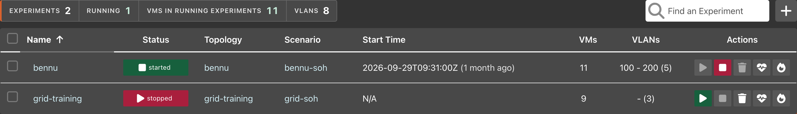
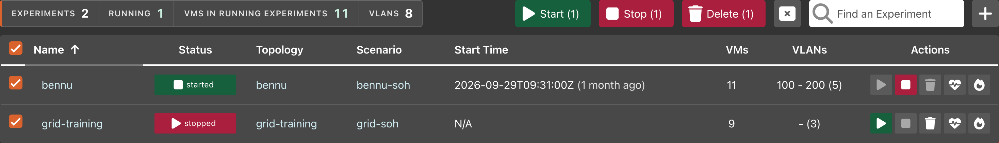
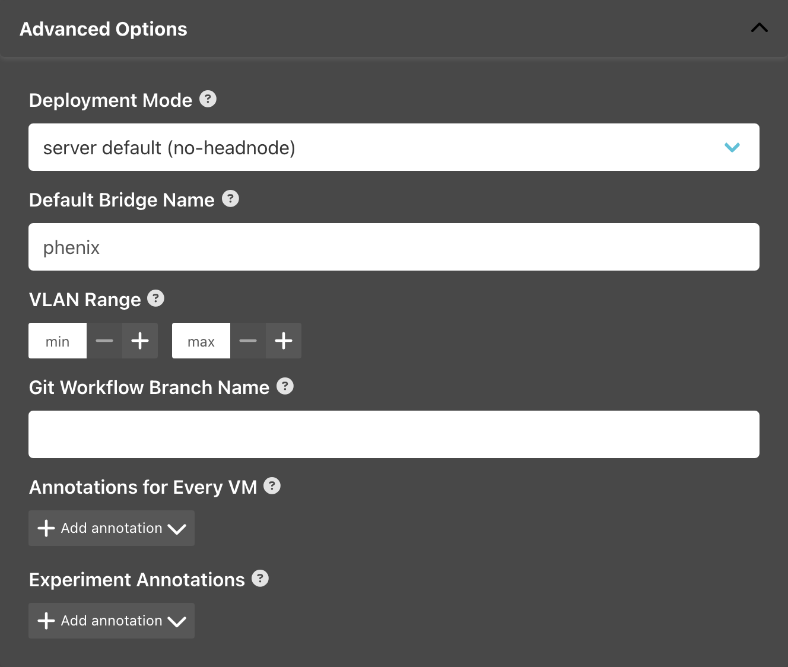
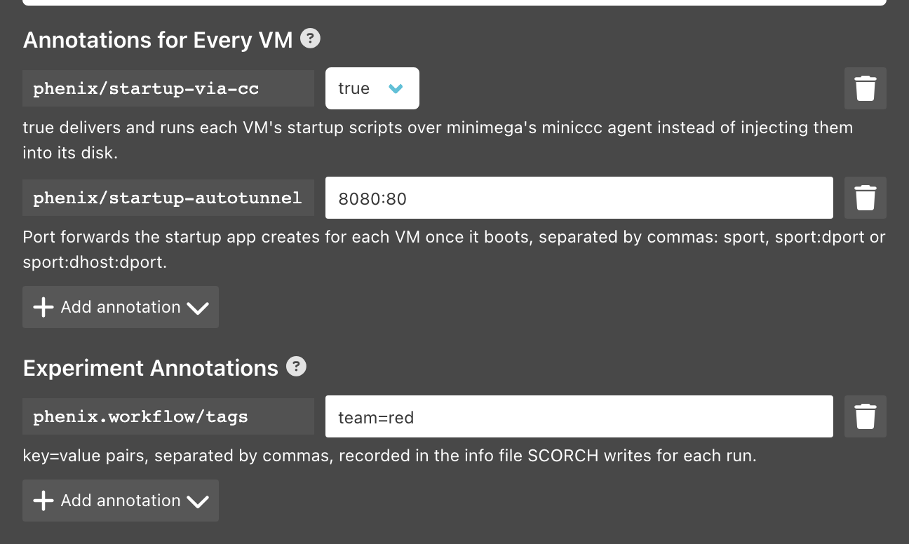

# Experiments

For experiments spanning multiple minimega hosts, see [GRE Mesh](gre-mesh.md)
to trunk experiment networks between hosts with `--use-gre-mesh`, including
the physical network MTU requirements.

## Listing Experiments

### From the Web-UI

Click on the `Experiments` tab. This will display all available experiments that
the user has access to view or edit.

The box above the table counts the listed experiments, how many of them are
running, the VMs in the running experiments, and their VLANs. The counts cover
every listed experiment, not only the ones the search shows.

{: width=800 .center}

Click a column heading to sort the table by it. `Start Time` shows when the
experiment started and how long ago that was (see
[Timestamps](web-ui.md#timestamps)). Click a name in the `Topology` or
`Scenario` column to open that config on the
[Configs](configuration.md#view-a-config) page, if your role may view it.

Each row's `Actions` column holds the experiment's start, stop and delete
buttons, a heartbeat button that opens its
[State of Health](state-of-health.md), and a fire button that opens its
[SCORCH runs](scorch.md). Experiments created or started from the command line
or a [workflow](workflow.md) appear in the table without reloading the page.

### From the Command Line Binary

This will display a list of all available experiments: it is run as a `root`
user.

```bash
phenix exp list
```

<br>

## Starting / Stopping Experiments

### From the Web-UI

Click the `stopped` button, or the green play button in the `Actions` column,
to start the experiment. Click the `started` button, or the red stop button,
to stop it. The status button shows a play icon when it starts the experiment
and a stop icon when it stops it. If your role cannot start or stop the
experiment, the status is a plain tag that you cannot click. phēnix asks you
to confirm a stop. A progress bar shows how many
of the experiment's VMs have started. While the experiment starts or stops,
its buttons are disabled, with the reason in their tooltips. The play and stop
buttons are also disabled when your role may not start or stop the experiment.

To start, stop or delete several experiments at once, check them in the
table's first column. Check the heading's checkbox to select every experiment
the search shows. A toolbar with `Start`, `Stop` and `Delete` buttons appears
beside the search box. Each button counts the checked experiments it can act
on. One confirmation names the experiments it acts on and the ones it skips.
When they are done, one message sums up the result and offers to retry the
experiments that failed.

{: width=800 .center}

### From the Command Line Binary

```bash
phenix exp start <experiment name>
```

Or ...

```bash
phenix exp stop <experiment name>
```

Or ...

```bash
phenix exp restart <experiment name>
```

Optionally, you can use the `--dry-run` flag to do everything except call out to
minimega.

While `phenix exp start` runs, the Experiments page of the web UI shows the
experiment as `starting` after a page refresh. phēnix refuses a second start of
the experiment until the first start ends.

After an experiment stops successfully, phēnix deletes the VM disk snapshots
created for file injection. To keep these snapshots for debugging, use
`--keep-injection-snapshots` or its `-K` shorthand:

```bash
phenix exp stop --keep-injection-snapshots <experiment name>
```

Only `phenix exp stop` accepts this option. Stopping an experiment from the
Web-UI, or with `phenix exp restart`, always deletes the snapshots.

If minimega cannot kill an experiment's VMs, for example because it is not
answering, the stop fails and the experiment stays running. Stop it again once
minimega answers. To mark the experiment stopped anyway, use `--force` or its
`-f` shorthand, then clear any of its VMs still in minimega by hand:

```bash
phenix exp stop --force <experiment name>
```

After such a failed stop, the Web-UI offers the same as a `Force Stop`
confirmation. Until the experiment is stopped, its periodic apps keep running
and its delayed VMs keep waiting to start.

In `auto` [bridge mode](bridge-mode.md), phēnix also deletes the bridge of the
experiment after it kills the VMs. phēnix sends the delete to each host of the
experiment. phēnix keeps the bridge when another running experiment uses it.
phēnix does not delete a bridge in `manual` mode, and never deletes the shared
`phenix` bridge.

The `phenix exp --help` command will output:

```text
Experiment management

Usage:
  phenix experiment [flags]
  phenix experiment [command]

Aliases:
  experiment, exp

Available Commands:
  apps            List of available apps to assign an experiment
  create          Create an experiment
  delete          Delete an experiment
  edit            Edit an experiment
  list            Display a table of available experiments
  reconfigure     Reconfigure an experiment
  restart         Restart an experiment
  schedule        Schedule an experiment
  schedulers      List of available schedulers to assign an experiment
  scorch          Start a Scorch run for experiment
  start           Start an experiment
  stop            Stop an experiment
  trigger         Trigger lifecycle stage for app(s) in experiment

Flags:
  -h, --help   help for experiment

Use "phenix experiment [command] --help" for more information about a command.
```

!!! note
    For a list of global flags supported across all `phenix` subcommands, see [Global Flags](settings.md#global-flags).

### Disk Check Before a Start

Before minimega launches a VM, phēnix checks the disk images and CD-ROM images
of the VMs that boot. Every start does this check: the Web-UI, the command
line, the API, `phenix workflow apply`, and the bulk `Start` and `Restart` of
VMs. phēnix checks:

* the disk images of each VM that is not external and does not have
  `do_not_boot: true`, through the backing chain of a qcow2 image to its base.
* the VM's CD-ROM image (`advanced.cdrom`), and each drive image with the
  `.iso` extension, which only need to exist.

phēnix refuses the start when a file is missing, when a backing chain is
broken, or when qemu cannot open an image, such as an encrypted image (see
[Broken Backing Chains](disks.md#broken-backing-chains) and
[Image Format Versions](disks.md#image-format-versions)). The experiment stays
stopped. The error names each VM, each disk and the missing file:

```text
Error: unable to start the foo experiment: qemu cannot open 2 disks on 1 VM: 2 errors occurred:
    * VM host-01: disk kali.qc2: backing file /phenix/images/ro_kali.qc2 is missing
```

An old or unusual image format, and a file phēnix cannot read, do not refuse
the start. The command line shows each one as a warning. A start from the
Web-UI or the API writes the warnings to the server log.

The `experiment.disk-check` setting changes the check (see
[Settings Reference](settings.md#settings-reference)):

| Value | Result |
| :--- | :--- |
| `error` (default) | A problem refuses the start. |
| `warn` | The experiment starts, and each problem is a warning. |
| `off` | phēnix does not check the images. |

With `phenix exp start --dry-run` or `--treat-mm-errors-as-warnings`, each
problem is a warning.

phēnix checks only the files on the head node. A file that only a compute node
has usually refuses the start. Copy it to the head node, or set
`experiment.disk-check` to `warn`. A restart checks the disks before it stops
the experiment, and refuses the restart if the start would fail. The bulk
`Start` and `Restart` of VMs check the selected VMs that minimega launches
again. A VM with a broken image fails, and the other VMs start.

## The Running Experiment Page

Click a running experiment's name to open its page. The card at the top left
names the experiment and shows its scenario, its topology, how many VMs and
VLANs it has, and when it started. The `VMs` tile also counts the VMs that
are running. If your role may read the scenario or topology config, its name
opens it on the Configs page. Beside the `Running` status, the heartbeat
button opens the experiment's [State of Health](state-of-health.md) and the
fire button opens its [SCORCH runs](scorch.md).

The `Apps` box at the top right shows each of the experiment's apps as a
tile. The tile says whether the app is `Running` or how its last run ended,
or whether it is a `Built-in` app or a `User app`. Click a user app's tile to
open the trigger dialog with that app checked, or click `Trigger` to pick the
apps yourself. `Trigger` is disabled, with the reason in its tooltip, when
your role may not trigger apps or the experiment has only built-in apps.

## Create a New Experiment

### From the Web-UI

{: width=800 .center}

Click the `+` button to the right of the filter field.

{: width=600 .center}

Enter `Experiment Name` and `Experiment Topology`, the remaining selection are
optional. In this example, `bennu` is an example topology and is not included
by default. You will need to [create](configuration.md) your own topology(ies).

Click `Create Experiment`, or `Create and Start` to also start the experiment
as soon as it is created. If the experiment cannot be created, the card shows
why and keeps what you entered, so you can correct it and try again. Hover
over the help icon after a field's label to see what the field does.

Expand `Advanced Options` for the remaining settings:

* `Deployment Mode`: which cluster hosts run the experiment's VMs
  (`no-headnode`, `only-headnode`, or `all`).
* `Default Bridge Name`: see [Bridge Mode](bridge-mode.md).
* `VLAN Range`: the VLAN IDs minimega may give the experiment's VLANs.
* `Git Workflow Branch Name`: links the experiment to a
  [workflow](workflow.md#branch-name) branch.
* `Annotations for Every VM` and `Experiment Annotations`: see
  [Adding Annotations](#adding-annotations).

{: width=500 .center}

#### Purely via the Web-UI (Uploading Topo/Scenario Files)

You can create an experiment entirely through the Web-UI using custom topology and scenario files without needing to use the CLI:

1. **Upload Configurations in the Configs Tab**:
    * Navigate to the **Configs** tab.
    * Click the **Upload** button to upload your topology file (`.yaml`).
    * (Optional) Click **Upload** again to upload your scenario file (`.yaml`).
    * Verify that your uploaded configurations appear in the table (e.g., `topology/my-topology` and `scenario/my-scenario`).

2. **Create Experiment in Experiments Tab**:
    * Navigate to the **Experiments** tab.
    * Click the `+` button to open the creation dialog.
    * Enter an **Experiment Name**.
    * Select your uploaded topology from the **Experiment Topology** dropdown.
    * (Optional) Select your uploaded scenario from the **Experiment Scenario** dropdown.
    * Click **Create Experiment** to create the experiment.

### From the Command Line Binary

You can create an experiment using either saved configuration names from the phēnix store or direct file paths to topology and scenario configuration files (`.yaml`).

```bash
# Using stored configuration names
phenix experiment create <experiment name> -t <topology name>
phenix experiment create <experiment name> -t <topology name> -s <scenario name>

# Using direct file paths for topology and scenario
phenix experiment create <experiment name> -t /path/to/topology.yaml
phenix experiment create <experiment name> -t /path/to/topology.yaml -s /path/to/scenario.yaml

# Specifying a base directory and disabled apps
phenix experiment create <experiment name> -t /path/to/topology.yaml -s /path/to/scenario.yaml -d </path/to/dir/> --disabled-apps "app1,app2"

# Adding annotations to every VM and to the experiment (see Adding Annotations below)
phenix experiment create <experiment name> -t <topology name> --node-annotation phenix/startup-via-cc=true --annotation phenix.workflow/tags=team=red
```

The `phenix exp create --help` command will output:

```text
Create an experiment

  Used to create an experiment from existing configurations; can be a
  topology, or topology and scenario, or paths to topology/scenario
  configuration files (YAML or JSON). (Optional are the arguments for
  scenario or base directory.)

Usage:
  phenix experiment create <experiment name> [flags]

Examples:

  phenix experiment create <experiment name> -t <topology name or /path/to/filename>
  phenix experiment create <experiment name> -t <topology name or /path/to/filename> -s <scenario name or /path/to/filename>
  phenix experiment create <experiment name> -t <topology name or /path/to/filename> -s <scenario name or /path/to/filename> -d </path/to/dir/>
  phenix experiment create <experiment name> -t <topology name or /path/to/filename> -s <scenario name or /path/to/filename> --disabled-apps "app1,app2"
  phenix experiment create <experiment name> -t <topology name> --node-annotation phenix/default-apps=false --annotation phenix.workflow/tags=nightly

Flags:
      --annotation stringArray        Experiment annotation as key=value; may be repeated
  -d, --base-dir string               Base directory to use for experiment (optional)
  -b, --default-bridge string         Default bridge name to use for experiment (optional) (default "phenix")
      --disabled-apps strings         Comma separated list of apps to disable
  -h, --help                          help for create
      --node-annotation stringArray   Annotation for every VM as key=value; true, false and JSON lists or objects keep their type; may be repeated
  -s, --scenario string               Name of an existing scenario to use (optional)
  -t, --topology string               Name of an existing topology to use
      --vlan-max int                  VLAN pool maximum
      --vlan-min int                  VLAN pool minimum
```

### Adding Annotations

An experiment can be given annotations when it is created, without editing its
topology or scenario:

| Annotations | Web-UI (`Advanced Options`) | Command line (repeatable) | API (`POST /experiments`) |
| :--- | :--- | :--- | :--- |
| On every VM | `Annotations for Every VM` | `--node-annotation key=value` | `node_annotations` |
| On the experiment | `Experiment Annotations` | `--annotation key=value` | `annotations` |

**Annotations for every VM** are node annotations, which apps read from the
topology's nodes, such as
[`phenix/default-apps`](apps.md#disable-default-apps-for-a-vm) and
[`phenix/startup-via-cc`](apps.md#c2-startup-script-delivery). phēnix adds them
to every VM in the experiment's own copy of the topology, so the topology config
itself is unchanged. A VM that already has an annotation keeps its own value,
and [external nodes](configuration.md#external-nodes) are skipped.

**Experiment annotations** are added to the experiment's metadata, where apps
can read them. For example, SCORCH records the `phenix.workflow/tags` pairs in
the info file it writes for each run. phēnix sets the `topology` and
`scenario` annotations itself and rejects them.

In the Web-UI, the `Add annotation` button under each list offers the
annotations phēnix's own apps read, each with a description and a suitable
value input, or a `Custom annotation` with any key and value. A VM annotation
value of `true` or `false` becomes a boolean, and a JSON list or object keeps
its type. Any other value stays a string. phēnix rejects a value of the wrong
type for an annotation its apps read, and names the annotation. Setting
`phenix/startup-autotunnel`, which creates port forwards, needs a role that
may create port forwards to every VM the experiment deploys.

{: width=600 .center}

To change one VM's annotations after the experiment is created, use the
[Annotations](vms.md#annotations) section of its details card.

```bash
# For every VM, deliver startup scripts over C2 and create a port forward from 8080 to its port 80
phenix experiment create my-experiment -t my-topology \
  --node-annotation phenix/startup-via-cc=true \
  --node-annotation 'phenix/startup-autotunnel=["8080:80"]' \
  --annotation phenix.workflow/tags=team=red
```

## Deleting Experiments

### From the Web-UI

The experiment must be stopped before it can be deleted; its trash can icon is
disabled while it runs. Click the trash can icon next to the experiment to
delete it. phēnix asks you to confirm first.

### From the Command Line Binary

An experiment must be stopped before it can be deleted:

```bash
phenix exp stop <experiment name>
phenix exp delete <experiment name>
```

Alternatively, the `-f`/`--force` flag can be used to automatically stop a
running experiment before deleting it, similar to `docker rm -f`, even when
minimega cannot kill its VMs, which are then left for you to clear by hand:

```bash
phenix exp delete -f <experiment name>
```

Using `all` instead of a specific experiment name will delete all stopped
experiments (or, when combined with `--force`, all experiments regardless of
whether they are running).

When phēnix cannot stop or delete an experiment, it continues with the other
experiments. Then the command exits with an error that names each failure.

The `phenix exp delete --help` command will output:

```text
Delete an experiment

  Used to delete an existing experiment; experiment must be stopped.
  Using 'all' instead of a specific experiment name will include all
  stopped experiments. Use the -f/--force flag to automatically stop
  a running experiment before deleting it.

  When phenix cannot stop or delete an experiment, it continues with the
  other experiments. Then it exits with an error that names each failure.

Usage:
  phenix experiment delete <experiment name> [flags]

Aliases:
  delete, del

Flags:
  -f, --force   Stop a running experiment before deleting it
  -h, --help    help for delete
```

## Scheduling an Experiment

### Schedulers

A scheduler assigns the VMs of a stopped experiment to the hosts of the
minimega cluster. It writes each assignment to the `schedules` section of the
experiment, which maps a VM hostname to a cluster host. When the experiment
starts, each VM starts on its host, and minimega places each VM that has no
host. phēnix runs a scheduler only when you tell it to, or when a user app
asks for one (exit code `101`). You can also set the host of one VM on the
Stopped Experiment page.

phēnix has these built-in schedulers:

| Scheduler | What it does |
|---|---|
| `isolate-experiment` | Puts all VMs on one host that has no VMs: the host that you set for the first VM if that host is empty, else the empty host with the most free memory. |
| `round-robin` | Puts each VM that has no host on the host that has the fewest VMs at that time, so that the VMs spread evenly across the hosts. |
| `subnet-compute` | Puts VMs whose first interface is on the same VLAN on the same host while it has free memory, and starts each new VLAN on the host with the least committed memory. |

`round-robin` and `subnet-compute` keep the hosts that you set before.
`isolate-experiment` replaces them. phēnix also runs any program named
`phenix-scheduler-<name>` on its `PATH` as the scheduler `<name>`.

### From Web-UI

The experiment must be stopped; click on the experiment name to enter the
Stopped Experiment component. Click the `Schedule` button to the right of the
start button. The menu tells how many VMs have a host, and lists the
schedulers of the server. Click a scheduler, then confirm. The scheduler
assigns hosts as [Schedulers](#schedulers) tells.

{: width=400 .center}

### From the Command Line Binary

The list of available schedules can be found by running the following command.

```bash
phenix experiment schedulers
```

Then apply the desired schedule with the following command.

```bash
phenix experiment schedule <experiment name> <algorithm>
```

## Triggering App Lifecycle Stages

You can manually trigger an app lifecycle stage for an experiment without
stopping and restarting it.

### From the Command Line Binary

The `phenix exp trigger` command runs one app lifecycle stage on demand:

```bash
phenix exp trigger <lifecycle> <experiment name> [<app name> ...]
```

Where `<lifecycle>` is one of the following stages, or its shorthand:

* `configure` (or `config`)
* `pre-start` (or `pre`)
* `post-start` (or `post`)
* `running` (or `run`)
* `cleanup` (or `clean`)

Providing no app names triggers the stage for every app in the experiment. Use
`all` instead of an experiment name to trigger the stage in every experiment.
The `running` stage is skipped for experiments that are not running.

**Examples:**

Trigger the running stage for all apps in an experiment:

```bash
phenix exp trigger running my-experiment
```

Trigger the running stage for a specific app:

```bash
phenix exp trigger running my-experiment soh
```

Trigger the configure stage for all experiments:

```bash
phenix exp trigger configure all
```

### From the REST API

`POST /api/v1/experiments/<experiment name>/trigger?apps=<app,...>&stage=<stage>`
runs one stage for the apps that `apps` names. The `stage` value is one of the
full stage names above. Without `stage`, the request runs the `running` stage.
The request returns before the apps run. The `/ws` websocket reports the
progress of each app.

### From the Web-UI

On a running experiment's page, click `Trigger` or an app tile in the Apps box
to open the `phēnix Apps` dialog. The page header is collapsed by default. To
see the Apps box, click `Details`. The browser keeps this choice. Select a stage in the `Stage` list. The default stage is
`running`. Select the apps, then click `Trigger Apps`. The `running` stage does
not offer the apps that phēnix runs itself, such as `ntp`. The dialog shows a
warning for each other stage, because the stage can change the running
experiment. The `configure` stage rewrites the experiment spec.

### `trigger configure` vs. `reconfigure`

`phenix exp trigger configure` and `phenix experiment reconfigure` both re-run
the `configure` lifecycle stage, but they serve different purposes and are not
interchangeable:

| | `phenix exp trigger configure` | `phenix experiment reconfigure` |
|---|---|---|
| Use case | Manually re-run a specific app's (or apps') configure hook on demand, e.g. for debugging | Re-apply configuration after editing an experiment's stored topology, scenario, or deployment settings |
| Targets specific apps | Yes, via `[<app name> ...]` | No, always applies to every app |
| Validates the experiment config | No | Yes |
| Runs registered config hooks | No | Yes |
| Guards against running experiments | No | Yes (refuses to run if the experiment is running) |

Use `phenix experiment reconfigure` after changing an experiment's stored
settings. Use `phenix exp trigger configure` for targeted, on-demand
re-invocation of one or more apps' configure hooks, such as when debugging an
app.

### Deprecated Command

The `phenix exp trigger-running` command, and its `trig` alias, are deprecated
and will be removed in a future release. Use `phenix exp trigger running`
instead. The deprecated command:

```bash
phenix exp trigger-running my-experiment [<app name> ...]
```

Is equivalent to:

```bash
phenix exp trigger running my-experiment [<app name> ...]
```

## VLAN Aliases

Topologies refer to VLANs by alias, such as `MGMT` or `EXP-1`,
which is mapped by phēnix to a numerical VLAN ID.

### From Web-UI

On a stopped experiment, click the `VLAN IDs` button. The menu lists each
alias with its VLAN ID. Enter an ID from 1 to 4094, or 0 to let minimega
pick an ID when the experiment starts. Then click `Save VLAN IDs`.

### From the Command Line Binary

The `phenix vlan alias` command can list and change VLAN aliases.

```bash
# List VLAN aliases of every experiment
phenix vlan alias

# List VLAN aliases of a single experiment
phenix vlan alias <experiment name>

# Print the VLAN ID of a specific alias for an experiment
phenix vlan alias <experiment name> <alias name>

# Set the alias to a VLAN ID (add -f to overwrite an existing alias)
phenix vlan alias <experiment name> <alias name> <vlan id>
```

The VLAN ID must be a whole number from 1 to 4094.

For example, if the `MYVLAN` alias of `my-experiment` maps to VLAN 105:

```bash
$ phenix vlan alias my-experiment MYVLAN
105
```

A running experiment reports the VLAN IDs minimega assigned when it started. A
stopped experiment has no ID for an alias unless one was set explicitly, so
most alias lookups will fail until the experiment starts.

## Experiment Files

The `Files` tab of an experiment lists the files phēnix, its apps and SCORCH
wrote for it, such as packet captures and SCORCH archives. See
[Experiment Files](experiment-files.md) to find, open, download and delete
them.

## Common Workflows

### 1. Basic Experiment Lifecycle

```bash
# 1. Create experiment from topology/scenario files
phenix exp create my-experiment -t /path/to/topology.yaml -s /path/to/scenario.yaml

# 2. Start the experiment
phenix exp start my-experiment

# 3. View status and inspect VMs
phenix exp list
phenix vm info my-experiment

# 4. Stop the experiment when testing finishes
phenix exp stop my-experiment

# 5. Delete the experiment
phenix exp delete my-experiment
```

### 2. Updating and Reconfiguring an Experiment

```bash
# Reconfigure a stopped experiment after modifying underlying configuration files
phenix exp reconfigure my-experiment
```

### 3. Dry-Run Deployment Testing

```bash
# Test experiment startup logic without deploying minimega VMs
phenix exp start my-experiment --dry-run
```
