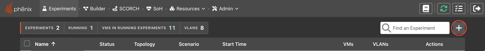
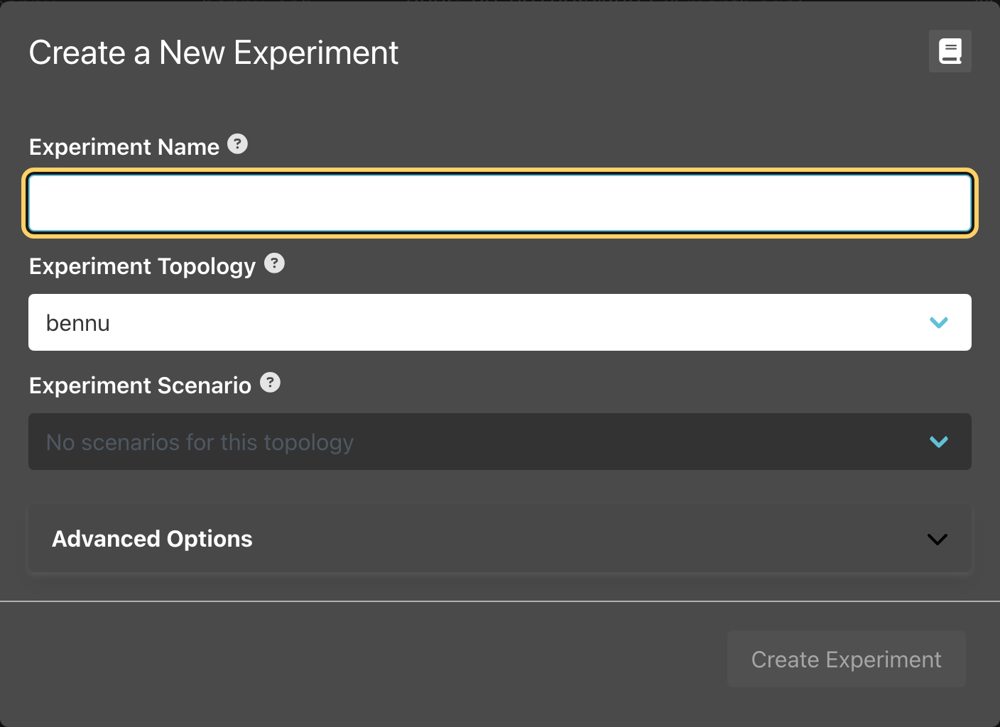
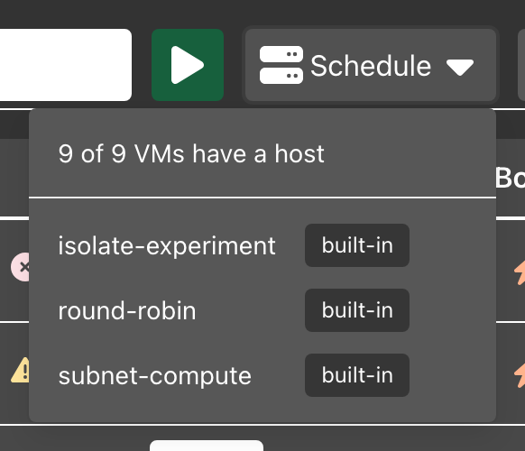

# Experiments

For experiments spanning multiple minimega hosts, see [GRE Mesh](gre-mesh.md)
to trunk experiment networks between hosts with `--use-gre-mesh`, including
the physical network MTU requirements.

## Listing Experiments

### From the Web-UI

Click on the `Experiments` tab. This will display all available experiments that
the user has access to view or edit.

### From the Command Line Binary

This will display a list of all available experiments: it is run as a `root`
user.

```bash
phenix exp list
```

<br>

## Starting / Stopping Experiments

### From the Web-UI

Clicking the `stopped` button will start the experiment; similarly the `started`
button will stop the experiment. The button shows a play icon when it starts
the experiment and a stop icon when it stops the experiment. If your role cannot
start or stop the experiment, the status is a plain tag that you cannot click.
A progress bar is used to update the progress
of starting an experiment. During the update to the experiment -- starting or
stopping -- it will not be accessible or available to delete.

### From the Command Line Binary

```bash
phenix exp start <experiment name>
```

Or ...

```bash
phenix exp stop <experiment name>
```

Or ...

```bash
phenix exp restart <experiment name>
```

Optionally, you can use the `--dry-run` flag to do everything except call out to
minimega.

While `phenix exp start` runs, the Experiments page of the web UI shows the
experiment as `starting` after a page refresh. phēnix refuses a second start of
the experiment until the first start ends.

After an experiment stops successfully, phēnix deletes the VM disk snapshots
created for file injection. To keep these snapshots for debugging, use
`--keep-injection-snapshots` or its `-K` shorthand:

```bash
phenix exp stop --keep-injection-snapshots <experiment name>
```

Only `phenix exp stop` accepts this option. Stopping an experiment from the
Web-UI, or with `phenix exp restart`, always deletes the snapshots.

The `phenix exp --help` command will output:

```text
Experiment management

Usage:
  phenix experiment [flags]
  phenix experiment [command]

Aliases:
  experiment, exp

Available Commands:
  apps            List of available apps to assign an experiment
  create          Create an experiment
  delete          Delete an experiment
  edit            Edit an experiment
  list            Display a table of available experiments
  reconfigure     Reconfigure an experiment
  restart         Restart an experiment
  schedule        Schedule an experiment
  schedulers      List of available schedulers to assign an experiment
  scorch          Start a Scorch run for experiment
  start           Start an experiment
  stop            Stop an experiment
  trigger         Trigger lifecycle stage for app(s) in experiment

Flags:
  -h, --help   help for experiment

Use "phenix experiment [command] --help" for more information about a command.
```

!!! note
    For a list of global flags supported across all `phenix` subcommands, see [Global Flags](settings.md#global-flags).

## Create a New Experiment

### From the Web-UI

{: width=800 .center}

Click the `+` button to the right of the filter field.

{: width=600 .center}

Enter `Experiment Name` and `Experiment Topology`, the remaining selection are
optional. In this example, `bennu` is an example topology and is not included
by default. You will need to [create](configuration.md) your own topology(ies),
or draw and publish one, with its experiment, in the
[Builder](builder/publishing.md).

#### Purely via the Web-UI (Uploading Topo/Scenario Files)

You can create an experiment entirely through the Web-UI using custom topology and scenario files without needing to use the CLI:

1. **Upload Configurations in the Configs Tab**:
    * Navigate to the **Configs** tab.
    * Click the **Upload** button to upload your topology file (`.yaml`).
    * (Optional) Click **Upload** again to upload your scenario file (`.yaml`).
    * Verify that your uploaded configurations appear in the table (e.g., `topology/my-topology` and `scenario/my-scenario`).

2. **Create Experiment in Experiments Tab**:
    * Navigate to the **Experiments** tab.
    * Click the `+` button to open the creation dialog.
    * Enter an **Experiment Name**.
    * Select your uploaded topology from the **Experiment Topology** dropdown.
    * (Optional) Select your uploaded scenario from the **Experiment Scenario** dropdown.
    * Click **Create Experiment** to create the experiment.

### From the Command Line Binary

You can create an experiment using either saved configuration names from the phēnix store or direct file paths to topology and scenario configuration files (`.yaml`).

```bash
# Using stored configuration names
phenix experiment create <experiment name> -t <topology name>
phenix experiment create <experiment name> -t <topology name> -s <scenario name>

# Using direct file paths for topology and scenario
phenix experiment create <experiment name> -t /path/to/topology.yaml
phenix experiment create <experiment name> -t /path/to/topology.yaml -s /path/to/scenario.yaml

# Specifying a base directory and disabled apps
phenix experiment create <experiment name> -t /path/to/topology.yaml -s /path/to/scenario.yaml -d </path/to/dir/> --disabled-apps "app1,app2"
```

The `phenix exp create --help` command will output:

```text
Create an experiment

  Used to create an experiment from existing configurations; can be a
  topology, or topology and scenario, or paths to topology/scenario
  configuration files (YAML or JSON). (Optional are the arguments for
  scenario or base directory.)

Usage:
  phenix experiment create <experiment name> [flags]

Examples:

  phenix experiment create <experiment name> -t <topology name or /path/to/filename>
  phenix experiment create <experiment name> -t <topology name or /path/to/filename> -s <scenario name or /path/to/filename>
  phenix experiment create <experiment name> -t <topology name or /path/to/filename> -s <scenario name or /path/to/filename> -d </path/to/dir/>
  phenix experiment create <experiment name> -t <topology name or /path/to/filename> -s <scenario name or /path/to/filename> --disabled-apps "app1,app2"
  phenix experiment create <experiment name> -t <topology name> --node-annotation phenix/default-apps=false --annotation phenix.workflow/tags=nightly

Flags:
      --annotation stringArray        Experiment annotation as key=value; may be repeated
  -d, --base-dir string               Base directory to use for experiment (optional)
  -b, --default-bridge string         Default bridge name to use for experiment (optional) (default "phenix")
      --disabled-apps strings         Comma separated list of apps to disable
  -h, --help                          help for create
      --node-annotation stringArray   Annotation for every VM as key=value; true, false and JSON lists or objects keep their type; may be repeated
  -s, --scenario string               Name of an existing scenario to use (optional)
  -t, --topology string               Name of an existing topology to use
      --vlan-max int                  VLAN pool maximum
      --vlan-min int                  VLAN pool minimum
```

## Deleting Experiments

### From the Web-UI

The experiment must be stopped before it can be deleted; its trash can icon is
disabled while it runs. Click the trash can icon next to the experiment to
delete it.

### From the Command Line Binary

An experiment must be stopped before it can be deleted:

```bash
phenix exp stop <experiment name>
phenix exp delete <experiment name>
```

Alternatively, the `-f`/`--force` flag can be used to automatically stop a
running experiment before deleting it, similar to `docker rm -f`, even when
minimega cannot kill its VMs, which are then left for you to clear by hand:

```bash
phenix exp delete -f <experiment name>
```

Using `all` instead of a specific experiment name will delete all stopped
experiments (or, when combined with `--force`, all experiments regardless of
whether they are running).

The `phenix exp delete --help` command will output:

```text
Delete an experiment

  Used to delete an existing experiment; experiment must be stopped.
  Using 'all' instead of a specific experiment name will include all
  stopped experiments. Use the -f/--force flag to automatically stop
  a running experiment before deleting it.

Usage:
  phenix experiment delete <experiment name> [flags]

Aliases:
  delete, del

Flags:
  -f, --force   Stop a running experiment before deleting it
  -h, --help    help for delete
```

## Scheduling an Experiment

### From Web-UI

The experiment must be stopped; click on the experiment name to enter the
Stopped Experiment component. Click the `Schedule` button to the right of the
start button. The menu tells how many VMs have a host, and lists the
schedulers of the server. Click a scheduler, then confirm. The scheduler
assigns a host to each VM. `round-robin` and `subnet-compute` keep the hosts
that you set before. `isolate-experiment` replaces them.

{: width=400 .center}

### From the Command Line Binary

The list of available schedules can be found by running the following command.

```bash
phenix experiment schedulers
```

Then apply the desired schedule with the following command.

```bash
phenix experiment schedule <experiment name> <algorithm>
```

A user scheduler (`phenix-scheduler-<name>`) gets a JSON object on STDIN: the
experiment spec (`spec`) and the schedulable cluster hosts with their disk
usage (`hosts`). To see
this JSON, run the following command. The command stores nothing.

```bash
phenix util scheduler-json <experiment name>
```

### Scheduling Limits

* A built-in scheduler must finish in 45 seconds. A user scheduler
  (`phenix-scheduler-<name>`) must finish in 2 minutes. If a scheduler does
  not finish in time, phēnix stops it and stores no schedule. The web UI and
  the REST API then show error 504.
* If the experiment changes or starts while phēnix schedules it, phēnix keeps
  that change and stores no schedule. The web UI and the REST API then show
  error 409. Schedule the experiment again.
* The web UI and the REST API lock the experiment while they schedule it. You
  cannot start or change the experiment until the schedule is complete.
* If the cluster has mesh peers and no peer answers, phēnix stores no
  schedule. The web UI and the REST API then show error 503. Make sure that
  minimega runs on the compute nodes, then schedule the experiment again.
* A schedule can have warnings. phēnix stores the schedule and shows each
  warning. The web UI shows them in a notice, `phenix experiment schedule`
  logs them, and the REST API puts them in `warnings`. A built-in scheduler
  gives a warning in these conditions:
    * A VM is set to a host that is not a schedulable cluster host.
      `round-robin` and `subnet-compute` keep that host.
      `isolate-experiment` puts the VM on a different host.
    * The VMs on a host need more memory or more CPUs than the host has.
      The warning gives the committed value and the available value.
* The capacity checks include the VMs that have `do_not_boot` set, because
  you can boot these VMs later.
* `subnet-compute` puts a VM that has no interfaces on the host that has the
  most VMs of the experiment. If that host does not have sufficient memory,
  it uses the next host.

## Triggering App Lifecycle Stages

You can manually trigger an app lifecycle stage for an experiment without
stopping and restarting it.

### From the Command Line Binary

The `phenix exp trigger` command runs one app lifecycle stage on demand:

```bash
phenix exp trigger <lifecycle> <experiment name> [<app name> ...]
```

Where `<lifecycle>` is one of the following stages, or its shorthand:

* `configure` (or `config`)
* `pre-start` (or `pre`)
* `post-start` (or `post`)
* `running` (or `run`)
* `cleanup` (or `clean`)

Providing no app names triggers the stage for every app in the experiment. Use
`all` instead of an experiment name to trigger the stage in every experiment.
The `running` stage is skipped for experiments that are not running.

**Examples:**

Trigger the running stage for all apps in an experiment:

```bash
phenix exp trigger running my-experiment
```

Trigger the running stage for a specific app:

```bash
phenix exp trigger running my-experiment soh
```

Trigger the configure stage for all experiments:

```bash
phenix exp trigger configure all
```

### From the REST API

`POST /api/v1/experiments/<experiment name>/trigger?apps=<app,...>&stage=<stage>`
runs one stage for the apps that `apps` names. The `stage` value is one of the
full stage names above. Without `stage`, the request runs the `running` stage.
The request returns before the apps run. The `/ws` websocket reports the
progress of each app.

### From the Web-UI

On a running experiment's page, click `Trigger` or an app tile in the Apps box
to open the `phēnix Apps` dialog. The page header is collapsed by default. To
see the Apps box, click `Details`. The browser keeps this choice. Select a stage in the `Stage` list. The default stage is
`running`. Select the apps, then click `Trigger Apps`. The `running` stage does
not offer the apps that phēnix runs itself, such as `ntp`. The dialog shows a
warning for each other stage, because the stage can change the running
experiment. The `configure` stage rewrites the experiment spec.

### `trigger configure` vs. `reconfigure`

`phenix exp trigger configure` and `phenix experiment reconfigure` both re-run
the `configure` lifecycle stage, but they serve different purposes and are not
interchangeable:

| | `phenix exp trigger configure` | `phenix experiment reconfigure` |
|---|---|---|
| Use case | Manually re-run a specific app's (or apps') configure hook on demand, e.g. for debugging | Re-apply configuration after editing an experiment's stored topology, scenario, or deployment settings |
| Targets specific apps | Yes, via `[<app name> ...]` | No, always applies to every app |
| Validates the experiment config | No | Yes |
| Runs registered config hooks | No | Yes |
| Resets the minimega bridge | No | Yes (deletes it so it's recreated with current settings, unless using the GRE mesh) |
| Guards against running experiments | No | Yes (refuses to run if the experiment is running) |

Use `phenix experiment reconfigure` after changing an experiment's stored
settings. Use `phenix exp trigger configure` for targeted, on-demand
re-invocation of one or more apps' configure hooks, such as when debugging an
app.

### Deprecated Command

The `phenix exp trigger-running` command, and its `trig` alias, are deprecated
and will be removed in a future release. Use `phenix exp trigger running`
instead. The deprecated command:

```bash
phenix exp trigger-running my-experiment [<app name> ...]
```

Is equivalent to:

```bash
phenix exp trigger running my-experiment [<app name> ...]
```

## VLAN Aliases

Topologies refer to VLANs by alias, such as `MGMT` or `EXP-1`,
which is mapped by phēnix to a numerical VLAN ID.

### From Web-UI

On a stopped experiment, click the `VLAN IDs` button. The menu lists each
alias with its VLAN ID. Enter an ID from 1 to 4094, or 0 to let minimega
pick an ID when the experiment starts. Then click `Save VLAN IDs`.

### From the Command Line Binary

The `phenix vlan alias` command can list and change VLAN aliases.

```bash
# List VLAN aliases of every experiment
phenix vlan alias

# List VLAN aliases of a single experiment
phenix vlan alias <experiment name>

# Print the VLAN ID of a specific alias for an experiment
phenix vlan alias <experiment name> <alias name>

# Set the alias to a VLAN ID (add -f to overwrite an existing alias)
phenix vlan alias <experiment name> <alias name> <vlan id>
```

For example, if the `MYVLAN` alias of `my-experiment` maps to VLAN 105:

```bash
$ phenix vlan alias my-experiment MYVLAN
105
```

A running experiment reports the VLAN IDs minimega assigned when it started. A
stopped experiment has no ID for an alias unless one was set explicitly, so
most alias lookups will fail until the experiment starts.

## Common Workflows

### 1. Basic Experiment Lifecycle

```bash
# 1. Create experiment from topology/scenario files
phenix exp create my-experiment -t /path/to/topology.yaml -s /path/to/scenario.yaml

# 2. Start the experiment
phenix exp start my-experiment

# 3. View status and inspect VMs
phenix exp list
phenix vm info my-experiment

# 4. Stop the experiment when testing finishes
phenix exp stop my-experiment

# 5. Delete the experiment
phenix exp delete my-experiment
```

### 2. Updating and Reconfiguring an Experiment

```bash
# Reconfigure a stopped experiment after modifying underlying configuration files
phenix exp reconfigure my-experiment
```

### 3. Dry-Run Deployment Testing

```bash
# Test experiment startup logic without deploying minimega VMs
phenix exp start my-experiment --dry-run
```
