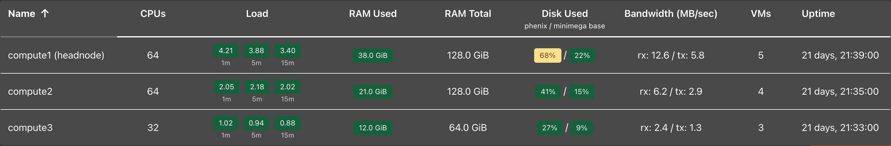

# Hosts

The `Hosts` page (in the `Resources` menu) lists the nodes in the minimega
mesh and how busy each one is.

{: width=800 .center}

`Load`, `RAM Used` and `Disk Used` turn yellow at 65% and red at 85%. Load is
measured against the host's CPU count, so a load of 4 is green on an 8-CPU
host and red on a 4-CPU host. `Disk Used` is for the disks that hold the
phēnix and minimega base directories, and is measured at most once a minute.

## Command Line

`phenix host list` shows each node's CPUs, load, memory, VMs and network
traffic, and doesn't need a running `phenix ui`. See [phenix host](cli/host.md).

```shell
phenix host list

# Each node with the fields of GET /api/v1/hosts
phenix host list -o json
```

## See Also

* [minimega](minimega.md): how phēnix uses the minimega cluster.
* [Scheduling an Experiment](experiments.md#scheduling-an-experiment): choose which host runs each VM.
