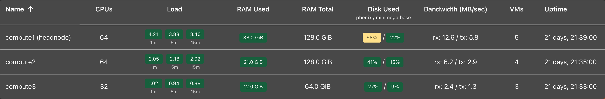

# Hosts

The `Hosts` page (in the `Resources` menu) lists the nodes in the minimega
mesh and what each one is carrying. It needs `list` on `hosts`, and only the
hosts your role may list appear.

{: width=800 .center}

## The Hosts Table

| Column | What it shows | Sorts |
| :--- | :--- | :--- |
| `Name` | The host's name, with `(headnode)` after it on the head node. | yes |
| `CPUs` | How many CPUs the host has. | yes |
| `Load` | The load averages over the last `1m`, `5m` and `15m`. | no |
| `RAM Used` | Memory in use. | yes |
| `RAM Total` | Memory the host has. | yes |
| `Disk Used (phenix / minimega base)` | How full the disks holding the phēnix and minimega base directories are. | no |
| `Bandwidth (MB/sec)` | The host's traffic, as `rx: <in> / tx: <out>`. | no |
| `VMs` | How many VMs are running on the host. | yes |
| `Uptime` | How long the host has been up. | yes |

The `Load`, `RAM Used` and `Disk Used` values are colored tags: green below
65%, yellow from 65%, and red from 85%. A load average is measured against the
host's CPU count, so a load of 4 is green on an 8-CPU host and red on a 4-CPU
host. The `Paginate` toggle appears above the table once there are more hosts
than one page holds (see [Tables](web-ui.md#tables)).

## Disk Usage

Each disk percentage comes from a command run on the host itself, so phēnix
measures it at most once a minute. The two percentages can therefore be older
than the rest of the row.

## Refreshing

The page reloads every 30 seconds while its browser tab is visible. The
header's refresh button reloads it at once and says how old the figures on
screen are (see
[Page Freshness and Refresh](web-ui.md#page-freshness-and-refresh)). The
server reuses a host list it read in the last few seconds, so the age counts
from when the server read the figures.

## From the Command Line Binary

`phenix host list` shows each node with its CPUs, load, memory, VMs and
network traffic. It asks minimega in the `phenix` process, so it does not
need a running `phenix ui`. `-o json` and `-o yaml` print each node with the
fields of `GET /api/v1/hosts`. See [phenix host](cli/host.md).
