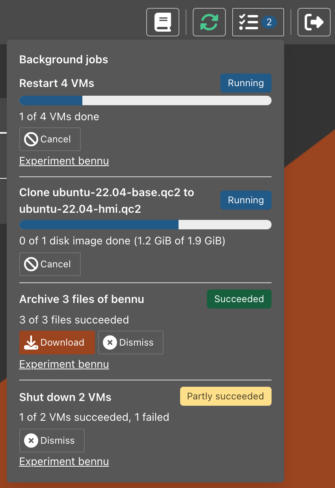

# Background Jobs

Some things take too long for a single web request: acting on lots of VMs at
once, zipping up experiment files, or cloning a big disk image. phēnix runs
these as background jobs on the server. You get an answer right away, and the
job keeps going even if you close the browser tab or lose your connection.

## Web UI

The [background jobs menu](web-ui.md#background-jobs-menu) in the header
lists your jobs and their progress, and lets you cancel them, download what
they produced, and dismiss them.

{: width=450 .center}

## What runs as a job

| Kind | Started by |
|---|---|
| `vms.action` | bulk actions in the VM table (see [VM Multi Action](vm-multi-action.md#api)) |
| `files.archive` | downloading several experiment files (see [Experiment Files](experiments.md#acting-on-several-files)) |
| `disk.clone` | cloning a disk image (see [Disks](disks.md#cloning-in-the-background)) |
| `experiments.start`, `experiments.trigger` | starting or triggering `all` experiments through the API |
| `experiments.periodic` | starting an experiment through `phenix ui` when an app in its scenario has `runPeriodically` (see [Starting / Stopping Experiments](experiments.md#starting-stopping-experiments)) |

An `experiments.periodic` job runs the apps' `running` stage on schedule until
the experiment stops or someone cancels the job. VM snapshots, starting a
single experiment and SCORCH runs aren't jobs.

## Job status

phēnix runs a few jobs at once for each user and queues the rest. A job is
`queued`, then `running`, and ends as `succeeded`, `partial` (some items
failed or were skipped), `failed` or `canceled`. A failed or skipped item has
an `error` that says why, and when trying it again may work, the web UI offers
`Retry failed`.

If you cancel a running VM action job, it doesn't start any more VMs and stops
after the ones in progress finish. A canceled archive or clone job stops at
once and leaves no file behind.

Jobs only live in the memory of the `phenix ui` server. A finished job is
kept for one hour, or until you dismiss it, and the archive of a
`files.archive` job is deleted with it. A cloned disk image stays.
Restarting the server loses every job and cancels the running ones (see
[Stopping the Server](settings.md#stopping-the-server)).

## Command Line

`phenix job` follows and cancels the jobs of the running `phenix ui` server,
for every user. It can't start jobs: commands such as `phenix vm restart` do
their work in the `phenix` process itself. See [phenix job](cli/job.md) for
every flag.

```bash
# Running and queued jobs of one experiment
phenix job list --experiment my-exp --active

# One job and the outcome of each item
phenix job get j0f3a9c2e81b4d7a6

# Cancel a job
phenix job cancel j0f3a9c2e81b4d7a6

# Wait at most 10 minutes for a job to finish
phenix job wait j0f3a9c2e81b4d7a6 --timeout 10m
```

`phenix job wait` exits `0` if the job succeeded, `2` if it ended `partial`,
and `1` otherwise.

## API

| Route | Does |
|---|---|
| `GET /api/v1/jobs` | lists jobs, newest first; filter with `?experiment=`, `?kind=` and `?active=true` |
| `GET /api/v1/jobs/{id}` | returns one job with every item and its result |
| `POST /api/v1/jobs/{id}/cancel` | cancels a job |
| `DELETE /api/v1/jobs/{id}` | dismisses a finished job and deletes its file |
| `GET /api/v1/jobs/{id}/artifact` | downloads the file the job produced (see [Downloads](api.md#downloads)) |

A route that starts a job answers with the job and its `Location`, as
[Background Jobs](api.md#background-jobs) in the API page describes. When the
queue is full, it answers `429 Too Many Requests` with `Retry-After`.

### Retrying a request that starts a job

If a client loses the answer, it can't tell whether the job started. To retry
safely, send an `Idempotency-Key` header (1 to 255 printable ASCII
characters, such as a UUID) and reuse it for each retry. A retry by the same
user with the same key, body and query gets the first answer again and doesn't
start a second job; the same key with a different body or query gets `422`. Keys are kept for an hour,
and a server restart forgets them.

```bash
# One key per request, reused for each of its retries
KEY=$(uuidgen)
curl -X POST -H "X-Phenix-Auth-Token: Bearer $TOKEN" \
  -H "Idempotency-Key: $KEY" \
  -d '{"action": "restart", "vms": ["web", "db"]}' \
  http://localhost:3000/api/v1/experiments/my-exp/vms/actions
```

## See Also

* [phenix job](cli/job.md): every job command and flag.
* [API](api.md#background-jobs): the routes that start a job and how to follow it.
* [Web UI](web-ui.md#background-jobs-menu): the menu that shows your jobs.
* [VM Multi Action](vm-multi-action.md): actions on several VMs at once.
* [Experiment Files](experiments.md#experiment-files): download several files as one archive.
* [Disks](disks.md#cloning-in-the-background): clone a disk image in the background.
