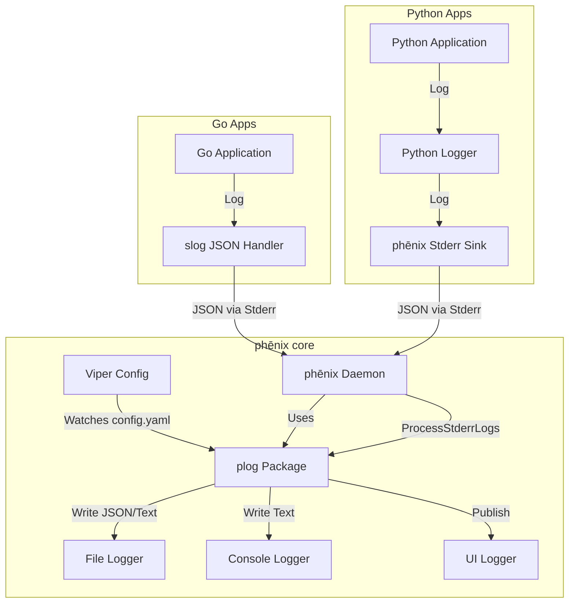

# Logging

phēnix features a centralized logging system that aggregates logs from the core daemon, internal Go services, and external user applications.

## Architecture

The logging architecture is designed to be **centralized**. The phēnix core acts as the aggregator, capturing `stderr` from all running applications, parsing the output as JSON, and ingesting it into the centralized logging system.



## CLI Verbosity (`--log.level`)

You can temporarily increase or decrease log verbosity for any command by using the global `--log.level` flag.

```bash
phenix <command> --log.level=<level>
```

This is useful when troubleshooting because it only affects that command invocation.

### Available Levels

phēnix supports the following log levels for `--log.level`:

* `debug`: Most verbose output for troubleshooting.
* `info`: Default level. Normal operational messages.
* `warn`: Warnings and errors.
* `error`: Errors only.
* `none`: Suppress all standard log output.

!!! note
    Level names are case-insensitive (for example, `DEBUG` and `debug` are equivalent).

### Examples

Use higher verbosity to inspect behavior while running a command:

```bash
# Run the UI with debug logging for this invocation
phenix ui --log.level=debug

# Show only warnings and errors while listing experiments
phenix exp list --log.level=warn

# Keep command output quiet unless an error occurs
phenix config get --log.level=error Role/vm-admin
```

To change the default level for all future commands, use settings:

```bash
phenix settings set log.level debug
```

To revert and use the configured default again for subsequent commands:

```bash
phenix settings unset log.level
```

## The App Contract

All applications (Go or Python) running under phēnix must adhere to the following contract to ensure their logs are correctly parsed and displayed in the UI:

1. **Output**: Logs must be written to `stderr`.
2. **Format**: Logs must be single-line **JSON** objects.
3. **Required Fields**:
    * `level`: `DEBUG`, `INFO`, `WARN`, `ERROR`
    * `msg`: The log message string.
    * `time`: Timestamp (RFC3339 or similar).
4. **Optional Fields**:
    * `traceback`: For exceptions/panics (string).

!!! tip
    Check out the [Example Applications](examples.md#example-applications) for complete, runnable reference implementations in Go and Python.

### Python Apps

Use the `phenix_apps.common.logger`. It is pre-configured to output JSON to stderr.

!!! important
    For fatal errors, **raise an exception** (e.g., `ValueError`, `RuntimeError`) instead of calling `sys.exit(1)`. The `AppBase` class wraps execution in a try/except block and will automatically catch the exception, log the traceback as structured JSON, and exit cleanly.

```python
from phenix_apps.common.logger import logger

def my_func():
    try:
        logger.bind(custom_field="value").info("Starting operation")
        # ... code ...
    except Exception:
        # Automatically captures traceback and formats as JSON
        logger.exception("Operation failed")
```

### Go Apps

Use `log/slog` with a JSON handler.

```go
import (
    "log/slog"
    "os"
)

func main() {
    logger := slog.New(slog.NewJSONHandler(os.Stderr, nil))
    slog.SetDefault(logger)

    slog.Info("Application started", "app", "my-app")
}
```

### phēnix Core

Use the `phenix/util/plog` package for logging within the core application.

```go
import "phenix/util/plog"

func MyFunc() {
    // Always provide a LogType enum for UI filtering
    plog.Info(plog.TypeSystem, "System initialized", "version", "1.0")
}
```

The log types are `AUDIT`, `SECURITY`, `SOH`, `SCORCH`, `PHENIX-APP`, `ACTION`,
`HTTP`, `MINIMEGA` and `SYSTEM`. Web handlers log `AUDIT` records with the
`phenix/web/audit` package rather than with `plog` directly (see
[Audit Events](#audit-events)).

### HTTP Request Logging

To view detailed HTTP request logs (method, path, status, duration), start the UI with the `--log-requests` flag.

## Audit Events

The web API logs an audit event, a record of type `AUDIT`, for each
security-relevant action: who read a packet capture, opened a console, VNC
session or port forward, changed a disk image, or uploaded, downloaded or
deleted a file. Its fields follow the
[Elastic Common Schema](https://www.elastic.co/guide/en/ecs/current/index.html)
(ECS) as flat dotted keys, so the system log file can be shipped to
Elasticsearch as it is.

Each audited action is logged with one of three outcomes:

* **Success** (`INFO`): the action worked. `event.outcome` is `success`.
* **Refused** (`WARN`): the user's role does not allow it. `event.outcome` is
  `failure`, `event.type` also holds `denied`, and `event.reason` says why:
  `forbidden`, or for example `not owner` for another user's console and
  `outside mount` for a path outside a VM's mount.
* **Failed** (`WARN`): the role allows it, but it failed. `event.outcome` is
  `failure` and `error.message` holds the error.

A request refused before its permission is checked, such as one with a
malformed body or a disk path outside the minimega files directory, is not
audited.

### Audited Actions

| `event.action` | `event.category` | `event.type` | Routes |
| :--- | :--- | :--- | :--- |
| `capture-start` | `network` | `start` | `POST .../vms/{name}/captures`, `POST .../captureSubnet` (one event per VM) |
| `capture-stop` | `network` | `end` | `DELETE .../vms/{name}/captures`, `POST .../stopCaptureSubnet` (one event per VM) |
| `capture-stream` | `network` | `access` | `GET .../captures/{iface}/stream`, `GET /webshark/streams/{token}` |
| `capture-webshark-open` | `network` | `access` | `POST /experiments/{exp}/webshark` |
| `capture-webshark-read` | `network` | `access` | `GET /webshark/captures/{name}` (once per grant), `GET /webshark/json?method=download` (once per download) |
| `capture-token-create` | `iam` | `creation` | `POST /experiments/{exp}/capture-tokens` |
| `capture-token-revoke` | `iam` | `deletion` | `DELETE /experiments/{exp}/capture-tokens/{id}` |
| `file-download` | `file` | `access` | `GET /experiments/{name}/files/{filename}` (downloads and the Files tab's viewer), `POST .../files/download` (one event per file sent, including those sent before the download failed), `GET .../vms/{name}/files/download`, `GET /jobs/{id}/artifact` of an archive job (one event per file archived); refusals of `GET .../files/{filename}/checksum` and `POST .../files/archive`, and archive jobs that fail or are canceled |
| `file-upload` | `file` | `creation` | the file server's upload page (one event per file) |
| `file-delete` | `file` | `deletion` | `DELETE /experiments/{name}/files/{filename}`, `POST .../files/delete` (one event per file) |
| `console-create` | `process` | `start` | `POST /console` |
| `console-attach` | `process` | `access` | `GET /console/{pid}/ws`; refusals of `GET /console/{pid}` and `POST /console/{pid}/size`, and of another user's console on any console route |
| `console-terminate` | `process` | `end` | `DELETE /console/{pid}` |
| `console-end` | `process` | `end` | none: a console ended, for any reason |
| `vnc-attach` | `session` | `start` | `GET .../vms/{name}/vnc/ws`; refusals of `GET .../vms/{name}/vnc` |
| `port-forward-attach` | `network` | `connection` | `GET .../vms/{name}/forwards/{host}/{port}/ws` |
| `disk-snapshot`, `disk-clone` | `file` | `creation` | `POST /disks/snapshot`, `POST /disks/clone`, `POST /disks/clone/jobs` |
| `disk-rename`, `disk-commit`, `disk-rebase`, `disk-resize` | `file` | `change` | `POST /disks/rename`, `/disks/commit`, `/disks/rebase`, `/disks/resize` |
| `disk-delete` | `file` | `deletion` | `DELETE /disks` |
| `disk-upload` | `file` | `creation` | `POST /disks` |
| `disk-download` | `file` | `access` | `GET /disks/download`; refusals of `GET /disks/checksum` |
| `vm-snapshot`, `vm-commit`, `vm-memory-snapshot` | `file` | `creation` | `POST .../vms/{name}/snapshots`, `/commit`, `/memorySnapshot` |
| `vm-restore` | `file` | `change` | `POST .../vms/{name}/snapshots/{snapshot}` |
| `vm-mount`, `vm-unmount` | `session` | `start`, `end` | `POST .../vms/{name}/mount`, `DELETE .../vms/{name}/unmount` |
| `vm-file-upload`, `vm-file-copy` | `file` | `creation` | `PUT .../vms/{name}/files/upload`, `POST .../vms/{name}/files/copy` |

A download is audited once, however many requests resuming it take: for a `GET`
answered with the whole file, or with a range starting at its first byte.

An action run as a [background job](jobs.md) is audited when the job finishes,
not when the request starting it is answered: as the user who started it,
without the request's `source.ip`, `http.request.method` and `url.path`, and
with the job's ID in `phenix.job.id`. A job canceled before its work was done
is a failure with `error.message` `canceled`. A request starting the job is
audited only when refused, or when it fails before the job starts. The files
of an archive job are audited when its archive is downloaded, by the user
downloading it, and only those archived, including any cut short, not those its
`MISSING.txt` lists as left out.

### Fields

| Field | Holds |
| :--- | :--- |
| `type` | `AUDIT` |
| `@timestamp` | when, in UTC (RFC 3339) |
| `event.kind`, `event.module`, `event.dataset` | `event`, `phenix`, `phenix.audit` |
| `event.action`, `event.category`, `event.type` | the action, as in the table above; `event.type` is a list |
| `event.outcome`, `event.reason`, `error.message` | the outcome, a refusal's reason, a failure's error |
| `user.name`, `user.roles` | the user, and their role |
| `source.ip` | the address of the client that sent the request |
| `network.forwarded_ip` | the first address in the request's `X-Forwarded-For` header, when it has one |
| `http.request.method`, `url.path` | the request's method and path; never its query, which can carry a token |
| `http.request.range` | a download's `Range` header, when it has one |
| `phenix.experiment.name`, `phenix.vm.name`, `phenix.vm.interface` | the experiment, VM and interface acted on |
| `file.path`, `file.name` | the file acted on |
| `phenix.file.target_path` | the file the action wrote or named: a new image, a backing image, a copy's or upload's destination |
| `file.size` | the bytes an upload wrote |
| `process.pid` | a console's process |
| `phenix.file.capture`, `phenix.file.preview` | whether a downloaded file is a packet capture, and whether it was shown in the Files tab's viewer |
| `phenix.file.count` | the files a failed bulk action, such as a download, deletion or archive job, asked for |
| `phenix.job.id` | the background job that did the action, or built the archive downloaded |
| `phenix.capture.subnet` | a subnet capture's subnet |
| `phenix.capability.id`, `phenix.capability.op`, `phenix.capability.ops`, `phenix.capability.expires` | a capture grant's ID (never its token), the operation used or those granted, and when it ends |
| `phenix.webshark.live` | whether a capture opened in WebShark is still running |
| `phenix.console.end_reason` | why a console ended: `user` (ended from the UI), `idle` (no websocket attached for 15 seconds), `shutdown` (the server stopped) or `exited` (its process exited) |
| `phenix.disk.size`, `phenix.disk.unsafe` | a resize's size and a rebase's `unsafe` |
| `phenix.mount.path` | where a VM's disk is mounted |
| `destination.address`, `destination.port`, `phenix.forward.owner` | a port forward's destination, and the user who created it |

`source.ip` is the address the connection came from: behind a reverse proxy, it
is the proxy's. `network.forwarded_ip` is copied from a header any client can
send, so it is not verified.

A request authorized by a capture grant (see [WebShark](webshark.md)) is
audited as the user the grant was given to, and its `url.path` is the route's
template, such as `/webshark/streams/{token}`, so the token is never logged.

### Where Audit Events Go

Audit events are always written to the system log file (`log.system.path`,
`/var/log/phenix/phenix.log` by default), whatever `log.level` is, `none`
included. The console and the Logs page's live view follow `log.level` and
`ui.logs.level` as for any other record, so with either at `warn` they show only
refusals and failures; reloading the Logs page reads the file and shows every
audit event. Like other logs, they are shown to roles with `get` on `logs`. On
the Logs page, choose `AUDIT` in the Type filter, and search for a field, such
as `event.action=disk-delete` or `user.name=alice`.

Actions taken with the `phenix` CLI, such as `phenix vm capture` or
`phenix image`, have no web user and are not audited, and neither are a
WebShark capture's watch requests or the console's resize and status checks,
other than their refusals.

### Shipping Audit Events with Filebeat

The system log file holds one JSON record per line. This Filebeat (7.17 or
later) input ships its audit events, with their own `@timestamp`:

```yaml
filebeat.inputs:
  - type: filestream
    id: phenix-audit
    paths:
      - /var/log/phenix/phenix.log
    parsers:
      - ndjson:
          target: ""
          overwrite_keys: true
          expand_keys: true
    processors:
      - drop_event:
          when:
            not:
              equals:
                type: AUDIT
      - rename:
          fields:
            - from: msg
              to: message
            - from: level
              to: log.level
          ignore_missing: true
      - drop_fields:
          fields: [time]
          ignore_missing: true
```

!!! tip "Troubleshooting"
    For common logging issues and solutions, please see the [Troubleshooting](troubleshooting.md) page.
