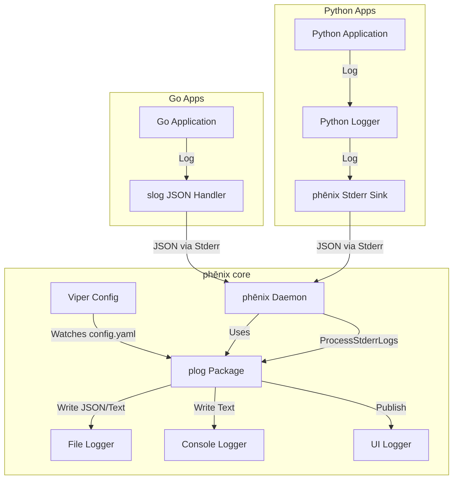
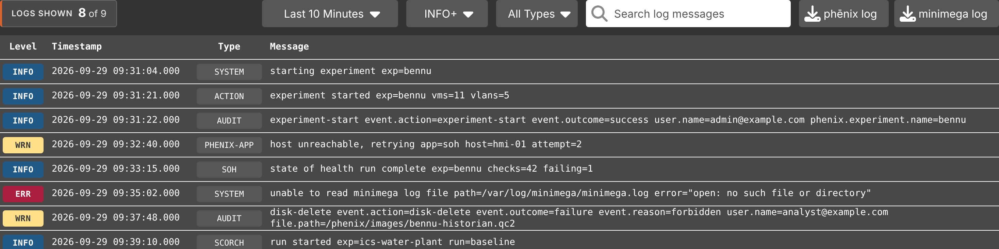

# Logging

phēnix features a centralized logging system that aggregates logs from the core daemon, internal Go services, and external user applications.

## Architecture

The logging architecture is designed to be **centralized**. The phēnix core acts as the aggregator, capturing `stderr` from all running applications, parsing the output as JSON, and ingesting it into the centralized logging system.



## CLI Verbosity (`--log.level`)

You can temporarily increase or decrease log verbosity for any command by using the global `--log.level` flag.

```bash
phenix <command> --log.level=<level>
```

This is useful when troubleshooting because it only affects that command invocation.

### Available Levels

phēnix supports the following log levels for `--log.level`:

* `debug`: Most verbose output for troubleshooting.
* `info`: Default level. Normal operational messages.
* `warn`: Warnings and errors.
* `error`: Errors only.
* `none`: Suppress all standard log output.

!!! note
    Level names are case-insensitive (for example, `DEBUG` and `debug` are equivalent).

### Examples

Use higher verbosity to inspect behavior while running a command:

```bash
# Run the UI with debug logging for this invocation
phenix ui --log.level=debug

# Show only warnings and errors while listing experiments
phenix exp list --log.level=warn

# Keep command output quiet unless an error occurs
phenix config get --log.level=error Role/vm-admin
```

To change the default level for all future commands, use settings:

```bash
phenix settings set log.level debug
```

To revert and use the configured default again for subsequent commands:

```bash
phenix settings unset log.level
```

## The App Contract

All applications (Go or Python) running under phēnix must adhere to the following contract to ensure their logs are correctly parsed and displayed in the UI:

1. **Output**: Logs must be written to `stderr`.
2. **Format**: Logs must be single-line **JSON** objects.
3. **Required Fields**:
    * `level`: `DEBUG`, `INFO`, `WARN`, `ERROR`
    * `msg`: The log message string.
    * `time`: Timestamp (RFC3339 or similar).
4. **Optional Fields**:
    * `traceback`: For exceptions/panics (string).

!!! tip
    Check out the [Example Applications](examples.md#example-applications) for complete, runnable reference implementations in Go and Python.

### Python Apps

Use the `phenix_apps.common.logger`. It is pre-configured to output JSON to stderr.

!!! important
    For fatal errors, **raise an exception** (e.g., `ValueError`, `RuntimeError`) instead of calling `sys.exit(1)`. The `AppBase` class wraps execution in a try/except block and will automatically catch the exception, log the traceback as structured JSON, and exit cleanly.

```python
from phenix_apps.common.logger import logger

def my_func():
    try:
        logger.bind(custom_field="value").info("Starting operation")
        # ... code ...
    except Exception:
        # Automatically captures traceback and formats as JSON
        logger.exception("Operation failed")
```

### Go Apps

Use `log/slog` with a JSON handler.

```go
import (
    "log/slog"
    "os"
)

func main() {
    logger := slog.New(slog.NewJSONHandler(os.Stderr, nil))
    slog.SetDefault(logger)

    slog.Info("Application started", "app", "my-app")
}
```

### phēnix Core

Use the `phenix/util/plog` package for logging within the core application.

```go
import "phenix/util/plog"

func MyFunc() {
    // Always provide a LogType enum for UI filtering
    plog.Info(plog.TypeSystem, "System initialized", "version", "1.0")
}
```

The log types are `AUDIT`, `SECURITY`, `SOH`, `SCORCH`, `PHENIX-APP`, `ACTION`,
`HTTP`, `MINIMEGA` and `SYSTEM`. Web handlers log `AUDIT` records with the
`phenix/web/audit` package rather than with `plog` directly (see
[Audit Events](#audit-events)).

### HTTP Request Logging

To view detailed HTTP request logs (method, path, status, duration), start the UI with the `--log-requests` flag.

## The Logs Page

The web UI's `Logs` tab shows the system log's entries, oldest first, and
follows new entries as the server logs them. It needs `get` on `logs`.

{: width=800 .center}

* The `Logs shown` box at the top left counts the entries that pass the date
  range, level, type and search filters, such as `Logs shown 120 of 4,000`.
* The `Level` column shows each entry's level as a colored badge: `DBG`,
  `INFO`, `WRN` or `ERR`. Hold the pointer over a badge to see the full level
  name.
* The `phēnix log` and `minimega log` buttons at the top right download the
  log files themselves (see [Downloading Log Files](#downloading-log-files)).

### Downloading Log Files

`phēnix log` downloads the system log file (`log.system.path`) as it is when
the download starts, without its rotated files. `minimega log` downloads the
file that `ui.logs.minimega-path` names, which the `phenix ui` server must be
able to read. In a container deployment, mount minimega's log into the phēnix
container. A file that cannot be downloaded has its button grayed out, and
the button's tooltip says why. Both downloads need `get` on `logs`, and each
is audited as `log-download`. The [API](api.md) serves the same files at
`GET /logs/files/{name}`, and a download can be resumed (see
[Downloads](api.md#downloads)).

## Audit Events

The web API logs an audit event, a record of type `AUDIT`, for each
security-relevant action: signing in and out, refused tokens, changes to
users, configs, experiments, VMs, disk images, files and settings, starts and
stops of experiments, apps, SCORCH runs and captures, and consoles, VNC
sessions, port forwards and downloads. Its fields follow the
[Elastic Common Schema](https://www.elastic.co/guide/en/ecs/current/index.html)
(ECS) as flat dotted keys, so the system log file can be shipped to
Elasticsearch as it is.

Each audited action has one of three outcomes:

* **Success** (`INFO`): the action worked. `event.outcome` is `success`.
* **Refused** (`WARN`): the user's role does not allow it. `event.outcome` is
  `failure`, `event.type` also holds `denied`, and `event.reason` says why.
* **Failed** (`WARN`): the role allows it, but it failed. `event.outcome` is
  `failure`, and `error.message` holds the error.

An audit event never holds a password or a token. A request refused before
its permission is checked, such as one with a malformed body, is not audited,
except for a request refused for its token (see
[Refused Tokens](#refused-tokens)).

### Audited Actions

| `event.action` | `event.category` | `event.type` | Routes |
| :--- | :--- | :--- | :--- |
| `sign-in` | `authentication` | `start` | `GET`, `POST /login`, by password or through a proxy (`phenix.auth.method`); `POST /signup`, once the user is created |
| `sign-out` | `authentication` | `end` | `POST /logout` |
| `user-create` | `iam` | `creation` | `POST /users`, `POST /signup` (as the user signing up); refused for a role that grants a permission the requester does not hold (`event.reason` `privilege escalation`) |
| `user-update` | `iam` | `change` | `PATCH /users/{username}` changing a first or last name (`phenix.user.changed`) |
| `user-role-change` | `iam` | `change` | `PATCH /users/{username}` with a `role_name`; refused, and the role left as it is, without `patch` on `users/roles` (a `role_name` equal to the user's current role is not refused), or for a role that grants a permission that neither the requester nor the user holds (`event.reason` `privilege escalation`) |
| `user-password-change` | `iam` | `change` | `PATCH /users/{username}` with a `new_password` |
| `user-delete` | `iam` | `deletion` | `DELETE /users/{username}`; refused for the user's own account (`event.reason` `own user`) |
| `user-token-create` | `iam` | `creation` | `POST /users/{username}/tokens` |
| `role-create` | `iam` | `creation` | `POST /roles` (`phenix.role.name`); refused for a role that grants a permission the requester does not hold (`event.reason` `privilege escalation`) |
| `role-update` | `iam` | `change` | `PATCH /roles/{name}` (`phenix.role.name`, and `phenix.role.users` for the users whose copy of the role changed, or could not change); refused as `role-create` is |
| `role-delete` | `iam` | `deletion` | `DELETE /roles/{name}` (`phenix.role.name`) |
| `request-auth` | `authentication` | `info` | any API or file server request refused for its token (`event.reason`), at most once a minute for each client address and reason (see [Refused Tokens](#refused-tokens)) |
| `config-create` | `configuration` | `creation` | `POST /configs`, `POST /workflow/configs/{branch}` for a new config (and its refusal by a role that may neither create nor update configs), and `PUT /configs/{kind}/{name}` refusals of the new name it renames a config to |
| `config-update` | `configuration` | `change` | `PUT /configs/{kind}/{name}`, `POST /workflow/configs/{branch}` for a stored config |
| `config-delete` | `configuration` | `deletion` | `DELETE /configs/{kind}/{name}` |
| `workflow-apply` | `configuration` | `change` | `POST /workflow/apply/{branch}` (`phenix.workflow.branch`, `phenix.workflow.action`) |
| `settings-update` | `configuration` | `change` | `POST /settings` (`phenix.settings.changed`) |
| `experiment-create` | `configuration` | `creation` | `POST /experiments` |
| `experiment-update` | `configuration` | `change` | `PATCH /experiments/{name}`, and the VLAN pin and range routes `PUT` and `DELETE .../vlans/aliases/{alias}`, `PUT` and `DELETE .../vlans/range`, `POST .../vlans/pin-live` |
| `experiment-schedule` | `configuration` | `change` | `POST /experiments/{name}/schedule` |
| `experiment-delete` | `configuration` | `deletion` | `DELETE /experiments/{name}` |
| `experiment-start` | `host` | `start` | `POST /experiments/{name}/start` |
| `experiment-stop` | `host` | `end` | `POST /experiments/{name}/stop` |
| `app-trigger` | `process` | `start` | `POST /experiments/{name}/trigger` (`phenix.app.names`, `phenix.app.stage`) |
| `app-trigger-cancel` | `process` | `end` | `DELETE /experiments/{name}/trigger` |
| `scorch-start` | `process` | `start` | `POST .../scorch/pipelines/{run}`, `POST .../scorch/pipelines/{run}/cleanup` (`phenix.scorch.cleanup_only`) |
| `scorch-cancel` | `process` | `end` | `DELETE .../scorch/pipelines/{run}` |
| `scorch-clear` | `process` | `change` | `POST .../scorch/pipelines/{run}/clear` |
| `scorch-terminal-exit` | `process` | `end` | `POST .../scorch/terminals/{pid}/exit/{id}` |
| `vm-start` | `host` | `start` | `POST .../vms/{name}/start`, `POST .../vms/actions` with `start` (one event per VM) |
| `vm-stop` | `host` | `end` | `POST .../vms/{name}/stop`, `POST .../vms/actions` with `pause` |
| `vm-shutdown` | `host` | `end` | `POST .../vms/{name}/shutdown`, `POST .../vms/actions` with `shutdown` |
| `vm-restart` | `host` | `change` | `POST .../vms/{name}/restart`, `POST .../vms/actions` with `restart` |
| `vm-reset-disk` | `host` | `change` | `POST .../vms/{name}/reset`, `POST .../vms/actions` with `resetDisk` |
| `vm-redeploy` | `host` | `change` | `POST .../vms/{name}/redeploy` |
| `vm-kill` | `host` | `end` | `DELETE .../vms/{name}`, `POST .../vms/actions` with `kill` |
| `vm-update` | `configuration` | `change` | `PATCH .../vms/{name}`, `PATCH /experiments/{exp}/vms` and `POST /experiments/{exp}/vms/resetSettings` (one event per VM), `PUT` and `DELETE .../vms/{name}/interfaces/{iface}/qos` (`qos`), naming the settings changed in `phenix.vm.changed`; refused (`event.reason` `port forwards not allowed`) for annotations that start port forwards the role may not create |
| `vm-cdrom-change`, `vm-cdrom-eject` | `host` | `change` | `POST .../vms/{name}/cdrom` (the disc in `file.path`), `DELETE .../vms/{name}/cdrom` |
| `capture-start` | `network` | `start` | `POST .../vms/{name}/captures`, `POST .../captureSubnet` (one event per VM), `POST .../captureVlan` (one event per capture, `phenix.capture.vlan`) |
| `capture-stop` | `network` | `end` | `DELETE .../vms/{name}/captures`, `POST .../stopCaptureSubnet` (one event per VM), `POST .../stopCaptureVlan` (one event per capture, `phenix.capture.vlan`) |
| `capture-stream` | `network` | `access` | `GET .../captures/{iface}/stream`, `GET /webshark/streams/{token}` |
| `capture-webshark-open` | `network` | `access` | `POST /experiments/{exp}/webshark` |
| `capture-webshark-read` | `network` | `access` | `GET /webshark/captures/{name}` (once per grant), `GET /webshark/json?method=download` (once per download) |
| `capture-token-create` | `iam` | `creation` | `POST /experiments/{exp}/captureTokens` |
| `capture-token-revoke` | `iam` | `deletion` | `DELETE /experiments/{exp}/captureTokens/{id}` |
| `netflow-start`, `netflow-stop` | `network` | `start`, `end` | `POST /experiments/{exp}/netflow`, `DELETE /experiments/{exp}/netflow` |
| `netflow-download` | `file` | `access` | `GET /experiments/{exp}/netflow/captures/{id}` (once per download, not per resumed range or `HEAD`), naming the capture and format in `phenix.netflow.capture` and `phenix.netflow.format`, and for CSV and JSONL the flows written and lines skipped in `phenix.netflow.flows` and `phenix.netflow.skipped` |
| `file-download` | `file` | `access` | `GET /experiments/{name}/files/{filename}` (downloads and the Files tab's viewer), `POST .../files/download` (one event per file sent, including those sent before the download failed), `GET .../vms/{name}/files/download`, `GET /jobs/{id}/artifact` of an archive job (one event per file archived); refusals of `GET .../files/{filename}/checksum` and `POST .../files/archive`, and archive jobs that fail or are canceled |
| `file-upload` | `file` | `creation` | the file server's upload page (one event per file) |
| `file-delete` | `file` | `deletion` | `DELETE /experiments/{name}/files/{filename}`, `POST .../files/delete` (one event per file) |
| `console-create` | `process` | `start` | `POST /console` |
| `console-attach` | `process` | `access` | `GET /console/{pid}/ws`; refusals of `GET /console/{pid}` and `POST /console/{pid}/size`, and of another user's console on any console route |
| `console-terminate` | `process` | `end` | `DELETE /console/{pid}` |
| `console-end` | `process` | `end` | none: a console ended, for any reason |
| `vnc-attach` | `session` | `start` | `GET .../vms/{name}/vnc/ws`; refusals of `GET .../vms/{name}/vnc` |
| `port-forward-attach` | `network` | `connection` | `GET .../vms/{name}/forwards/{host}/{port}/ws` |
| `disk-snapshot`, `disk-clone` | `file` | `creation` | `POST /disks/snapshot`, `POST /disks/clone`, `POST /disks/clone/jobs` |
| `disk-rename`, `disk-commit`, `disk-rebase`, `disk-resize` | `file` | `change` | `POST /disks/rename`, `/disks/commit`, `/disks/rebase`, `/disks/resize` |
| `disk-delete` | `file` | `deletion` | `DELETE /disks`; refused (`event.reason` `in use`) for an image that other images or experiments use, and `phenix.disk.force` for a forced delete |
| `disk-upload` | `file` | `creation` | `POST /disks` |
| `disk-download` | `file` | `access` | `GET /disks/download`; refusals of `GET /disks/checksum` |
| `vm-snapshot`, `vm-commit`, `vm-memory-snapshot` | `file` | `creation` | `POST .../vms/{name}/snapshots`, `/commit`, `/memorySnapshot` |
| `vm-restore` | `file` | `change` | `POST .../vms/{name}/snapshots/{snapshot}` |
| `vm-mount`, `vm-unmount` | `session` | `start`, `end` | `POST .../vms/{name}/mount`, `DELETE .../vms/{name}/unmount` |
| `vm-file-upload`, `vm-file-copy` | `file` | `creation` | `PUT .../vms/{name}/files/upload`, `POST .../vms/{name}/files/copy` |
| `log-download` | `file` | `access` | `GET /logs/files/{name}`, naming the log file in `phenix.log.name` |
| `vlan-blacklist-add`, `vlan-blacklist-remove` | `configuration` | `creation`, `deletion` | `PUT /vlans/blacklist/{id}`, `DELETE /vlans/blacklist/{id}`, naming the VLAN ID in `phenix.vlan.id` |
| `vlan-release` | `configuration` | `deletion` | `DELETE /vlans/allocations/{namespace}`, naming the minimega namespace in `phenix.vlan.namespace` |
| `minimega-command` | `process` | `start` | `POST /minimega/commands`, naming the command line in `phenix.minimega.command` |
| `runtime-setting-change` | `configuration` | `change` | `PUT /runtimeSettings/{key}`, `DELETE /runtimeSettings/{key}`, naming the setting in `phenix.setting.key` |

A download is audited once, however many requests resuming it take. An action
run as a [background job](jobs.md) is audited when the job finishes, as the
user who started it, with the job's ID in `phenix.job.id`. A bulk VM action
job is audited once for each VM. A workflow apply with `dryRun=true` changes
nothing, and is audited with `phenix.dry_run` `true` and `event.type` `info`.
A request over the Unix socket, such as those of `phenix workflow apply`, has
no web user: it is audited with `phenix.auth.method` `unix-socket` and the
socket's `Global Admin` role in `user.roles`.

### Fields

| Field | Holds |
| :--- | :--- |
| `type` | `AUDIT` |
| `@timestamp` | when, in UTC (RFC 3339) |
| `event.kind`, `event.module`, `event.dataset` | `event`, `phenix`, `phenix.audit` |
| `event.action`, `event.category`, `event.type` | the action, as in the table above (`event.type` is a list) |
| `event.outcome`, `event.reason`, `error.message` | the outcome, a refusal's reason, a failure's error |
| `user.name`, `user.roles` | the user, and their role |
| `user.target.name`, `user.target.roles` | the user a user action acted on, and the role it gave them |
| `phenix.user.changed` | the names a `user-update` changed: `first_name`, `last_name` |
| `phenix.auth.method` | how a user signed in: `password`, `proxy-header` or `proxy-jwt`, or `unix-socket` for a request over the Unix socket |
| `phenix.auth.claimed_user` | the user a refused proxy JWT names, which any client could have forged |
| `phenix.suppressed` | the token refusals from the same client address and reason not audited since the last one that was |
| `phenix.workflow.branch`, `phenix.workflow.action` | the branch a workflow was sent for, and the action the apply planned |
| `phenix.dry_run` | `true` for a dry run, which changed nothing |
| `phenix.experiment.force` | `true` for an experiment stop forced with `?force=true` |
| `phenix.settings.changed`, `phenix.settings.values` | the settings a `settings-update` changes, and their new values, other than any that could be a secret |
| `phenix.vm.changed` | the VM settings a `vm-update` changes, without their values |
| `phenix.token.expires` | when a created token expires |
| `phenix.config.name`, `phenix.config.new_name` | the config acted on, as `Kind/name`, and the name an update renames it to |
| `phenix.app.names` | the apps a trigger names |
| `phenix.schedule.algorithm` | a schedule's algorithm |
| `phenix.scorch.run`, `phenix.scorch.cleanup_only`, `phenix.scorch.running` | a SCORCH run, whether only its cleanup stage was started, and whether a canceled run was executing |
| `source.ip` | the address of the client that sent the request (behind a reverse proxy, the proxy's) |
| `network.forwarded_ip` | the first address in the request's `X-Forwarded-For` header, which is not verified |
| `http.request.method`, `url.path` | the request's method and path, never its query |
| `http.request.range` | a download's `Range` header, when it has one |
| `phenix.experiment.name`, `phenix.vm.name`, `phenix.vm.interface` | the experiment, VM and interface acted on |
| `file.path`, `file.name` | the file acted on |
| `phenix.file.target_path` | the file the action wrote or named: a new image, a backing image, a copy's or upload's destination |
| `file.size` | the bytes an upload wrote |
| `process.pid` | a console's or SCORCH terminal's process |
| `phenix.file.capture`, `phenix.file.preview` | whether a downloaded file is a packet capture, and whether it was shown in the Files tab's viewer |
| `phenix.netflow.capture`, `phenix.netflow.format` | the netflow capture downloaded, by its ID, and its format: `text`, `csv` or `jsonl` |
| `phenix.netflow.flows`, `phenix.netflow.skipped` | the flows a CSV or JSONL netflow download wrote, and the lines left out because they do not parse |
| `phenix.file.count` | the files a failed bulk action asked for |
| `phenix.job.id` | the background job that did the action, or built the archive downloaded |
| `phenix.capture.subnet` | a subnet capture's subnet |
| `phenix.capability.id`, `phenix.capability.op`, `phenix.capability.ops`, `phenix.capability.expires` | a capture grant's ID (never its token), the operation used or those granted, and when it ends |
| `phenix.log.name` | the log file a `log-download` asked for: `phenix` or `minimega` |
| `phenix.webshark.live` | whether a capture opened in WebShark is still running |
| `phenix.console.end_reason` | why a console ended: `user`, `idle`, `shutdown` or `exited` |
| `phenix.disk.size`, `phenix.disk.unsafe` | a resize's size and a rebase's `unsafe` |
| `phenix.mount.path` | where a VM's disk is mounted |
| `destination.address`, `destination.port`, `phenix.forward.owner` | a port forward's destination, and the user who created it |

A request authorized by a capture token (see [WebShark](webshark.md)) is
audited as the user the token was given to, and its `url.path` is the route's
template, such as `/webshark/streams/{token}`, so the token is never logged.

### Refused Tokens

A request to the API, the file server or a health probe that the server
refuses for its credentials is audited as a `request-auth` failure, with
`event.reason` saying why:

* `missing`: no token, on a route that needs one.
* `malformed`: a token or `X-Phenix-Auth-Token` header that does not parse.
* `invalid`: a token with a bad signature, or one that names no user.
* `expired`: a token past its expiry.
* `revoked`: a token its user no longer holds, after signing out or deleting
  it.
* `unknown-user`, `no-role`: a token naming a user that does not exist, or
  whose role cannot be read.
* `proxy-user-mismatch`: a proxy's user header naming another user than the
  token.

`user.name` is the user the token names, when its signature was checked.
With `proxy-jwt`, the server does not check the signature, so the user a
refused token names is in `phenix.auth.claimed_user` instead, and is not who
sent the request. The token itself is never logged. Only the first refusal
each minute from a client address for a reason is audited, and the next one
audited counts those skipped in `phenix.suppressed`.

### Where Audit Events Go

Audit events are always written to the system log file (`log.system.path`),
whatever `log.level` is. The console and the Logs page's live view follow
`log.level` and `ui.logs.level`, so with either at `warn` they show only
refusals and failures. On the Logs page, choose `AUDIT` in the Type filter,
and search for a field, such as `event.action=disk-delete` or
`user.name=alice`. Actions taken with the `phenix` CLI have no web user and
are not audited, other than those `phenix workflow apply` sends through the
Unix socket.

### Shipping Audit Events with Filebeat

The system log file holds one JSON record per line, so this Filebeat (7.17
or later) input ships its audit events with their own `@timestamp`:

```yaml
filebeat.inputs:
  - type: filestream
    id: phenix-audit
    paths:
      - /var/log/phenix/phenix.log
    parsers:
      - ndjson:
          target: ""
          overwrite_keys: true
          expand_keys: true
    processors:
      - drop_event:
          when:
            not:
              equals:
                type: AUDIT
      - rename:
          fields:
            - from: msg
              to: message
            - from: level
              to: log.level
          ignore_missing: true
      - drop_fields:
          fields: [time]
          ignore_missing: true
```

!!! tip "Troubleshooting"
    For common logging issues and solutions, please see the [Troubleshooting](troubleshooting.md) page.
