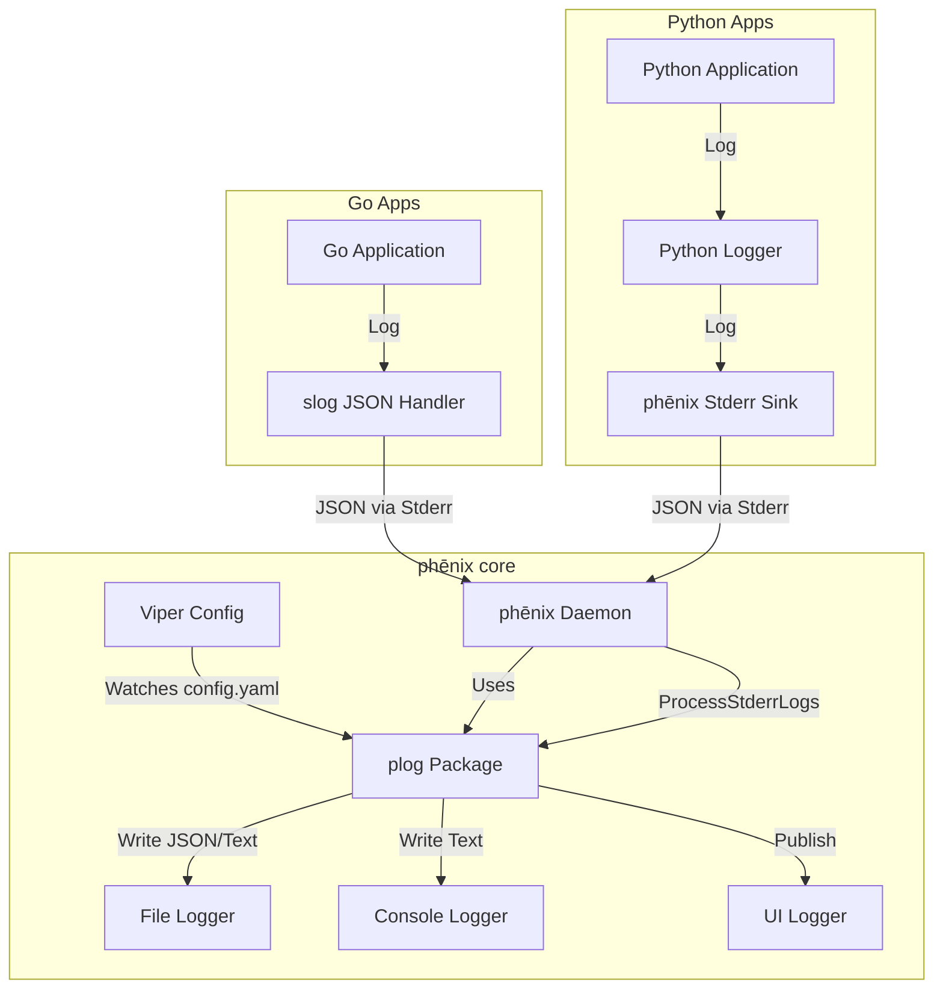

# Logging

phēnix features a centralized logging system that aggregates logs from the core daemon, internal Go services, and external user applications.

## Architecture

The logging architecture is designed to be **centralized**. The phēnix core acts as the aggregator, capturing `stderr` from all running applications, parsing the output as JSON, and ingesting it into the centralized logging system.



## CLI Verbosity (`--log.level`)

You can temporarily increase or decrease log verbosity for any command by using the global `--log.level` flag.

```bash
phenix <command> --log.level=<level>
```

This is useful when troubleshooting because it only affects that command invocation.

### Available Levels

phēnix supports the following log levels for `--log.level`:

* `debug`: Most verbose output for troubleshooting.
* `info`: Default level. Normal operational messages.
* `warn`: Warnings and errors.
* `error`: Errors only.
* `none`: Suppress all standard log output.

!!! note
    Level names are case-insensitive (for example, `DEBUG` and `debug` are equivalent).

### Examples

Use higher verbosity to inspect behavior while running a command:

```bash
# Run the UI with debug logging for this invocation
phenix ui --log.level=debug

# Show only warnings and errors while listing experiments
phenix exp list --log.level=warn

# Keep command output quiet unless an error occurs
phenix config get --log.level=error Role/vm-admin
```

To change the default level for all future commands, use settings:

```bash
phenix settings set log.level debug
```

To revert and use the configured default again for subsequent commands:

```bash
phenix settings unset log.level
```

## The App Contract

All applications (Go or Python) running under phēnix must adhere to the following contract to ensure their logs are correctly parsed and displayed in the UI:

1. **Output**: Logs must be written to `stderr`.
2. **Format**: Logs must be single-line **JSON** objects.
3. **Required Fields**:
    * `level`: `DEBUG`, `INFO`, `WARN`, `ERROR`
    * `msg`: The log message string.
    * `time`: Timestamp (RFC3339 or similar).
4. **Optional Fields**:
    * `traceback`: For exceptions/panics (string).

!!! tip
    Check out the [Example Applications](examples.md#example-applications) for complete, runnable reference implementations in Go and Python.

### Python Apps

Use the `phenix_apps.common.logger`. It is pre-configured to output JSON to stderr.

!!! important
    For fatal errors, **raise an exception** (e.g., `ValueError`, `RuntimeError`) instead of calling `sys.exit(1)`. The `AppBase` class wraps execution in a try/except block and will automatically catch the exception, log the traceback as structured JSON, and exit cleanly.

```python
from phenix_apps.common.logger import logger

def my_func():
    try:
        logger.bind(custom_field="value").info("Starting operation")
        # ... code ...
    except Exception:
        # Automatically captures traceback and formats as JSON
        logger.exception("Operation failed")
```

### Go Apps

Use `log/slog` with a JSON handler.

```go
import (
    "log/slog"
    "os"
)

func main() {
    logger := slog.New(slog.NewJSONHandler(os.Stderr, nil))
    slog.SetDefault(logger)

    slog.Info("Application started", "app", "my-app")
}
```

### phēnix Core

Use the `phenix/util/plog` package for logging within the core application.

```go
import "phenix/util/plog"

func MyFunc() {
    // Always provide a LogType enum for UI filtering
    plog.Info(plog.TypeSystem, "System initialized", "version", "1.0")
}
```

The log types are `AUDIT`, `SECURITY`, `SOH`, `SCORCH`, `PHENIX-APP`, `ACTION`,
`HTTP`, `MINIMEGA` and `SYSTEM`. Web handlers log `AUDIT` records with the
`phenix/web/audit` package rather than with `plog` directly (see
[Audit Events](#audit-events)).

### HTTP Request Logging

To view detailed HTTP request logs (method, path, status, duration), start the UI with the `--log-requests` flag.

## The Logs Page

The web UI's Logs page shows the system log's entries, oldest first, and
follows new entries as the server logs them. It needs `get` on `logs`.

* The **Logs shown** box at the top left counts the entries that pass the
  date range, level, type and search filters. When the filters hide some, it
  also says how many were loaded, such as `Logs shown 120 of 4,000`.
* The **Level** column shows each entry's level as a short badge: `DBG`
  (dark gray), `INFO` (blue), `WRN` (yellow) and `ERR` (red). A level the page
  does not know shows its own name in uppercase. Hold the pointer over a badge
  to see the full level name.
* The **phēnix log** and **minimega log** buttons at the top right download
  the log files themselves (see [Downloading Log Files](#downloading-log-files)).

### Downloading Log Files

**phēnix log** downloads the system log file (`log.system.path`) as it is
when the download starts, without its rotated files. **minimega log**
downloads the file that `ui.logs.minimega-path` names, which the `phenix ui`
server must be able to read; in a container deployment, mount minimega's log
into the phēnix container. A file that cannot be downloaded has its button
grayed out, and the button's tooltip says why, such as `the minimega log file
is not configured (set ui.logs.minimega-path)`. The page checks the files
again every 30 seconds and after it reconnects, so a button comes on once its
file appears.

Through the API, `GET /logs/files` lists both files and whether each can be
downloaded now, and `GET /logs/files/phenix` or `GET /logs/files/minimega`
downloads one. A download also answers `HEAD` and resumes with `Range` (see
[Downloads](api.md#downloads)). Both routes need `get` on `logs`, and each
download is audited as `log-download`.

```bash
curl -OJ -H "X-Phenix-Auth-Token: Bearer $TOKEN" \
  https://phenix.example.com/api/v1/logs/files/phenix
```

## Audit Events

The web API logs an audit event, a record of type `AUDIT`, for each
security-relevant action: who signed in or out, or sent a request with a
missing, expired or otherwise refused token; created, changed or deleted a
user, config or experiment; applied a workflow or changed the settings;
started or stopped an experiment, an app, a SCORCH run or a netflow capture;
changed a VM's settings or optical disc, or powered it on or off; read a
packet capture or downloaded a netflow capture; opened a console, VNC session
or port forward; changed a disk image; uploaded, downloaded or deleted a file;
or downloaded a log file. Signing in and out, and
refused tokens, are logged only as these events, not as `SECURITY` records. Its fields follow the
[Elastic Common Schema](https://www.elastic.co/guide/en/ecs/current/index.html)
(ECS) as flat dotted keys, so the system log file can be shipped to
Elasticsearch as it is.

Each audited action is logged with one of three outcomes:

* **Success** (`INFO`): the action worked. `event.outcome` is `success`.
* **Refused** (`WARN`): the user's role does not allow it. `event.outcome` is
  `failure`, `event.type` also holds `denied`, and `event.reason` says why:
  `forbidden`, or for example `not owner` for another user's console and
  `outside mount` for a path outside a VM's mount.
* **Failed** (`WARN`): the role allows it, but it failed. `event.outcome` is
  `failure` and `error.message` holds the error. A failed sign-in, with an
  unknown user or a wrong password, is a failure whose `error.message` is
  `invalid credentials`, so the two cannot be told apart.

A request refused before its permission is checked, such as one with a
malformed body or a disk path outside the minimega files directory, is not
audited, except for a request the API refuses for its token (see
[Refused Tokens](#refused-tokens)). Neither is a sign-in request that names no user or password. An
audit event never holds a password or a token: a sign-in's `user.name` is the
user it named, and a token's event names only its user and expiry.

### Audited Actions

| `event.action` | `event.category` | `event.type` | Routes |
| :--- | :--- | :--- | :--- |
| `sign-in` | `authentication` | `start` | `GET`, `POST /login`, by password or through a proxy (`phenix.auth.method`); `POST /signup`, once the user is created |
| `sign-out` | `authentication` | `end` | `POST /logout` |
| `user-create` | `iam` | `creation` | `POST /users`, `POST /signup` (as the user signing up) |
| `user-update` | `iam` | `change` | `PATCH /users/{username}` changing a first or last name (`phenix.user.changed`) |
| `user-role-change` | `iam` | `change` | `PATCH /users/{username}` with a `role_name`; refused, and the role left as it is, without `patch` on `users/roles` (a `role_name` equal to the user's current role is not refused) |
| `user-password-change` | `iam` | `change` | `PATCH /users/{username}` with a `new_password` |
| `user-delete` | `iam` | `deletion` | `DELETE /users/{username}`; refused for the user's own account (`event.reason` `own user`) |
| `user-token-create` | `iam` | `creation` | `POST /users/{username}/tokens` |
| `request-auth` | `authentication` | `info` | any API or file server request refused for its token (`event.reason`), at most once a minute for each client address and reason (see [Refused Tokens](#refused-tokens)) |
| `config-create` | `configuration` | `creation` | `POST /configs`, `POST /workflow/configs/{branch}` for a new config (and its refusal by a role that may neither create nor update configs), and `PUT /configs/{kind}/{name}` refusals of the new name it renames a config to |
| `config-update` | `configuration` | `change` | `PUT /configs/{kind}/{name}`, `POST /workflow/configs/{branch}` for a stored config |
| `config-delete` | `configuration` | `deletion` | `DELETE /configs/{kind}/{name}` |
| `workflow-apply` | `configuration` | `change` | `POST /workflow/apply/{branch}` (`phenix.workflow.branch`, `phenix.workflow.action`) |
| `settings-update` | `configuration` | `change` | `POST /settings` (`phenix.settings.changed`) |
| `experiment-create` | `configuration` | `creation` | `POST /experiments` |
| `experiment-update` | `configuration` | `change` | `PATCH /experiments/{name}` |
| `experiment-schedule` | `configuration` | `change` | `POST /experiments/{name}/schedule` |
| `experiment-delete` | `configuration` | `deletion` | `DELETE /experiments/{name}` |
| `experiment-start` | `host` | `start` | `POST /experiments/{name}/start` |
| `experiment-stop` | `host` | `end` | `POST /experiments/{name}/stop` |
| `app-trigger` | `process` | `start` | `POST /experiments/{name}/trigger` (`phenix.app.names`) |
| `app-trigger-cancel` | `process` | `end` | `DELETE /experiments/{name}/trigger` |
| `scorch-start` | `process` | `start` | `POST .../scorch/pipelines/{run}`, `POST .../scorch/pipelines/{run}/cleanup` (`phenix.scorch.cleanup_only`) |
| `scorch-cancel` | `process` | `end` | `DELETE .../scorch/pipelines/{run}` |
| `scorch-clear` | `process` | `change` | `POST .../scorch/pipelines/{run}/clear` |
| `scorch-terminal-exit` | `process` | `end` | `POST .../scorch/terminals/{pid}/exit/{id}` |
| `vm-start` | `host` | `start` | `POST .../vms/{name}/start`, `POST .../vms/actions` with `start` (one event per VM) |
| `vm-stop` | `host` | `end` | `POST .../vms/{name}/stop`, `POST .../vms/actions` with `pause` |
| `vm-shutdown` | `host` | `end` | `POST .../vms/{name}/shutdown`, `POST .../vms/actions` with `shutdown` |
| `vm-restart` | `host` | `change` | `POST .../vms/{name}/restart`, `POST .../vms/actions` with `restart` |
| `vm-reset-disk` | `host` | `change` | `POST .../vms/{name}/reset`, `POST .../vms/actions` with `resetDisk` |
| `vm-redeploy` | `host` | `change` | `POST .../vms/{name}/redeploy` |
| `vm-kill` | `host` | `end` | `DELETE .../vms/{name}`, `POST .../vms/actions` with `kill` |
| `vm-update` | `configuration` | `change` | `PATCH .../vms/{name}`, `PATCH /experiments/{exp}/vms` (one event per VM), naming the settings changed in `phenix.vm.changed`; refused (`event.reason` `port forwards not allowed`) for annotations that start port forwards the role may not create |
| `vm-cdrom-change`, `vm-cdrom-eject` | `host` | `change` | `POST .../vms/{name}/cdrom` (the disc in `file.path`), `DELETE .../vms/{name}/cdrom` |
| `capture-start` | `network` | `start` | `POST .../vms/{name}/captures`, `POST .../captureSubnet` (one event per VM) |
| `capture-stop` | `network` | `end` | `DELETE .../vms/{name}/captures`, `POST .../stopCaptureSubnet` (one event per VM) |
| `capture-stream` | `network` | `access` | `GET .../captures/{iface}/stream`, `GET /webshark/streams/{token}` |
| `capture-webshark-open` | `network` | `access` | `POST /experiments/{exp}/webshark` |
| `capture-webshark-read` | `network` | `access` | `GET /webshark/captures/{name}` (once per grant), `GET /webshark/json?method=download` (once per download) |
| `capture-token-create` | `iam` | `creation` | `POST /experiments/{exp}/captureTokens` |
| `capture-token-revoke` | `iam` | `deletion` | `DELETE /experiments/{exp}/captureTokens/{id}` |
| `netflow-start`, `netflow-stop` | `network` | `start`, `end` | `POST /experiments/{exp}/netflow`, `DELETE /experiments/{exp}/netflow` |
| `netflow-download` | `file` | `access` | `GET /experiments/{exp}/netflow/captures/{id}` (once per download, not per resumed range or `HEAD`), naming the capture and format in `phenix.netflow.capture` and `phenix.netflow.format`, and for CSV and JSONL the flows written and lines skipped in `phenix.netflow.flows` and `phenix.netflow.skipped` |
| `file-download` | `file` | `access` | `GET /experiments/{name}/files/{filename}` (downloads and the Files tab's viewer), `POST .../files/download` (one event per file sent, including those sent before the download failed), `GET .../vms/{name}/files/download`, `GET /jobs/{id}/artifact` of an archive job (one event per file archived); refusals of `GET .../files/{filename}/checksum` and `POST .../files/archive`, and archive jobs that fail or are canceled |
| `file-upload` | `file` | `creation` | the file server's upload page (one event per file) |
| `file-delete` | `file` | `deletion` | `DELETE /experiments/{name}/files/{filename}`, `POST .../files/delete` (one event per file) |
| `console-create` | `process` | `start` | `POST /console` |
| `console-attach` | `process` | `access` | `GET /console/{pid}/ws`; refusals of `GET /console/{pid}` and `POST /console/{pid}/size`, and of another user's console on any console route |
| `console-terminate` | `process` | `end` | `DELETE /console/{pid}` |
| `console-end` | `process` | `end` | none: a console ended, for any reason |
| `vnc-attach` | `session` | `start` | `GET .../vms/{name}/vnc/ws`; refusals of `GET .../vms/{name}/vnc` |
| `port-forward-attach` | `network` | `connection` | `GET .../vms/{name}/forwards/{host}/{port}/ws` |
| `disk-snapshot`, `disk-clone` | `file` | `creation` | `POST /disks/snapshot`, `POST /disks/clone`, `POST /disks/clone/jobs` |
| `disk-rename`, `disk-commit`, `disk-rebase`, `disk-resize` | `file` | `change` | `POST /disks/rename`, `/disks/commit`, `/disks/rebase`, `/disks/resize` |
| `disk-delete` | `file` | `deletion` | `DELETE /disks` |
| `disk-upload` | `file` | `creation` | `POST /disks` |
| `disk-download` | `file` | `access` | `GET /disks/download`; refusals of `GET /disks/checksum` |
| `vm-snapshot`, `vm-commit`, `vm-memory-snapshot` | `file` | `creation` | `POST .../vms/{name}/snapshots`, `/commit`, `/memorySnapshot` |
| `vm-restore` | `file` | `change` | `POST .../vms/{name}/snapshots/{snapshot}` |
| `vm-mount`, `vm-unmount` | `session` | `start`, `end` | `POST .../vms/{name}/mount`, `DELETE .../vms/{name}/unmount` |
| `vm-file-upload`, `vm-file-copy` | `file` | `creation` | `PUT .../vms/{name}/files/upload`, `POST .../vms/{name}/files/copy` |
| `log-download` | `file` | `access` | `GET /logs/files/{name}`, naming the log file in `phenix.log.name` |

A download is audited once, however many requests resuming it take: for a `GET`
answered with the whole file, or with a range starting at its first byte.

An action run as a [background job](jobs.md) is audited when the job finishes,
not when the request starting it is answered: as the user who started it,
without the request's `source.ip`, `http.request.method` and `url.path`, and
with the job's ID in `phenix.job.id`. A job canceled before its work was done
is a failure with `error.message` `canceled`. A request starting the job is
audited only when refused, or when it fails before the job starts. A bulk VM
action job (`POST .../vms/actions`) is audited once for each VM: the VMs the
role may not act on as refusals when the job is asked for, and the others when
it finishes, those it did not get to before it was canceled as failures.

A workflow apply or workflow config upsert with `dryRun=true` checks what it
would do and changes nothing: it is audited with `phenix.dry_run` `true` and
`event.type` `info` in place of the action's own, so it never reads as a
change. A request over the Unix socket, such as those of `phenix workflow
apply`, has no web user or client address: it is audited without `user.name`
and `source.ip`, with `phenix.auth.method` `unix-socket` and the socket's
`Global Admin` role in `user.roles`.

Starting an experiment's apps or a SCORCH run is audited when the run starts;
how the run ends is in the `SCORCH` and `SYSTEM` logs. A Role or User config
changed through `/configs` is audited as a config action, with
`phenix.config.name` naming it. The files
of an archive job are audited when its archive is downloaded, by the user
downloading it, and only those archived, including any cut short, not those its
`MISSING.txt` lists as left out.

### Fields

| Field | Holds |
| :--- | :--- |
| `type` | `AUDIT` |
| `@timestamp` | when, in UTC (RFC 3339) |
| `event.kind`, `event.module`, `event.dataset` | `event`, `phenix`, `phenix.audit` |
| `event.action`, `event.category`, `event.type` | the action, as in the table above; `event.type` is a list |
| `event.outcome`, `event.reason`, `error.message` | the outcome, a refusal's reason, a failure's error |
| `user.name`, `user.roles` | the user, and their role |
| `user.target.name`, `user.target.roles` | the user a user action acted on, and the role it gave them |
| `phenix.user.changed` | the names a `user-update` changed: `first_name`, `last_name` |
| `phenix.auth.method` | how a user signed in: `password`, `proxy-header` or `proxy-jwt`; or `unix-socket` for any request over the Unix socket |
| `phenix.auth.claimed_user` | the user a refused proxy JWT names; any client could have forged it (see [Refused Tokens](#refused-tokens)) |
| `phenix.suppressed` | the token refusals from the same client address and reason not audited since the last one that was |
| `phenix.workflow.branch`, `phenix.workflow.action` | the branch a workflow or workflow config was sent for, and the action the apply planned (`create`, `createAndStart`, `update`, `updateAndStart`, `restart` or `none`) |
| `phenix.dry_run` | `true` for a dry run, which changed nothing |
| `phenix.experiment.force` | `true` for an experiment stop forced with `?force=true`, which marks the experiment stopped even if minimega could not kill its VMs |
| `phenix.settings.changed`, `phenix.settings.values` | the settings a `settings-update` changes, as `category.name`, and their new values, other than any that could be a secret |
| `phenix.vm.changed` | the VM settings a `vm-update` changes, without their values: `cpus`, `memory`, `disk`, `inject_partition`, `interface`, `tags`, `do_not_boot`, `host`, `snapshot`, `annotations` |
| `phenix.token.expires` | when a created token expires |
| `phenix.config.name`, `phenix.config.new_name` | the config acted on, as `Kind/name`, and the name an update renames it to |
| `phenix.app.names` | the apps a trigger names, as the request's `apps` gives them |
| `phenix.schedule.algorithm` | a schedule's algorithm |
| `phenix.scorch.run`, `phenix.scorch.cleanup_only`, `phenix.scorch.running` | a SCORCH run, whether only its cleanup stage was started, and whether a canceled run was executing |
| `source.ip` | the address of the client that sent the request |
| `network.forwarded_ip` | the first address in the request's `X-Forwarded-For` header, when it has one, cut to 64 bytes |
| `http.request.method`, `url.path` | the request's method and path, cut to 1,024 bytes; never its query, which can carry a token |
| `http.request.range` | a download's `Range` header, when it has one |
| `phenix.experiment.name`, `phenix.vm.name`, `phenix.vm.interface` | the experiment, VM and interface acted on |
| `file.path`, `file.name` | the file acted on |
| `phenix.file.target_path` | the file the action wrote or named: a new image, a backing image, a copy's or upload's destination |
| `file.size` | the bytes an upload wrote |
| `process.pid` | a console's or SCORCH terminal's process |
| `phenix.file.capture`, `phenix.file.preview` | whether a downloaded file is a packet capture, and whether it was shown in the Files tab's viewer |
| `phenix.netflow.capture`, `phenix.netflow.format` | the netflow capture downloaded, by its ID, and the format it was downloaded as: `text`, `csv` or `jsonl` |
| `phenix.netflow.flows`, `phenix.netflow.skipped` | the flows a CSV or JSONL netflow download wrote, and the lines it left out because they do not parse |
| `phenix.file.count` | the files a failed bulk action, such as a download, deletion or archive job, asked for |
| `phenix.job.id` | the background job that did the action, or built the archive downloaded |
| `phenix.capture.subnet` | a subnet capture's subnet |
| `phenix.capability.id`, `phenix.capability.op`, `phenix.capability.ops`, `phenix.capability.expires` | a capture grant's ID (never its token), the operation used or those granted, and when it ends |
| `phenix.log.name` | the log file a `log-download` asked for: `phenix` or `minimega` |
| `phenix.webshark.live` | whether a capture opened in WebShark is still running |
| `phenix.console.end_reason` | why a console ended: `user` (ended from the UI), `idle` (no websocket attached for 15 seconds), `shutdown` (the server stopped) or `exited` (its process exited) |
| `phenix.disk.size`, `phenix.disk.unsafe` | a resize's size and a rebase's `unsafe` |
| `phenix.mount.path` | where a VM's disk is mounted |
| `destination.address`, `destination.port`, `phenix.forward.owner` | a port forward's destination, and the user who created it |

`source.ip` is the address the connection came from: behind a reverse proxy, it
is the proxy's. `network.forwarded_ip` is copied from a header any client can
send, so it is not verified.

A request authorized by a capture grant (see [WebShark](webshark.md)) is
audited as the user the grant was given to, and its `url.path` is the route's
template, such as `/webshark/streams/{token}`, so the token is never logged.

### Refused Tokens

A request to the API, the file server or a health probe that the server
refuses for its credentials is audited as a `request-auth` failure, with
`event.reason` saying why:

* `missing`: no token, on a route that needs one.
* `malformed`: a token or `X-Phenix-Auth-Token` header that does not parse.
* `invalid`: a token with a bad signature, or one that names no user.
* `expired`: a token past its expiry.
* `revoked`: a token its user no longer holds, after signing out or
  deleting it.
* `unknown-user`, `no-role`: a token naming a user that does not exist, or
  whose role cannot be read.
* `proxy-user-mismatch`: a proxy's user header naming another user than the
  token.

`user.name` is the user the token names, when it was read from a token whose
signature was checked, and empty otherwise. With `proxy-jwt`, the server does
not check a token's signature, so any client that reaches it directly can
name any user: the user a refused proxy JWT names is in
`phenix.auth.claimed_user` instead, and is not who sent the request. Either
user is cut to 128 bytes. The token itself is never logged. A browser tab left open with an expired token
can poll many times a minute, so only the first refusal each minute from a
client address (`source.ip`) for a reason is audited; the next one audited
counts those skipped in `phenix.suppressed`. The server remembers at most
1,024 addresses and reasons; past that, refusals from new addresses share one
count for each reason.

### Where Audit Events Go

Audit events are always written to the system log file (`log.system.path`,
`/var/log/phenix/phenix.log` by default), whatever `log.level` is, `none`
included. The console and the Logs page's live view follow `log.level` and
`ui.logs.level` as for any other record, so with either at `warn` they show only
refusals and failures; reloading the Logs page reads the file and shows every
audit event. Like other logs, they are shown to roles with `get` on `logs`. On
the Logs page, choose `AUDIT` in the Type filter, and search for a field, such
as `event.action=disk-delete` or `user.name=alice`.

Actions taken with the `phenix` CLI, such as `phenix vm capture` or
`phenix image`, have no web user and are not audited, other than those
`phenix workflow apply` sends through the Unix socket. Neither are a
WebShark capture's watch requests or the console's resize and status checks,
other than their refusals, nor reads that change nothing, such as `GET`
requests for configs, the running netflow capture or the list of recorded
netflow captures.

### Shipping Audit Events with Filebeat

The system log file holds one JSON record per line. This Filebeat (7.17 or
later) input ships its audit events, with their own `@timestamp`:

```yaml
filebeat.inputs:
  - type: filestream
    id: phenix-audit
    paths:
      - /var/log/phenix/phenix.log
    parsers:
      - ndjson:
          target: ""
          overwrite_keys: true
          expand_keys: true
    processors:
      - drop_event:
          when:
            not:
              equals:
                type: AUDIT
      - rename:
          fields:
            - from: msg
              to: message
            - from: level
              to: log.level
          ignore_missing: true
      - drop_fields:
          fields: [time]
          ignore_missing: true
```

!!! tip "Troubleshooting"
    For common logging issues and solutions, please see the [Troubleshooting](troubleshooting.md) page.
