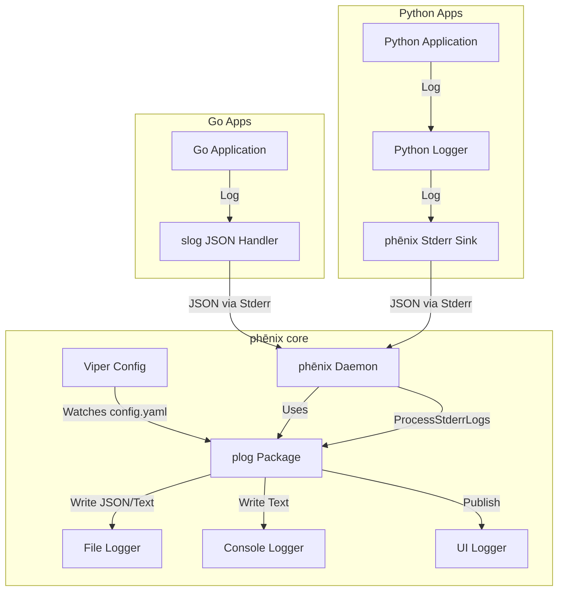

# Logging

phēnix features a centralized logging system that aggregates logs from the core daemon, internal Go services, and external user applications.

## Architecture

The logging architecture is designed to be **centralized**. The phēnix core acts as the aggregator, capturing `stderr` from all running applications, parsing the output as JSON, and ingesting it into the centralized logging system.



## CLI Verbosity (`--log.level`)

You can temporarily increase or decrease log verbosity for any command by using the global `--log.level` flag.

```bash
phenix <command> --log.level=<level>
```

This is useful when troubleshooting because it only affects that command invocation.

### Available Levels

phēnix supports the following log levels for `--log.level`:

* `debug`: Most verbose output for troubleshooting.
* `info`: Default level. Normal operational messages.
* `warn`: Warnings and errors.
* `error`: Errors only.
* `none`: Suppress all standard log output.

!!! note
    Level names are case-insensitive (for example, `DEBUG` and `debug` are equivalent).

### Examples

Use higher verbosity to inspect behavior while running a command:

```bash
# Run the UI with debug logging for this invocation
phenix ui --log.level=debug

# Show only warnings and errors while listing experiments
phenix exp list --log.level=warn

# Keep command output quiet unless an error occurs
phenix config get --log.level=error Role/vm-admin
```

To change the default level for all future commands, use settings:

```bash
phenix settings set log.level debug
```

To revert and use the configured default again for subsequent commands:

```bash
phenix settings unset log.level
```

## The App Contract

All applications (Go or Python) running under phēnix must adhere to the following contract to ensure their logs are correctly parsed and displayed in the UI:

1. **Output**: Logs must be written to `stderr`.
2. **Format**: Logs must be single-line **JSON** objects.
3. **Required Fields**:
    * `level`: `DEBUG`, `INFO`, `WARN`, `ERROR`
    * `msg`: The log message string.
    * `time`: Timestamp (RFC3339 or similar).
4. **Optional Fields**:
    * `traceback`: For exceptions/panics (string).

!!! tip
    Check out the [Example Applications](examples.md#example-applications) for complete, runnable reference implementations in Go and Python.

### Python Apps

Use the `phenix_apps.common.logger`. It is pre-configured to output JSON to stderr.

!!! important
    For fatal errors, **raise an exception** (e.g., `ValueError`, `RuntimeError`) instead of calling `sys.exit(1)`. The `AppBase` class wraps execution in a try/except block and will automatically catch the exception, log the traceback as structured JSON, and exit cleanly.

```python
from phenix_apps.common.logger import logger

def my_func():
    try:
        logger.bind(custom_field="value").info("Starting operation")
        # ... code ...
    except Exception:
        # Automatically captures traceback and formats as JSON
        logger.exception("Operation failed")
```

### Go Apps

Use `log/slog` with a JSON handler.

```go
import (
    "log/slog"
    "os"
)

func main() {
    logger := slog.New(slog.NewJSONHandler(os.Stderr, nil))
    slog.SetDefault(logger)

    slog.Info("Application started", "app", "my-app")
}
```

### phēnix Core

Use the `phenix/util/plog` package for logging within the core application.

```go
import "phenix/util/plog"

func MyFunc() {
    // Always provide a LogType enum for UI filtering
    plog.Info(plog.TypeSystem, "System initialized", "version", "1.0")
}
```

The log types are `AUDIT`, `SECURITY`, `SOH`, `SCORCH`, `PHENIX-APP`, `ACTION`,
`HTTP`, `MINIMEGA` and `SYSTEM`. Web handlers log `AUDIT` records with the
`phenix/web/audit` package rather than with `plog` directly (see
[Audit Events](#audit-events)).

### HTTP Request Logging

To view detailed HTTP request logs (method, path, status, duration), start the UI with the `--log-requests` flag.

## Audit Events

The web API logs an audit event, a record of type `AUDIT`, for each
security-relevant action.

### Audited Actions

| `event.action` | `event.category` | `event.type` | Routes |
| :--- | :--- | :--- | :--- |
| `sign-in` | `authentication` | `start` | `GET`, `POST /login`, by password or through a proxy (`phenix.auth.method`); `POST /signup`, once the user is created |
| `sign-out` | `authentication` | `end` | `POST /logout` |
| `user-create` | `iam` | `creation` | `POST /users`, `POST /signup` (as the user signing up) |
| `user-update` | `iam` | `change` | `PATCH /users/{username}` changing a first or last name (`phenix.user.changed`) |
| `user-role-change` | `iam` | `change` | `PATCH /users/{username}` with a `role_name`; refused, and the role left as it is, without `patch` on `users/roles` (a `role_name` equal to the user's current role is not refused) |
| `user-password-change` | `iam` | `change` | `PATCH /users/{username}` with a `new_password` |
| `user-delete` | `iam` | `deletion` | `DELETE /users/{username}`; refused for the user's own account (`event.reason` `own user`) |
| `user-token-create` | `iam` | `creation` | `POST /users/{username}/tokens` |
| `request-auth` | `authentication` | `info` | any API or file server request refused for its token (`event.reason`), at most once a minute for each client address and reason |
| `config-create` | `configuration` | `creation` | `POST /configs`, `POST /workflow/configs/{branch}` for a new config (and its refusal by a role that may neither create nor update configs), and `PUT /configs/{kind}/{name}` refusals of the new name it renames a config to |
| `config-update` | `configuration` | `change` | `PUT /configs/{kind}/{name}`, `POST /workflow/configs/{branch}` for a stored config |
| `config-delete` | `configuration` | `deletion` | `DELETE /configs/{kind}/{name}` |
| `workflow-apply` | `configuration` | `change` | `POST /workflow/apply/{branch}` (`phenix.workflow.branch`, `phenix.workflow.action`) |
| `settings-update` | `configuration` | `change` | `POST /settings` (`phenix.settings.changed`) |
| `experiment-create` | `configuration` | `creation` | `POST /experiments` |
| `experiment-update` | `configuration` | `change` | `PATCH /experiments/{name}` |
| `experiment-schedule` | `configuration` | `change` | `POST /experiments/{name}/schedule` |
| `experiment-delete` | `configuration` | `deletion` | `DELETE /experiments/{name}` |
| `experiment-start` | `host` | `start` | `POST /experiments/{name}/start` |
| `experiment-stop` | `host` | `end` | `POST /experiments/{name}/stop` |
| `app-trigger` | `process` | `start` | `POST /experiments/{name}/trigger` (`phenix.app.names`, `phenix.app.stage`) |
| `app-trigger-cancel` | `process` | `end` | `DELETE /experiments/{name}/trigger` |
| `scorch-start` | `process` | `start` | `POST .../scorch/pipelines/{run}`, `POST .../scorch/pipelines/{run}/cleanup` (`phenix.scorch.cleanup_only`) |
| `scorch-cancel` | `process` | `end` | `DELETE .../scorch/pipelines/{run}` |
| `scorch-clear` | `process` | `change` | `POST .../scorch/pipelines/{run}/clear` |
| `scorch-terminal-exit` | `process` | `end` | `POST .../scorch/terminals/{pid}/exit/{id}` |
| `vm-start` | `host` | `start` | `POST .../vms/{name}/start`, `POST .../vms/actions` with `start` (one event per VM) |
| `vm-stop` | `host` | `end` | `POST .../vms/{name}/stop`, `POST .../vms/actions` with `pause` |
| `vm-shutdown` | `host` | `end` | `POST .../vms/{name}/shutdown`, `POST .../vms/actions` with `shutdown` |
| `vm-restart` | `host` | `change` | `POST .../vms/{name}/restart`, `POST .../vms/actions` with `restart` |
| `vm-reset-disk` | `host` | `change` | `POST .../vms/{name}/reset`, `POST .../vms/actions` with `resetDisk` |
| `vm-redeploy` | `host` | `change` | `POST .../vms/{name}/redeploy` |
| `vm-kill` | `host` | `end` | `DELETE .../vms/{name}`, `POST .../vms/actions` with `kill` |
| `vm-update` | `configuration` | `change` | `PATCH .../vms/{name}`, `PATCH /experiments/{exp}/vms` and `POST /experiments/{exp}/vms/resetSettings` (one event per VM), `PUT` and `DELETE .../vms/{name}/interfaces/{iface}/qos` (`qos`), naming the settings changed in `phenix.vm.changed`; refused (`event.reason` `port forwards not allowed`) for annotations that start port forwards the role may not create |
| `vm-cdrom-change`, `vm-cdrom-eject` | `host` | `change` | `POST .../vms/{name}/cdrom` (the disc in `file.path`), `DELETE .../vms/{name}/cdrom` |
| `capture-start` | `network` | `start` | `POST .../vms/{name}/captures`, `POST .../captureSubnet` (one event per VM), `POST .../captureVlan` (one event per capture, `phenix.capture.vlan`), `POST /experiments/{exp}/captures` (`phenix.capture.id`) |
| `capture-stop` | `network` | `end` | `DELETE .../vms/{name}/captures`, `POST .../stopCaptureSubnet` (one event per VM), `POST .../stopCaptureVlan` (one event per capture, `phenix.capture.vlan`), `DELETE /experiments/{exp}/captures/{id}` (`phenix.capture.id`) |
| `capture-stream` | `network` | `access` | `GET .../captures/{iface}/stream`, `GET /experiments/{exp}/captures/{id}/stream` (`phenix.capture.id`), `GET /webshark/streams/{token}` |
| `capture-webshark-open` | `network` | `access` | `POST /experiments/{exp}/webshark` (`phenix.capture.id` for an experiment capture) |
| `capture-webshark-read` | `network` | `access` | `GET /webshark/captures/{name}` (once per grant), `GET /webshark/json?method=download` (once per download) |
| `capture-token-create` | `iam` | `creation` | `POST /experiments/{exp}/captureTokens` |
| `capture-token-revoke` | `iam` | `deletion` | `DELETE /experiments/{exp}/captureTokens/{id}` |
| `netflow-start`, `netflow-stop` | `network` | `start`, `end` | `POST /experiments/{exp}/netflow`, `DELETE /experiments/{exp}/netflow` |
| `netflow-download` | `file` | `access` | `GET /experiments/{exp}/netflow/captures/{id}` (once per download, not per resumed range or `HEAD`), naming the capture and format in `phenix.netflow.capture` and `phenix.netflow.format`, and for CSV and JSONL the flows written and lines skipped in `phenix.netflow.flows` and `phenix.netflow.skipped` |
| `file-download` | `file` | `access` | `GET /experiments/{name}/files/{filename}` (downloads and the Files tab's viewer), `POST .../files/download` (one event per file sent, including those sent before the download failed), `GET .../vms/{name}/files/download`, `GET /jobs/{id}/artifact` of an archive job (one event per file archived); refusals of `GET .../files/{filename}/checksum` and `POST .../files/archive`, and archive jobs that fail or are canceled |
| `file-upload` | `file` | `creation` | the file server's upload page (one event per file) |
| `file-delete` | `file` | `deletion` | `DELETE /experiments/{name}/files/{filename}`, `POST .../files/delete` (one event per file) |
| `console-create` | `process` | `start` | `POST /console` |
| `console-attach` | `process` | `access` | `GET /console/{pid}/ws`; refusals of `GET /console/{pid}` and `POST /console/{pid}/size`, and of another user's console on any console route |
| `console-terminate` | `process` | `end` | `DELETE /console/{pid}` |
| `console-end` | `process` | `end` | none: a console ended, for any reason |
| `vnc-attach` | `session` | `start` | `GET .../vms/{name}/vnc/ws`; refusals of `GET .../vms/{name}/vnc` |
| `port-forward-attach` | `network` | `connection` | `GET .../vms/{name}/forwards/{host}/{port}/ws` |
| `disk-snapshot`, `disk-clone` | `file` | `creation` | `POST /disks/snapshot`, `POST /disks/clone`, `POST /disks/clone/jobs` |
| `disk-rename`, `disk-commit`, `disk-rebase`, `disk-resize` | `file` | `change` | `POST /disks/rename`, `/disks/commit`, `/disks/rebase`, `/disks/resize` |
| `disk-delete` | `file` | `deletion` | `DELETE /disks`; refused (`event.reason` `in use`) for an image that other images or experiments use, and `phenix.disk.force` for a forced delete |
| `disk-upload` | `file` | `creation` | `POST /disks` |
| `disk-download` | `file` | `access` | `GET /disks/download`; refusals of `GET /disks/checksum` |
| `vm-snapshot`, `vm-commit`, `vm-memory-snapshot` | `file` | `creation` | `POST .../vms/{name}/snapshots`, `/commit`, `/memorySnapshot` |
| `vm-restore` | `file` | `change` | `POST .../vms/{name}/snapshots/{snapshot}` |
| `vm-mount`, `vm-unmount` | `session` | `start`, `end` | `POST .../vms/{name}/mount`, `DELETE .../vms/{name}/unmount` |
| `vm-file-upload`, `vm-file-copy` | `file` | `creation` | `PUT .../vms/{name}/files/upload`, `POST .../vms/{name}/files/copy` |
| `log-download` | `file` | `access` | `GET /logs/files/{name}`, naming the log file in `phenix.log.name` |

!!! tip "Troubleshooting"
    For common logging issues and solutions, please see the [Troubleshooting](troubleshooting.md) page.
