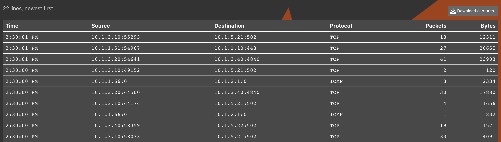

# Experiment Netflow

The minimega platform supports [netflow
capture](https://sandia-minimega.github.io/minimega/reference/minimega/#capture), wherein flows
through an Open vSwitch bridge can be parsed into an ASCII format and forwarded
to a remote endpoint for additional consumption.

phēnix extends this capability by collecting an experiment's netflow records
from minimega and streaming them to the web UI over a WebSocket. The only
requirement for enabling netflow for an experiment is that the experiment be
configured to use a bridge name that is not the default `phenix` bridge. This
can be done automatically for all experiments by enabling [auto bridge mode](bridge-mode.md),
or per-experiment via the UI by expanding the `Advanced Options` section when
creating a new experiment and providing the `Default Bridge Name` setting.

{: width=400 .center}

!!! note
    The `Default Bridge Name` field is only shown when the server is running in
    `manual` bridge mode. In `auto` mode the bridge name is always the
    experiment name, so the field is hidden.

This can also be done via the CLI by providing the `--default-bridge, -b` option
when using the `phenix exp create` subcommand.

!!! warning
    As mentioned above, the experiment netflow capability **will not work** if a
    default bridge name is not explicitly specified for an experiment. This is
    to prevent network flows across multiple experiments from being captured.

## Usage

Running experiments have a green network button in the button row to the right
of the VM search box, alongside the red button that stops the experiment and the
heartbeat button that opens [State of Health](state-of-health.md). Its tooltip
reads `Start Netflow Capture`. Clicking it starts netflow capture for the
non-default bridge the experiment is configured to use for all VM network
interfaces.

{: width=800 .center}

The button spins while a capture is starting or stopping. Once the capture is
running the button turns red and its tooltip reads `Stop Netflow Capture`. To
stop netflow capture for the experiment, click the red button. If you return to
a running experiment that is already capturing, the page joins the capture in
progress and the button is red straight away.

The `Netflow` tab is the last tab of the running experiment, and it is always
there for users whose role can read netflow. Until flows arrive it reads
`No netflow captures yet. Start one with the netflow button above.`

Captured flows are shown as a table with `Time`, `Source`, `Destination`,
`Protocol`, `Packets` and `Bytes` columns, newest flow first. `Source` and
`Destination` are each an address and port, and `Protocol` is named for the
protocols phēnix knows (`ICMP`, `TCP`, `UDP` and `ICMPv6`) and is otherwise the
IP protocol number. The table is sized to the window, so the page footer stays
on screen as flows come in. Starting and stopping a capture add their own rows,
so the table also records when each capture ran.

{: width=800 .center}

The line above the table reports how many flows the tab is holding. The live
view keeps the 10,000 most recent flows and shows the newest 500 of them; every
flow is also recorded, as described in [Recorded Captures](#recorded-captures).

With the `Netflow` tab active, the search box reads `Search netflow` and filters
the flows already collected, on their time, addresses and protocol. The count
above the table then reports how many of the collected flows match.

!!! note
    A capture stops on its own when the experiment stops, and a capture started
    in one browser window can be stopped from another. If the capture has
    already stopped on the server, stopping it resets the button and says so
    instead of reporting an error.

## Recorded Captures

phēnix records every netflow capture as it streams it, to the experiment's
files as `netflow/<id>.txt`, where `<id>` is the capture's UTC start time, such
as `20261028T153012.345Z`. The file holds every line minimega sent, exactly as
it arrived, one flow per line:

```text
2026-10-28T09:30:12-06:00	1.5s	6	10.0.0.1:1234	<->	10.0.0.2:443	2	2048
```

The fields are the flow's start time, its duration, the IP protocol number, the
source and destination address and port, and its packet and byte counts. The
file also appears in the [Files](experiments.md#experiment-files) tab, where it can be viewed,
downloaded and deleted like any other experiment file.

The `Download captures` button beside the line above the table, shown even
before any flows arrive, opens a list of the experiment's recorded captures,
newest first, with when each started and stopped, its flow count and its size.
Each capture downloads in three formats:

| Format | File | Contents |
| :--- | :--- | :--- |
| Text | `<exp>-netflow-<id>.txt` | The recorded lines, unchanged. The download can be resumed. |
| CSV | `<exp>-netflow-<id>.csv` | One row per flow, under a header row of the field names below. |
| JSONL | `<exp>-netflow-<id>.jsonl` | One JSON object per flow per line, with the field names below as keys. |

CSV and JSONL name the fields as the
[Elastic Common Schema](https://www.elastic.co/guide/en/ecs/current/index.html)
does, so the files load into Elasticsearch, a spreadsheet or a script as they
are:

| Field | Value |
| :--- | :--- |
| `event.start` | When the flow started, in UTC (RFC 3339) |
| `event.end` | When the flow ended, in UTC (RFC 3339) |
| `event.duration` | The flow's duration in nanoseconds |
| `source.ip`, `source.port` | The source address and port |
| `destination.ip`, `destination.port` | The destination address and port |
| `network.transport` | The protocol's IANA name, such as `tcp`, `udp` or `icmp`; empty in CSV, and left out of JSONL, for a protocol without one |
| `network.iana_number` | The IP protocol number |
| `network.packets`, `network.bytes` | The flow's packet and byte counts |

A line that does not parse as a flow is kept in the text download but left out
of CSV and JSONL. The audit event of the download counts the lines left out
(see [Logging](logging.md)).

A capture still running is listed as `Recording`, and downloads as it was when
the download started. A capture the phēnix server did not finish, because the
server stopped or restarted while it was recording, is listed as `Interrupted`
and its flow count as `Unknown`; its recorded flows still download.

Each capture records at most `ui.netflow.max-size` megabytes, 100 by default
(see [Settings](settings.md)). A capture that reaches the limit, or hits a
write error, stops recording, is marked `Truncated`, and goes on streaming to
the `Netflow` tab; while it runs it is listed as `Live only`. `0` turns
recording off. If a capture cannot be recorded, for example because the disk is
full, it still starts and streams, and the server logs the error.

!!! note
    phēnix records every netflow datagram it reads, but on a busy bridge or a
    slow disk the host can drop datagrams before phēnix reads them, without
    counting them. phēnix asks for a 4 MiB receive buffer, which Linux limits
    to `net.core.rmem_max`; raise that on the host (for example
    `sysctl -w net.core.rmem_max=4194304`) for the larger buffer to take
    effect.

!!! warning
    Captures are not authenticated. phēnix records every datagram that reaches
    the capture's UDP port, whoever sent it, so a host that can reach the
    phēnix server can add lines to a capture, or fill it to its size limit.
    Limit who can reach the server's UDP ports.

Recorded captures stay after the experiment stops, and are never deleted
automatically. Stop a capture before deleting its `netflow/<id>.txt` in the
Files tab. When an experiment is deleted, its captures stay in
`<base-dir.phenix>/images/<exp>/files/netflow/` with no route to them, as its
packet captures do; an experiment created later with the same name lists them
again. Remove that directory on the host to clean up.

Downloading a capture needs the `experiments/netflow` `get` permission, the same
as the `Netflow` tab. The text file is also reachable through the Files tab,
with the `experiments/files` `get` permission. There is no CLI command for
recorded captures; use the API routes `GET /api/v1/experiments/{name}/netflow/captures`
and `GET /api/v1/experiments/{name}/netflow/captures/{id}?format=text|csv|jsonl`
(see the [API](api.md)).
