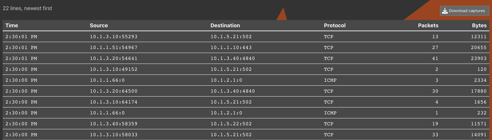

# Experiment Netflow

The minimega platform supports [netflow
capture](https://sandia-minimega.github.io/minimega/reference/minimega/#capture), wherein flows
through an Open vSwitch bridge can be parsed into an ASCII format and forwarded
to a remote endpoint for additional consumption.

phēnix extends this capability by collecting an experiment's netflow records
from minimega and streaming them to the web UI over a WebSocket. The only
requirement for enabling netflow for an experiment is that the experiment be
configured to use a bridge name that is not the default `phenix` bridge. This
can be done automatically for all experiments by enabling [auto bridge mode](bridge-mode.md),
or per-experiment via the UI by expanding the `Advanced Options` section when
creating a new experiment and providing the `Default Bridge Name` setting.

{: width=400 .center}

!!! note
    The `Default Bridge Name` field is only shown when the server is running in
    `manual` bridge mode. In `auto` mode the bridge name is always the
    experiment name, so the field is hidden.

This can also be done via the CLI by providing the `--default-bridge, -b` option
when using the `phenix exp create` subcommand.

!!! warning
    As mentioned above, the experiment netflow capability **will not work** if a
    default bridge name is not explicitly specified for an experiment. This is
    to prevent network flows across multiple experiments from being captured.

## Usage

Running experiments have a green network button to the right of the VM search
box, beside the red button that stops the experiment. Its tooltip reads
`Start Netflow Capture`. Clicking it starts netflow capture on the bridge the
experiment is configured to use, for all VM network interfaces.

{: width=800 .center}

Once the capture is running, the button turns red and its tooltip reads
`Stop Netflow Capture`. Click it to stop the capture. A capture also stops on
its own when the experiment stops, and a capture started in one browser window
can be stopped from another.

The `Netflow` tab, the last tab of the running experiment, shows the captured
flows as a table with `Time`, `Source`, `Destination`, `Protocol`, `Packets`
and `Bytes` columns, newest first. Until the first line arrives, the tab shows
`Waiting for netflow lines from the running capture.` The line above the table counts the flows
it holds, and the search box filters them by time, address and protocol.
Starting and stopping a capture add their own rows, so the table also records
when each capture ran.

{: width=800 .center}

## Recorded Captures

phēnix records every netflow capture to the experiment's files as
`netflow/<id>.txt`, where `<id>` is the capture's UTC start time. The file
holds every line minimega sent, one flow per line:

```text
2026-10-28T09:30:12-06:00	1.5s	6	10.0.0.1:1234	<->	10.0.0.2:443	2	2048
```

The fields are the flow's start time, its duration, the IP protocol number,
the source and destination address and port, and its packet and byte counts.
The file also appears in the experiment's [Files](experiment-files.md) tab,
where it can be viewed, downloaded and deleted like any other experiment file.

The `Download captures` button above the table lists the experiment's
recorded captures, newest first, with when each started and stopped, its flow
count and its size. Each capture downloads in three formats:

| Format | File | Contents |
| :--- | :--- | :--- |
| Text | `<exp>-netflow-<id>.txt` | The recorded lines, unchanged. The download can be resumed. |
| CSV | `<exp>-netflow-<id>.csv` | One row per flow, under a header row of the field names below. |
| JSONL | `<exp>-netflow-<id>.jsonl` | One JSON object per flow per line, with the field names below as keys. |

CSV and JSONL name the fields as the
[Elastic Common Schema](https://www.elastic.co/guide/en/ecs/current/index.html)
does, so the files load into Elasticsearch, a spreadsheet or a script as they
are:

| Field | Value |
| :--- | :--- |
| `event.start`, `event.end` | When the flow started and ended, in UTC (RFC 3339) |
| `event.duration` | The flow's duration in nanoseconds |
| `source.ip`, `source.port` | The source address and port |
| `destination.ip`, `destination.port` | The destination address and port |
| `network.transport` | The protocol's IANA name, such as `tcp`, `udp` or `icmp`, when it has one |
| `network.iana_number` | The IP protocol number |
| `network.packets`, `network.bytes` | The flow's packet and byte counts |

A line that does not parse as a flow is kept in the text download but left
out of CSV and JSONL.

Each capture records at most `ui.netflow.max-size` megabytes, 100 by default
(see [Settings Reference](settings.md#settings-reference)). A capture that
reaches the limit stops recording, is marked `Truncated`, and goes on
streaming to the `Netflow` tab. A capture the server did not finish, because
it stopped while recording, is listed as `Interrupted`.

!!! note
    On a busy bridge or a slow disk, the host can drop netflow datagrams
    before phēnix reads them. Raise `net.core.rmem_max` on the host (for
    example `sysctl -w net.core.rmem_max=4194304`) to give phēnix a larger
    receive buffer.

!!! warning
    Captures are not authenticated. A host that can reach the phēnix server's
    UDP ports can add lines to a capture, or fill it to its size limit. Limit
    who can reach those ports.

Recorded captures stay after the experiment stops, and are never deleted
automatically. Stop a capture before deleting its file in the `Files` tab.
When an experiment is deleted, its captures stay in
`<base-dir.phenix>/images/<exp>/files/netflow/`. Remove that directory on the
host to clean up.

Downloading a capture needs the `experiments/netflow` `get` permission, the
same as the `Netflow` tab. The same list and downloads are available through
the [API](api.md) and the command line.

## From the Command Line Binary

The `phenix exp netflow` commands call the running `phenix ui` server through
its unix socket, because the capture runs in that server (see
[phenix experiment](cli/experiment.md#phenix-experiment-netflow)).

```bash
phenix exp netflow start <experiment name>
phenix exp netflow status <experiment name>
phenix exp netflow stop <experiment name>

# List the recorded captures, then write one as CSV
phenix exp netflow captures <experiment name>
phenix exp netflow download <experiment name> <capture ID> --format csv -O flows.csv
```

`--format` is `text` (the default), `csv` or `jsonl`. Without `-O`, the
capture goes to standard output.
