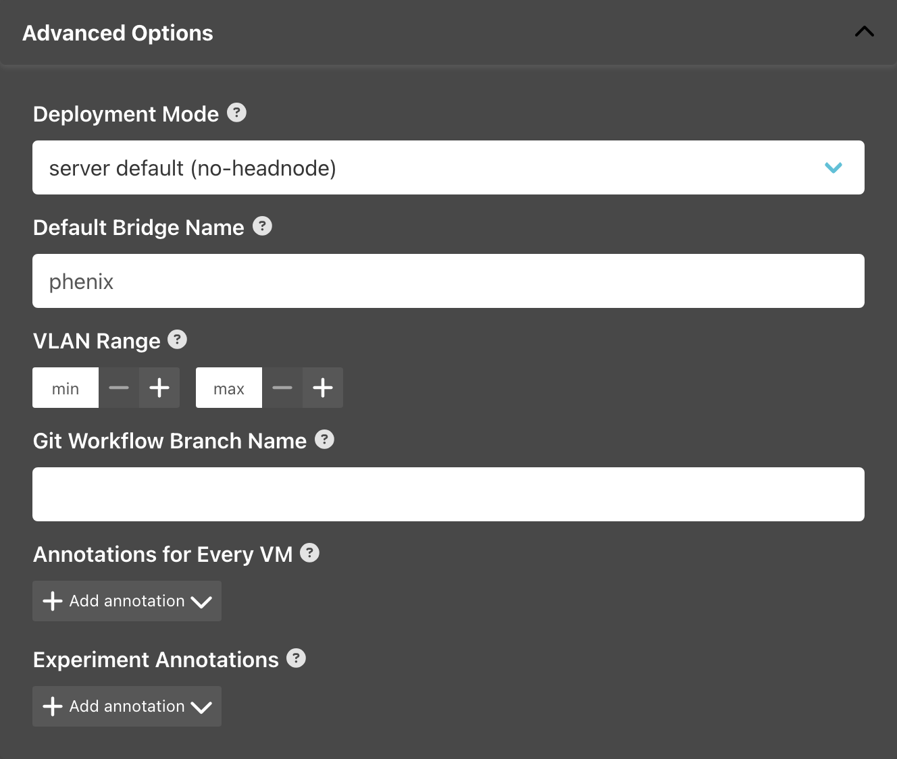
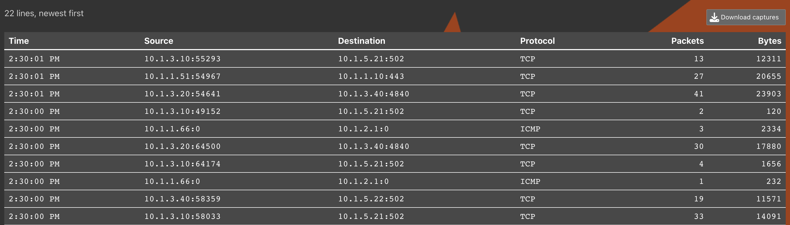

# Experiment Netflow

The minimega platform supports [netflow
capture](https://sandia-minimega.github.io/minimega/reference/minimega/#capture), wherein flows
through an Open vSwitch bridge can be parsed into an ASCII format and forwarded
to a remote endpoint for additional consumption.

phēnix extends this capability by making the minimega netflow ASCII format
available for streaming over WebSockets for experiments. The only requirement
for enabling netflow for an experiment is that the experiment be configured to
use a bridge name that is not the default `phenix` bridge. This can be done
automatically for all experiments by enabling [auto bridge mode](bridge-mode.md),
or per-experiment via the UI by expanding the `Advanced Options` section when
creating a new experiment and providing the `Default Bridge Name` setting.

{: width=400 .center}

!!! note
    The `Default Bridge Name` field is only shown when the server is running in
    `manual` bridge mode. In `auto` mode the bridge name is always the
    experiment name, so the field is hidden.

This can also be done via the CLI by providing the `--default-bridge, -b` option
when using the `phenix exp create` subcommand.

!!! warning
    As mentioned above, the experiment netflow capability **will not work** if a
    default bridge name is not explicitly specified for an experiment. This is
    to prevent network flows across multiple experiments from being captured.

## Usage

Running experiments will have a green network icon to the right of the VM search
box that, when clicked, will start netflow capture for the non-default bridge
the experiment is configured to use for all VM network interfaces.

{: width=800 .center}

Once enabled, the icon will turn red (to signify it can be stopped), and the
`Netflow` tab of the running experiment will be updated with a
table of netflow data from minimega as it streams in. Until the first line
arrives, the tab shows `Waiting for netflow lines from the running capture.`
The start and stop of each capture get their own rows.

{: width=800 .center}

To stop netflow capture for the experiment, click the red network icon. A
capture also stops when the experiment stops.

## Recorded Captures

phēnix records every capture to the experiment's files as `netflow/<id>.txt`,
where `<id>` is the capture's UTC start time. Each line is one flow as
minimega sent it (the `6` is the IP protocol number):

```text
2026-10-28T09:30:12-06:00	1.5s	6	10.0.0.1:1234	<->	10.0.0.2:443	2	2048
```

You can view, download and delete the file in the experiment's
[Files](experiments.md#experiment-files) tab, but stop the capture before you delete it.

The `Download captures` button above the `Netflow` table lists the recorded
captures and downloads each one as text (`<exp>-netflow-<id>.txt`, the lines
unchanged), CSV (`.csv`, one row per flow) or JSONL (`.jsonl`, one JSON object
per flow per line). CSV and JSONL use
[Elastic Common Schema](https://www.elastic.co/guide/en/ecs/current/index.html)
field names: `event.start` and `event.end` (UTC, RFC 3339), `event.duration` (in
nanoseconds), `source.ip`, `source.port`, `destination.ip`,
`destination.port`, `network.transport` (the protocol's IANA name, such as
`tcp`, when it has one), `network.iana_number`, `network.packets` and
`network.bytes`. Lines that don't parse as a flow are only in the text
download.

Each capture records at most `ui.netflow.max-size` megabytes, 100 by default
(see [Settings Reference](settings.md#settings-reference)). A capture that hits
the limit stops recording and is marked `Truncated`, but keeps streaming to the
`Netflow` tab. One that a server stop cut off is marked `Interrupted`.

Recorded captures are never deleted automatically, not even with the
experiment. To clean up, remove `<base-dir.phenix>/images/<exp>/files/netflow/`
on the host.

On a busy bridge or a slow disk, the host can drop netflow datagrams before
phēnix reads them. Raise `net.core.rmem_max` on the host (for example
`sysctl -w net.core.rmem_max=4194304`) to give phēnix a larger receive buffer.

!!! warning
    Captures are not authenticated. A host that can reach the phēnix server's
    UDP ports can add lines to a capture, or fill it to its size limit. Limit
    who can reach those ports.

## Command Line

The `phenix exp netflow` commands do the same, through a running `phenix ui`:

```bash
phenix exp netflow start my-exp
phenix exp netflow status my-exp
phenix exp netflow stop my-exp

# list the recorded captures, then download one as CSV
phenix exp netflow captures my-exp
phenix exp netflow download my-exp 20261028T153012.345Z --format csv -O flows.csv
```

Without `-O`, the download goes to standard output. See
[phenix experiment netflow](cli/experiment.md#phenix-experiment-netflow) for
all of the options.

## See Also

* [Packet Captures](packet-captures.md): capture the packets themselves, not just the flows.
