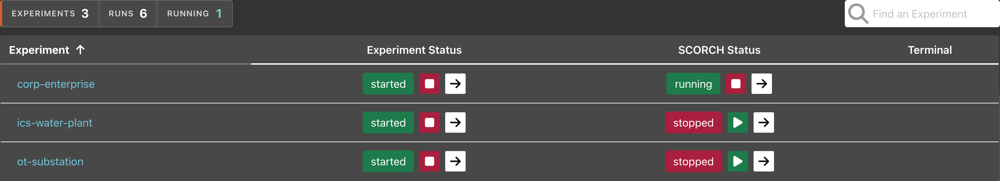
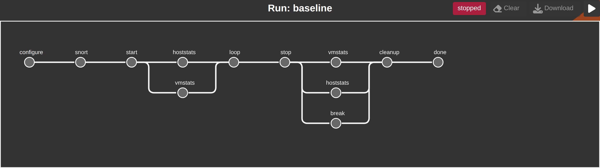
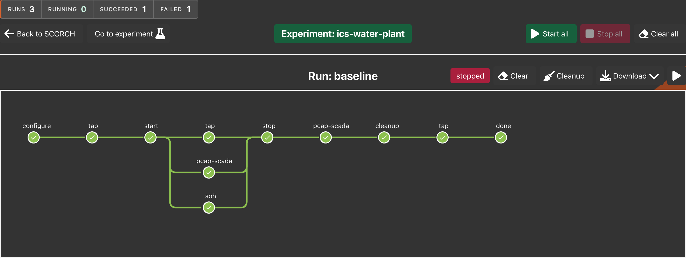
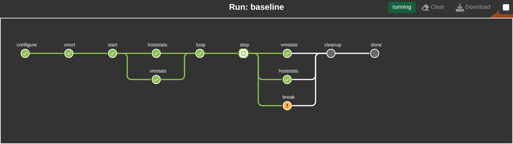
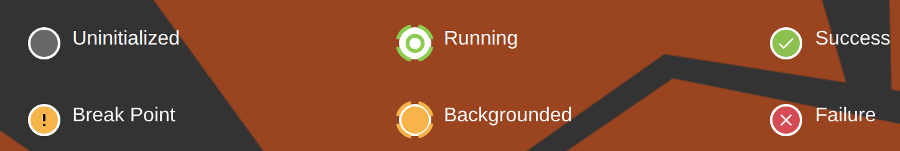
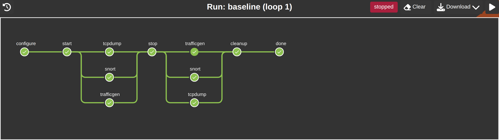
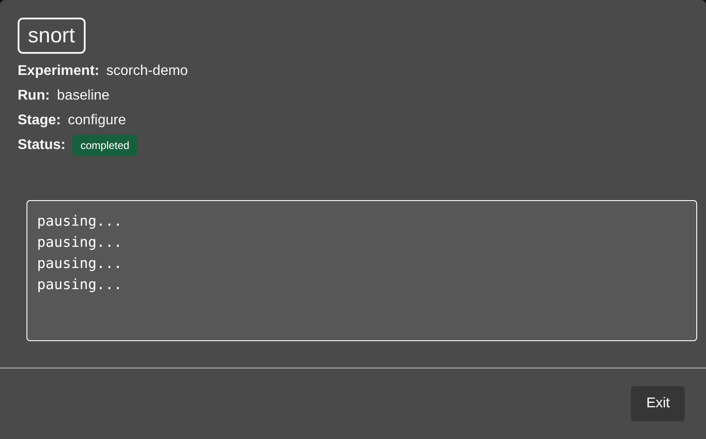
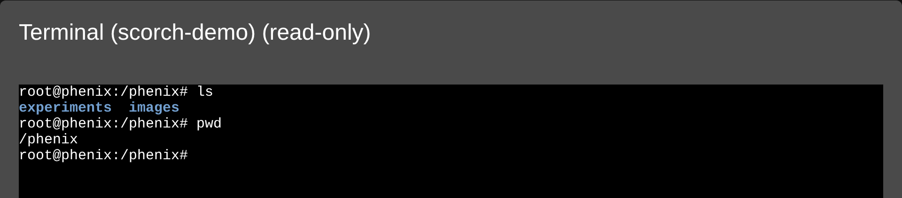
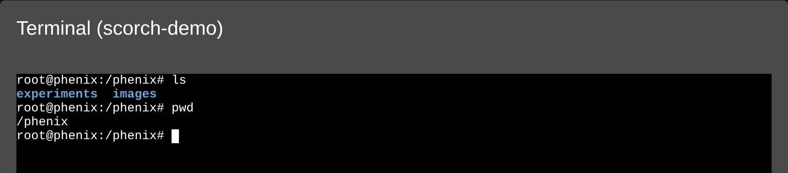
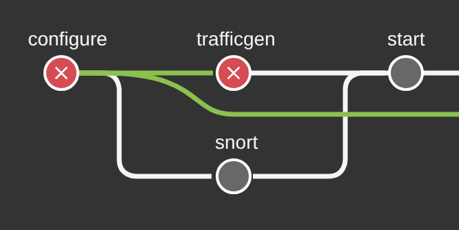

# Scorch

Scorch &mdash; **SC**enario **ORCH**estration &mdash; is an automated scenario orchestration framework within phēnix. It is included in phēnix as a [core app](apps.md#additional-core-apps). The development of the Scorch framework was motivated by the need to facilitate rigorous experimentation. Some advantages of Scorch include the ability to run many repeated scenarios on an experiment with consistency and minimal overhead. Scorch also provides the ability to efficiently capture experimental data for retrieval and analysis.

A phēnix [scenario](configuration.md#scenario) configuration file is used to define and configure the Scorch app for use on a topology. The Scorch app is meant to allow for the staging of [Scorch components](#scorch-components) in sequence to execute against a running experiment. When applied to a given topology, the Scorch app will be available in the [Scorch table](#scorch-table) to execute and then observe, manipulate in some cases, and review output from available components for a given [stage](#stages) in the [Scorch pipeline](#scorch-pipeline).

The [configuration file](#example-configuration) and most of the screenshots in the rest of this document are from an example Scorch scenario, `scorch-demo`.

## Scorch Components

A Scorch component is simply an executable available to be called by the Scorch app within phēnix. A component is expected to implement any or all of the various [stages](#stages) in the [Scorch pipeline](#scorch-pipeline).

For an executable to be considered a Scorch component, it must meet the following requirements:

1. Follow the `phenix-scorch-component-<type>` naming convention, where `<type>` is the component type used in the Scorch app configuration. An example would be `phenix-scorch-component-tcpdump`.
1. Be an executable file.
1. Be in the `PATH` of the user running phēnix.

Scorch runs the executable for each component type that is not a [built-in component](#built-in-components). If the executable is not in the `PATH`, the component fails. [phenix doctor](doctor.md#checks) lists the components in the `PATH` and warns when a scenario uses one that is not installed.

When the Scorch app executes a Scorch component, it will pass a number of positional arguments to the component via the command line, as well as the JSON representation of the experiment the component is to be executed against via STDIN. The positional arguments passed are as follows:

1. run stage (`configure`, `start`, `stop`, or `cleanup`)
1. component name (name given to component type in Scorch app configuration)
1. run ID (integer `>= 0` representing the array index of the Scorch run in the app configuration being executed)
1. loop (integer `>= 0` representing the current run loop being executed)
1. count (integer `>= 0` representing the current loop count being executed)

Scorch also sets these environment variables for the component: `PHENIX_DIR`, `PHENIX_FILES_DIR` (the files directory of the experiment), `PHENIX_LOG_LEVEL`, `PHENIX_LOG_FILE` (`stderr`), `PHENIX_DRYRUN`, and `PHENIX_SCORCH_STARTTIME` (the start time of the run).

!!! tip
    To see the JSON that a component gets on STDIN, run [`phenix util scorch-json <exp-name> <component-name>`](cli/util.md#phenix-util-scorch-json). The command writes the arguments and the `PHENIX_*` environment variables of the component to STDERR (not with `-o json`). Use `--run`, `--loop`, `--stage`, and `--count` to select the point in the run. The command stores nothing. The REST API gives the same JSON at `GET /api/v1/experiments/<exp-name>/scorch/components/<component-name>/input`, with the query parameters `run`, `loop`, `stage`, `count`, `replace`, and `runtime`. During a run, the `tap` and `break` components can add taps to the experiment status that later components get. The command does not show these taps.

During component execution, the Scorch app assumes anything written to STDOUT by a component is intended to be relayed to the user. Thus, when Scorch is run via the web UI, anything written to STDOUT gets streamed to the UI for viewing. Any error messages generated by a component should be written to the log file or to STDERR unless it's to also be relayed to the user directly. Scorch writes what a component writes to STDERR to the phēnix log as `SCORCH` entries. A line that follows [the app contract](logging.md#the-app-contract) keeps its level.

The Scorch app expects a component executable to exit with a value of `0` upon completion if the component was successful, and exit with any other value otherwise. An exit value of anything other than `0` will result in Scorch halting execution of the current stage and jumping to the next appropriate stage to complete the Scorch run. In the `stop` and `cleanup` stages, Scorch still executes the other components of the stage (see [Stages](#stages)).

### Component and Run Settings

The Scorch app is configured in the `metadata` of the `scorch` app in a [Scenario](configuration.md#scenario). Each item of `components` has these keys:

- `name`: the name that the runs use for the component.
- `type`: a [built-in component](#built-in-components), or the `<type>` of a `phenix-scorch-component-<type>` executable. It defaults to `name`.
- `background`: if `true`, a component in the `configure` or `start` stage runs in the background, and Scorch continues with the next component. Scorch stops it when the run executes the same component in the `cleanup` stage (for `configure`) or the `stop` stage (for `start`). `background` has no effect in the `stop` and `cleanup` stages, and no effect on the `break` and `tap` components.
- `metadata`: the settings of the component. Scorch applies the [replacements](#replace) to it before each execution.

Each item of `runs` has these keys:

- `name`: the name of the run in the web UI.
- `count`: the number of times to execute the run (default `1`). Each pass executes all the stages. If a pass fails, the run stops.
- `configure`, `start`, `stop` and `cleanup`: the names of the components to execute in that stage, in order.
- `loop`: a loop to execute after the `start` stage and before the `stop` stage (see [Stages](#stages)).
- `replace`: see [Replace](#replace).
- `filebeat`: see [Automated Component Data Collection](#automated-component-data-collection).

A `loop` has the same keys as a run, except `name` and `filebeat`. Its `count` is the number of times to execute the loop (default `1`).

### Automated Component Data Collection

The Scorch app is capable of generating a configuration file for and starting an instance of [Filebeat](https://www.elastic.co/beats/filebeat) in the background before execution of each Scorch run. As each Scorch component is executed, any data it generates and collects can be configured to be automatically processed by Filebeat for indexing in [Elasticsearch](https://www.elastic.co/elasticsearch/). At a minimum, this requires the following.

1. Filebeat to be enabled and configured in the Scorch app configuration.
1. A Filebeat input to be configured for each component generating and collecting data.
1. The `filebeat` executable installed and in the `PATH` of the user running phēnix.

The `filebeat` block of the Scorch app has these keys:

- `enabled`: if `true`, Scorch starts Filebeat for each run that has at least one Filebeat input.
- `config`: the Filebeat configuration. Scorch adds its own settings to it: the `scorch.experiment`, `scorch.run_id`, `scorch.run_name` (when the run has a name), `scorch.runtime` and `scorch.start_time` fields, the logging (level `warning` unless `logging.level` is set), the registry, and the inputs.
- `expNameAsIndexName`: if `true`, Scorch sets the Elasticsearch index to `experiment-<experiment-name>`.

A run can have its own `filebeat` block, which replaces the block of the app for that run. Scorch starts Filebeat only if the block of the app has `enabled: true`.

The `filebeat.inputs` of a component are Filebeat inputs. Scorch uses only the file name of each path, and reads that file in each `loop-<loop>-count-<count>` directory of the component. Thus, a component must write its data to `scorch/run-<run>/<component-name>/loop-<loop>-count-<count>/` in the files of the experiment (`PHENIX_FILES_DIR`). Scorch sets `scan_frequency` to `5s`, sets `close_inactive` to `5s` unless the input sets it, and adds the `scorch.itername` and `scorch.output_file` fields. After the run, Scorch waits for Filebeat to finish reading the files, then stops it.

See the [example configuration](#example-configuration) below for examples of how Filebeat and Filebeat inputs are configured in the Scorch app configuration.

## Built-in Components

The following Scorch component types are considered `core` components, in that they are included in the main phēnix repository and are available for use in Scorch app configurations by default.

| Component                 | Description                                                                         |
|---------------------------|-------------------------------------------------------------------------------------|
| [break](#break-component) | pauses the run and gives users a shell on the phēnix server until a user exits it   |
| [pause](#pause-component) | pauses the run for a configured duration                                            |
| [soh](#soh-component)     | runs the [State of Health](state-of-health.md) app at this point of the run         |
| [tap](#tap-component)     | creates a minimega tap, with optional external network access, for other components |

### `break` Component

The `break` component is comparable to a source code break point when debugging an application in that it pauses execution of the current Scorch run until a user exits the break. While the `break` component is running, users have access to a shell on the server running phēnix as the user running phēnix. The first user to access the shell via the terminal modal in the UI whose role may create `experiments/trigger` (the permission that starts a run) will have read-write access and can exit the break. Every other user whose role may get the experiment has read-only access but will get live updates as the user with read-write access uses the terminal.

The terminal has an `Exit` button for the user with read-write access, which exits the terminal and ends the break. Users with read-only access have a `Close` button, which closes the terminal window but does not exit the terminal. If the run executes in the process of [phenix experiment scorch](cli/experiment.md#phenix-experiment-scorch) (`phenix ui` is not running), the shell opens in the terminal of that command.

It's possible to configure the `break` component in the Scorch app configuration to create a minimega tap when the component is executed. When the component exits, the tap will be deleted. In addition to the tap, external network access can also be configured (e.g., Internet access). With a tap, the shell runs in the network namespace of the tap.

| Option | Type | Default | Description |
| ------ | ---- | ------- | ----------- |
| `tap` | map | none | A tap to create while the break runs, with the options of the [`tap`](#tap-component) component. |
| `readme` | string | none | Markdown text that the terminal shows (with `/usr/local/bin/glow`) in place of a shell. |

An example of configuring a `break` component to create a tap and configure external network access during the `configure` stage is as follows. The `break` component can be configured to run in any stage.

```yaml
spec:
  apps:
  - name: scorch
    metadata:
      components:
      - name: break-tap
        type: break
        metadata:
          tap:
            bridge: phenix
            vlan: MGMT
            ip: 172.16.33.25/16
            internetAccess: true
      runs:
      - configure: ["break-tap"]
```

### `pause` Component

The `pause` component is similar to the [`break`](#break-component) component in that it pauses execution of the current Scorch run, but instead of waiting for user intervention, the `pause` component waits for a configured duration before continuing.

```yaml
spec:
  apps:
  - name: scorch
    metadata:
      components:
      - name: pause-1m
        type: pause
        metadata:
          duration: 1m
      runs:
      - start:
        - pause-1m
```

The `duration` field accepts Go duration strings (e.g., `10s`, `1m30s`, `2h`). If not specified, it defaults to `10s`.

| Option | Type | Default | Description |
| ------ | ---- | ------- | ----------- |
| `duration` | string | `10s` | How long to pause. |
| `failStages` | list of stages | none | The stages in which the component fails after the pause, for example to test how a run handles a failure. |

To use random durations, use the [replace](#replace) feature with a distribution specification:

```yaml
spec:
  apps:
  - name: scorch
    metadata:
      components:
      - name: pause-random
        type: pause
        metadata:
          duration: "{{PAUSE_DURATION}}s"
      runs:
      - name: random-pause-run
        replace:
          "{{PAUSE_DURATION}}":
            type: int
            uniform:
              minimum: 5
              maximum: 10
        start:
        - pause-random
```

### `soh` Component

The `soh` component allows users to execute the [State of
Health](state-of-health.md) app at scheduled times throughout a Scorch run. This
is handy when, for example, other Scorch components might cause nodes in the
experiment to misbehave or fail.

The component can be configured to limit which
health checks are run, and can also be configured to fail if any of the health
checks fail. The log level can also be configured, which will limit what logs
get sent to the component's UI modal while the component is running.

The State of Health app must be configured in the scenario, and must have run
after the experiment started. If not, the component fails.

| Option | Type | Default | Description |
| ------ | ---- | ------- | ----------- |
| `checks` | list | all checks | The checks to run (see the example below). |
| `c2Timeout` | string | the `c2Timeout` of the soh app | The C2 timeout for this execution, as a Go duration string. |
| `failOnError` | bool | `false` | Fail the component if a check fails. |
| `logLevel` | string | `info` | The lowest level of the logs that the component shows: `debug`, `info`, `warn` or `error`. |

Each stage of the component writes its check results to
`scorch/run-<run>/<component>/loop-<loop>-count-<count>/soh-<stage>.json` in the
experiment's files (for example, `soh-start.json`).

```yaml
spec:
  apps:
  - name: scorch
    metadata:
      components:
      - name: health-check
        type: soh
        metadata:
          c2Timeout: 5s # if provided, will update the C2 timeout setting when this component runs the state of health app
          checks:       # default is to run all the following checks
            - network-config       # Ensure all nodes still have network configured per the topology. Will use `skipInitialNetworkConfigTests` setting in soh app config.
            - reachability         # Basic ICMP-based reachability testing. Will use `testReachability` setting in soh app config.
            - custom-reachability  # IP-based reachability testing (TCP or UDP). Will use `testCustomReachability` setting in soh app config.
            - files                # Ensure expected files exist in nodes. Will use `hostFiles` setting in soh app config.
            - files-absent         # Ensure files do not exist in nodes. Will use `hostFilesAbsent` setting in soh app config.
            - services             # Ensure expected services are running in nodes. Will use `hostServices` setting in soh app config.
            - processes            # Ensure processes are running in nodes. Will use `hostProcesses` setting in soh app config.
            - ports                # Ensure listeners are running in nodes. Will use `hostListeners` setting in soh app config.
            - docker               # Ensure Docker containers are up/healthy in nodes. Will use `dockerContainers` setting in soh app config.
            - custom               # Run custom tests in nodes. Will use `hostCustomTests` setting in soh app config.
            - cpu-load             # Gather CPU load stats from nodes.
            - flows                # Gather packet flows from ElasticSearch server. Requires `packetCapture` setting to be configured in soh app config.
          failOnError: true # default is false
          logLevel: debug   # default is info
      runs:
      - start: ["health-check"]
```

### `tap` Component

The `tap` component implements the exact same functionality described above in the [`break`](#break-component) component for creating a minimega tap and, optionally, external network access, but allows for the tap (and external network access, if configured) to exist while other components are executed (as opposed to only existing for the duration of the [`break`](#break-component) component).

| Option | Type | Default | Description |
| ------ | ---- | ------- | ----------- |
| `bridge` | string | the default bridge of the experiment | The bridge to add the tap to. |
| `vlan` | string | none (required) | The VLAN alias to tap. |
| `ip` | string | none | The IP address of the tap, in CIDR notation. Required for external access. |
| `externalAccess.enabled` | bool | `false` | Give the tapped VLAN external network access. |
| `internetAccess` | bool | `false` | The older name of `externalAccess.enabled`. |

The [tap app](apps.md#tap-app) section tells how phēnix creates a tap in a network namespace and gives it external network access.

An example of configuring a `tap` component to create a tap and configure external network access is as follows. The `tap` component can be configured to run in the `start` stage (create the tap), the `stop` stage (delete the tap), and the `cleanup` stage (delete the tap). Configuring the `tap` component in the `cleanup` stage ensures that the tap is deleted even if preceding stages or components fail or if the SCORCH run is cancelled.

```yaml
spec:
  apps:
  - name: scorch
    metadata:
      components:
      - name: tap-inet
        type: tap
        metadata:
          bridge: phenix
          vlan: MGMT
          ip: 172.16.33.25/16
          internetAccess: true
      runs:
      - start: ["tap-inet"]
        stop: ["tap-inet"]
        cleanup: ["tap-inet"]
```

**NOTE:** In deployments where `minimega` is running in a container on the headnode, and Docker networking is in use (e.g., the `minimega` container is **not** configured to use host networking), users will need to execute the following commands if access to the `minimega` tap created by the [`tap`](#tap-component) (or [`break`](#break-component)) component from the Docker host is required.

```shell
ovs-docker add-port phenix TDN minimega
docker exec -it minimega ovs-vsctl add-port phenix TDN
ovs-vsctl add-port phenix temp-tap tag=<vlan-ID> -- set interface temp-tap type=internal
```

The above commands assume the name of the minimega container is `minimega`. The name of the local tap created (in this case, `temp-tap`) can be whatever, but the value for the VLAN tag must match the numerical ID of the VLAN that's mapped to the VLAN alias used in the [`tap`](#tap-component) (or [`break`](#break-component)) component configuration. Run [`phenix vlan alias <experiment-name> <VLAN-alias>`](cli/vlan.md#phenix-vlan-alias) to print that ID.

!!! note
    Using host networking mode for the `minimega` container allows for all the above nonsense to be skipped.

## User-defined Components

The following Scorch component types have been developed external to the main phenix repository and are available in the [sceptre-phenix-apps](https://github.com/sandialabs/sceptre-phenix-apps/tree/main/src/python/phenix_apps/apps/scorch) repository, which also includes README-based documentation for each component. Most are developed in Python, and leverage common helper classes that ease the development of user components. The repository installs each component as a `phenix-scorch-component-<type>` executable, and also installs `phenix-scorch-validate`, which checks the component metadata in a scenario file before you run it.

| Component | Description |
| --------- | ----------- |
| [art](https://github.com/sandialabs/sceptre-phenix-apps/tree/main/src/python/phenix_apps/apps/scorch/art) | Runs Atomic Red Team attacks (MITRE ATT&CK techniques). |
| [caldera](https://github.com/sandialabs/sceptre-phenix-apps/tree/main/src/python/phenix_apps/apps/scorch/caldera) | Executes operations in [MITRE Caldera](https://caldera.mitre.org/) via the REST API. |
| [cc](https://github.com/sandialabs/sceptre-phenix-apps/tree/main/src/python/phenix_apps/apps/scorch/cc) | Runs commands and moves files on VMs through minimega Command and Control ([miniccc](https://sandia-minimega.github.io/minimega/training/miniclass/module-28/)). |
| [collector](https://github.com/sandialabs/sceptre-phenix-apps/tree/main/src/python/phenix_apps/apps/scorch/collector) | Collects and processes data from cyber-physical experiments and Scorch components. |
| [disruption](https://github.com/sandialabs/sceptre-phenix-apps/tree/main/src/python/phenix_apps/apps/scorch/disruption) | Orchestrates and executes disruption scenarios for cyber-physical experiments. |
| [erspan](https://github.com/sandialabs/sceptre-phenix-apps/tree/main/src/python/phenix_apps/apps/scorch/erspan) | Mirrors the traffic of an experiment, live, to a capture machine outside phēnix through an ERSPAN tunnel. |
| [ettercap](https://github.com/sandialabs/sceptre-phenix-apps/tree/main/src/python/phenix_apps/apps/scorch/ettercap) | Runs [Ettercap](https://github.com/Ettercap/ettercap). |
| [hoststats](https://github.com/sandialabs/sceptre-phenix-apps/tree/main/src/python/phenix_apps/apps/scorch/hoststats) | Collects resource utilization statistics on minimega hosts. |
| [iperf](https://github.com/sandialabs/sceptre-phenix-apps/tree/main/src/python/phenix_apps/apps/scorch/iperf) | Collects network performance measurements using [iperf3](https://github.com/esnet/iperf) or [rperf](https://github.com/opensource-3d-p/rperf). |
| [kafka](https://github.com/sandialabs/sceptre-phenix-apps/tree/main/src/python/phenix_apps/apps/scorch/kafka) | Filters and exports Kafka data as a CSV or JSON file. |
| [mm](https://github.com/sandialabs/sceptre-phenix-apps/tree/main/src/python/phenix_apps/apps/scorch/mm) | Runs minimega actions: packet captures, starting and stopping VMs, and connecting or disconnecting VM interfaces. |
| [opcexport](https://github.com/sandialabs/sceptre-phenix-apps/tree/main/src/python/phenix_apps/apps/scorch/opcexport) | Exports data from an OPC server to Elasticsearch. |
| [pcap](https://github.com/sandialabs/sceptre-phenix-apps/tree/main/src/python/phenix_apps/apps/scorch/pcap) | Collects PCAPs from VMs via minimega's `capture pcap` [API](https://sandia-minimega.github.io/minimega/training/miniclass/module-39/). |
| [pipe](https://github.com/sandialabs/sceptre-phenix-apps/tree/main/src/python/phenix_apps/apps/scorch/pipe) | Implements minimega `pipe` [API](https://sandia-minimega.github.io/minimega/training/miniclass/module-29/). |
| [providerdata](https://github.com/sandialabs/sceptre-phenix-apps/tree/main/src/python/phenix_apps/apps/scorch/providerdata) | Collects and verifies data from pybennu providers, such as the RTDS or OPALRT. |
| [qos](https://github.com/sandialabs/sceptre-phenix-apps/tree/main/src/python/phenix_apps/apps/scorch/qos) | Apply Quality of Service ([QoS](https://sandia-minimega.github.io/minimega/reference/minimega/#qos)) effects on network interfaces, including dropping packets (loss), delaying packets (delay), or limiting bandwidth (rate). |
| [rtds](https://github.com/sandialabs/sceptre-phenix-apps/tree/main/src/python/phenix_apps/apps/scorch/rtds) | Collects and verifies data from the Real-Time Dynamic Simulator (RTDS), and orchestrates the starting/stopping of RSCAD cases. |
| [snort](https://github.com/sandialabs/sceptre-phenix-apps/tree/main/src/python/phenix_apps/apps/scorch/snort) | Configures and runs [Snort](https://www.snort.org/). |
| [ssh](https://github.com/sandialabs/sceptre-phenix-apps/tree/main/src/python/phenix_apps/apps/scorch/ssh) | Executes commands on a remote host and copies files from it. |
| [tcpdump](https://github.com/sandialabs/sceptre-phenix-apps/tree/main/src/python/phenix_apps/apps/scorch/tcpdump) | Executes and collects and processes data from `tcpdump`. |
| [trafficgen](https://github.com/sandialabs/sceptre-phenix-apps/tree/main/src/python/phenix_apps/apps/scorch/trafficgen) | Network traffic generation. |
| [vmstats](https://github.com/sandialabs/sceptre-phenix-apps/tree/main/src/python/phenix_apps/apps/scorch/vmstats) | Collects resource utilization statistics from Linux VMs in the experiment, using the `vmstat` command. |

## Replace

!!! warning
    The `replace` feature applies changes to the entire component metadata. Please choose placeholder names carefully!

The `replace` feature allows dynamic substitution of values in component metadata at runtime. Replacements are defined per-run (or loop) and are resolved once at the start of each pass of the run/loop (see `count`), ensuring consistent values throughout that pass of the pipeline. This can be used to parameterize components, or introduce controlled randomness into experiments.

Replacements are defined in the `replace` block of a run or loop. Each key is a placeholder string that will be replaced in component metadata. The type specifies how the replacement value is determined. Replaces can be 'stacked' like below, where the `{{RAND1}}` is defined at the run level and carries through to all subordinate loops, but `{{OVERRIDE}}` is overridden in each interior loop.

The value of a placeholder is one of these:

- A list of values. Scorch selects one value at random.
- A distribution, with exactly one of `uniform` (`minimum` and `maximum`, default `0` to `10`), `gaussian` (`mean` and `stddev`, default `10` and `2`) or `exponential` (`mean`, default `10`). With `type: int`, Scorch rounds the value to an integer. Otherwise, the value is a float.

If a metadata string is only the placeholder, the string becomes the value with its type (for example, a number). Otherwise, Scorch replaces the placeholder with the value as text.

An example scorch run:

```yaml
- name: scorch
  metadata:
    components:
      - name: cc
        type: cc
        metadata:
          vms:
            - hostname: testy
              start:
                - type: exec
                  args: 'echo "We have picked RAND1: {{RAND1}}, RAND2: {{RAND2}}, RAND3: {{RAND3}}, override: {{OVERRIDE}}"'
    runs:
      - name: replacey
        replace:
          '{{RAND1}}': ['foo', 'bar', 'baz']
          '{{OVERRIDE}}': ['run']
        start: [ cc ]
        loop:
          count: 2
          replace:
            '{{RAND2}}':
              type: int
              uniform:
                minimum: 10
                maximum: 100
            '{{OVERRIDE}}': ['loop 1']
          start: [cc]
          loop:
            count: 3
            replace:
              '{{RAND3}}':
                type: float
                gaussian:
                  mean: 100.123
                  stddev: 10.456
              '{{OVERRIDE}}': ['loop 2']
            start: [cc]
```

Would result in the following commands:

```bash
echo "We have picked RAND1: bar, RAND2: {{RAND2}}, RAND3: {{RAND3}}, override: run"
echo "We have picked RAND1: bar, RAND2: 19, RAND3: {{RAND3}}, override: loop 1"
echo "We have picked RAND1: bar, RAND2: 19, RAND3: 86.97164992182161, override: loop 2"
echo "We have picked RAND1: bar, RAND2: 19, RAND3: 114.48324331867562, override: loop 2"
echo "We have picked RAND1: bar, RAND2: 19, RAND3: 95.97843337384487, override: loop 2"
echo "We have picked RAND1: bar, RAND2: 82, RAND3: {{RAND3}}, override: loop 1"
echo "We have picked RAND1: bar, RAND2: 82, RAND3: 91.0323724023587, override: loop 2"
echo "We have picked RAND1: bar, RAND2: 82, RAND3: 96.65899272237336, override: loop 2"
echo "We have picked RAND1: bar, RAND2: 82, RAND3: 94.85640056376343, override: loop 2"
```

The same resolved values are used across all stages (`configure`, `start`, `stop`, `cleanup`) and all subordinate loop iterations (until they are overridden). However, each new pass of a run or loop, and each new run of the same scorch pipeline, will generate new replacement values, allowing for variability across runs.

`phenix util scorch-json` selects the replacement values in the same way as a run, and writes them to STDERR (not with `-o json`). To set a value, use `--replace <key>=<value>`.

## Scorch Table

The Scorch table, accessible as one of the tab selections within the phēnix UI, lists all possible Scorch apps available based on the experiments established in phēnix. The following columns or functions are available:

- `Experiment`: the experiment name, which links to the experiment's [runs page](#runs-page)
- `Experiment Status`: this reports on the status of the experiment &mdash; an experiment must be running for a Scorch app to start. The buttons next to it [start or stop the experiment](experiments.md#starting-stopping-experiments) and open the [experiment's page](experiments.md#the-running-experiment-page).
- `SCORCH Status`: this will report the running or stopped status of the Scorch app itself. The buttons next to it start the first run or stop the run that is executing, and open the [runs page](#runs-page).
- `Terminal`: if the Scorch app has reached a break point, a terminal will be available &mdash; if clicked, a terminal dialog will be opened and is running on the phēnix host system
- `Find an Experiment`: similar to the search fields in other tables within the phēnix UI, it is possible to filter experiment names based on terms entered here

Each button is only shown if your role permits the action it takes.



## Scorch Pipeline

Scorch pipelines are available from the [Scorch table](#scorch-table) in the phēnix UI. The table is sorted by Experiment name by default. Only those experiments with the Scorch app configured in the [scenario](configuration.md#scenario) configuration will be listed in the table. It is possible to _start_ or _stop_ an experiment, as well as _start_ or _stop_ a Scorch run. Finally, if a terminal is available when a break point is reached in a running Scorch app, it can be accessed from the table.

The Scorch pipeline provides a graphical representation of the Scorch app, including the `configure`, `start`, `stop`, and `cleanup` stages. If the Scorch app provides output for a given step, or component, users can click into the component and receive the output. The output window opens as soon as the component is clicked and shows a loading indicator until the output arrives.

A user can access the terminal if a break point is reached by clicking on the component. As with the terminal access described above, a dialog will be presented with a terminal running on the phēnix host system.



### Runs Page

To open an experiment's runs page, click its name in the
[Scorch table](#scorch-table), or its fire button on the Experiments table or
the experiment's page.



`Start all` starts the runs one after another, `Stop all` stops the executing
run and drops the ones waiting to start, and `Clear all` clears the status of
every run that isn't running. Each run also has its own buttons:

- `Clear`: forgets the statuses of the run's components, so its pipeline reads as never run
- `Cleanup`: executes only this run's `cleanup` stage, for example to tear down what a canceled run left behind. It is shown only for a run that has `cleanup` components.
- `Download`: the archives of the run's artifacts. Each time a run finishes, Scorch archives what it wrote to `scorch-run-<run>_<start>.tgz` in the experiment's files. The archive also holds a `<experiment>-scorch-run-<run>-<start>.json` file with the run's name, start and end times, and the phēnix and minimega versions. From the command line, use [phenix experiment files get](cli/experiment.md#phenix-experiment-files-get).
- the start or stop button: starts the run, or stops it while it executes

### Stages

For a given Scorch pipeline, there are four stages of execution:

1. `configure`
1. `start`
1. `stop`
1. `cleanup`

A Scorch component may implement any or all of the various stages, and Scorch will execute each stage inside the components in order. Each component can be configured in the Scorch app scenario [configuration file](configuration.md#scenario) (see [Component and Run Settings](#component-and-run-settings)).

!!! note
    There is additional `done` stage in the UI obtained when `cleanup` has been completed. It is meant to report the completion of all stages in the Pipeline UI, and shows as failed when a component failed or the run's data could not be archived.

It's completely up to the component developer if and how an execution stage is implemented and handled by the component. If a component is configured in the Scorch app to be executed as part of a stage, but the component does not implement said stage, then the Scorch app will happily continue on to the next component in the stage (unless the component errors out if the current stage is not implemented, in which case the Scorch run will fail).



The following indicators are presented for each component of the Scorch app:

- Uninitialized: a component has not yet been reached or initialized &mdash; if the component has not yet been run, all components will be identified as uninitialized
- Running: the component is currently running and has not yet been completed
- Success: the component has completed successfully
- Break Point: a break component has been reached &mdash; a terminal should be accessible by clicking on the component
- Backgrounded: a component is running in the background
- Failure: a component has failed for some reason &mdash; reporting on the failure may be accessible by click on the component



Loops are also available within a Scorch app and are included in the configuration file. A loop supports _looping_ within a given component through additional components. Once a loop is completed, the next component is executed. There is no limit on the number of loops or depth of them. The Scorch pipeline UI supports access to each loop and will report the depth in the pipeline's title. The first loop in the `scorch-demo` app is presented in the following example; clicking the return button will return the display one level up in the loop chain (or ending at the parent Scorch app). To open a loop, click the `loop` node in the pipeline. Scorch executes a loop after the `start` stage and before the `stop` stage.



In addition to loops, multi-run is supported within a Scorch app. Unlike loops, multi-run allows for individual Scorch runs containing four separate stages. They are not nested in each other but are independent runs. A use case for multi-run could be executing multiple independent portions of an experiment against a topology, in any order or executing a run multiple times. There are two runs depicted in the [configuration](#example-configuration) below.

As described above, each component will provide a modal for output reporting. The output could either be a fairly straight forward report, nothing at all, or it include logging output for a given component in the stage. The result will be streamed as it is received if the component is currently in a running component. If the component has finished running, the output will be static. If a component has no output at all, the window closes again and says so. If the window falls too far behind a running component, it stops streaming; reopen it to see the full output.



A terminal modal is available from the Scorch table when a break point component is reached; it is also available in the Scorch pipeline. There are two types of terminal modals: read-write and read-only. If another user opens a terminal modal for a given component, it will be read-only the next time a terminal is open. The following are examples of each. In the first example, a read-only terminal, the user viewing this modal is only observing what another using is executing. In the second example, a read-write terminal, the user ran two simple commands on the phenix host system. The terminal sends <kbd>Tab</kbd> to the shell. To move focus out of the terminal, press <kbd>Ctrl</kbd>+<kbd>]</kbd>, then <kbd>Tab</kbd> or <kbd>Shift</kbd>+<kbd>Tab</kbd> (see [Accessibility](accessibility.md#vm-consoles)).

{: width=600 .center}

{: width=600 .center}

If a component fails, the Scorch app will skip the remaining components involved in the current execution stage and jump to the next appropriate stage to complete the Scorch run. For example, if a component fails in the `Configure` stage the Scorch app will jump to the `Cleanup` stage, and if a component fails in the `Start` stage Scorch will jump to the `Stop` stage (skipping execution of any configured loops in either case). If a component fails in the `stop` or `cleanup` stage, Scorch still executes the remaining components of that stage, and the run fails.

{: width=300 .center}

### Command Line

`phenix exp scorch` starts a Scorch run (`--run`, 0 by default), prints its
progress, and exits with an error if the run fails. If [phenix ui](cli/ui.md#phenix-ui) is running,
the server executes the run, so the web UI shows it and Ctrl+C cancels it.
Otherwise the run executes in the command's own process, and the web UI
doesn't show it.

With `phenix ui` running, you can instead act on the run with one of
`--status`, `--cancel`, `--cleanup` (runs only the `cleanup` stage) or
`--clear` (see [phenix experiment scorch](cli/experiment.md#phenix-experiment-scorch)):

```bash
phenix exp scorch my-exp --run 1
phenix exp scorch my-exp --run 1 --status
phenix exp scorch my-exp --run 1 --status -o json
```

## Example Configuration

Example Scenario using the [vmstats](https://github.com/sandialabs/sceptre-phenix-apps/tree/main/src/python/phenix_apps/apps/scorch/vmstats), [hoststats](https://github.com/sandialabs/sceptre-phenix-apps/tree/main/src/python/phenix_apps/apps/scorch/hoststats), [tcpdump](https://github.com/sandialabs/sceptre-phenix-apps/tree/main/src/python/phenix_apps/apps/scorch/tcpdump), [trafficgen](https://github.com/sandialabs/sceptre-phenix-apps/tree/main/src/python/phenix_apps/apps/scorch/trafficgen), [snort](https://github.com/sandialabs/sceptre-phenix-apps/tree/main/src/python/phenix_apps/apps/scorch/snort), and [`break`](#break-component) components.

```yaml
apiVersion: phenix.sandia.gov/v2
kind: Scenario
metadata:
  name: scorch-demo
spec:
  apps:
  - name: mirror
    metadata:
      directGRE:
        enabled: true
        mirrorBridge: phenix
        mirrorNet: 172.30.0.0/16
        mirrorVLAN: mirror
    hosts:
    - hostname: detector
      metadata:
        interface: IF0
        vlans:
        - EXP
  - name: scorch
    metadata:
      components:
      - name: vmstats
        type: vmstats
        metadata:
          filebeat.inputs:
          - enabled: true
            type: log
            json.add_error_key: true
            paths:
            - vm_stats.jsonl
            processors:
            - copy_fields:
                fields:
                - from: json
                  to: scorch.vmstats
            - drop_fields:
                fields:
                - json
            - timestamp:
                field: scorch.vmstats.UTC
                layouts:
                - '2006-01-02 15:04:05'
      - name: hoststats
        type: hoststats
        background: true
        metadata:
          filebeat.inputs:
          - enabled: true
            type: log
            json.add_error_key: true
            paths:
            - host_stats.jsonl
            processors:
            - copy_fields:
                fields:
                - from: json
                  to: scorch.hoststats
            - drop_fields:
                fields:
                - json
            - timestamp:
                field: scorch.hoststats.timestamp
                layouts:
                - UNIX_MS
      - name: trafficgen
        type: trafficgen
        metadata:
          scripts:
            backgroundGen: /phenix/topologies/scorch-demo/scripts/background-gen.py
            malwareGen: /phenix/topologies/scorch-demo/scripts/malware-gen.py
            trafficServer: /phenix/topologies/scorch-demo/scripts/traffic-server.py
          targets:
          - backgroundClient:
              hostname: background-gen
              probability: 0.01
              rate: 10000
            duration: 30
            hostname: traffic-server
            interface: IF0
            malwareClient:
              hostname: malware-gen
              probability: 1.25
              rate: 20
      - name: break
        type: break
        metadata: {}
      - name: tcpdump
        type: tcpdump
        metadata:
          convert_to_json: true
          filebeat.inputs:
          - enabled: true
            type: log
            json.add_error_key: true
            paths:
            - '*.pcap.jsonl'
            processors:
            - copy_fields:
                fields:
                - from: json
                  to: scorch.tcpdump
            - drop_fields:
                fields:
                - json
          vms:
          - hostname: detector
            iface: eth0
      - name: snort
        type: snort
        metadata:
          configs:
          - dst: /etc/snort/snort.conf
            name: snort
            src: /phenix/topologies/scorch-demo/configs/snort.conf
          - dst: /etc/snort/rules/emotet.rules
            name: emotet
            src: /phenix/topologies/scorch-demo/configs/emotet.rules
          filebeat.inputs:
          - enabled: true
            type: log
            json.add_error_key: true
            paths:
            - snort-stats.jsonl
            processors:
            - copy_fields:
                fields:
                - from: json
                  to: scorch.snort
            - drop_fields:
                fields:
                - json
            - timestamp:
                field: scorch.snort.timestamp
                layouts:
                - UNIX
          hostname: detector
          scripts:
            configSnort:
              executor: bash
              script: /phenix/topologies/scorch-demo/scripts/configure-snort.sh
          interface: eth0
          waitDuration: 5
      runs:
      - name: baseline
        configure:
        - trafficgen
        - snort
        start:
        - hoststats
        - vmstats
        loop:
          configure: null
          start:
          - tcpdump
          - snort
          - trafficgen
          stop:
          - trafficgen
          - snort
          - tcpdump
          cleanup: null
        stop:
        - vmstats
        - hoststats
        - break
      - start:
        - tcpdump
        - trafficgen
        stop:
        - trafficgen
        - tcpdump
      filebeat:
        enabled: true
        config:
          output.elasticsearch:
            hosts:
            - es:9200
          setup.dashboards.enabled: true
          setup.kibana.host: http://kibana:5601
```

## See Also

- [phenix experiment scorch](cli/experiment.md#phenix-experiment-scorch): start, follow, cancel or clean up a run.
- [phenix util scorch-json](cli/util.md#phenix-util-scorch-json): print the JSON that a component reads.
- [Scenario](configuration.md#scenario): the config that holds the Scorch app.
- [Apps](apps.md#additional-core-apps): Scorch and the other core apps.
- [State of Health](state-of-health.md): the app that the `soh` component runs.
- [Example Applications](examples.md): user apps that follow the same logging contract as a component.
- [Troubleshooting](troubleshooting.md#apps-or-a-scorch-run-stay-marked-as-running): when a run stays marked as running.
