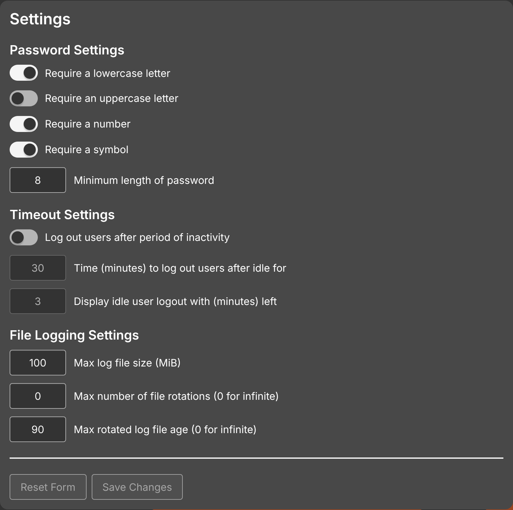

# Settings & Configuration

phēnix supports dynamic configuration management via the `phenix settings` command.
A running `phenix ui` applies changes to the `log.*` settings, `ui.logs.level`,
`experiment.disk-check` and the users file at once, without restarting. It
reads every other setting only at startup, and logs a warning that names each
changed key that needs a restart (never the values themselves):

```text
config change takes effect only when phenix ui restarts keys="store.endpoint, ui.listen-endpoint"
```

## Configuration Files

phēnix looks for a configuration file (e.g. `config.yaml`, `config.json`, `config.toml`) in the following locations, in order, and reads the first it finds:

**When run as root:**

* `./config.yaml` (the working directory)
* `/etc/phenix/config.yaml`

**When run as a regular user:**

* `./config.yaml` (the working directory)
* `$HOME/.config/phenix/config.yaml`
* `/etc/phenix/config.yaml`

It looks for `users.yaml` in the same locations. `sudo phenix` searches as
the user that runs `sudo`, so it also searches that user's
`$HOME/.config/phenix`.

Before any command runs, phēnix creates the default log directory
(`$HOME/phenix_logs`, or `/var/log/phenix` as root) and, as root,
`/etc/phenix`. When it finds no config file, it creates an empty
`config.yaml` in `$HOME/.config/phenix/` (`/etc/phenix/` as root), so that
it can watch the file for changes.

### Example Configuration

```yaml
base-dir:
  minimega: /tmp/minimega
  phenix: /phenix
log:
  level: info
  console: stderr
  system:
    path: /var/log/phenix/phenix.log
store:
  endpoint: bolt:///etc/phenix/store.bdb
ui:
  listen-endpoint: 0.0.0.0:3000
  jwt-signing-key: abcde12345
  logs:
    minimega-path: /var/log/minimega/minimega.log
```

## Configuration vs. Data Store

It is important to distinguish between the **System Configuration** and the **Data Store**:

* **System Configuration (`config.yaml`)**: Configures the phēnix *daemon* itself. It controls *how* the service runs (e.g., log levels, API ports, storage backend connection strings).
* **Data Store (BoltDB)**: Stores the *application state*. It holds *what* phēnix manages (e.g., defined experiments, topologies, user accounts, active VM states).

Deleting `config.yaml` resets daemon behavior to defaults. Deleting the Data Store results in data loss (experiments, users, etc.).

## Store Configuration

The phenix tool uses a bbolt key-value data store, a single file with no external dependencies that is only accessible on one machine. Set its path with the `bolt://` store endpoint (e.g. `bolt:///etc/phenix/store.bdb`).

## Managing Settings

```bash
# View all current runtime settings
phenix settings list

# Change log level to debug
phenix settings set log.level debug

# Revert a setting to default
phenix settings unset log.level

# Reset all settings
phenix settings unset --all
```

`phenix settings set` gives the value the type of the flag of the setting. For
example, `log.system.max-size` takes an integer, `ui.jwt-lifetime` takes a
duration such as `24h`, and `ui.users` takes a comma-separated list. A string
setting, such as `ui.jwt-signing-key`, keeps the text as it is, so `0123` stays
`0123`. The command refuses a value that does not have the type of the setting.

`phenix settings set` and `phenix settings unset` change only the key. The
comments, the key order and the other keys in the file stay. A new key goes at
the end of its section. An empty section, such as `{}`, changes to block style
when you set a key in it. When you unset a key that is not in the file, the
file does not change.

## Checking the Configuration

`phenix doctor` checks the configuration without a running `phenix ui`. It
prints each setting with its source, then the result of each check, with a
hint for every failure. See [Doctor](doctor.md).

## Configuration Precedence

phēnix resolves each setting in the following order (highest to lowest):

1. **Command Line Flags**: Arguments passed directly to the binary (e.g., `phenix ui --log.level=debug`).
2. **Environment Variables**: Variables like `PHENIX_LOG_LEVEL`. An empty variable is ignored.
3. **Config File**: Settings in `config.yaml` (managed via `phenix settings set`), with
   `users.yaml` merged over it.
4. **Defaults**: Internal application defaults.

A `PHENIX_*` variable therefore hides a value that `phenix settings set` writes
to the config file. `phenix doctor` warns about each one in its `env-overrides`
check; unset the variable to use the file's value.

`phenix settings set` and `phenix settings unset` change the config file
phēnix read, or create `config.yaml` in `$HOME/.config/phenix/` (`/etc/phenix/`
as root) when it read none. Both refuse a config file that is not YAML.

## Global Flags

The following global flags are supported by all `phenix` subcommands. The
[CLI reference](cli/index.md) lists them with every command's own flags.

| Flag | Type | Default | Description |
| :--- | :--- | :--- | :--- |
| `--base-dir.builder-templates` | `string` | `<base-dir.phenix>/builder/templates` | Directory of the Builder template files that `phenix ui` reads at start. |
| `--base-dir.injects` | `string` | `<base-dir.phenix>/injects` | Directory that `phenix workflow apply` stages topology injects into. The `phenix ui` server reports its value to the CLI, and the flag on the `phenix workflow apply` command line overrides it. See [Workflow](workflow.md). |
| `--base-dir.minimega` | `string` | `/tmp/minimega` | Base minimega directory. |
| `--base-dir.phenix` | `string` | `/phenix` | Base phēnix directory. |
| `--base-dir.topologies` | `string` | `<base-dir.phenix>/topologies` | Directory that `phenix workflow apply` looks up topology directory names in. See [Workflow](workflow.md). |
| `--bridge-mode` | `string` | `manual` | Bridge naming mode for experiments (`auto` uses experiment name for bridge; `manual` uses user-specified bridge name, or `phenix` if omitted). A `phenix ui` running in `auto` mode makes the commands that reach it over `--unix-socket` use `auto`. See [Bridge Mode](bridge-mode.md). |
| `--color` | `string` | `auto` | When to color the output (`auto`, `on`, or `off`). `auto` colors only a terminal, and not when `NO_COLOR` is set or `TERM` is `dumb`. See [Colors](#colors). |
| `--deploy-mode` | `string` | — | Deploy mode for minimega VMs (`all`, `no-headnode`, or `only-headnode`). |
| `--experiment.disk-check` | `string` | `error` | What a start does when a VM disk image or CD-ROM image is missing, or its backing chain is broken (`error`, `warn`, or `off`). See [Disk Check Before a Start](experiments.md#disk-check-before-a-start). |
| `-h, --help` | — | — | Display help information for the command. |
| `--hostname-suffixes` | `string` | `-minimega,-phenix` | Hostname suffixes to strip. |
| `--log.console` | `string` | `stderr` | Destination output for console logs in text format (`stderr`, `stdout`, or a file path). |
| `--log.level` | `string` | `info` | Level to log messages at (`debug`, `info`, `warn`, `error`). |
| `--log.system.max-age` | `int` | `90` | Maximum number of days to retain old log files. |
| `--log.system.max-backups` | `int` | `3` | Maximum number of old log files to retain. |
| `--log.system.max-size` | `int` | `100` | Maximum size in megabytes of the system log file before rotation. |
| `--log.system.path` | `string` | `/var/log/phenix/phenix.log` | Path to persistent system log in JSON Lines format, with one JSON object per line. |
| `--mount-dir` | `string` | `<base-dir.phenix>/mounts` | Base directory for VM filesystem mounts. |
| `--store.endpoint` | `string` | `bolt:///etc/phenix/store.bdb` | BoltDB store endpoint (`bolt://<path>`). |
| `--unix-socket` | `string` | `/tmp/phenix.sock` | phēnix unix socket to listen on (`ui` subcommand) or connect to. |
| `--use-gre-mesh` | `bool` | `false` | Use GRE tunnels between mesh nodes for VLAN trunking. See [GRE Mesh](gre-mesh.md). |

## Colors

phēnix colors parts of its text output: the statuses in tables, the rows of
`phenix doctor`, warnings and errors. The `--color` flag, the `color` setting
or `PHENIX_COLOR` sets when:

* `auto` (the default) colors output only on a terminal, and not when
  `NO_COLOR` is set or `TERM` is `dumb`.
* `on` colors every output, also a file or a pipe.
* `off` colors no output.

phēnix refuses another value. JSON and YAML output, and the output of
`phenix doctor --report`, never have color.

## Settings Reference

| Setting Key | Environment Variable | Default | Description |
| :--- | :--- | :--- | :--- |
| `bridge-mode` | `PHENIX_BRIDGE_MODE` | `manual` | Bridge naming mode for experiments. `auto` uses the experiment name as the bridge name; `manual` uses the user-specified bridge name, or `phenix` if not specified. See [Bridge Mode](bridge-mode.md). |
| `experiment.disk-check` | `PHENIX_EXPERIMENT_DISK_CHECK` | `error` | What a start does when a VM disk image or CD-ROM image is missing, or its backing chain is broken. `error` refuses the start, `warn` starts the experiment and shows each problem as a warning, and `off` does not check the images. It applies to every start: the CLI, the web UI, the REST API, `phenix workflow apply`, and the bulk start and restart of VMs. phēnix refuses another value. `phenix ui` applies a change at once. See [Disk Check Before a Start](experiments.md#disk-check-before-a-start). |
| `use-gre-mesh` | `PHENIX_USE_GRE_MESH` | `false` | Enable Layer 2 GRE tunnels for the default bridge of experiments created or updated with this setting. See [GRE Mesh](gre-mesh.md) for usage, server inheritance, and MTU requirements. `phenix ui` reads this setting at startup. **(Restart Required)** |
| `log.level` | `PHENIX_LOG_LEVEL` | `info` | Global log verbosity (`debug`, `info`, `warn`, `error`). |
| `color` | `PHENIX_COLOR` | `auto` | When phēnix colors its output: statuses in tables, `phenix doctor` rows, warnings and errors. `auto` colors only a terminal, and not when `NO_COLOR` is set or `TERM` is `dumb`. `on` and `off` ignore both variables. JSON and YAML output never have color. phēnix refuses another value. See [Colors](#colors). |
| `log.console` | `PHENIX_LOG_CONSOLE` | `stderr` | Destination for console logs (`stderr`, `stdout`, or a file path). Uses **Text/Human-Readable** format. Note: Setting this to a file path will prevent console logs from appearing in `docker logs`. |
| `log.system.path` | `PHENIX_LOG_SYSTEM_PATH` | `/var/log/phenix/phenix.log` | Path to the persistent system log file (used by UI). Uses **JSON** format. This is independent of `log.console` and is always active. |
| `log.system.max-size` | `PHENIX_LOG_SYSTEM_MAX_SIZE` | `100` | Max size in MB before rotation. |
| `log.system.max-backups` | `PHENIX_LOG_SYSTEM_MAX_BACKUPS` | `3` | Number of old log files to retain. |
| `log.system.max-age` | `PHENIX_LOG_SYSTEM_MAX_AGE` | `90` | Max age in days to retain old logs. |
| `ui.logs.level` | `PHENIX_UI_LOGS_LEVEL` | `""` | Log level for the web UI stream (defaults to `log.level`). |
| `ui.logs.minimega-path` | `PHENIX_UI_LOGS_MINIMEGA_PATH` | `""` | Path to the minimega log file to display in the UI and offer for download on the Logs page. **(Restart Required)** |
| `ui.features` | `PHENIX_UI_FEATURES` | `""` | Comma-separated list of optional UI features to enable (space-separated in `PHENIX_UI_FEATURES`). Currently supports `vm-mount`, which enables transferring files to and from a running VM. See [Mount a VM](vms.md#mount-a-vm). `phenix ui` turns on `webshark`, `tunneler-download` and `file-server` itself, and refuses to start with `webshark` set but no WebShark build. **(Restart Required)** |
| `ui.file-server-endpoint` | `PHENIX_UI_FILE_SERVER_ENDPOINT` | `0` (disabled) | Address (`port` or `host:port`) for the separate experiment file-upload server. A port-only value binds to `127.0.0.1`. Also works with the `vm-mount` feature - see [Uploading Experiment Files from the phēnix Server](vms.md#uploading-experiment-files-from-the-phenix-server). If it is set and the address cannot be listened on, `phenix ui` exits with an error. **(Restart Required)** |
| `ui.shutdown-grace-period` | `PHENIX_UI_SHUTDOWN_GRACE_PERIOD` | `5` | How many seconds stopping `phenix ui` may take to finish requests and jobs and close connections, as a whole number such as `10`. `0` closes everything without waiting; a negative value, or one that is not a whole number of seconds (such as `10s` or `1.5`), is refused at startup. Also `phenix ui --shutdown-grace-period`. See [Stopping the Server](#stopping-the-server). **(Restart Required)** |
| `ui.netflow.max-size` | `PHENIX_UI_NETFLOW_MAX_SIZE` | `100` | Maximum size in megabytes of each recorded netflow capture, as a whole number. A capture that reaches it stops recording and is marked truncated, while the live view goes on. `0` does not record captures; a negative value, or one that is not a whole number, is refused at startup. Also `phenix ui --netflow.max-size`. See [Recorded Captures](netflow.md#recorded-captures). **(Restart Required)** |
| `mount-dir` | `PHENIX_MOUNT_DIR` | `<base-dir.phenix>/mounts` | Base directory used for VM filesystem mounts created via `phenix vm mount`. See [Mount a VM](vms.md#mount-a-vm). |
| `base-dir.injects` | `PHENIX_BASE_DIR_INJECTS` | `<base-dir.phenix>/injects` | Directory that `phenix workflow apply` stages a topology directory's `phenix-injects/` into, as `<base-dir.injects>/<name>`. The phēnix server's value is used unless `--base-dir.injects` is given; see [Workflow](workflow.md#settings). Use an absolute path. **(Restart Required)** |
| `base-dir.topologies` | `PHENIX_BASE_DIR_TOPOLOGIES` | `<base-dir.phenix>/topologies` | Directory where `phenix workflow apply NAME` looks for `NAME` when `NAME` isn't an existing path. Use an absolute path. See [Workflow](workflow.md). |
| `base-dir.builder-templates` | `PHENIX_BASE_DIR_BUILDER_TEMPLATES` | `<base-dir.phenix>/builder/templates` | Directory of Builder node template files that `phenix ui` reads at start as read-only server collections. Use an absolute path. **(Restart Required)** |

## Stopping the Server

`phenix ui` shuts down cleanly on `SIGINT` (CTRL+C) or `SIGTERM` (`docker stop`),
taking at most `ui.shutdown-grace-period` seconds (5 by default):

* It stops accepting connections. Requests in progress may finish until the
  grace period ends.
* It closes every websocket, including consoles, SCORCH terminals, VNC and
  port forwards, so the web UI says that the server is shutting down.
* Running [background jobs](jobs.md) get the first half of the grace period
  to finish, and are canceled then. Queued jobs are canceled at once.
* It ends minimega consoles and SCORCH terminals, so their processes do not
  outlive the server.

A second `SIGINT` or `SIGTERM` stops the server at once. `docker stop` waits
10 seconds before it kills the container, so if you raise
`ui.shutdown-grace-period` past that, raise Docker's timeout with it
(`stop_grace_period` in `docker-compose.yml`, or `docker stop --time`).

## The Settings Page

The web UI's `Settings` tab needs `update` on `settings`. Unlike the settings
above, these are kept in the data store and take effect as soon as they are
saved, with no `config.yaml` change or restart.

{: width=800 .center}

| Section | Setting | Default |
| :--- | :--- | :--- |
| `Password Settings` | `Require a lowercase letter`, `Require a number`, `Require a symbol` | on |
| `Password Settings` | `Require an uppercase letter` | off |
| `Password Settings` | `Minimum length of password`, 8 to 32 | `8` |
| `Timeout Settings` | `Log out users after period of inactivity` | off |
| `Timeout Settings` | `Time (minutes) to log out users after idle for` | `30` |
| `Timeout Settings` | `Display idle user logout with (minutes) left` | `3` |
| `File Logging Settings` | `Max log file size (MiB)` of the system log | `100` |
| `File Logging Settings` | `Max number of file rotations (0 for infinite)` | `0` |
| `File Logging Settings` | `Max rotated log file age (0 for infinite)`, in days | `90` |

The two idle timeout boxes are grayed out until the timeout is turned on. The
idle time must be at least `0.5` minutes, and the warning time must be less
than the idle time. `Reset Form` puts the loaded settings back, and
`Save Changes` saves them.

## phēnix Apps Environment Variables

Apps (`phenix-apps`) run as subprocesses and read their configuration from the environment.
phēnix sets these itself when it launches an app:

| Environment Variable | Value | Description |
| :--- | :--- | :--- |
| `PHENIX_DIR` | `base-dir.phenix` | Base phēnix data directory. |
| `PHENIX_FILES_DIR` | experiment files directory | Where the app reads and writes experiment files. |
| `PHENIX_LOG_LEVEL` | phēnix's own value, else `DEBUG` | App log verbosity. |
| `PHENIX_LOG_FILE` | `stderr` | App logs stream back to phēnix rather than to a file. |
| `PHENIX_DRYRUN` | `true` / `false` | Whether the run is a dry run. |
| `PHENIX_STORE_ENDPOINT` | `store.endpoint` | Data store endpoint (user apps only). |
| `PHENIX_SCORCH_STARTTIME` | run start time | Scorch components only. |

The rest are inherited from the phēnix process:

| Environment Variable | Default | Description |
| :--- | :--- | :--- |
| `PHENIX_TEMP_DIR` | `/tmp/phenix` | App temporary directory. |
| `MM_FILEPATH` | `/phenix/images` | Base minimega file path. |
| `MM_SOCKET_PATH` | `/tmp/minimega/minimega` | minimega command socket. |

### miniccc (`cc`) Timing

Apps drive VMs over minimega's `cc` command-and-control channel. These bound how long an app
waits, in seconds.

| Environment Variable | Default | Description |
| :--- | :--- | :--- |
| `PHENIX_CC_POLL_RATE` | `2.0` | Interval between `cc` polls. |
| `PHENIX_CC_CLIENT_GRACE` | `300.0` | Wait for a miniccc client to register before failing. |
| `PHENIX_CC_SEND_GRACE` | `300.0` | Wait for a file send or component start to be acknowledged. |
| `PHENIX_CC_CMD_GRACE` | `0.0` | Wait for a command response. `0` waits indefinitely, supervised by client liveness instead. |
| `PHENIX_CC_EXITCODE_GRACE` | `10.0` | Wait for an exit code once the response is counted. |
| `PHENIX_CC_LIVENESS_INTERVAL` | `10.0` | Interval between client-liveness checks during an unbounded wait. |
| `PHENIX_CC_LOG_INTERVAL` | `10.0` | Delay before the first "still waiting" log line. |
| `PHENIX_CC_LOG_MAX_INTERVAL` | `320.0` | Ceiling for that interval, which doubles each time. |
