# State of Health

State of Health (SoH) is a core (but not default) app meant to assist with
understanding the state of a running experiment. It has many [configuration options](#configuration-options), and relies on [minimega's command and control
infrastructure](https://sandia-minimega.github.io/minimega/training/miniclass/module-28/) (ie. the `miniccc` agent running in experiment VMs) to drive and
collect the experiment health state data. See the [command and control](#command-and-control) section for more details.

## User Interface

SoH information is presented in the UI in two places. The `SoH` tab in
the navbar summarizes every experiment in one table (see
[State of Health Overview](#state-of-health-overview)). Each experiment also
has its own SoH page, with its [topology graph](#topology-graph) and, when SoH
[packet capture](#packet-capture) is enabled, its
[network volume](#network-volume). To open an experiment's SoH page, click its
heartbeat button (tooltip `view state of health`) in the `Actions` column of
the Experiments table, or beside the `Running` status on the experiment's
page. Both buttons need `get` on the experiment.

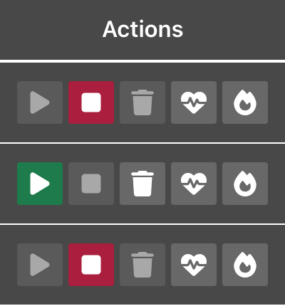{: width=200 .center}

On an experiment's SoH page, `Go to experiment` returns to the experiment, a
book button opens this documentation page, and a flame button opens the
experiment's [SCORCH](scorch.md) runs. Two counters above the graph show how
many VMs and VLANs the current filter is showing, and the status legend is in
a column to the left of the graph. The refresh control in the header reloads
either page (see
[Page Freshness and Refresh](web-ui.md#page-freshness-and-refresh)).

## State of Health Overview

The `SoH` tab in the navbar lists every experiment in one table,
so you can see which experiments need attention without opening each one. The
tab needs the `experiments` `list` and `vms` `list` permissions, and it lists
only the experiments your role may `get`.

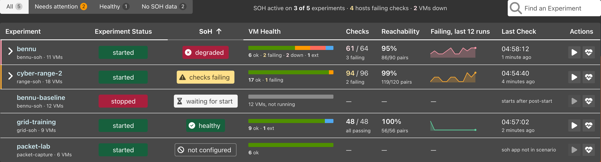{: width=800 .center}

Each row describes one experiment:

| Column | Shows |
|---|---|
| `Experiment` | the experiment's name, linking to it, with its scenario and VM count beneath |
| `Experiment Status` | `started`, `stopped`, or what phēnix is doing to it |
| `SoH` | the experiment's verdict (see below) |
| `VM Health` | a bar of the experiment's VMs by state, with the counts beneath |
| `Checks` | how many checks passed out of the total, and how many are failing |
| `Reachability` | the share of reachability pairs that pass, or `not tested` |
| `Failing, last 12 runs` | a sparkline of the failing check count of each of the last 12 runs |
| `Last Check` | when the last run finished and how long ago that was, or `running now…` |
| `Actions` | a button to run SoH on the experiment, and one to open its topology graph |

The `SoH` column holds one of these verdicts:

| Verdict | Meaning |
|---|---|
| `degraded` | a VM that should be up is down, at least 20% of the checked hosts have a failing check, or fewer than 90% of the reachability pairs pass |
| `checks failing` | at least one check is failing, but the experiment is not `degraded` |
| `waiting for start` | the `soh` app is configured, but the experiment is not running yet |
| `waiting for first run` | the experiment is running, but the app has no results yet |
| `healthy` | every check the app ran passed |
| `not configured` | the experiment's scenario does not include the `soh` app |

Rows are marked red for `degraded` and orange for `checks failing`. The table
is sorted by verdict, worst first, and can also be sorted by `Experiment`,
`Experiment Status`, `Checks` and `Last Check`.

Above the table, the `All`, `Needs attention`, `Healthy` and `No SOH data`
filters each count the experiments they hold, and the `Find an Experiment` box
narrows the table by name. A one-line summary beside the filters gives how
many experiments SoH is active on, how many hosts are failing checks, and how
many VMs are down.

Expand the row of an experiment with problems to list them by `Host`, `Check`,
`Target`, `Result` and `Checked`, failing checks first, then the VMs that are
down. The detail has `Open topology graph` and `Run SOH` buttons, and a
`Show all N problems` link when it lists only some of them.

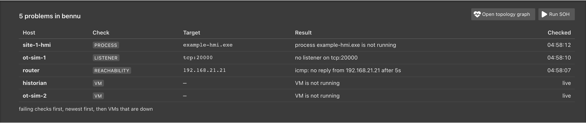{: width=800 .center}

A legend under the table names the colors of the `VM Health` bar. A VM counts
as down only when it should be up: a VM marked Do Not Boot, an external
device, or a VM still waiting for its delayed start is not a problem.

`Run SOH` in a row's `Actions` column triggers a new run for that experiment.
When a run cannot be triggered, the button is disabled and its tooltip says
why.

The overview reloads when an experiment, a VM or an `soh` run changes, and
while a run is in progress. While an experiment is starting or stopping, the
overview shows each running experiment's VM states as it last read them, and
says `states may be out of date` under the `VM Health` bar.

## Topology Graph

This tab displays a network graph of the running experiment.

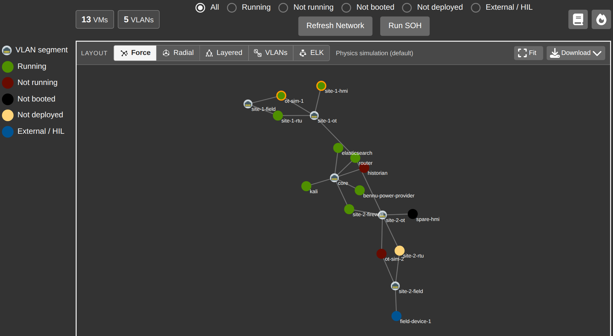{: width=800 .center}

The color of the node is based on the condition of the corresponding VM and
could be:

* `Running`
* `Not running` (part of the experiment, but currently paused)
* `Not booted` (part of the experiment, but marked as Do Not Boot)
* `Not deployed` (part of the experiment, but flushed from minimega)
* `External / HIL` (an [external node](configuration.md#external-nodes), i.e.
  hardware in the loop, not deployed by minimega)

Those five conditions, along with the icon used for a VLAN segment, make up
the legend to the left of the graph. While the experiment is stopped, its VMs
are drawn without a status color. External nodes keep theirs.

The graph can also be filtered to one condition, with the filters above the
graph:

* `All` (the default)
* `Running`
* `Not running`
* `Not booted`
* `Not deployed`
* `External / HIL`

The filter you pick is kept when the graph reloads, and the VM and VLAN
counters above the graph show how much of the experiment it is showing. When
nothing matches, choose `All` to see every node again.

The `Refresh Network` button reloads the graph data from the server. It keeps
the filter you picked.

The `Run SOH` button triggers a new SoH run. It is only shown to roles that
may trigger apps for the experiment. While a run cannot be triggered, it is
replaced by a disabled button that says why, such as `Exp Not Running`. To
bring in the latest SoH data without running the checks again, use the
`Refresh Network` button.

Before the first SoH run, a note beside the buttons tells you why there are no
results:

* The soh app waits for its first run, which starts after post-start.
* The soh app is running its first checks.
* The scenario sets `disabled: true` on the soh app, so the app did not run at
  post-start. The `Run SOH` button is available. Use it to start the app
  manually.

The `SoH` tab shows the same information for each experiment in
its `Last Check` column and on its run buttons.

The graph opens in the `VLAN groups` layout (the `VLANs` button), which puts
the hosts in a box for each VLAN. Use the layout buttons above the graph to
select a different layout. The page remembers the layout that you select. The
graph uses the `Force` layout when the `VLAN groups` layout cannot draw it: the
graph has more than 300 nodes, or the layout fails. A note above the graph
tells you when the graph is too large for the layout. When a layout that you
selected fails, the page does not remember it.

Hovering over a node in the graph will cause it to expand to show what operating
system the node is running. An orange border around a node is indicative of the
node currently having health issues (e.g., expected files, services, or
processes are missing, or the node cannot reach other nodes on the network).
Other virtual systems will also be represented accordingly (e.g., a printer or
firewall).

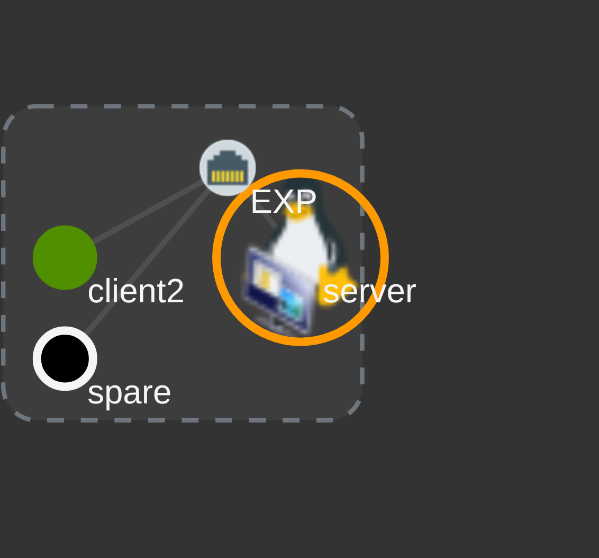{: width=800 .center}

Clicking on the node with an orange border will produce a details modal with the
current error reporting.

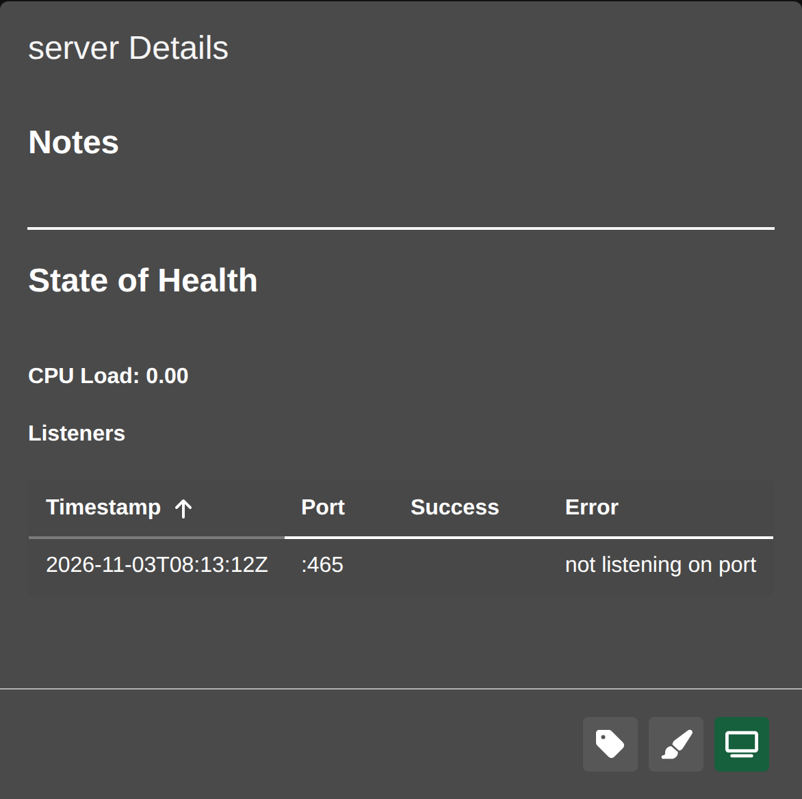{: width=800 .center}

If there are no errors to report and command and control is enabled, the details
modal will only show the current CPU load.

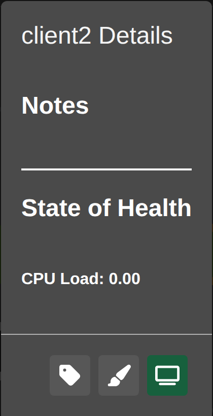{: width=800 .center}

Note the green button in the lower right corner of the modal; this will provide
access to the VNC for any running VM. When the VM is not running, access to the
VNC will be disabled. Finally, if there is no SoH information to report on a
given VM, it will be noted in the details modal. The following screenshot is an
example of no SoH information with the VNC button disabled.

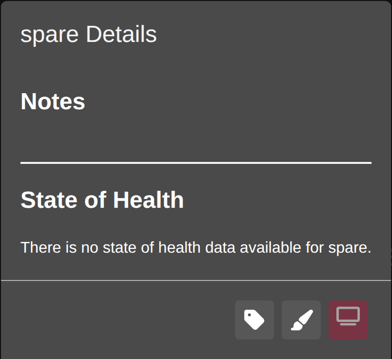{: width=800 .center}

## Graph Layouts

The `Layout` picker in the bar above the graph decides how the nodes are
arranged. The hint for the layout you picked is shown beside the picker.

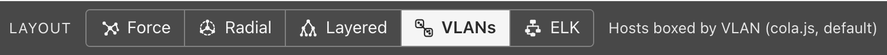{: width=800 .center}

| Layout | What it draws |
|---|---|
| `Force` | `Physics simulation`: nodes repel each other and their links pull them together |
| `Radial tree` | `Rings out from the core router`: the most central router or firewall in the middle, everything else in rings by hop distance |
| `Layered` | `Top-down tiers (dagre)`: the core on top, VLANs under their routers, hosts below |
| `VLAN groups` | `Hosts boxed by VLAN (cola.js, default)`: a labeled box per VLAN around the hosts on it |
| `ELK layered` | `Top-down tiers with host blocks (ELK)`: tiers like `Layered`, arranged by the ELK engine |

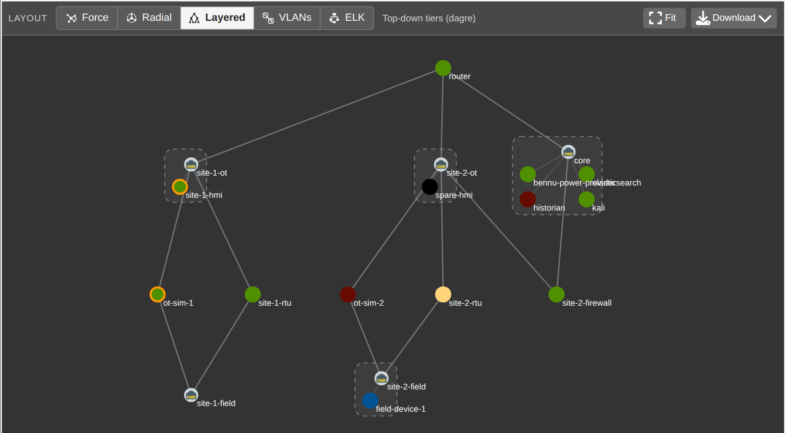{: width=800 .center}

Your choice is remembered in the browser. `VLAN groups` is the default. It is
disabled on graphs of more than 300 nodes, which then use `Force`, and a layout
that fails to load falls back to `Force` with an error notification. Hovering,
clicking and the status colors work the same in every layout.

The `Fit` button zooms the whole graph into view. The graph refits itself when
the window is resized, unless you have zoomed or panned it.

## Downloading the Graph

The `Download` menu beside the `Fit` button saves the graph as drawn, in one of
three formats.

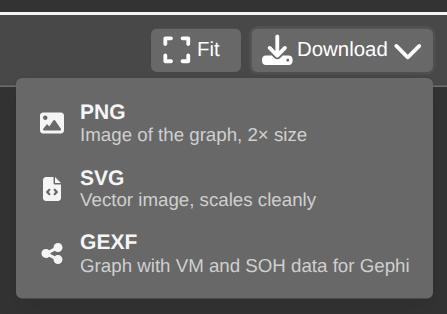{: width=800 .center}

| Format | Menu hint | What you get |
|---|---|---|
| `PNG` | `Image of the graph, 2× size` | A bitmap at twice the drawing's size |
| `SVG` | `Vector image, scales cleanly` | A standalone vector image that can be scaled or edited |
| `GEXF` | `Graph with VM and SOH data for Gephi` | A GEXF 1.3 graph file for [Gephi](https://gephi.org/) and Gephi Lite |

The PNG and the SVG are sized so the whole graph fits. Both carry a title
naming the experiment, the VM and VLAN counts, the filter, the layout, the date
and the legend. The GEXF file holds each VM and VLAN node with its status, OS
type, VM state, SoH check results and position, and an edge for each interface.
When [network volume](#network-volume) data is available, the traffic flows are
added as weighted edges. VM details such as host and addresses are included
only if your role may list the experiment's VMs.

Downloads are named `<experiment>-soh-<layout>-<timestamp>.<ext>`.

## External Devices

Experiments that include hardware-in-the-loop or other devices not deployed by
minimega can still represent them in the topology graph by adding them to the
topology as [external nodes](configuration.md#external-nodes) (`external:
true`). External nodes show up in the graph with the `External / HIL` status
color (see the legend above) and, when hovered, still show which OS type/icon
was configured for them.

Because external nodes don't run `miniccc`, they're excluded from the
automated command-and-control-based checks described in [Command and
Control](#command-and-control) (network config, reachability, listening ports,
processes, Docker containers, CPU load). Clicking on an external node's details modal will
therefore always report no SoH information available, and the VNC button will
be disabled since phenix has no console access to it.

External nodes can still participate in reachability testing indirectly: their
IP address(es) are read from the topology configuration, so they can be used as
the `src` or `dst` in a
[`testCustomReachability`](#configuration-options) entry to verify connectivity
to/from the device from another VM in the experiment.

!!! tip "Getting a line to draw to an external device"
    The topology graph only draws a line between two nodes when they share a
    common VLAN name on one of their network interfaces (the VLAN name becomes
    the shared switch node in the graph). To connect an external node to the
    rest of the topology in the graph, give it a `network.interfaces[].vlan`
    value that matches the VLAN used by the node(s) you want it connected to.
    Interfaces on the `MGMT` or `MIRROR` VLANs are always ignored when drawing
    these lines (for both external and internal nodes), and an external node
    with no `vlan` set on its interface(s) will appear in the graph as an
    isolated node with no connecting lines.

## Network Volume

This tab displays a chord graph that shows network flows between nodes using
flows from Packetbeat fed to Elasticsearch; connections represent the volume of
traffic between nodes.

!!! tip
    This information is only available if the packet capture option is enabled
    for SoH.

This is an example chord graph of a Protonuke server with two clients; one of
which is requesting content at a delayed interval (therefore less traffic flow).

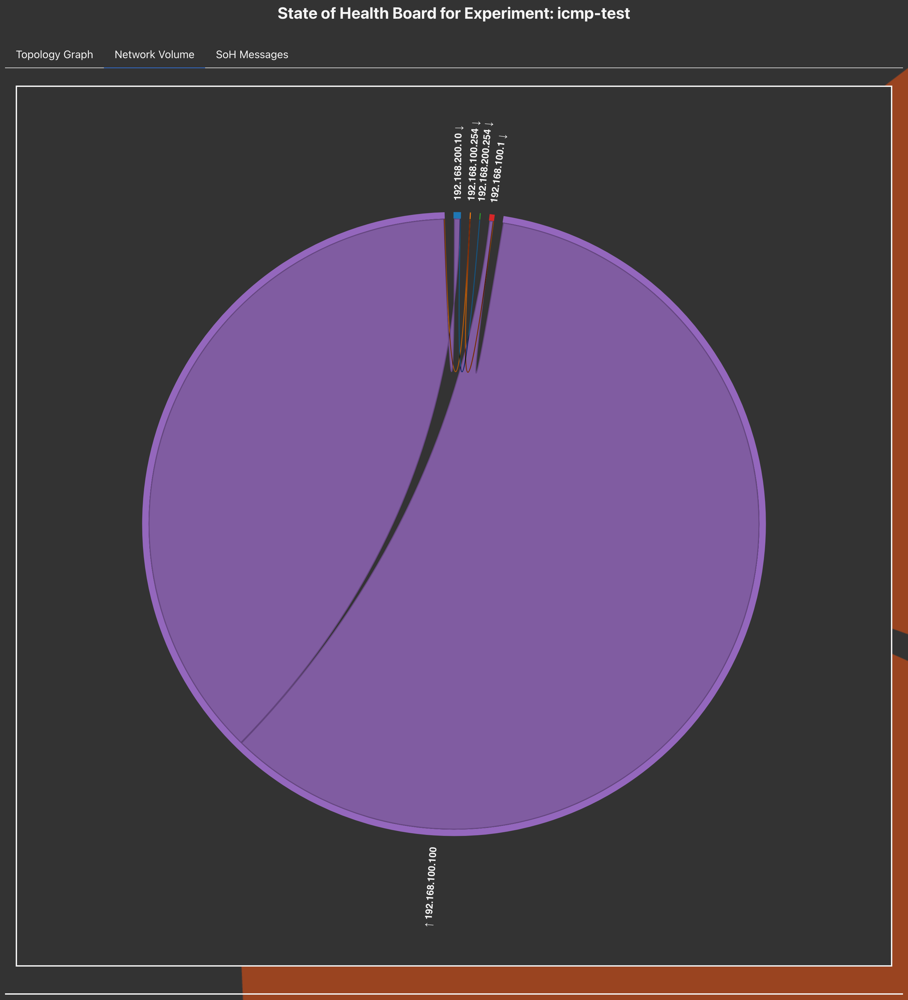{: width=800 .center}

If you hover over traffic flow, a tooltip will appear providing additional
details. (In this screenshot, the mouse is hovering over the traffic for IP
`192.168.100.1`.)

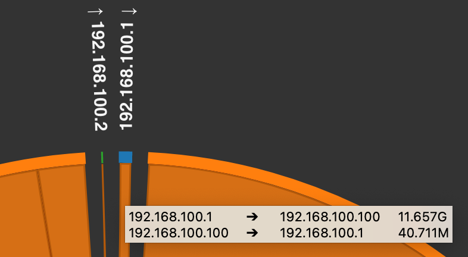{: width=800 .center}

## Configuration Options

* `disabled`: Like any (non-default) phenix app, `soh` can be disabled at startup
  by setting `disabled: true`. In this case, health checks will not be run at experiment
  startup but can be triggered manually after the experiment is running through either
  the `phenix` cli or web UI

* `appMetadataProfileKey`: since the listeners and processes one might want to
  monitor could be highly dependent on other apps that are configured for an
  experiment, it's possible to specify the `hostListeners` and `hostProcesses`
  to be monitored in the other apps themselves under the key specified here.
  The default key is `sohProfile`.

* `c2Timeout`: a [Golang duration
  string](https://golang.org/pkg/time/#ParseDuration) specifying how long to
  wait for the `miniccc` C2 client to become active in a VM before moving on and
  marking the VM as not to be monitored. The default is `5m`.

* `c2AppearGrace`: a [Golang duration
  string](https://golang.org/pkg/time/#ParseDuration) specifying how long a
  C2 command can take to show on the cluster host that has the VM's `miniccc`
  client. If the command does not show in this time, the check fails at once.
  `0s` disables this limit. The default is `30s`.

* `c2ClientGrace`: a [Golang duration
  string](https://golang.org/pkg/time/#ParseDuration) specifying how long the
  `miniccc` client of a VM can be absent while a check waits for its response.
  If the client stays absent for longer, the check fails with the error for an
  inactive C2 client, and SoH sends no more checks to the VM during that SoH run.
  `0s` disables this limit. The default is `90s`.

* `c2Concurrency`: the maximum number of C2 checks that one SoH run sends at the
  same time. The other checks wait until a check ends. This wait does not count
  against `c2Timeout`. A value of `0` or less removes the limit. The default is
  `16`.

* `exitOnError`: a boolean representing whether the app should cause the entire
  experiment deployment to fail if it has any errors. The default is `false`.

* `startupDelay`: a [Golang duration
  string](https://golang.org/pkg/time/#ParseDuration) specifying how long to
  wait before initiating checks at the experiment starts. This can be useful
  when some processes are not healthy immediately at experiment start. This
  only delays SoH when it first runs at the experiment start. It will not delay
  SoH when run manually later by clicking the `Run SOH` button in the UI or
  running `phenix exp trigger running` (or the deprecated `trigger-running`
  command) from the command line. The default is no delay.

* `hostCustomTests`: If present, a map of custom tests to run on the given
  hosts.

    * `name`: name of test. Used as script name to be sent to the host. The
      script name is `<host>-<name>`. SoH replaces each run of white space with
      one `_`. Then it replaces each character other than a letter, a digit,
      `-`, `_`, or `.` with `_`. If this changes the name, SoH adds `-` and an
      8-character hash, for example `web-db_check-420ef7c9`. Thus two test
      names on one host do not use the same script file.

    * `testScript`: the actual script (can be multiple lines) to be executed
      using the specified `executor`.

    * `executor`: the application to execute the `testScript` with (e.g. `bash`,
      `powershell`).

    * `testStdout`: a string to look for in STDOUT from the executed script. If
      found, the test passes. If not found, it fails.

    * `testStderr`: a string to look for in STDERR from the executed script. If
      found, the test passes. If not found, it fails.

    * `validateStdout`: a script to run that will be provided, via STDIN, the
      STDOUT from the executed script. If this validation script exits 0, the
      test passes. If it exits non-zero, the test fails. This validation script
      should always be a bash script, even if the host is a Windows host.

    * `validateStderr`: a script to run that will be provided, via STDIN, the
      STDERR from the executed script. If this validation script exits 0, the
      test passes. If it exits non-zero, the test fails. This validation script
      should always be a bash script, even if the host is a Windows host.

* `hostFiles`: a map of VMs, each specifying a list of file paths that should
  exist within the VM. Paths may target Linux or Windows VMs. Missing files are
  reported in the node's **Files** table in the SoH details modal and mark the
  node as unhealthy. The default is `nil`.

    ```yaml
    hostFiles:
      linux-server:
      - /etc/phenix/startup/1_hostname-start.sh
      windows-client:
      - 'C:\ProgramData\phenix\ready.txt'
    ```

* `hostServices`: a map of VMs, each specifying a list of service names that
  should be running within the VM. Linux VMs are checked via `systemctl`, and
  Windows VMs are checked via `Get-Service`. Services that aren't active are
  reported in the node's **Services** table in the SoH details modal and mark
  the node as unhealthy. The default is `nil`.

    ```yaml
    hostServices:
      linux-server:
      - sshd
      windows-client:
      - Spooler
    ```

* `dockerContainers`: a map of VMs, each specifying a list of Docker container
  names/IDs that should be up and healthy within the VM. For each container, if
  it has a [Docker
  healthcheck](https://docs.docker.com/reference/dockerfile/#healthcheck)
  configured, its health status (`healthy`, `unhealthy`, or `starting`) is
  used to determine node health; otherwise, the container simply being in the
  `running` state is considered healthy. Requires the `docker` CLI to be
  available on the VM (Linux or Windows) and the VM's `miniccc` user to have
  permission to run it. Results are reported in the node's **Docker
  Containers** table in the SoH details modal and mark the node as unhealthy
  if a container is missing, not running, or unhealthy. The default is `nil`.

    ```yaml
    dockerContainers:
      linux-server:
      - nginx
      - redis
    ```

* `hostListeners`: a map of VMs, each specifying a list of listening ports to
  check for within the VM. If the port can be listening on any interface, the
  form `:80` can be used. If the port should be listening on a specific
  interface, the form `192.168.1.10:80` can be used. Each address and port can
  contain only letters, digits, and the characters `-_.%*/`. The default is
  `nil`.

* `hostProcesses`: a map of VMs, each specifying a list of process names to
  check for within the VM. On Linux, each entry is a `pgrep -f` pattern, which
  matches the full command line, for example `python3 server.py`. On Windows,
  each entry is a `Get-Process` name. The check passes when the VM returns one
  or more process IDs. Other output, for example a `pgrep` error, makes the
  check fail with an error. The default is `nil`.

* `hostsToUseUUIDForC2Active`: a list of topology hostnames to use the minimega
  VM UUID for when determining if their cc agent is active. This is useful for
  topology nodes that are configured with snapshots disabled, preventing their
  hostname from getting updated when booted. Note that this configuration option
  also supports being set to `all` (e.g., `hostsToUseUUIDForC2Active: all`) if a
  user wishes to use the minimega VM UUID for all topology nodes.

* `injectICMPAllow`: a boolean representing whether any existing firewall/router
  rulesets should have a rule added to allow ICMP between all nodes to
  facilitate reachability testing. See [Injecting ICMP
  Rules](#injecting-icmp-rules) for more details. If reachability tests are
  disabled, then this will be too, regardless of its setting here. The default
  is `false`.

* `packetCapture`: if present, a partially hidden packet capture infrastructure
  based on Elasticsearch, Kibana, and Packetbeat will be deployed for the experiment.
  See [Packet Capture](#packet-capture) for more details. The default is `nil`.

    * `elasticImage`: path to the disk image to use for the Elastic/Kibana VM
      for packet capture. An `image/PHENIX-elasticsearch` config comes bundled with
      phenix and can be used to build an image to use here. There is no default
      for this setting; if packet capture is to be deployed it must be provided.

    * `packetBeatImage`: path to the disk image to use for the Packetbeat VM for
      packet capture. An `image/PHENIX-packetbeat` config comes bundled with phenix and
      can be used to build an image to use here. There is no default for this
      setting; if packet capture is to be deployed it must be provided.

    * `elasticServer`:

        * `hostname`: the hostname to use for the Elastic/Kibana server added to
          the experiment topology. There is no default for this setting; if
          packet capture is to be deployed it must be provided.

        * `vcpus`: the number of CPUs to assign to the Elastic/Kibana server VM.
          The default is 4.

        * `memory`: the amount of memory to assign to the Elastic/Kibana server
          VM. The default is 4096.

        * `ipAddress`: the IP address to use for the Elastic/Kibana server added
          to the experiment topology. The network interface this IP address is
          used for will be added to the experiment VLAN specified by `vlan`. The
          IP address must be an IPv4 address in CIDR notation. There should also be
          sufficient IP addresses after the one specified here to be assigned to
          each of the Packetbeat monitor VMs that will be deployed, as the IP
          addresses assigned to them on the VLAN specified by `vlan` will
          increment up from this IP. There is no default for this setting; if
          packet capture is to be deployed it must be provided.

        * `vlan`: the experiment VLAN to add the Elastic/Kibana and Packetbeat
          VMs to. There is no default for this setting; if packet capture is to
          be deployed it must be provided.

    * `captureHosts`: a map of VMs, each specifying a list of network interface
      names to monitor. One Packetbeat VM will be deployed for each VM interface
      specified. The default is `nil`.

* `skipInitialNetworkConfigTests`: by default, a set of tests will be run on
  each VM to ensure the VM was assigned the correct IP address and can reach its
  default gateway (if specified). Setting this to true will skip these initial
  tests, but will also disable reachability testing. The default is `false`.

* `skipHosts`: a list of VM hostnames and/or disk image names to skip health
  monitoring for. For disk image names, any host using the disk image as its
  primary image will be skipped. A disk image name ends in `.qc2`, `.qcow2`,
  or `.qcow`. The default is `nil`.

* `testReachability`: reachability testing is the process of making sure each VM
  can reach other VMs within the experiment over the network. See [Network
  Reachability](#network-reachability) for more details. There are three options
  for this setting: `off`, `sample`, `full`.

    * `off`: reachability testing is disabled. This is the default.

    * `sample`: each VM in the experiment will attempt to ping a random VM in
      every other experiment VLAN.

    * `full`: each VM in the experiment will attempt to ping every other VM in
      every other experiment VLAN.

* `testCustomReachability`: if present, a list of custom reachability test
  settings.

    * `src`: hostname to conduct test from.

    * `dst`: hostname and interface name (e.g. `host-01|IF0`) to conduct test
      to.

    * `proto`: protocol to use for test. Currently the options are `tcp` and
      `udp`. If `udp` is used, the `udpPacketBase64` setting must be provided.

    * `port`: destination port to conduct test to.

    * `wait`: amount of time to wait for a response from the destination. If not
      provided, the default of `5s` is used.

    * `udpPacketBase64`: a base64-encoded packet to send when testing using
      `udp`. This is required to generate a response over UDP to determine if
      the remote server is up and reachable. The given packet must be valid
      enough to generate a response from the server.

### Network Reachability

Testing network reachability for a VM requires that the VM has minimega's
command and control (C2) layer active (ie., the `miniccc` agent is running in
the VM), has the correct IP address configured, and can ping its default route
if one is configured. If C2 is not active for a VM after the `c2Timeout`
duration has passed, then the VM will be excluded from reachability testing.
Once C2 is up for a VM, the VM is queried to confirm its IP address is
configured and its gateway is reachable for a maximum of 5 minutes. Once all the
VMs with C2 detected have their IP address configured and their gateways are
reachable, reachability tests begin.

Reachability tests are run in the post-start stage and each time the running
stage is triggered. Given this, if for some reason a VM comes up with its C2
agent active, but its network has to be configured manually, it will not be
included in reachability tests during the post-start stage. Once the VM's
network settings have been configured manually, the running stage can be
triggered and the VM will be included in reachability tests this time around.

### Injecting ICMP Rules

The `injectICMPAllow` option can be used to add rules to routers/firewalls in
the topology to prevent reachability tests from failing due to ACLs. When
enabled, all rulesets present in the experiment (either in the topology or
scenario) will have a rule prepended to the list of existing rules allowing the
ICMP protocol to/from any address. To ensure this rule is applied before any
other rule, the SoH app attempts to inject it with an ID of 1 (since Vyatta/VyOS
orders rules by ID). If a rule already exists with an ID of 1 then injecting
this rule will fail.

A check is done each time an experiment is started to see if injecting ICMP
rules is enabled, and if not, any injected rules are removed from the
experiment. This means the setting can be changed between runs of an experiment
(e.g., using `phenix config edit experiment/<name>`) and the change will be
reflected accurately when the experiment is started again.

### Packet Capture

The SoH packet capture capability leverages minimega's tap mirroring to monitor
traffic on experiment VM interfaces with Packetbeat and feed network flow data
to Elasticsearch.

When enabled, an Elasticsearch/Kibana VM is added to the experiment's topology so it
can be accessed via the phenix UI. Packetbeat VMs are deployed in minimega for
each experiment VM interface that's configured to be monitored, but are not
added to the experiment topology so they do not clutter the phenix UI.

When packet capture is enabled, the phenix UI SoH tab will include a Network
Volume tab that uses network flow data queried from Elasticsearch to populate a
chord graph in an effort to depict how much traffic is flowing between VMs.
Users/Analysts can also access Kibana using
VNC via the phenix UI to do additional analysis on the network flow data that's
being captured.

## Sample SoH Scenario Config

```yaml
spec:
  apps:
  - name: soh
    disabled: false
    metadata:
      appMetadataProfileKey: sohProfile  # metadata key to look for in other apps
      c2Timeout: 5m
      exitOnError: false
      startupDelay: 5m  # only delays at experiment start (PostStart phase)
      hostCustomTests:
        host-00:
        - name: FooBarTest
          testScript: |
            cat /etc/passwd | grep root
          validateStdout: |
            count=$(wc -l)
            [[ $count -eq 1 ]] && exit 0 || exit 1
          executor: bash
        host-01:
        - name: SuckaTest.ps1
          testScript: |
            Get-Process miniccc -ErrorAction SilentlyContinue
          testStdout: miniccc
          executor: powershell -NoProfile -ExecutionPolicy bypass -File
      hostFiles:
        host-00:
        - /etc/phenix/startup/1_hostname-start.sh
        host-01:
        - 'C:\ProgramData\phenix\ready.txt'
      hostServices:
        host-00:
        - sshd
        host-01:
        - Spooler
      dockerContainers:
        host-00:
        - nginx
        - redis
      hostListeners:
        client:
        - :502
        server:
        - :80
        - :443
      hostProcesses:
        client:
        - miniccc
        server:
        - miniccc
      hostsToUseUUIDForC2Active:
      - host-02
      injectICMPAllow: true
      packetCapture:
        elasticImage: /phenix/images/elasticsearch.qc2
        packetBeatImage: /phenix/images/packetbeat.qc2
        elasticServer:
          hostname: soh-elasticsearch-server
          vcpus: 4
          memory: 4096
          ipAddress: 172.16.200.1/16
          vlan: MGMT
        captureHosts:
          client:
          - IF0  # interface to monitor on "client" node in topology
          server:
          - IF0  # interface to monitor on "server" node in topology
      skipInitialNetworkConfigTests: false  # if true, testReachability will be off
      skipHosts:
      - kali.qc2  # can be an image name, in which case any host using image will be skipped
      - foobar-host  # can be hostname from topology
      testReachability: full  # can be off, sample, or full
      testCustomReachability:
      - src: host-00
        dst: host-01|IF0
        proto: tcp
        port: 22
        wait: 30s
      - src: host-01
        dst: host-00|IF0
        proto: tcp
        port: 22
        wait: 30s
```

## Command and Control

As mentioned earlier, SoH relies on minimega's command and control infrastructure ([miniccc](https://sandia-minimega.github.io/minimega/training/miniclass/module-28/))
to drive and collect the experiment health state data. Under the hood, the SoH
app uses C2 to execute a test on a VM (`cc exec`), wait for the command to
complete (`cc commands`), grab the STDOUT/STDERR of the command (`cc
responses`), and compare it to an expected response.

Current tests executed on Linux VMs include the following:

* `ip addr`
* `ip route`
* `ping -c 1 <ip>`
* `stat -c present -- <path>`
* `systemctl is-active -- <service>`
* `pgrep -f -- <process>`
* `ss -lntu state all 'sport = <port>'`
* `cat /proc/loadavg`

Corresponding tests for Windows VMs include the following:

* `ipconfig /all`
* `route print`
* `ping -n 1 <ip>`
* `powershell -NoProfile -Command "if (Test-Path -LiteralPath '<path>' -PathType Leaf) { 'present' }"`
* `powershell -NoProfile -Command "if ((Get-Service -Name '<service>' -ErrorAction SilentlyContinue).Status -eq 'Running') { 'active' }"`
* `powershell -NoProfile -Command "Get-Process -Name '<process>' -ErrorAction SilentlyContinue | Select-Object -ExpandProperty Id"`
* `powershell -NoProfile -Command "@(Get-NetTCPConnection -State Listen -ErrorAction SilentlyContinue; Get-NetUDPEndpoint -ErrorAction SilentlyContinue) | Where-Object LocalPort -eq <port> | Select-Object -First 1"`
* `powershell -command "Get-WmiObject Win32_Processor | Measure-Object -Property LoadPercentage -Average | Select -ExpandProperty Average"`

SoH quotes each value, so that the VM gets the value as one argument. A path,
service, container, or process value can contain spaces and quotes. minimega
expands environment variables in each `cc exec` argument, also in quoted text.
Thus, SoH does not send a check if its value has a `$` before a letter, a
digit, `_`, `{`, or one of `*#$@!?-` (for example, `$HOME`). Other uses of `$`
are permitted, for example at the end of a process pattern. minimega also
replaces a value that starts with `file:`, `http:`, `https:`, or `tar:`, so
SoH does not send that check. For each check that SoH does not send, the
check result shows an error.

### SoH Run History

Besides the per-host results of its latest run, the `soh` app records each
finished run in its app status: `lastRun` (when the run finished),
`lastRunDuration` (in seconds), and `history`, a summary of the last 20 runs.
Each history entry holds the run's `time` and `duration`, the `total` number
of checks it ran, how many were `failing`, and the `hostsFailing` and
`hostsDown` counts. The
[State of Health Overview](#state-of-health-overview) takes its `Last Check`
column and its `Failing, last 12 runs` sparkline from this history.
