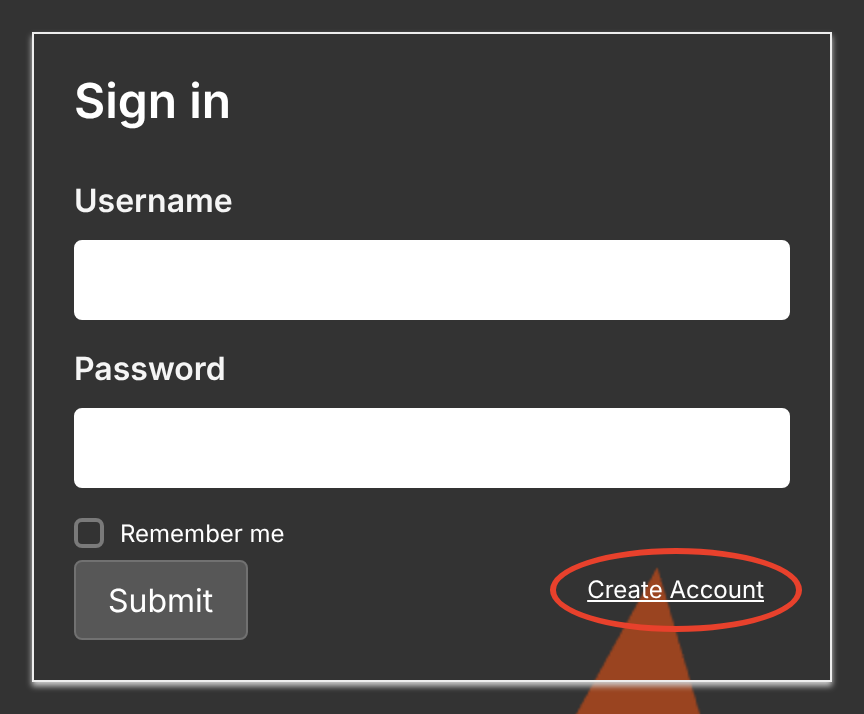
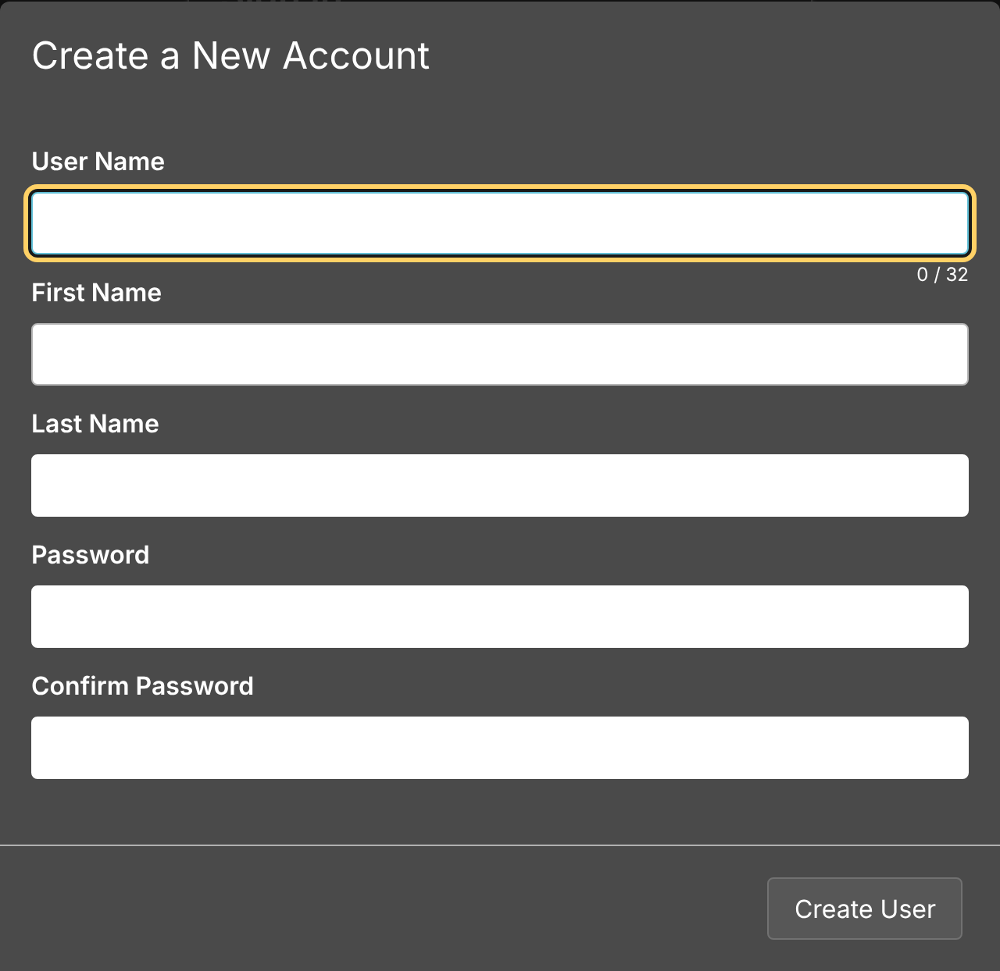
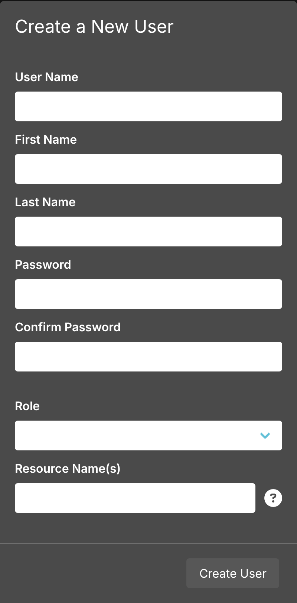
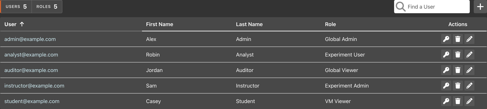

# User Authn/Authz in phenix

`phenix` provides three separate modes of user authentication (authn) and
authorization (authz).

* disabled
* enabled
* proxy

## `disabled` Mode

When in `disabled` mode, no user authentication or authorization occurs. Users
do not have to authenticate, and all actions are allowed.

To use `disabled` mode, the UI should be built with `VITE_AUTH=disabled` (if
Docker is being used to build the UI, use Docker build arg
`PHENIX_WEB_AUTH=disabled`) and the UI server should be started without the
`-k/--jwt-signing-key` option set.

## `enabled` Mode

When in `enabled` mode, user authentication and authorization occurs within
phenix directly. Users have to authenticate to the phenix UI, and certain
actions are prohibited based on the role assigned to the user.

To use `enabled` mode, the UI should be built with `VITE_AUTH=enabled` (if
Docker is being used to build the UI, use Docker build arg
`PHENIX_WEB_AUTH=enabled`) and the UI server should be started with the
`-k/--jwt-signing-key` (and optionally the `--jwt-lifetime`) option set.

## `proxy` Mode

When in `proxy` mode, user authentication is expected to occur in a reverse
proxy that sits in front of phenix but user authorization still occurs within
phenix directly. Users authenticate to the proxy, and certain actions are
prohibited based on the role assigned to the user.

To use `proxy` mode, the UI should be built with `VITE_AUTH=proxy` (if Docker
is being used to build the UI, use Docker build arg `PHENIX_WEB_AUTH=proxy`) and
the UI server should be started with the `-k/--jwt-signing-key` and
`--proxy-auth-header` (and optionally the `--jwt-lifetime`) options set.

In addition, the reverse proxy should add a header to requests being proxied
that contains the username of the authenticated user, with the name of the
header matching what `--proxy-auth-header` is set to (for example,
`--proxy-auth-header=X-phenix-user`).

If a user is able to authenticate to the proxy but is not yet a user in phenix,
they will be added as a phenix user automatically and assigned the `Disabled`
role that will deny all actions until an admin user can assign them a different
role.

## Create a new user

There are three primary ways to create new users. A username must start with
a letter or digit and contain only letters, digits, `.`, `_`, `@`, `+` and `-`.
phenix refuses other usernames and stores no user.

1. Choose the `Create Account` link off the login page and complete all fields
   in the `Create a New Account` dialogue. This will initiate a message to an
   administrator's account who can then activate the account, setting the
   role(s) and resource name(s).

    {: width=400 .center}

    {: width=400 .center}

2. From the `Users` page in the `Admin` menu, click the `+` button to create
   a new user. Here the administrator will add the [role(s) and resource
   name(s)](#user-administration). phenix refuses a username that is already
   taken or a role that does not exist, and stores no user.

    {: width=400 .center}

3. Create a YAML or JSON file at `/etc/phenix/users.[yml|json]` with the
   following structure. When the `phenix` UI starts, it looks for this file and
   adds any users present in the file that are not already present in `phenix`.
   For users in the file that already exist, `phenix` ensures the user role
   matches what's in the file and updates it as necessary. This file is also
   automatically watched, so any users added to the file while `phenix` is
   running will automatically be added to `phenix`. An entry may end with
   resource names that scope the role, each after its own `:`. phenix skips
   and logs an entry whose role does not exist, and stores no user for it.

```yaml
ui:
  users:
    - <username>:<password>:<role name>[:<resource name>...]
    - ...
```

## Login

The login page is self-descriptive. Using the `Remember me` checkbox will set a
token to local storage so that you can remove the requirement to enter a
`Username` and `Password` each time the page or site is reloaded.

If an administrator starts the UI server with the following command,
authentication is enabled:

```shell
phenix ui -k <some_string>
```

Without the `-k` (or `--jwt-signing-key`), authentication is disabled.

## Generating User Authentication Tokens

From the `Users` page in the `Admin` menu, click the key icon next to the
given user's name. The icon shows for your own user, and for another user
only when your role has [`users/tokens`](#resource-userstokens) `create` on
them. A dialog
box will pop up where you can enter in a description for the token to be created
and an expiration date. This expiration date should be entered in Golang time
duration. For example, `4320h` is valid and represents 4320 hours or about 6
months. After clicking `Create Token` a token should appear with the expiration
date.

This token can be used to authenticate when using the Phenix API. Specifically, you would include the following as a header in HTTP requests.

```http
X-Phenix-Auth-Token: Bearer ******
```

## User Administration

The `Users` link in the `Admin` menu shows for a role with
[`users`](#resource-users) `list`, or with `users` `get` on your own user, which then lists only you.

### Updating Users

An administrator is able to click on the username on the table in the Users tab
to update a user. They can update `First Name` or `Last Name`, `Role`,
`Experiment Names`, and `Resource Name(s)`.

The `Find a User` search box above the table matches user names, first and
last names, and role names. The table can be sorted by `User`, `First Name`,
`Last Name` or `Role`, and the counts above it give how many users and roles
it lists.

{: width=800 .center}

### Roles

`Global Admin` is the administrator level account and has access to all
capabilities, to include user management. Global Admins also have access to all
resources. The following table provides a high-level overview of all the
available roles and their access rights.

| Role              | Limits                                                                                                                   | List  |  Get  | Create | Update | Patch | Delete |
|-------------------|:-------------------------------------------------------------------------------------------------------------------------|:-----:|:-----:|:------:|:------:|:-----:|:------:|
| Global Admin      | Can see and control absolutely anything/everything.                                                                      | E V U | E V U | E V U  | E V U  | E V U | E V U  |
| Global Viewer     | Can see absolutely anything/everything, but cannot make any changes.                                                     | E V U | E V U |        |        |       |        |
| Experiment Admin  | Can see and control anything/everything for assigned experiments, including VMs, but cannot create new experiments.      | E V   | E V   |   V    | E V    |   V   | E\* V  |
| Experiment User   | Can see assigned experiments, and can control VMs within assigned experiments, but cannot modify experiments themselves. | E V   | E V   |        |        |   V   |        |
| Experiment Viewer | Can see assigned experiments and VMs within assigned experiments, but cannot modify or control experiments or VMs.       | E V   | E V   |        |        |       |        |
| VM Admin          | Can see assigned experiments, and has full administrative control over VMs in assigned experiments.                       | E V   | E V   |   V    |   V    |   V   |   V    |
| VM Viewer         | Can only see VM screenshots and access VM VNC, nothing else.                                                             |   V   |       |        |        |       |        |

Key: E - experiment resource, V - VM resource, U - user resource

E\* in the Experiment Admin row means the role can delete an experiment's
files, but not the experiment itself.

The built-in **Builder** role is for users of the [Builder](builder/index.md).
It holds `builder` `use`, which gives access to the Builder and all its
drafts, templates, layer sets and icons. It can also list, get, create,
update and delete Topology, Scenario and Experiment configs, and can list,
get, create and update experiments.
Global Viewer does not have `builder` `use`. See the policies in
[Builder (`builder`)](#builder-builder) and
[The Builder role](builder/details/administration.md#the-builder-role).

The web UI hides or disables what your role cannot do, using the same
permissions the server checks. If you open a page your role cannot use, phēnix
sends you to the first page your role can use.

### Manage Custom Roles Through the API

A Global Admin can create, update and delete custom roles through the REST
API. The built-in roles cannot be changed or deleted. The
[`roles`](#resource-roles) resource controls these routes. The caller must
also hold each permission that the role gives. A policy without resource names
counts as a policy for `*`. A custom role cannot give `create`, `patch` or
`delete` on `roles`.

To create a role:

1. Send `POST /api/v1/roles` with the name and the policies of the role.
2. Optionally, add `metadataName` to set the config name.
3. Read the config name from the `Location` header of the `201` response.

```json
{
  "name": "Lab Operator",
  "metadataName": "lab-operator",
  "policies": [
    {"resources": ["experiments"], "verbs": ["list", "get"]},
    {"resources": ["vms", "vms/*"], "verbs": ["list", "get", "update"]}
  ]
}
```

If you do not set `metadataName`, phēnix makes the config name from the name.
phēnix changes the name to lower case and changes other characters to `-`.
For example, `Lab Operator` becomes `lab-operator`. The config name and the
name must not be a name of another role. phēnix compares these names without
case, so `GLOBAL ADMIN` is the name of a built-in role.

A request body can have 1 MiB. A role can have 256 policies. A policy can have
64 resources, 64 verbs and 64 resource names.

To give the role to a user, send `PATCH /api/v1/users/{username}` with
`role_name` and `resource_names`. You must hold each permission that the role
gives with those resource names. Permissions that the user already holds do
not count.

To update a role:

1. Send `PATCH /api/v1/roles/{name}` with all of the new policies.
2. Read `count` and the `users` list in the response.

An empty `policies` list leaves the role with no policies. The `users`
list names only the users that you can list. The UI of each changed user
connects again with the new role.

`{name}` is the config name or the name of the role. The update replaces the
policies of the role. It also changes the copy of the role that each user with
the role holds. Each user keeps the resource names that the user got with the
role. If the old role has no policy without resource names, phēnix cannot find
those names. Then the new policies without resource names give the user no
named resource. Give the role to the user again to set the names. A role
cannot get a new name.

If phēnix cannot change the copy of some users, the response is `500`. The
`details.users` list names those users. Send the same request again to update
them. A user copy that is not a copy of the old role keeps its resource names.

To delete a role:

1. Give each user of the role a different role.
2. Send `DELETE /api/v1/roles/{name}`.

phēnix does not delete a role that a user has. phēnix also does not delete a
role that a default user in `ui.users` or the development key in
`ui.jwt-signing-key` names. The `409` response gives the number of users of the
role.

### Resources

#### Resource: `experiments`

|      |      |
|------|------|
| Verb | list |
| Desc | get a list of all experiments |
| Exp. Scoped | yes (list is filtered to only include experiments in scope) |
| Res. Scoped | no |

|      |      |
|------|------|
| Verb | get |
| Desc | get a specific experiment |
| Exp. Scoped | yes |
| Res. Scoped | no |

|      |      |
|------|------|
| Verb | create |
| Desc | create a new experiment |
| Exp. Scoped | no |
| Res. Scoped | no |

|      |      |
|------|------|
| Verb | delete |
| Desc | delete a specific experiment |
| Exp. Scoped | yes |
| Res. Scoped | no |

#### Resource: `experiments/start`

|      |      |
|------|------|
| Verb | update |
| Desc | start an experiment |
| Exp. Scoped | yes |
| Res. Scoped | no |

#### Resource: `experiments/stop`

|      |      |
|------|------|
| Verb | update |
| Desc | stop an experiment |
| Exp. Scoped | yes |
| Res. Scoped | no |

#### Resource: `experiments/schedule`

|      |      |
|------|------|
| Verb | get |
| Desc | get current schedule for an experiment |
| Exp. Scoped | yes |
| Res. Scoped | no |

|      |      |
|------|------|
| Verb | create |
| Desc | schedule an experiment using schedule algorithm; on any experiment, list the schedule algorithms |
| Exp. Scoped | yes |
| Res. Scoped | no |

#### Resource: `experiments/trigger`

|      |      |
|------|------|
| Verb | create |
| Desc | trigger a lifecycle stage of an experiment's apps, and type into or exit a SCORCH break terminal |
| Exp. Scoped | yes |
| Res. Scoped | no |

#### Resource: `experiments/captures`

|      |      |
|------|------|
| Verb | list |
| Desc | get list of packet captures for an experiment |
| Exp. Scoped | yes (list is filtered to only include experiments in scope) |
| Res. Scoped | yes (list is filtered to only include VMs in scope) |

|      |      |
|------|------|
| Verb | create |
| Desc | start an [experiment capture](packet-captures.md) |
| Exp. Scoped | yes |
| Res. Scoped | no |

|      |      |
|------|------|
| Verb | get |
| Desc | get a specific experiment capture (with `experiments/files` get, also stream it and open it in WebShark) |
| Exp. Scoped | yes |
| Res. Scoped | no |

|      |      |
|------|------|
| Verb | delete |
| Desc | stop a specific experiment capture |
| Exp. Scoped | yes |
| Res. Scoped | no |

#### Resource: `experiments/files`

|      |      |
|------|------|
| Verb | list |
| Desc | get list of files for an experiment |
| Exp. Scoped | yes (list is filtered to only include experiments in scope) |
| Res. Scoped | no |

|      |      |
|------|------|
| Verb | get |
| Desc | get specific experiment file |
| Exp. Scoped | yes |
| Res. Scoped | no |

|      |      |
|------|------|
| Verb | create |
| Desc | upload one or more files to an experiment |
| Exp. Scoped | yes |
| Res. Scoped | no |

|      |      |
|------|------|
| Verb | delete |
| Desc | delete one or more experiment files |
| Exp. Scoped | yes |
| Res. Scoped | no |

#### Resource: `vms`

|      |      |
|------|------|
| Verb | list |
| Desc | get list of VMs for an experiment |
| Exp. Scoped | yes (list is filtered to only include experiments in scope) |
| Res. Scoped | yes (list is filtered to only include VMs in scope) |

|      |      |
|------|------|
| Verb | get |
| Desc | get a specific experiment VM |
| Exp. Scoped | yes |
| Res. Scoped | yes |

|      |      |
|------|------|
| Verb | patch |
| Desc | update a specific experiment VM, reset its saved settings, or get and change its link quality |
| Exp. Scoped | yes |
| Res. Scoped | yes |

|      |      |
|------|------|
| Verb | delete |
| Desc | delete a specific experiment VM |
| Exp. Scoped | yes |
| Res. Scoped | yes |

#### Resource: `vms/start`

|      |      |
|------|------|
| Verb | update |
| Desc | start a specific experiment VM |
| Exp. Scoped | yes |
| Res. Scoped | yes |

#### Resource: `vms/stop`

|      |      |
|------|------|
| Verb | update |
| Desc | stop a specific experiment VM |
| Exp. Scoped | yes |
| Res. Scoped | yes |

#### Resource: `vms/redeploy`

|      |      |
|------|------|
| Verb | update |
| Desc | redeploy a specific experiment VM |
| Exp. Scoped | yes |
| Res. Scoped | yes |

#### Resource: `vms/screenshot`

|      |      |
|------|------|
| Verb | get |
| Desc | get screenshot for a specific experiment VM |
| Exp. Scoped | yes |
| Res. Scoped | yes |

|      |      |
|------|------|
| Verb | create |
| Desc | save a full-size screenshot of a specific experiment VM in the experiment files |
| Exp. Scoped | yes |
| Res. Scoped | yes |

#### Resource: `vms/vnc`

|      |      |
|------|------|
| Verb | get |
| Desc | open the console of a specific experiment VM and read its VNC session information |
| Exp. Scoped | yes |
| Res. Scoped | yes |

#### Resource: `vms/captures`

|      |      |
|------|------|
| Verb | list |
| Desc | get list of packet captures for a specific experiment VM |
| Exp. Scoped | yes |
| Res. Scoped | yes |

|      |      |
|------|------|
| Verb | create |
| Desc | start a packet capture on a specific experiment VM, also as part of a VLAN capture |
| Exp. Scoped | yes |
| Res. Scoped | yes |

|      |      |
|------|------|
| Verb | delete |
| Desc | stop all packet captures on a specific experiment VM, also as part of a VLAN capture |
| Exp. Scoped | yes |
| Res. Scoped | yes |

#### Resource: `exp/captureSubnet`

|      |      |
|------|------|
| Verb | create |
| Desc | start packet captures on every VM interface in a subnet of an experiment |
| Exp. Scoped | yes |
| Res. Scoped | no |

|      |      |
|------|------|
| Verb | delete |
| Desc | stop the packet captures of a subnet of an experiment (roles that may start them gain it on startup) |
| Exp. Scoped | yes |
| Res. Scoped | no |

#### Resource: `vms/snapshots`

|      |      |
|------|------|
| Verb | list |
| Desc | get list of snapshots for a specific experiment VM |
| Exp. Scoped | yes |
| Res. Scoped | yes |

|      |      |
|------|------|
| Verb | create |
| Desc | create a snapshot of a specific experiment VM |
| Exp. Scoped | yes |
| Res. Scoped | yes |

|      |      |
|------|------|
| Verb | update |
| Desc | restore a specific experiment VM to a previous snapshot |
| Exp. Scoped | yes |
| Res. Scoped | yes |

#### Resource: `vms/commit`

|      |      |
|------|------|
| Verb | create |
| Desc | create a new backing image from a specific experiment VM |
| Exp. Scoped | yes |
| Res. Scoped | yes |

#### Resource: `applications`

|      |      |
|------|------|
| Verb | list |
| Desc | get list of user applications |
| Exp. Scoped | no |
| Res. Scoped | yes (list is filtered to only include applications in scope) |

#### Resource: `topologies`

|      |      |
|------|------|
| Verb | list |
| Desc | get list of available topologies |
| Exp. Scoped | no |
| Res. Scoped | yes (list is filtered to only include topologies in scope) |

#### Resource: `disks`

A `disks` resource name is a disk image's file name, such as `win10.qcow2`,
and matches the files of that name in every folder of the minimega files
directory. See [Disks](disks.md#permissions).

|      |      |
|------|------|
| Verb | list |
| Desc | get list of disk images |
| Exp. Scoped | no (listing one experiment's images also needs `get` on that experiment) |
| Res. Scoped | yes (list is filtered to only include images in scope; an image outside the minimega files directory also needs `get` on an experiment using it, unless it backs a listed image) |

|      |      |
|------|------|
| Verb | get |
| Desc | download a disk image |
| Exp. Scoped | no |
| Res. Scoped | yes |

|      |      |
|------|------|
| Verb | create |
| Desc | snapshot or clone a disk image |
| Exp. Scoped | no |
| Res. Scoped | yes (the new image's file name; the image copied also needs `get`) |

|      |      |
|------|------|
| Verb | update |
| Desc | commit, rebase, resize, or rename a disk image |
| Exp. Scoped | no |
| Res. Scoped | yes (commit also needs it for the backing image) |

|      |      |
|------|------|
| Verb | delete |
| Desc | delete a disk image |
| Exp. Scoped | no |
| Res. Scoped | yes |

|      |      |
|------|------|
| Verb | upload |
| Desc | upload a disk image |
| Exp. Scoped | no |
| Res. Scoped | no |

#### Resource: `hosts`

|      |      |
|------|------|
| Verb | list |
| Desc | get list of minimega cluster hosts |
| Exp. Scoped | no |
| Res. Scoped | yes (list is filtered to only include hosts in scope) |

#### Resource: `users`

|      |      |
|------|------|
| Verb | list |
| Desc | get list of users |
| Exp. Scoped | no |
| Res. Scoped | yes (list is filtered to only include users in scope) |

|      |      |
|------|------|
| Verb | get |
| Desc | get a specific user |
| Exp. Scoped | no |
| Res. Scoped | yes |

|      |      |
|------|------|
| Verb | create |
| Desc | create a new user |
| Exp. Scoped | no |
| Res. Scoped | no |

|      |      |
|------|------|
| Verb | patch |
| Desc | update an existing user |
| Exp. Scoped | no |
| Res. Scoped | yes |

|      |      |
|------|------|
| Verb | delete |
| Desc | delete an existing user |
| Exp. Scoped | no |
| Res. Scoped | yes |

#### Resource: `users/tokens`

|      |      |
|------|------|
| Verb | create |
| Desc | create an API token for another user (also needs `users` `patch` on them) |
| Exp. Scoped | no |
| Res. Scoped | yes |

By default only `Global Admin` has this permission. A user with `users`
`patch` on themselves creates their own tokens without it.

#### Resource: `users/roles`

|      |      |
|------|------|
| Verb | patch |
| Desc | update user role assignments |
| Exp. Scoped | no |
| Res. Scoped | yes |

#### Resource: `roles`

|      |      |
|------|------|
| Verb | list |
| Desc | get list of roles (`GET /roles`) |
| Exp. Scoped | no |
| Res. Scoped | no |

|      |      |
|------|------|
| Verb | get |
| Desc | get a specific role by its config name or display name (`GET /roles/{name}`) |
| Exp. Scoped | no |
| Res. Scoped | yes (the name in the request) |

Add `?permissions=true` to either request to also get the permissions that
each role gives.

|      |      |
|------|------|
| Verb | create |
| Desc | create a new custom role (`POST /roles`) |
| Exp. Scoped | no |
| Res. Scoped | no |

|      |      |
|------|------|
| Verb | patch |
| Desc | update the policies of a custom role, and of the users that have it (`PATCH /roles/{name}`) |
| Exp. Scoped | no |
| Res. Scoped | yes (the name in the request) |

|      |      |
|------|------|
| Verb | delete |
| Desc | delete a custom role that no user has (`DELETE /roles/{name}`) |
| Exp. Scoped | no |
| Res. Scoped | yes (the name in the request) |

Only the built-in Global Admin role has `create`, `patch` and `delete` on
`roles`. A custom role cannot get them. For `get`, `patch` and `delete`, the
resource name is the role name in the request path. That name can be the
config name or the name of the role.

#### Resource: `configs`

|      |      |
|------|------|
| Verb | list, get, create, update, delete |
| Desc | manage store configurations (topologies, scenarios, etc.) |
| Exp. Scoped | no |
| Res. Scoped | yes |

Config permissions are matched against the config's `Kind/name`, not its name
alone, so write `resourceNames` that way: `Topology/my-topo` rather than
`my-topo`. A `*` in a resource name never crosses the `/`, so use `*/*` or
`Topology/*` to cover every config or every topology. `create` and `update`
are also checked against the `Kind/name` of the config in the request body, so
a role scoped to `Topology/*` cannot create or overwrite a `User` or `Role`
config. An update that renames a config or changes its kind also needs
`create` for the new `Kind/name`.

A `User` config read or written through the configs API never carries the
user's password hash or API tokens, and an update keeps the stored ones.
Change a password or a token from the `Users` tab or the users API.

#### Resource: `builder`

|      |      |
|------|------|
| Verb | use |
| Desc | use the Builder: read and change every Builder draft, template, layer set and icon (see [Builder permissions](builder/details/administration.md#permissions)) |
| Exp. Scoped | no |
| Res. Scoped | no |

#### Resource: `settings`

|      |      |
|------|------|
| Verb | update |
| Desc | update phēnix system settings |
| Exp. Scoped | no |
| Res. Scoped | no |

#### Resource: `vms/mount`

|      |      |
|------|------|
| Verb | list, get, post, patch, delete |
| Desc | manage VM filesystem mounts on headnode |
| Exp. Scoped | yes |
| Res. Scoped | yes |

#### Resource: `vms/forwards`

|      |      |
|------|------|
| Verb | list, get, create, delete |
| Desc | manage port forwarding rules for experiment VMs |
| Exp. Scoped | yes |
| Res. Scoped | yes |

`create` is also needed to give a VM the `phenix/startup-autotunnel`
annotation through the web UI or API, when creating an experiment or editing
the VM.

#### Resource: `vms/cdrom`

|      |      |
|------|------|
| Verb | update, delete |
| Desc | mount or eject CD-ROM ISO images on experiment VMs |
| Exp. Scoped | yes |
| Res. Scoped | yes |

#### Resource: `vms/memorySnapshot`

|      |      |
|------|------|
| Verb | create |
| Desc | create ELF memory dumps of experiment VMs |
| Exp. Scoped | yes |
| Res. Scoped | yes |

#### Resource: `jobs`

|      |      |
|------|------|
| Verb | list, get, update, delete |
| Desc | list, read (and download the artifact of), cancel, and dismiss [background jobs](jobs.md) other users started; a user always may for their own |
| Exp. Scoped | yes (the job's experiment; a job of no experiment needs `jobs/global` instead) |
| Res. Scoped | no |

#### Resource: `jobs/global`

|      |      |
|------|------|
| Verb | list, get, update, delete |
| Desc | as for `jobs`, for the background jobs of no experiment, such as disk clones, that other users started |
| Exp. Scoped | no |
| Res. Scoped | no |

### Built-In Roles

The following default roles are defined in phēnix as YAML resource specifications:

#### Global Admin (`global-admin`)

```yaml
apiVersion: phenix.sandia.gov/v1
kind: Role
metadata:
  name: global-admin
spec:
  roleName: Global Admin
  policies:
  - resources:
    - "*"
    - "*/*"
    resourceNames:
    - "*"
    - "*/*"
    verbs:
    - "*"
```

#### Global Viewer (`global-viewer`)

```yaml
apiVersion: phenix.sandia.gov/v1
kind: Role
metadata:
  name: global-viewer
spec:
  roleName: Global Viewer
  policies:
  - resources:
    - "*"
    - "*/*"
    resourceNames:
    - "*"
    - "*/*"
    verbs:
    - list
    - get
  - resources:
    - "vms/mount"
    resourceNames:
    - "*"
    - "*/*"
    verbs:
    - post
    - delete
```

#### Builder (`builder`)

phenix creates this role at start if the store does not have it. If a stored
`builder` role does not have the `builder` `use` policy, phenix adds it (see
[The Builder role](builder/details/administration.md#the-builder-role)).

```yaml
apiVersion: phenix.sandia.gov/v1
kind: Role
metadata:
  name: builder
spec:
  roleName: Builder
  policies:
  # Only the config kinds the Builder reads and publishes: User and Role
  # configs hold accounts and permissions.
  - resources:
    - configs
    resourceNames:
    - "Topology/*"
    - "Scenario/*"
    - "Experiment/*"
    verbs:
    - list
    - get
    - create
    - update
    - delete
  # Read and change every draft, template, icon and layer set.
  - resources:
    - builder
    verbs:
    - use
  - resources:
    - schemas
    resourceNames:
    - "*"
    verbs:
    - get
  - resources:
    - topologies
    - scenarios
    resourceNames:
    - "*"
    verbs:
    - list
    - get
  - resources:
    - experiments
    resourceNames:
    - "*"
    verbs:
    - list
    - get
    - create
    - update
  - resources:
    - disks
    resourceNames:
    - "*"
    verbs:
    - list
```

#### Experiment Admin (`experiment-admin`)

```yaml
apiVersion: phenix.sandia.gov/v1
kind: Role
metadata:
  name: experiment-admin
spec:
  roleName: Experiment Admin
  policies:
  - resources:
    - experiments
    - "experiments/*"
    verbs:
    - list
    - get
    - update
  - resources:
    - vms
    - "vms/*"
    verbs:
    - list
    - get
    - create
    - update
    - patch
    - delete
  - resources:
    - disks
    resourceNames:
    - "*"
    verbs:
    - list
  - resources:
    - "experiments/files"
    verbs:
    - create
    - delete
  - resources:
    - jobs
    verbs:
    - list
    - get
    - update
    - delete
  - resources:
    - hosts
    resourceNames:
    - "*"
    verbs:
    - list
```

!!! note
    On startup the UI server adds `experiments/files` `delete` to stored
    `Experiment Admin` roles, and a `jobs` policy scoped to each user's
    experiments. `Experiment User` can upload but not delete experiment files.

#### Experiment User (`experiment-user`)

```yaml
apiVersion: phenix.sandia.gov/v1
kind: Role
metadata:
  name: experiment-user
spec:
  roleName: Experiment User
  policies:
  - resources:
    - experiments
    - "experiments/*"
    verbs:
    - list
    - get
  - resources:
    - vms
    - "vms/*"
    verbs:
    - list
    - get
    - patch
  - resources:
    - "vms/redeploy"
    verbs:
    - update
  - resources:
    - "vms/captures"
    verbs:
    - create
    - delete
  - resources:
    - "vms/snapshots"
    verbs:
    - list
    - create
    - update
  - resources:
    - "vms/screenshot"
    verbs:
    - create
  - resources:
    - "experiments/files"
    verbs:
    - create
  - resources:
    - hosts
    resourceNames:
    - "*"
    verbs:
    - list
```

#### Experiment Viewer (`experiment-viewer`)

```yaml
apiVersion: phenix.sandia.gov/v1
kind: Role
metadata:
  name: experiment-viewer
spec:
  roleName: Experiment Viewer
  policies:
  - resources:
    - experiments
    - "experiments/*"
    - vms
    - "vms/*"
    verbs:
    - list
    - get
  - resources:
    - hosts
    resourceNames:
    - "*"
    verbs:
    - list
  - resources:
    - "vms/mount"
    verbs:
    - post
    - delete
```

!!! note
    On startup the UI server scopes the `vms/mount` policy of every user
    assigned `Experiment Viewer` to the same resource names as the user's
    `vms` policy.

#### VM Admin (`vm-admin`)

```yaml
apiVersion: phenix.sandia.gov/v1
kind: Role
metadata:
  name: vm-admin
spec:
  roleName: VM Admin
  policies:
  - resources:
    - experiments
    - "experiments/*"
    verbs:
    - list
    - get
  - resources:
    - vms
    - "vms/*"
    verbs:
    - "*"
```

#### VM Viewer (`vm-viewer`)

```yaml
apiVersion: phenix.sandia.gov/v1
kind: Role
metadata:
  name: vm-viewer
spec:
  roleName: VM Viewer
  policies:
  - resources:
    - vms
    verbs:
    - list
  - resources:
    - "vms/screenshot"
    - "vms/vnc"
    verbs:
    - get
  - resources:
    - "vms/mount"
    verbs:
    - post
    - list
    - delete
    - get
```
