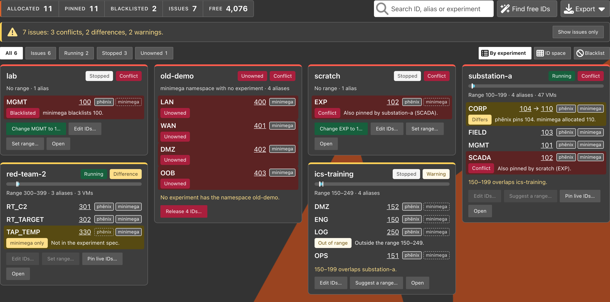
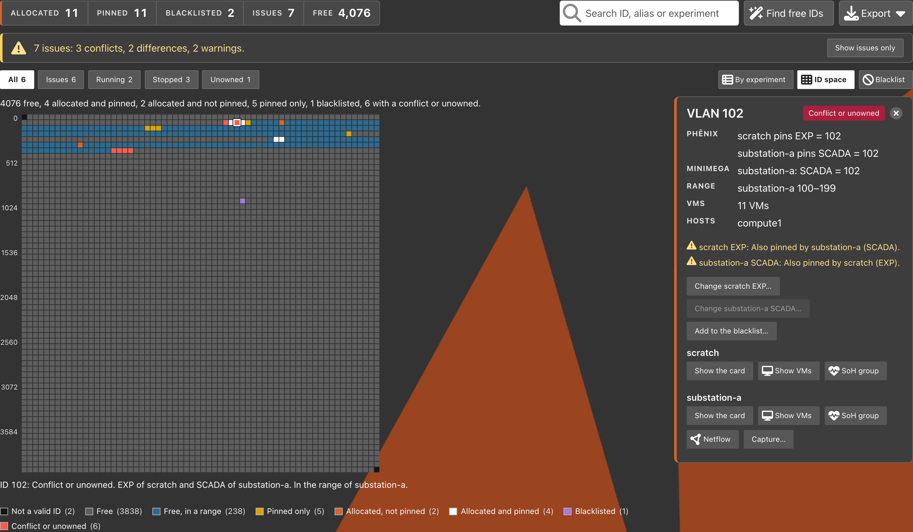
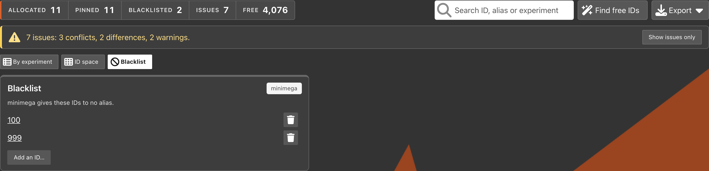
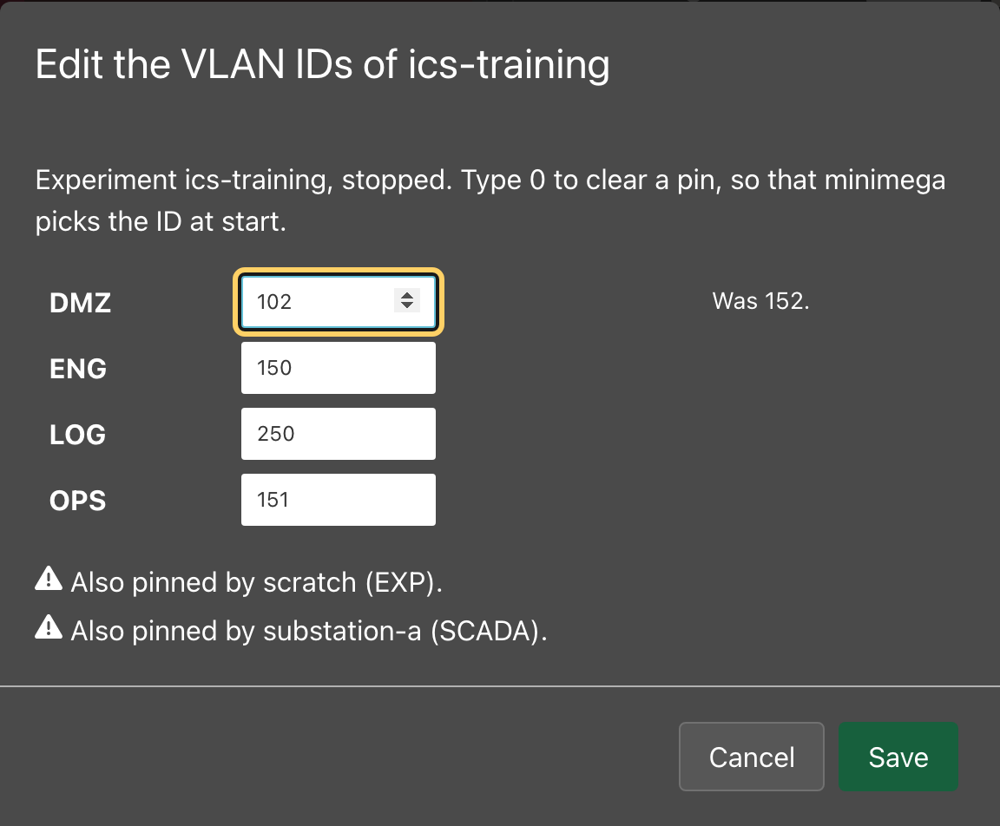
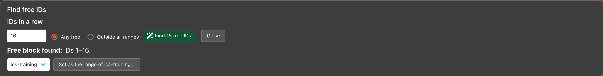

# VLANs

The `VLANs` page (in the `Resources` menu) shows every VLAN ID in use in the
cluster: which experiment and alias use it, and whether phēnix and minimega
agree. You can also pin IDs, set ranges, edit the minimega blacklist, and
release IDs that no experiment owns.

All experiments on the phēnix bridge share one pool of IDs, 1 to 4094, and
they stay apart only because their IDs are different. This page shows you a
clash between two experiments before the second one fails to start.

{: width=800 .center}

## Permissions

A role scoped to some experiments sees only the IDs of those experiments. The
blacklist and the namespaces that no experiment owns show only to roles with
the resource name `*` (see [Resource: `vlans`](user-administration.md#resource-vlans)).
When an issue involves an experiment you can't see, the page calls it
`another experiment`.

## What the Page Shows

The page merges two sources:

* phēnix has, for each experiment, running or stopped, the pinned ID of each
  alias (`spec.vlans.aliases`), the range (`spec.vlans.min` and
  `spec.vlans.max`), and the aliases its topology uses.
* minimega has the ID it gave each alias in each namespace, and the
  cluster's blacklist.

When the two disagree, the alias shows both, phēnix first: `104 → 110`. The
sources are only compared for running experiments, since a stopped experiment
has no minimega namespace. If phēnix can't read minimega, the page shows only
the experiment specs.

An ID can be `pinned` (the experiment spec sets it), `allocated` (minimega
gave it to an alias in a running namespace), `blacklisted` (minimega gives it
to no alias), or more than one of these at once. An ID with none of these is
free.

### Issues

Click `Show issues only`, or the `Issues` total, to see only the cards with
an issue.

| Kind | Severity | Means |
| :--- | :--- | :--- |
| `duplicate-pin` | conflict | Two owners pin or use the same ID, and at least one of them pins it. |
| `pin-blacklisted` | conflict | A pin uses an ID on the minimega blacklist. |
| `unowned` | conflict | A minimega namespace holds IDs, but no phēnix experiment has that name. |
| `id-differs` | difference | A running experiment pins one ID for an alias, but minimega gave the alias a different ID. |
| `minimega-only` | difference | minimega has an alias of a running experiment that the spec does not have. |
| `range-overlap` | warning | The ranges of two experiments overlap. It's a problem only when they run at the same time. |
| `out-of-range` | warning | A pin is outside the range of its experiment. |

## Views

The page has three views:

* `By experiment` (the default) has a card for each experiment and for each
  minimega namespace that no experiment owns. A card shows the experiment's
  status, a bar of the ID space with its range and IDs, and each alias with
  its IDs and issues.
* `ID space` (`/vlans?view=grid`) shows every ID from 0 to 4095 as a cell in
  a 64 × 64 grid, colored by state. Drag across the grid, or Shift+click, to
  see a summary of a range of IDs.
* `Blacklist` (`/vlans?view=blacklist`) lists each ID on the minimega
  blacklist.

{: width=800 .center}

{: width=800 .center}

### Details Panel

Click any ID, on a card or in the grid, to open its details: each experiment
that pins it, each minimega namespace that uses it, whether it's blacklisted,
which experiment ranges hold it, the VMs on it (with their interface and
host), and its issues. From there you can jump to the experiment's card, its
VMs, its [State of Health](state-of-health.md) group, or its
[Netflow](netflow.md) tab, or start a packet capture (`Capture…`) on every
interface on that VLAN of a running experiment.

### Filters, Search and Links

The search box matches an ID that a card holds or ranges over, or part of an
experiment or alias name. The page keeps its state in the URL, so you can
share a link to exactly what you're looking at. For example,
`/vlans?experiment=substation-a` shows only that experiment's card,
`/vlans?vlan=102` opens the details of ID 102, and `?filter=issues` and
`?q=MGMT` apply a filter and a search.

## Fixing a Conflict

If an experiment fails to start because minimega gave one of its pinned IDs
to another alias, the error message has a `Show the conflict` link that opens
this page on that ID (see
[VLAN In Use at a Start](experiments.md#vlan-in-use-at-a-start)).

The cards and the details panel offer quick fixes for an issue, such as
`Change <alias> to <id>…`, which opens the ID dialog with a free ID filled
in, or `Suggest a range…` for a range that overlaps another.

!!! note
    You can only change the pins or the range of a stopped experiment.
    `Pin live IDs…` is the only change you can make to a running one.

{: width=500 .center}

### Pinning and Unpinning IDs

Click `Edit IDs…` on an experiment's card. Type an ID from 1 to 4094 for
each alias you want to pin, or 0 to unpin it. An alias with no pin gets its
ID from minimega when the experiment starts. A pin outside the experiment's
range is refused.

```shell
# Pin the EXP alias of my-exp to VLAN 101
phenix vlan alias my-exp EXP 101

# Unpin it
phenix vlan alias my-exp EXP --unpin
```

### Setting a Range

minimega gives an experiment's aliases IDs from its range. Click
`Set range…` and fill in `Minimum` and `Maximum`, or click
`Suggest a free range` to fill in the first free block outside all ranges,
with one ID for each alias. `Clear the range` removes it. A range must hold
every pin of the experiment, and a range that overlaps another experiment's
range is a warning.

```shell
phenix vlan range my-exp 150 199
phenix vlan range my-exp --clear
```

### Pinning the Live IDs

When minimega gave an alias of a running experiment an ID that the spec does
not pin, `Pin live IDs…` copies the IDs from minimega into the spec, so the
next start gets the same IDs. An ID outside the experiment's range is
refused.

```shell
phenix vlan pin-live my-exp
```

### Changing the Blacklist

minimega gives a blacklisted ID to no alias, which is handy for an ID that a
hardware switch uses. Use `Add an ID…` on the `Blacklist` card or
`Add to the blacklist…` in the details panel. You can't blacklist an ID that
a minimega namespace already gave to an alias.

```shell
phenix vlan blacklist add 100
phenix vlan blacklist remove 100
```

!!! warning
    Removing an ID from the blacklist needs a minimega that has the
    `clear vlans blacklist <vlan>` command (see
    [sandia-minimega/minimega#1688](https://github.com/sandia-minimega/minimega/pull/1688)).
    With an older minimega the remove buttons are disabled, so phēnix can't
    undo an addition. minimega also refuses to remove an ID that a VM uses.

### Releasing Unowned IDs

A minimega namespace can keep its IDs after its experiment is gone. Click
`Release <n> IDs…` on its card to clear its aliases in minimega, so the IDs
can go to other experiments. phēnix refuses to release a namespace that an
experiment has, or whose VMs use its IDs.

```shell
phenix vlan release old-demo
```

## Find Free IDs

To find a block of free IDs:

1. Click `Find free IDs`.
2. Type how many IDs in a row you need. The default is 16.
3. Select `Any free`, or `Outside all ranges`.
4. Click `Find <n> free IDs`.

{: width=800 .center}

A free ID is one that no experiment in the cluster pins, no minimega
namespace uses, and minimega does not blacklist. If the block is in an
experiment's range, use it only for that experiment, or select
`Outside all ranges`. To make the block the range of a stopped experiment,
select the experiment, then click `Set as the range of <experiment>…`.

```shell
phenix vlan free --count 16 --outside-ranges
```

## Conflict Check Before a Save

phēnix checks an experiment's VLAN IDs against the cluster before each of
these saves:

* `Save VLAN IDs` in the `VLAN IDs` menu of a stopped experiment (see
  [VLAN Aliases](experiments.md#vlan-aliases))
* a save of an `Experiment` config in the config editor
* `Save` in the ID and range dialogs of this page

If it finds issues, the `VLAN Conflicts` dialog lists them. Click
`Save anyway` to save, or `Cancel` to keep the old IDs. If the check can't
run, the save goes ahead, and phēnix checks the IDs again when the experiment
starts. A new pin from the ID dialog is the exception: when minimega does not
answer, phēnix refuses it. To save such a pin anyway, use
`phenix vlan alias --force` or `?force=true` on the API.

To run the same check from the command line without saving anything:

```shell
phenix vlan check my-exp --alias EXP_1=101 --alias EXP_2=102
phenix vlan check my-exp --range 100-199
```

## Export

Click `Export`, then `CSV` or `JSON`, to save the rows of the cards that the
filters and search show. `vlans.csv` has one row for each ID of each owner,
plus a row with an empty `id` for each alias that has no pin and no live ID.
`vlans.json` has the same structure as the `GET /api/v1/vlans` response.

## Command Line

The `phenix vlan` commands give the same data and make the same changes (see
[phenix vlan](cli/vlan.md)). The ones not shown above:

```shell
# List every VLAN ID in the cluster, with a second table of issues
phenix vlan list

# Only the rows of one experiment, or only the rows with an issue
phenix vlan list --experiment substation-a
phenix vlan list --issues

# The CSV file of the Export button
phenix vlan list -o csv > vlans.csv

# List the blacklist
phenix vlan blacklist
```

`phenix vlan alias` and `phenix vlan range` run the same checks as the page,
and `--force` saves the change anyway. `--dry-run` checks a removal (an
unpin, `range --clear`, `release` or `blacklist remove`) without making it.

## API

The `/api/v1/vlans` and `/api/v1/experiments/{name}/vlans` endpoints do the
same as the page and the commands. For example, `GET /api/v1/vlans?issues=true`
lists only the rows with an issue. The [API docs](api.md) list each endpoint,
parameter and status under the `VLANs` tag.

Add `?force=true` to save a pin or range change that has a conflict, or a pin
when minimega does not answer.

## See Also

* [Bridge Mode](bridge-mode.md): one bridge per experiment.
* [GRE Mesh](gre-mesh.md): carry VLANs between cluster hosts over GRE tunnels.
* [Troubleshooting](troubleshooting.md#an-experiment-cannot-get-its-vlans): when an experiment cannot get its VLANs.
