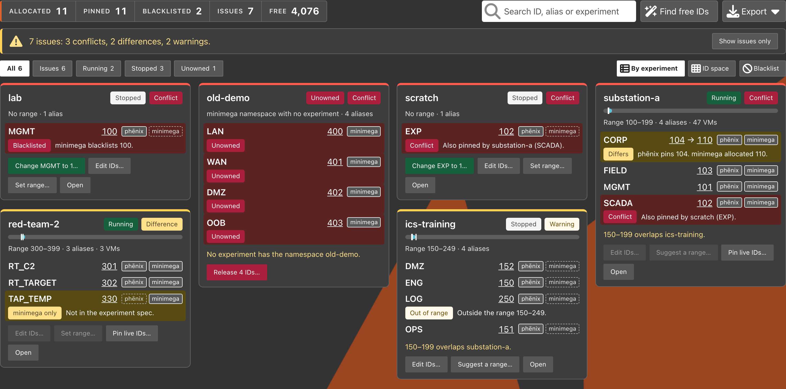
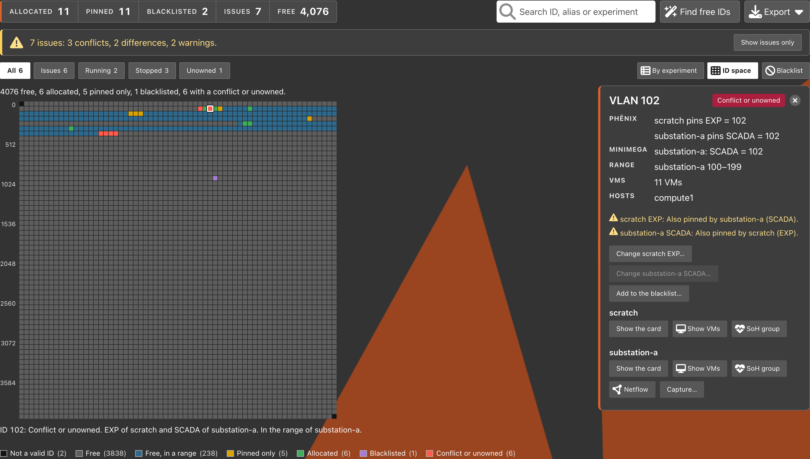
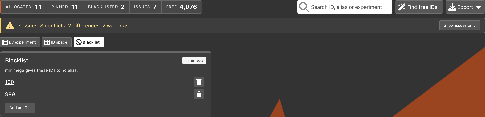

# VLANs

The `VLANs` page (in the `Resources` menu) shows each VLAN ID in the
cluster. It shows the experiment and the alias that use each ID, and whether
phēnix and minimega agree. On the same page you can pin IDs, set ranges,
change the minimega blacklist and release IDs that no experiment owns.

All experiments on the phēnix bridge get their IDs from one pool of IDs, 1
to 4094. They stay apart only because their IDs are different. The page
shows a clash between two experiments before the second experiment fails to
start.

{: width=800 .center}

## Permissions

The page needs `list` on `vlans`. A `vlans` resource name is an experiment
name, and the page shows the IDs of each experiment that your role may list.
The blacklist and the minimega namespaces that no experiment owns show only
with the resource name `*`.

When an issue names an experiment that your role may not see, the page calls
it `another experiment`. The VM list of the [details panel](#details-panel)
needs `get` on `vlans`. Each change needs its own permission (see
[Actions](#actions)).

The `Experiment Admin`, `Experiment User` and `Experiment Viewer` roles have
`list` and `get` on `vlans` for their experiments. `Global Admin` and
`Global Viewer` see all of the cluster (see
[Roles](user-administration.md#roles)).

## Sources and Differences

The page merges two sources into one list of rows. Each row is one VLAN ID of
one owner and one alias.

| Source | What it gives |
| :--- | :--- |
| phēnix | For each experiment, running or stopped: the pinned ID of each alias (`spec.vlans.aliases`), the range (`spec.vlans.min` and `spec.vlans.max`), and the aliases that the topology uses. |
| minimega | For each namespace: the ID that minimega gave each alias. For the cluster: the blacklist. |

Each alias on a card has two source tags, `phēnix` and `minimega`. A tag is
solid when that source has an ID for the alias. When the two IDs are
different, the alias shows both IDs, the phēnix ID first: `104 → 110`.

phēnix compares the two sources only for a running experiment. A stopped
experiment has no minimega namespace, so a pin with no minimega ID is
usual for it.

When phēnix cannot read minimega, a notice says so. The page then shows only
the phēnix experiment specs, with no differences.

### Row States

A row can have more than one state. An ID that the spec pins and that
minimega also gave the alias has the two states `pinned` and `allocated`.

| State | Means |
| :--- | :--- |
| `pinned` | The experiment spec sets this ID for the alias. |
| `allocated` | minimega gave this ID to the alias in a running namespace. |
| `blacklisted` | minimega gives this ID to no alias. |

An ID that no row has is free. Free IDs show only in the
[ID space view](#id-space-view), in the totals and in
[Find Free IDs](#find-free-ids).

### Issues

The banner above the cards counts the issues by severity, for example
`7 issues: 3 conflicts, 2 differences, 2 warnings.` A conflict between two
experiments counts one time. Click `Show issues only`, or the `Issues` total,
to show only the cards with an issue.

| Kind | Severity | Means | Example message |
| :--- | :--- | :--- | :--- |
| `duplicate-pin` | conflict | Two owners pin or use the same ID, and one of them at least pins it. | `Also pinned by scratch (EXP).` |
| `pin-blacklisted` | conflict | A pin uses an ID on the minimega blacklist. | `minimega blacklists 100.` |
| `unowned` | conflict | A minimega namespace holds IDs, but no phēnix experiment has that name. | `No experiment has the namespace old-demo.` |
| `id-differs` | difference | A running experiment pins one ID for an alias, but minimega gave the alias a different ID. | `phēnix pins 104. minimega allocated 110.` |
| `minimega-only` | difference | minimega has an alias of a running experiment that the spec does not have. | `Not in the experiment spec.` |
| `range-overlap` | warning | The ranges of two experiments overlap. It is a problem only when the two experiments run at the same time. | `150–199 overlaps substation-a.` |
| `out-of-range` | warning | A pin is outside the range of its experiment. | `Outside the range 150–249.` |

Each card shows the issues from the point of view of its experiment. The
cards with the worst issues come first, then the cards are in name order.
The cards fill each row from left to right, and each card moves up to the
bottom of the card above it.

## By Experiment View

The page opens in the `By experiment` view. It has a card for each
experiment and a card for each minimega namespace that no experiment owns.
The `Blacklist` card is in the [Blacklist view](#blacklist-view). Each card
shows:

* the name, and a tag: `Running`, `Stopped` or `Unowned`
* a tag for its worst issue: `Conflict`, `Difference` or `Warning`
* a bar of the ID space, 1 to 4094, with the range and the IDs of the
  experiment
* the range, the count of aliases and, for a running experiment, the count of
  VMs
* each alias with its IDs, its source tags, its worst issue and the message
  of each issue. A pinned alias has a solid edge and a pushpin icon. An alias
  with no pin has a dashed edge, and shows `Not pinned` when minimega did not
  give it an ID.
* the buttons for the [actions](#actions) that your role may use, and a flask
  button that opens the experiment. `Edit IDs…`, `Set range…` and
  `Pin live IDs…` are icon buttons (a pencil, arrows and a pushpin). Their
  tooltips give their names.

Click an ID to open its [details](#details-panel). Click the name of a card
to select the card. The ID space view then outlines the range and the IDs of
that experiment. Click the name again to clear the selection.

## ID Space View

Click `ID space`, or open `/vlans?view=grid`, to see each ID from 0 to 4095
as a cell in a grid of 64 rows of 64 IDs. IDs 0 and 4095 are not valid VLAN
IDs. The color of a cell shows the most important state of its ID:

* `Not a valid ID`
* `Free`
* `Free, in a range`
* `Pinned only`
* `Allocated, not pinned`
* `Allocated and pinned`
* `Blacklisted`
* `Conflict or unowned`

The legend below the grid counts the IDs in each state, and names each
outline:

* `Range of <experiment>` and `IDs of <experiment>`, for the selected card
* `Free block found`, for the result of [Find Free IDs](#find-free-ids)

A filter or a search dims the IDs that no card on screen holds or ranges
over. The line below the grid describes the ID under the pointer. Click a
cell to open the details of its ID.

To see the details of a range of IDs, drag across the IDs, or hold Shift and
click an ID. Shift+click selects the IDs from the last ID that you opened. The
range panel counts the IDs in each state, and names the experiment ranges
that hold them. It lists each ID in use (at most 50) with its state, its pins
and its minimega aliases, and the issues of the IDs. Click an ID in the panel
to open its own details.

{: width=800 .center}

To use the grid with the keyboard, move the focus to the grid with Tab.
Then use these keys:

| Key | Moves to |
| :--- | :--- |
| Arrow keys | The next ID in that direction |
| Page Up and Page Down | The ID 8 rows up or down |
| Home and End | The first or last ID of the row |
| Ctrl+Home and Ctrl+End | ID 1 or ID 4094 |
| Enter | Opens the details of the ID |
| Shift+Enter | Opens the range panel of the IDs from the last ID that you opened to this ID |

## Blacklist View

Click `Blacklist`, or open `/vlans?view=blacklist`, to see only the
`Blacklist` card. The card has the tag `minimega` and lists each ID on the
minimega blacklist. The `Blacklist` button shows only when your role may see
the blacklist. This view has no filter buttons. A link with
`?filter=blacklist` also opens the `Blacklist` view.

{: width=800 .center}

## Details Panel

The details panel opens next to the view. It shows the VLAN ID, its state,
and these items when they apply:

* `phēnix`: each experiment that pins the ID, and its alias
* `minimega`: each namespace that gave the ID to an alias
* `Blacklist`: when minimega blacklists the ID
* `Range`: each experiment whose range holds the ID
* `VMs`: the VMs on the ID, with their experiment, interface and host. The
  panel names the first 10 VMs.
* `Hosts`: the cluster hosts of those VMs
* the message of each issue of the ID

Below these items are the actions that your role may use on the ID. For each
experiment with the ID, the panel also has these buttons:

* `Show the card`: shows the card of the experiment in the `By experiment`
  view
* `Show VMs`: opens the experiment with a search for the alias
* `SoH group`: opens the [State of Health](state-of-health.md) of the
  experiment
* `Netflow`: opens the [Netflow](netflow.md) tab of a running experiment with
  the ID in its search. It needs `get` on `experiments/netflow`.
* `Capture…`: starts packet captures on each interface on the VLAN of a
  running experiment. It needs `create` on `vms/captures`.

Click the close button, or the browser's Back button, to close the panel.

## Filters, Search and Links

The buttons above the view filter the cards, and each button counts its
cards: `All`, `Issues`, `Running`, `Stopped` and `Unowned`. The `Blacklist`
view does not show these buttons.

The search box finds a card by an ID that it holds or ranges over, or by a
part of its name or of an alias name. The search ignores case. The filters
and the search apply to the `By experiment` and `ID space` views.

The page keeps its state in the query string, so you can copy a link to it:

| Key | Example | Shows |
| :--- | :--- | :--- |
| `view` | `?view=grid` or `?view=blacklist` | The ID space view or the Blacklist view |
| `filter` | `?filter=issues` | The cards of one filter button |
| `q` | `?q=MGMT` | The cards that match the search |
| `experiment` | `?experiment=substation-a` | Only the card of the experiment, selected |
| `vlan` | `?vlan=102` | The details of the ID |

An `Experiment:` tag shows the `experiment` key. Click its close button to
show all experiments again. The browser's Back button cancels each change
except text that you type in the search box.

## Find Free IDs

To find a block of free IDs, do these steps:

1. Click `Find free IDs`.
2. Type the count of IDs in a row. The default is 16.
3. Select `Any free`, or `Outside all ranges`.
4. Click `Find <n> free IDs`.

A free ID is an ID that no experiment pins, no minimega namespace uses and
minimega does not blacklist. The search counts all experiments, also the
experiments that your role cannot see. The page goes to the ID space view
and outlines the block.

When the block is in the range of an experiment, a note says so. Use that
block only for that experiment, or select `Outside all ranges`. To make the
block the range of a stopped experiment, select the experiment, then click
`Set as the range of <experiment>…`.

## Export

Click `Export`, then `CSV` or `JSON`. The file holds the rows of the cards
that the filters and the search show:

* `vlans.csv` has the columns `id`, `alias`, `experiment`, `namespace`,
  `running`, `states`, `phenix`, `minimega`, `vms`, `hosts` and `issues`. It
  has a row for each ID of each owner. Each alias with no pin and no live ID
  also has a row, with an empty `id`.
* `vlans.json` has the same structure as the `GET /api/v1/vlans` response.

## Actions

The cards and the details panel show only the actions that your role may
use. A change to the pins or the range needs a stopped experiment. On a
running experiment these buttons are disabled, and their tooltip says
`Stop the experiment to change its VLAN IDs`. `Pin live IDs…` is the only
change to a running experiment.

| Action | Where | Needs |
| :--- | :--- | :--- |
| `Change <alias> to <id>…` on a card, or `Change <experiment> <alias>…` in the details panel: opens the ID dialog with a free ID | Experiment card, details panel | `patch` on `experiments` |
| `Edit IDs…`: pins or unpins the aliases | Experiment card | `patch` on `experiments` |
| `Set range…`: sets or clears the range | Experiment card | `patch` on `experiments` |
| `Suggest a range…`: opens the range dialog with a free range, for a range that overlaps | Experiment card | `patch` on `experiments` |
| `Pin live IDs…`: copies the minimega IDs into the spec | Card of a running experiment | `patch` on `experiments` |
| `Add an ID…` or `Add to the blacklist…` | Blacklist card (in the Blacklist view), details panel | `create` on `vlans/blacklist` with the resource name `*` |
| The remove button of an ID, or `Remove from the blacklist…` | Blacklist card (in the Blacklist view), details panel | `delete` on `vlans/blacklist` with the resource name `*` |
| `Release <n> IDs…` or `Release the IDs of <namespace>…` | Unowned card, details panel | `delete` on `vlans/allocations` with the resource name `*` |

### Pinning and Unpinning IDs

The ID dialog has a field for each alias. Type an ID from 1 to 4094, or 0 to
unpin the alias. When an alias has no pin, minimega selects its ID when the
experiment starts. The dialog checks the new IDs in the cluster while you
type, and shows each issue that it finds. Click `Save` to save the IDs.

phēnix refuses a pin that is outside the range of the experiment. When a pin
gives a conflict, phēnix asks you before it saves it (see
[Conflict Check Before a Save](#conflict-check-before-a-save)). When some IDs
do not save, the dialog stays open with those IDs.

### Setting a Range

minimega gives the aliases of the experiment IDs from its range. The range
dialog has the `Minimum` and `Maximum` fields. `Suggest a free range` fills
in the first free block outside all ranges, with one ID for each alias. The
dialog checks the range in the cluster while you type. Click
`Clear the range` to remove the range.

phēnix refuses a range that does not hold a pin of the experiment. A range
that overlaps the range of another experiment is a warning, and phēnix asks
you before it saves it.

### Pinning the Live IDs

`Pin live IDs…` shows on the card of a running experiment when minimega gave
an alias an ID that the spec does not pin. The confirmation lists each alias
with its old and new ID. phēnix then copies the IDs from minimega into the
spec, so the next start gives the same IDs. phēnix refuses an ID that is
outside the range of the experiment.

### Changing the Blacklist

minimega gives a blacklisted ID to no alias, for example an ID that a
hardware switch uses. phēnix refuses to blacklist an ID that a minimega
namespace gave to an alias. While an addition or a removal runs, its button
shows a spinner, and the `Blacklist` card shows a status line, such as
`Adding 100 to the blacklist…`.

To remove an ID from the blacklist, phēnix needs a minimega that has the
`clear vlans blacklist <vlan>` command (see
[sandia-minimega/minimega#1688](https://github.com/sandia-minimega/minimega/pull/1688)).
With an older minimega, the remove buttons are disabled. Their tooltip says
`minimega cannot remove IDs from its blacklist`. The confirmation to add an
ID then tells you that you cannot undo the change. minimega refuses to remove
an ID that a VM uses.

If the minimega blacklist has a number that is not in 1–4094, the `Blacklist`
card shows it with `(not a VLAN ID)` and no remove button.

### Releasing Unowned IDs

A namespace that no experiment owns can keep its IDs after its experiment is
gone. `Release` clears the aliases of that namespace in minimega, so minimega
can give the IDs to other experiments. phēnix refuses to release a namespace
that an experiment has, or whose VMs use its IDs.

## Conflict Check Before a Save

phēnix checks the VLAN IDs of an experiment in the cluster before these
saves:

* `Save VLAN IDs` in the `VLAN IDs` menu of a stopped experiment (see
  [VLAN Aliases](experiments.md#vlan-aliases))
* a save of an `Experiment` config in the config editor
* `Save` in the ID dialog and in the range dialog of this page

When the check finds issues, the `VLAN Conflicts` dialog lists them. Click
`Save anyway` to save, or `Cancel` to keep the old IDs. In the dialogs of
this page, `Save anyway` shows only when your role may see each experiment
that the issues name. A blacklisted pin also needs `list` on `vlans` with
the resource name `*`. Otherwise, phēnix refuses the change.

The check needs `list` on `vlans` for the experiment. When the check cannot
run, the save continues, and phēnix checks the IDs again when the
experiment starts.

## Show the Conflict

An experiment start can fail because minimega gives a pinned ID to another
alias. The error message then has a `Show the conflict` link, which opens
this page with the details of that ID. The link needs `list` on `vlans`.

## Refreshing

The page reloads when an experiment starts, stops or changes, and when a
VLAN change occurs. The header's refresh button makes the server read
minimega again (see
[Page Freshness and Refresh](web-ui.md#page-freshness-and-refresh)). The
server reuses a read of minimega for up to 5 seconds while the same
experiments run.

## REST API

The [API docs](api.md) list each parameter and status under the `VLANs` tag.

| Endpoint | Description |
| :--- | :--- |
| `GET /api/v1/vlans` | Lists the rows, the experiments, the issues, the blacklist and the minimega status. `?experiment=`, `?vlan=`, `?state=` and `?issues=true` filter it. `?format=csv` gives a CSV file. |
| `GET /api/v1/vlans/{id}` | Gives the rows, the VM interfaces and the issues of one ID. |
| `GET /api/v1/vlans/free` | Finds the first block of `count` free IDs in a row. `min`, `max` and `outside_ranges` limit the search. |
| `POST /api/v1/vlans/check` | Gives the issues of proposed pins and a range. It saves nothing. |
| `GET /api/v1/vlans/blacklist` | Lists the minimega blacklist. |
| `PUT /api/v1/vlans/blacklist/{id}` | Adds an ID to the blacklist. |
| `DELETE /api/v1/vlans/blacklist/{id}` | Removes an ID from the blacklist. It returns `501` when minimega cannot. |
| `DELETE /api/v1/vlans/allocations/{namespace}` | Releases the IDs of a namespace that no experiment owns. |
| `GET /api/v1/experiments/{name}/vlans` | Gives the aliases, the pins, the live IDs, the range and the issues of one experiment. |
| `PUT /api/v1/experiments/{name}/vlans/aliases/{alias}` | Pins an alias to an ID. |
| `DELETE /api/v1/experiments/{name}/vlans/aliases/{alias}` | Unpins an alias. |
| `PUT /api/v1/experiments/{name}/vlans/range` | Sets the range. |
| `DELETE /api/v1/experiments/{name}/vlans/range` | Clears the range. |
| `POST /api/v1/experiments/{name}/vlans/pin-live` | Pins the live IDs of a running experiment. |

A pin or a range change that gives a conflict returns `409` with the issues.
A pin also returns `409` when minimega does not answer. Add `?force=true` to
save the change anyway. A change to the pins or the range of a
running experiment returns `409`.

## Command Line

The `phenix vlan` commands give the same data and changes (see
[phenix vlan](cli/vlan.md)):

* [`phenix vlan list`](cli/vlan.md#phenix-vlan-list) lists the rows and the
  issues. `--experiment`, `--vlan`, `--state` and `--issues` filter it, and
  `-o csv` gives the CSV file of the [Export](#export).
* [`phenix vlan blacklist`](cli/vlan.md#phenix-vlan-blacklist) lists,
  adds and removes blacklisted IDs.
* [`phenix vlan release`](cli/vlan.md#phenix-vlan-release) releases the IDs
  of an unowned namespace.
* [`phenix vlan pin-live`](cli/vlan.md#phenix-vlan-pin-live) pins the live
  IDs of a running experiment.
* [`phenix vlan alias`](cli/vlan.md#phenix-vlan-alias) and
  [`phenix vlan range`](cli/vlan.md#phenix-vlan-range) show and set pins and
  ranges. `--unpin` clears a pin, and `--clear` clears a range. They do the
  checks of the page, and `--force` saves the change anyway.
* [`phenix vlan free`](cli/vlan.md#phenix-vlan-free) finds a block of free
  IDs, as [Find Free IDs](#find-free-ids) does.
* [`phenix vlan check`](cli/vlan.md#phenix-vlan-check) gives the issues of
  proposed pins and a range, and saves nothing.

`-o json` and `-o yaml` print the body of the matching endpoint. Add
`--dry-run` to `phenix vlan alias --unpin`, `phenix vlan range --clear`,
`phenix vlan release` and `phenix vlan blacklist remove` to check the change
and make none.
