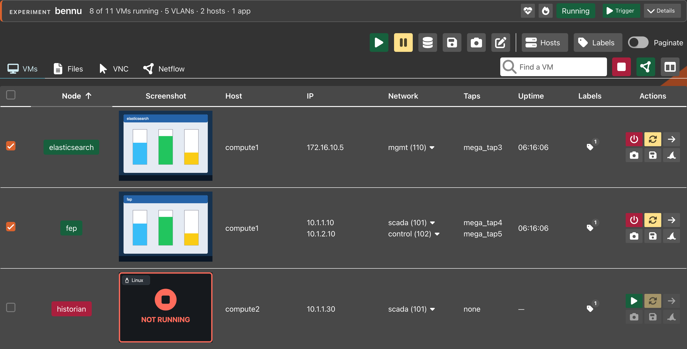
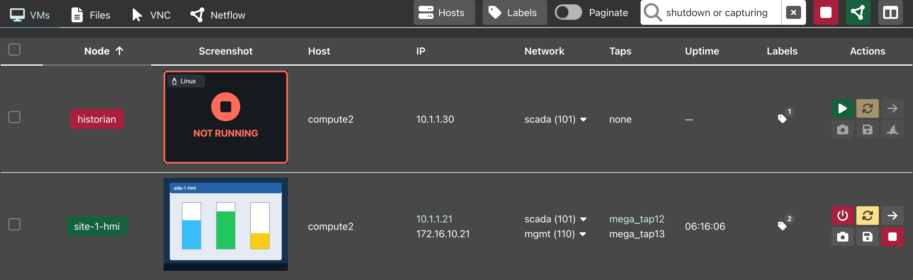
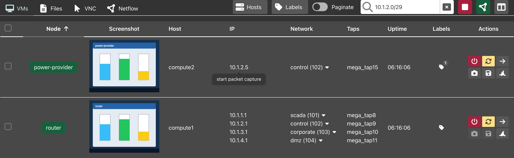
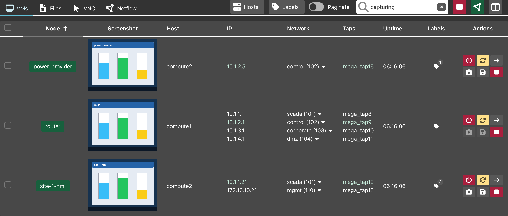

# VM Multi Action

## Selecting VMs

### From the Web-UI

The experiment must be started; click on the experiment name to enter the
Running Experiment component. Within that component, click on the checkbox
in the header of the first column, to the left of the `Node` column, to
select all the VMs; its tooltip reads `Select/Unselect All`. Alternatively,
the checkbox at the start of a VM's row can be used to select the
VM. Once one or more VMs are selected, a toolbar will appear to the
left of the `Hosts` and `Labels` filters, before the search text box.
The buttons on the toolbar are essentially the same as described in
[VMs](vms.md).



### From the Command Line Binary

Several `phenix vm` commands support selecting target VMs by label with `-l` / `--label`, or all VMs using `all`.
When using labels, a VM name argument is not required.

Supported commands:

* `phenix vm info`
* `phenix vm pause`
* `phenix vm resume`
* `phenix vm restart`
* `phenix vm reset-disk`
* `phenix vm redeploy`
* `phenix vm shutdown`
* `phenix vm kill`

Behavior:

* Multiple labels are supported and use OR semantics (a VM is selected if any label matches).
* Labels support glob patterns (for example, `ot-*` or `*-server`).
* The special label `all` selects every VM in the experiment.
* Labels can be provided by repeating `-l` and/or as a comma-separated value.

Examples:

```shell
# Show VM info for all VMs with a label matching "ot-*"
phenix vm info <experiment name> --label ot-*

# Restart VMs that match either label
phenix vm restart <experiment name> -l control -l historian

# Pause VMs using comma-separated labels
phenix vm pause <experiment name> -l control,historian

# Shutdown all VMs in the experiment
phenix vm shutdown <experiment name> --label all
```

## Searching for VMs

The search text box can be used to filter the list of VMs to
only apply actions to the filtered list.

### From the Web-UI

The experiment must be started; click on the experiment name to enter the
Running Experiment component. Within that component, use the search
textbox to find VMs by:

* state - The keywords `running,shutdown,paused,capturing` can be used
  to find VMs in a specific state. Also, the `not` keyword can be used
  to negate search term(s) (i.e. `not running`)

* ipv4 address - VMs in a specific subnet can be found by entering the
  subnet (i.e `192.168.1.0/30`). An address with no mask (i.e. `192.168.1.5`)
  finds the VMs that have that address.

* other fields (i.e. name, taps, tags) - All other fields will be
  searched for a keyword contained within the field

* combine search terms - Search terms can be combined by using `or and`
  keywords. Parenthesis can also be used to group search terms. Two terms
  with no keyword between them use `and`. The search applies `not` first,
  then `and`, then `or`. For example, `web db or ot` is the same as
  `(web and db) or ot`.

* escape keywords - To find keywords that appear in a VM name use double
  quotes. For example, to find a VM named `free_running`, type `"running"`.
  A quoted term can contain spaces. For example, `"web server"` finds a VM
  named `my web server`, but not a VM named `web-server`.

A search that the Web-UI cannot parse finds no VMs. For example, `(web`,
`web and`, and `"web` find no VMs.

The `Hosts` and `Labels` filters beside the search box narrow the list further.

#### Example

Multiple search terms



### From the Command Line Binary

While the interactive search bar is specific to the Web-UI, you can view and list all VMs in an experiment (or filter for specific VMs by name or label) using the `phenix vm info` command:

```bash
# List details for all VMs in an experiment
phenix vm info <experiment name>

# Display details for a specific VM in an experiment
phenix vm info <experiment name> <vm name>

# Filter VMs by label
phenix vm info <experiment name> --label <label>
```

## Starting/Stopping Packet Captures

### From the Web-UI

In the VM table, click a network in the `Network` column to open its menu.
The menu has these capture items:

* `Start capture on this interface` or `Stop capture on this interface`
  starts or stops the capture on that interface.
* `Start interface captures on VLAN <alias>` starts a capture on each
  interface on that VLAN.
* `Stop interface captures on VLAN <alias>` stops the captures on that VLAN.
  The menu shows this item only when an interface on that VLAN has a capture.
* `Capture VLAN <alias>…` opens the dialog of an experiment capture of that
  VLAN. An experiment capture records the VLAN on all hosts into one file. See
  [Experiment Packet Captures](packet-captures.md). When the server does not
  report capture support, the item is disabled and shows the reason.
* `Show capture files in the Files tab` opens the `Files` tab with a search for
  the capture files of that interface.
* `Open live capture in WebShark` opens the capture of that interface on the
  WebShark page. The menu shows this item only when the interface has a capture
  and the server has WebShark.

The VM must be running to start or stop a capture from the menu.

`Start capture on this interface` and
`Start interface captures on VLAN <alias>` open a dialog. Select the `Format`,
`pcapng` or `pcap`, and click `Start`. The capture file name ends in `.pcapng`
or `.pcap` to match the format. When the server does not report capture
support, the items start the captures at once in pcap format.

The menu also has these items:

* `Change VLAN…` moves the interface to another VLAN.
* `Disconnect` disconnects the interface from its VLAN. A dialog asks you to
  confirm.
* `Set link quality…` opens a dialog that shapes the traffic that the VM
  receives on the interface. Enter a loss in percent (less than 100), a delay
  in us, ms, or s (such as `100ms`), or a rate of 1 to 999999999 kbit, mbit,
  or gbit. You cannot set a rate with a loss or a delay. `Clear` removes the link quality from the interface.
* `Show VMs on VLAN <alias>` shows only the VMs on that VLAN. It puts the
  network name and its VLAN ID in the search box, for example `"exp_1 (101)"`.

The VM must be running to use `Change VLAN…`, `Disconnect`, or
`Set link quality…`. If you cannot use an item of the menu, the network shows
as text. A VLAN request shows one message for all of its captures.

The Web-UI has no single control for a subnet's captures. Enter the subnet in
the search box, such as `10.1.5.20/30`, to list the VMs in it. Then click an
address in a VM's `IP` column, or a tap in its `Taps` column, to start a
capture on that interface (see [Packet Capture](vms.md#packet-capture)).




To find every VM with a running packet capture, enter `capturing` in the search
box.



### From the Command Line Binary

To start packet captures on running VMs for a specific subnet, use the following command.

```shell
phenix vm capture start-subnet <experiment name> <subnet>
```

To stop all packet captures for a specific subnet, use the following command.

```shell
phenix vm capture stop-subnet <experiment name> <subnet>
```

To start packet captures on each interface on a VLAN of the running VMs, use
the following command. Give the VLAN alias, such as `EXP_1`.

```shell
phenix vm capture start-vlan <experiment name> <vlan alias>
```

To stop the packet captures on the interfaces on a VLAN, use the following
command. The captures on other interfaces continue.

```shell
phenix vm capture stop-vlan <experiment name> <vlan alias>
```

The `--filter` flag of these four commands limits them to the VMs that the
filter matches.

The `--format` flag of `start-subnet` and `start-vlan` sets the capture file
format, `pcapng` (the default) or `pcap`.

To stop all packet captures for an experiment, use the following command.

```shell
phenix vm capture stop-all <experiment name>
```

## Stopped Experiment Component

Similar to the Running Experiment component, multiple VMs can be selected
for the Stopped Experiment component. Its toolbar shows how many VMs you
selected and has these buttons, named by their tooltips:

* `set to boot` and `set to not boot` clear or set the `do not boot` flag.
* `make the disks persistent` and `make the disks non-persistent` clear or
  set the `snapshot` flag.
* `reset settings to the topology values` sets the host, CPUs, memory, disk,
  inject partition, persistence, and `do not boot` flag of each VM back to
  the values of the topology. The toolbar shows this button only when a
  selected VM has these values. The reset skips each selected VM that does
  not have these values or that already uses them.

Each button changes every selected VM. While the server works, the button
spins and the toolbar tells what it does. Then a message tells how many VMs
changed. A message about VMs that failed has a `Retry failed` button.

The `Hosts` and `Labels` buttons show only the VMs that are assigned to the
hosts you check, or that have the labels you check. In addition, VMs in the
Stopped Experiment component can be searched by:

* state - The keyword `dnb` can be used to find all VMs with the
  `do not boot` flag set to `true`. Also, the `not` keyword can be used
  to negate search term(s) (i.e. `not dnb`)

* ipv4 address - VMs in a specific subnet can be found by entering the
  subnet (i.e `192.168.1.0/30`). An address with no mask (i.e. `192.168.1.5`)
  finds the VMs that have that address.

* other fields (i.e. VM, host, disk)

* combine search terms - Search terms can be combined by using `or and`
  keywords. Parenthesis can also be used to group search terms. The rules
  are the same as in the Running Experiment component: two terms with no
  keyword between them use `and`, and the search applies `not` first, then
  `and`, then `or`.

* escape keywords - To find keywords that appear in a VM name use double
  quotes. For example, to find a VM named `dnb_me`, type `"dnb"`.
  A quoted term can contain spaces. For example, `"web server"` finds a VM
  named `my web server`.

A search that the Web-UI cannot parse finds no VMs.
