# VMs

## VM Info

### From the Web-UI

The experiment must be started; click on the experiment name to enter the
Running Experiment component. Within that component, click on the VM name (its
tooltip reads `details and actions`) and you will be presented with the VM's
details card. The URL `/experiment/<name>?vm=<vm>` opens the details card of
that VM.

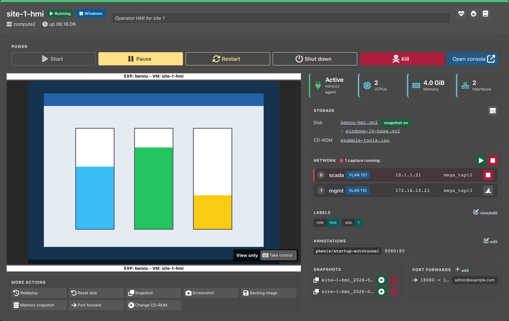{: width=800 .center}

#### The Header

The header is colored by the VM's state and shows:

* the VM name and a state tag: `Running`, `Paused`, `Shut down`, `Building`,
  `Delayed start`, `Error`, `Busy` or `Not booted`
* an OS box that names the guest operating system from the topology's
  `hardware.os_type`, with an icon for its family
* a `do not boot` tag, when the VM is flagged not to boot
* the host the VM runs on and how long it has been up, or
  `starts after <delay>` for a VM with a delayed start
* the VM's description from the topology, if it has one
* buttons that open the experiment's [State of Health](state-of-health.md)
  page, its [SCORCH](scorch.md) page, and this documentation page

#### Screenshot and Console

The top left of the card shows a live, view-only console of the VM (see
[The Details Window](#the-details-window)). Click the screen, or click
`Open console` beside the power buttons, to open the console page of the VM
in a new browser tab. When the VM is not running, the card says so instead,
such as `No screen: the VM is shut down`.

When a VM has no screenshot, the card, the VM table and the VM tiles show a
picture instead. The picture has a large icon and a label in the color of the
VM's state. The colors are the same as the colors of the
[State of Health](state-of-health.md) graph.

| Label | Icon | Color | Shows for |
| :--- | :--- | :--- | :--- |
| `EXTERNAL NODE` | A plug | Blue | An external node |
| `DELAYED START` | An hourglass | Yellow | A VM that waits for its delayed start. When phēnix knows the delay, a second line shows `starts after <delay>`. |
| `NOT RUNNING` | A stop sign | Red | A VM that is not running |
| `DO NOT BOOT` | A ban sign | Purple | A VM that is flagged not to boot |
| `NO SCREENSHOT` | An eye with a slash | Gray | A running VM that has no screenshot |
| `BUSY` | Gears | Gray | A VM that is busy |

When the VM has an `os_type`, a chip at the top left of the picture shows the
icon and the name of the guest operating system.

#### Power

The `Power` section holds the VM's power buttons:

* `Start`: start the VM. On a paused VM the button reads `Resume`.
* `Pause`: pause the VM until it is resumed.
* `Restart`: restart the running VM.
* `Shut down`: power off the VM. It can be started again later.
* `Kill`: kill the VM and remove it from the running experiment.

`Pause`, `Restart`, `Shut down` and `Kill` ask you to confirm first. `Start`
and `Resume` act at once. Each action runs as a [background job](jobs.md),
and the card then shows the VM as the action left it.

#### More Actions

`More actions`, under the screenshot, holds everything else:

| Button | What it does |
| ------ | ------------ |
| `Redeploy` | Kill the VM and deploy it again, optionally with new CPUs, memory or disk |
| `Reset disk` | Reset the VM's disk to how it was when the experiment started, discarding changes |
| `Snapshot` | Save the VM's current disk and memory as a snapshot that can be restored later |
| `Screenshot` | Save a full-size PNG of the VM's screen in the experiment files, in the screenshots folder |
| `Backing image` | Create a new backing image from the current VM disk |
| `Memory snapshot` | Save a dump of the VM's memory for forensics tools such as Volatility |
| `Port forward` | Forward a port to a port on the VM through its miniccc agent |
| `Insert CD-ROM` | Insert an ISO image into the VM's CD-ROM drive. Reads `Change CD-ROM` when one is inserted |
| `Mount disk` | Mount the VM's filesystem to browse, upload and download files |

`Reset disk` and `Snapshot` ask you to confirm first. `Screenshot` saves the
image at once (see [Save a VM Screenshot](#save-a-vm-screenshot)), and the
other buttons open a dialog. `Mount disk` appears only when the `vm-mount`
feature is enabled (see [Mount a VM](#mount-a-vm)). An action that the VM's
state rules out is grayed out with the reason in its tooltip, such as
`Cannot pause: the VM is not running`.

An action that the role cannot do is grayed out. Its tooltip names the
permission that the role needs, for example
`Your role does not permit this action (vms delete)`. This also applies to the
`Actions` column of the VM table, the selection toolbar and the bar of a live
tile. The server still checks each permission.

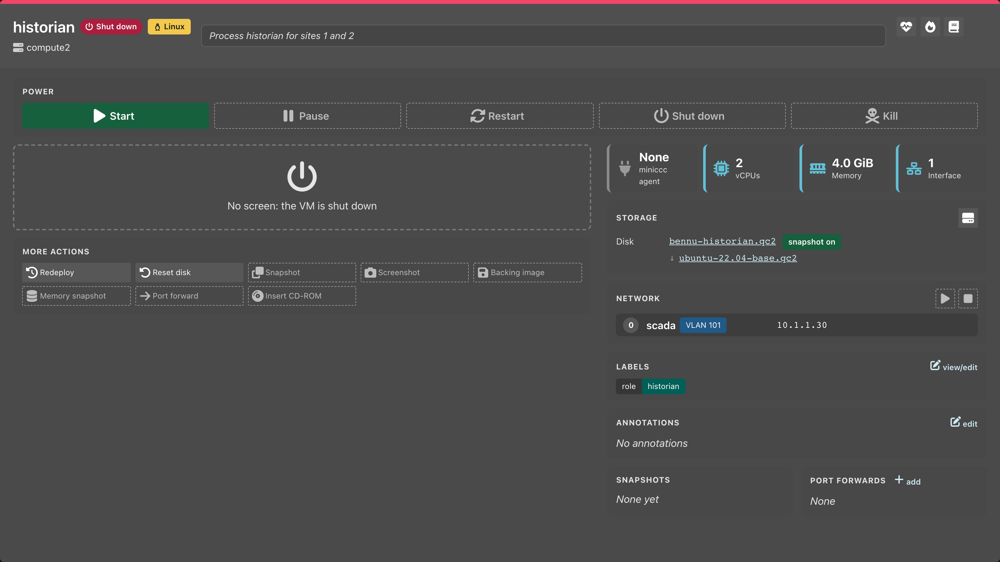{: width=800 .center}

#### Tiles

Four tiles beside the screenshot show the VM's `miniccc agent` state,
`vCPUs`, `Memory` and `Interfaces`.

#### Storage

`Storage` names the VM's disk, tagged `snapshot on` or `snapshot off`. With
`snapshot on`, writes go to a temporary overlay and the disk image is left
unchanged. The disk is named as the [Disks](disks.md) page names it, with the
same icons for an image
[outside the files directory](disks.md#images-outside-the-files-directory) or
with a [broken backing chain](disks.md#broken-backing-chains). Its backing
images are listed beneath it. A `CD-ROM` row appears while an ISO image is
inserted. If your role may list disks, each name opens the image's
[details card](disks.md#the-details-card) on the Disks page.

#### Network

`Network` lists one row per interface: its index, VLAN alias, VLAN ID, IP
address and tap name. Click the alias to move the interface to another VLAN,
if your role may do so. While the VM runs, each connected interface has a
shark-fin button that starts a packet capture on it. A capturing row is
highlighted, its button becomes a red stop button, and an `Open in WebShark`
button appears beside it. The section heading holds `Capture all interfaces`,
`Stop all packet captures` and a button that opens the
[WebShark](webshark.md) tab. See [Packet Capture](#packet-capture) and
[Capture All Interfaces](#capture-all-interfaces).

#### Labels, Snapshots and Port Forwards

`Labels` lists the VM's labels, and `view/edit` opens the label editor.
`Snapshots` lists the VM's snapshots, and the play button next to a snapshot
restores it after you confirm. The trash button next to a snapshot deletes it
after you confirm. The role needs the `delete` verb on the `vms/snapshots`
resource; without it, the trash button is grayed out. `Port forwards` lists
each forward with the user who created it, `add` creates one, and you can
delete the forwards you own. Each section appears only if your role may list
what it holds.

#### Annotations

`Annotations` lists the VM's node annotations, which apps read for per-VM
settings, from the experiment's copy of the topology. If your role may update
the VM, `edit` opens the same editor the create experiment card uses (see
[Adding Annotations](experiments.md#adding-annotations)), and `Save` replaces
the VM's annotations with the list. Changes are saved to the experiment, not
to the Topology config. Apps read most annotations when the experiment
starts, so most changes take effect the next time it starts.

#### VM State Unknown

When minimega does not answer for every VM of a running experiment, the `VMs`
tab says `minimega did not answer. Showing the VMs as configured`. The VMs
minimega did not report are listed as the topology configures them, with no
state, until minimega answers.

#### Busy VMs

While an action runs on the VM, the card shows `Busy with another action` and
disables every action. Clicking a busy VM's name in the table opens a
`VM Busy` alert instead of the card.

### From the Command Line Binary

There are two options for displaying the information for VMs in an experiment. First run
the following command to see information for all VMs in a given experiment.

```shell
phenix vm info <experiment name>
```

Or, run the following to see the information for a specific VM in an experiment.

```shell
phenix vm info <experiment name> [vm name] [--label <label>] [--host <host>]
```

`--host` lists only the VMs running on that cluster host. Repeat it to list
the VMs on any of several hosts, and combine it with a VM name, `--label` or
`--filter`. Press Tab after `--host` to complete host names.

```shell
phenix vm info my-exp --host compute1 --host compute2
phenix vm info my-exp --host compute1 --label role-web
```

`-o json` and `-o yaml` print each VM with the fields of the API, as
`GET /api/v1/experiments/{exp}/vms` gives them.

## Filtering and Sorting the VM Table

On the running experiment's `VMs` tab, the `Hosts`, `Labels` and `Paginate`
controls sit to the left of the `Find a VM` search box.

* `Hosts` lists every cluster host running one of the experiment's VMs. Check
  hosts to list only the VMs running on any of them.
* `Labels` lists every `key=value` label on the experiment's VMs. Check
  labels to list only the VMs that carry any of them.

Each button shows how many items are checked, and `Clear hosts` or
`Clear labels` unchecks them all. The filters combine with each other and
with the search box: a VM must match all of them.

Click the `Labels` heading to sort the VMs by how many labels they have, the
`Network` heading to sort them by the VLAN IDs of their interfaces, or the
`Taps` heading to sort them by tap name. VMs with no VLAN ID or tap, such as
VMs that are not running, come last. The `Uptime` column shows a dash for a
VM that is not running and `unknown` for an external node.

Click the `IP` heading to sort the VMs by the IP addresses of their
interfaces, as numbers. The addresses of one subnet are then together, so
`10.0.0.9` comes before `10.0.0.10`. VMs with no IP address come last. The VM
table of a stopped experiment also sorts by `IP`.

The same filters and sort columns are available through the [API](api.md).

## VM Actions Column

The running experiment's VM table has an `Actions` column of icon buttons
that act on that row's VM without opening its details card:

* `Shut down`, which becomes `Start` (or `Resume` for a paused VM) while the
  VM is not running
* `Restart`
* `Port forward`
* `Snapshot`
* `Backing image`
* `Capture all interfaces`, which becomes `Stop all packet captures` while the
  VM is capturing (see [Capture All Interfaces](#capture-all-interfaces))

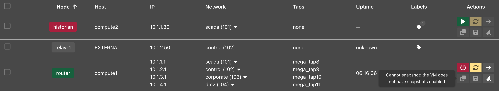{: width=800 .center}

The buttons work as they do on the details card: `Shut down`, `Restart` and
`Snapshot` ask you to confirm, `Port forward` and `Backing image` open their
dialogs, and the rest act at once. A disabled button gives the reason in its
tooltip, such as `Cannot snapshot: the VM does not have snapshots enabled`. A
button that your role cannot use names the permission, such as
`Your role does not permit this action (vms/snapshots create)`. External
nodes have no buttons, and the column is hidden if your role may take none of
these actions. You can turn the column off from the column picker above the table.

## Create a Backing Image

### From the Web-UI

Click on the name of a running VM in a started experiment to open its details
card, then click `Backing image` in `More actions`. The same action is in the
VM table's [Actions column](#vm-actions-column). The VM must be running and
have snapshots enabled.

phēnix shuts down the VM while it makes the image, and then starts the VM
again. It also starts the VM again if the operation fails.

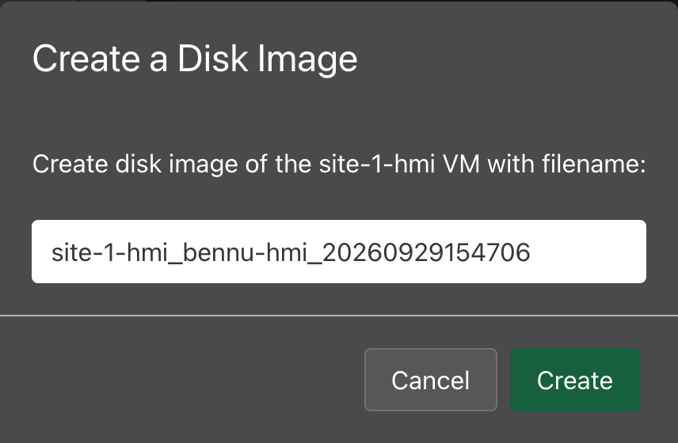{: width=500 .center}

### From the Command Line Binary

To create a backing image from the first disk of a running VM, run the
following command.

```shell
phenix vm commit <experiment name> <vm name> [image name]
```

The image name must be a bare file name, with no folder. It must not start
with a scheme that minimega fetches, such as `file:` or `http:`. If you do not
give a name, phēnix names the image after the base image of the VM and the time.
phēnix writes the image in `<base-dir.phenix>/images` on the head node, and
copies it to the other cluster nodes. The command prints the name of the
image. The VM can run on any cluster node.

The VM must have its snapshot flag set. For a VM with more than one disk, the
image holds only the first disk, and the command shows a warning.

## Create a Memory Snapshot

### From the Web-UI

Click on the name of a running VM in a started experiment to open its details
card, then click `Memory snapshot` in `More actions`. Type the file name and
click `Create`, or click `Cancel` to stop. The button is disabled
when the VM is not running.

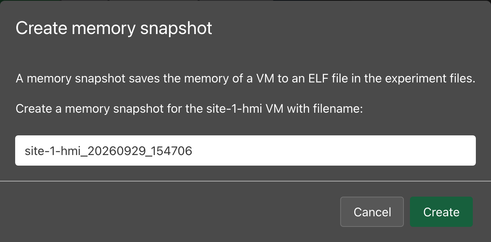{: width=500 .center}

### From the Command Line Binary

To create an ELF memory dump, run the following command.

```shell
phenix vm memory-snapshot <experiment name> <vm name> <snapshot file path>
```

A relative path is in the experiment files directory,
`<base-dir.phenix>/images/<experiment name>/files`. For a VM on a compute
node, phēnix copies the dump to the head node from that directory only. Thus,
for such a VM, phēnix refuses an absolute path outside that directory. Each
memory snapshot stops after one hour if QEMU does not complete it.

## Create a VM Snapshot

### From the Web-UI

Click on a running VM in a started experiment to open its details card, then
click `Snapshot` in `More actions` and confirm. The same action is in the VM
table's [Actions column](#vm-actions-column). The VM must be running and have
snapshots enabled. In Live mode, the bar of a tile in the VNC tab also has
`Snapshot` (see [Live Tiles](#live-tiles)). The selection toolbar and the top
bar of the console page also ask you to confirm. Once a snapshot exists, the
card's `Snapshots` section lists it, and the play button next to its name
restores it.

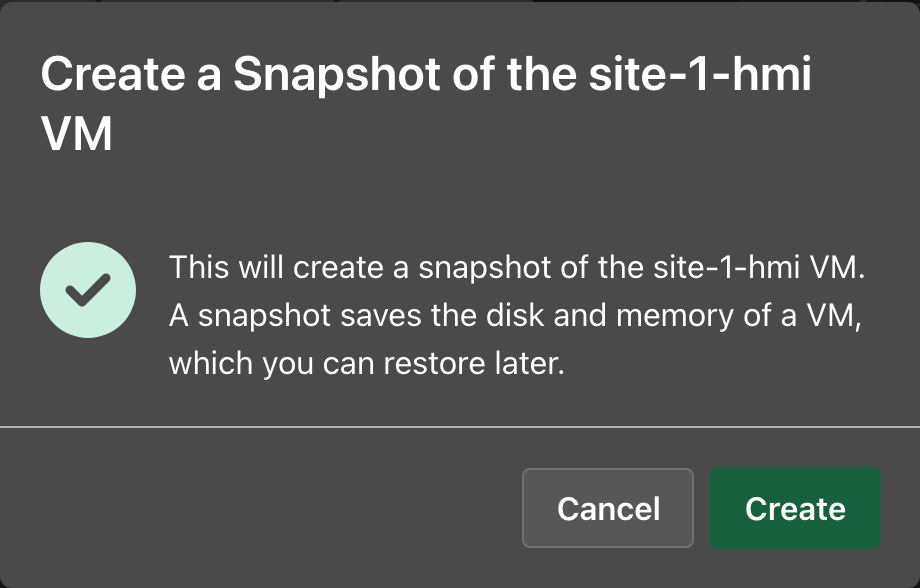{: width=500 .center}

### From the Command Line Binary

A VM snapshot holds the disk and the memory state of a VM. For an ELF memory
dump, use `phenix vm memory-snapshot`. To save and restore the state of a
running VM, do the steps that follow.

1. Create a snapshot of the VM. The command prints the name of the snapshot,
    for example `web__before-update`.

    ```shell
    phenix vm snapshot create <experiment name> <vm name> <snapshot name>
    ```

2. List the snapshots of the VM.

    ```shell
    phenix vm snapshot list <experiment name> <vm name>
    ```

3. Restore the VM to a snapshot. Use a name from the list.

    ```shell
    phenix vm snapshot restore <experiment name> <vm name> <snapshot name>
    ```

To delete a snapshot from every cluster node, use
`phenix vm snapshot delete <experiment name> <vm name> <snapshot name>`. The
experiment does not have to run. phēnix refuses a snapshot whose disk a
running VM uses.

The VM must have its snapshot flag set and only one disk. phēnix refuses a VM
with more than one disk, because a snapshot holds only the first disk
([#145](https://github.com/sandialabs/sceptre-phenix/issues/145)).

phēnix keeps the snapshot files on the cluster node that runs the VM, in
`<base-dir.phenix>/images/<experiment name>/files`. The list shows the
snapshots on all nodes. A restore of a VM on a node other than the head node
can fail if minimega on that node runs with the `-headnode` flag. minimega
then gets the snapshot files from the head node, which does not have them
([#153](https://github.com/sandialabs/sceptre-phenix/issues/153)).

## Save a VM Screenshot

### From the Web-UI

Click on a running VM in a started experiment to open its details card, then
click `Screenshot` (the camera icon) in `More actions`. The console page has
the same button in its top bar. phēnix saves a full-size PNG image of the VM
screen in the experiment files, in the `screenshots` folder. The file name is
`<vm>-<YYYYMMDD-HHMMSS>.png`, with the UTC time. phēnix does not replace a
file: when the name is in use, it adds `-1`, `-2` and so on. A message shows
the name of the file. The button is disabled when the VM is not running.
In Live mode, the bar of a tile in the VNC tab also has `Screenshot`.

The role must have the `create` verb on the `vms/screenshot` resource (see
[User Administration](user-administration.md)).

### From the Command Line Binary

There is currently no CLI subcommand that saves a VM screenshot in the
experiment files. Use the Web-UI or the REST API
(`POST /api/v1/experiments/<exp>/vms/<vm>/screenshots`). To write a PNG image
of the screen to a local file, use `phenix vm screenshot` (see
[VM VNC Access](#vm-vnc-access)).

## VM VNC Access

### From the Web-UI

The experiment must be started. The web UI shows the screen of a VM in three
places:

* The console page (`/vnc`) shows one to four VM consoles in a browser tab.
* The VNC tab of a running experiment and the VM Tiles page show live tiles.
* The details window of a VM shows a live console.

The VM must be running or paused, and it must not be busy with an action. The
role must have the `get` verb on the `vms/vnc` resource (see
[User Administration](user-administration.md)).

!!! note

    The console needs the minimega release that adds the `vga` column to
    `vm info`. With an older minimega, the console shows `minimega is too old:
    vm info has no vga column, update minimega`. Port forwards to the VNC port
    of a VM also fail. Key recordings (`vnc record kb`) of an older minimega
    do not include the key events that noVNC sends.

#### Open a Console

Click the screenshot of a VM in the VMs table, a live tile in the VNC tab, or
`Open console` in the details window of the VM. The console page opens in a
new browser tab. Each link has a real address. You can open the link in a new
window or copy it. When another tab already shows the same VMs, a message
tells you. Click `Open another anyway` to open one more tab.

#### The Console Page

The top bar acts on the pane that has keyboard input. It shows the VM name
and these controls:

* The flask button, at the left of the VM name, opens the page of the
  experiment of the pane.
* In single view, the information button at the right of the VM name opens
  the details card of the VM on the experiment page.
* The VM action buttons: `Pause` or `Resume`, `Restart`, `Shut down`,
  `Screenshot`, `Port forwards`, `Mount disk` and the packet capture button.
  `Screenshot` saves a PNG image of the VM screen in the experiment files
  (see [Save a VM Screenshot](#save-a-vm-screenshot)). `Mount disk` opens
  the same file browser as on the experiment page. It needs the `vm-mount`
  feature, a running VM and an active miniccc agent.
* `Port forwards` lists the port forwards of the VM. Each forward has
  `Remove`. Only the user that made a forward can remove it.
  `Add port forward` opens the same dialog as on the experiment page.
  `Tunneler` opens the [Tunneler](tunneler.md) page in a new tab.
* The packet capture button starts a capture on interface 0 when no capture
  of the VM runs. When minimega can write pcapng, a dialog asks for the
  format first. When a capture of the VM runs, the button is
  `Stop captures` and stops all captures of the VM.
* `Keys`, `Clipboard` and `View` are icon buttons. Their tooltips give their
  names.
* `Keys`: send Ctrl+Alt+Del, Esc, Tab, PrintScreen and Ctrl+Alt+F1 to F12. Hold
  Ctrl, Alt or Win, and release all held keys.
* `Clipboard`: send text to the VM (see [Copy and Paste](#copy-and-paste)).
  `Clear` empties the text box.
* `View`: the scaling (`Fit`, `Actual` or `Resize VM`), the quality, the
  compression, `View only`, full screen for the pane, and the keyboard
  shortcuts (see [The Keyboard Chord](#the-keyboard-chord)). The browser keeps
  these settings for each user. With `View only`, the console shows the VM
  screen, but sends no keyboard or mouse input to the VM.
  `Resize VM` needs a VM with `vga` `virtio`.
  To set it, add `vga: virtio` to the `advanced` settings of the VM in the
  topology. Linux VMs use `qxl` by default.
* `Actions`: a menu with `Snapshot`, `Memory snapshot`, `Backing image` and
  `Capture all interfaces` (or `Stop all packet captures`), then
  `Insert CD-ROM` (or `Change CD-ROM`), then `Edit labels` and
  `Edit annotations`, then `Redeploy`, `Reset disk` and `Kill` in red. They
  open the same dialogs as on the experiment page.
* The layout buttons, `Add VM` and `Full screen` for the page. In full
  screen, the same button is `Exit full screen`. `Add VM` shows the list of
  running VMs that it read the last time, and reads the list again. The
  browser keeps the list for each user.
* The connection state, for example `Connected`. Click it to see the screen
  size, the scaling, the encoding and the copy/paste mode. It also shows the
  host of the VM, its uptime, the state of its miniccc agent and its IP
  addresses, each with a copy button.
* `Hide toolbar`, at the right end, hides the top bar. The panes then use
  all of the page. A small `Show toolbar` button in the top left corner shows
  the bar again. Ctrl+] then T also hides or shows the bar (see
  [The Keyboard Chord](#the-keyboard-chord)). The browser keeps the choice.

An action that the VM state does not allow is grayed out, and its tooltip
gives the reason. An action that the role cannot do is also grayed out. Its
tooltip names the permission, for example
`Your role does not permit this action (vms delete)`.

`Pause`, `Restart`, `Shut down`, `Snapshot`, `Reset disk` and `Kill` ask you
to confirm. `Resume` does not ask. During `Redeploy` and `Reset disk`, the
pane shows that the VM restarts, and the console connects again when the VM
runs. After `Kill`, the pane shows `VM killed` and a link to the experiment
page.

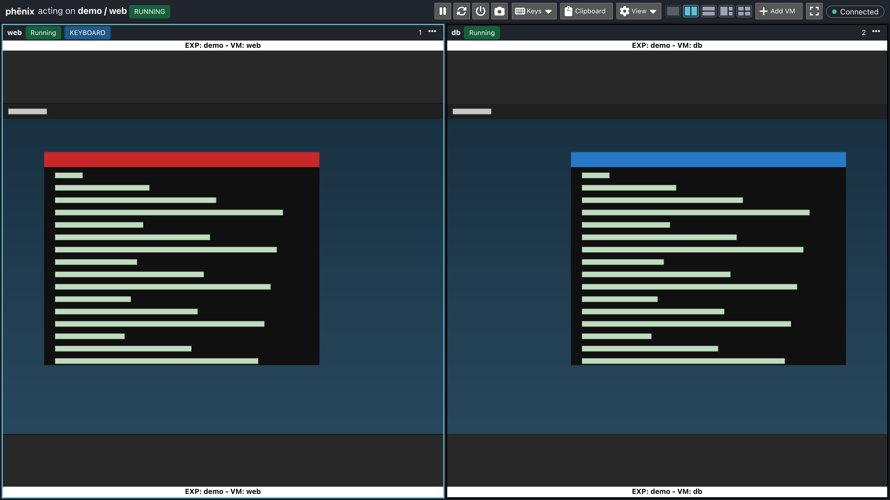

#### Split View

The console page shows up to four VMs. The VMs can be in different
experiments. Use `Add VM` to add a running VM, and select a layout in the top
bar: `One pane`, `Two columns`, `Two rows`, `One large pane and two stacked`
or `Grid of four`. The address of the page keeps the VMs and the layout, for
example `/vnc?vm=demo/web&vm=demo/db&layout=cols`. The layouts are `single`,
`cols`, `rows`, `main-2` and `grid`.

Each pane shows the banners of its VM and a header with the VM name, the VM
state, an information button, the pane number and a menu. The information
button opens the details card of the VM on the experiment page. The menu has `Swap with pane N`, `Open
alone`, `Full screen` and `Close`. Click a pane to give it keyboard input.
That pane shows a blue ring and the `Keyboard` tag. When you close a pane and
only one VM stays, the page shows that VM in one pane.

To open many VMs in one console page, select one to four running VMs in the
VMs tab, or with the check box on each tile in the VNC tab. Then click
`Open N selected in split` in the VNC tab.

#### The Keyboard Chord

The console sends every key to the VM. To move the keyboard out of the
console, press Ctrl+], then one more key:

| Key | Action |
|---|---|
| Tab | Move focus to the top bar. Shift+Tab moves focus to the last control of the bar. When the top bar is hidden, move focus to `Show toolbar`. |
| 1 to 4 | Give keyboard input to that pane. |
| F | Exit full screen. |
| T | Hide or show the top bar. |
| Esc | Cancel the chord. |

Press the key in the position of ] on a US keyboard. On a German keyboard,
that key is +. The `Keyboard` tag, the `Keys` menu and a message show this
hint. The message shows the first time that a pane gets keyboard input in a
browser session.

#### Full Screen and HTTPS

In full screen over HTTPS, Chrome and Edge send Esc, Alt+Tab and Ctrl+W to the
VM (Keyboard Lock). To exit full screen, press Ctrl+] then F, or hold Esc.
Over HTTP, full screen works without Keyboard Lock, and a message says
`Keyboard capture needs HTTPS`. Firefox and Safari do not have Keyboard Lock.
`Paste from clipboard` in the `Clipboard` panel also needs HTTPS.

#### Copy and Paste

The copy/paste mode of a VM comes from its minimega setting
`bidirectional-copy-paste`:

* Paste as keys (the default): phēnix types the text into the VM as key
  presses. It types printable ASCII characters, Tab and Enter only. Before it
  types text with other characters, the panel lists the characters that it
  types as "?" (above U+00FF) and the characters that it skips (U+0080 to
  U+00FF). It also shows the typing time. Click `Type anyway` or `Cancel`.
  For text longer than 5,000 characters, the bidirectional mode is faster.
* Bidirectional: the VM and the `Clipboard` panel exchange UTF-8 text in the
  two directions.

#### Live Tiles

The VNC tab of a running experiment and the VM Tiles page show a live,
view-only tile for each running or paused VM. A tile sends no keys and no
pointer events to the VM. A paused VM keeps a still tile with the `PAUSED`
tag. Click a tile to open its console page. Move the pointer over a tile to
show its bar, with `Open console`, `Details` and the VM power actions. In Live
mode, the bar also has `Screenshot` and `Snapshot`. The bar also shows when a control of the tile has
keyboard focus. A disabled button tells why in its tooltip. `Pause`,
`Restart`, `Shut down`, `Kill` and `Snapshot` ask you to confirm. `Start` and
`Resume` do not ask.

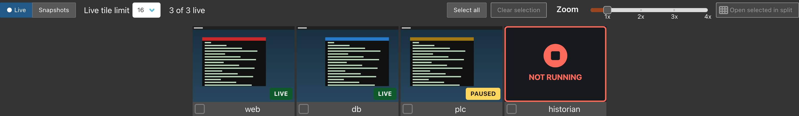

* `Live tile limit` sets how many tiles can be live at one time: 4, 8, 16 (the
  default), 24 or 32. The browser keeps the choice. A tile over the limit
  shows a screenshot with the `Snapshot` tag.
* `Snapshots` turns off all live tiles, and `Live` turns them on again.
* A tile is live only while at least 25% of it is on the screen. A tile that
  leaves the screen, or a browser tab that is hidden, disconnects after 30
  seconds.
* The server does not send screenshots of live tiles.

#### The Details Window

The details window of a VM shows a live, view-only console with the banners of
the VM. Click `Take control` to send keys and pointer events to the VM, and
`View only` to stop. `Open console` opens the console page of the VM.

!!! note

    QEMU allows 32 shared clients for each VM. Every console, live tile,
    details window, minimega recording and paste playback counts. Thus a
    browser tab never opens two connections to one VM. While the details window
    or a console pane of a VM is open, the tile of that VM in the same tab
    disconnects and shows its last screen.

#### VM Settings for VNC

phēnix adds two settings to the minimega script of an experiment:

* For each KVM VM, `vm config qemu-override "-vnc unix:" "-vnc
  lossy=on,vnc=unix:"`, before the `overrides` of the topology. With lossy
  updates, the quality level of a console or a tile selects JPEG for regions
  that look like photos. A topology override that matches `-vnc unix:` no
  longer matches, because this override changes that text first.
* For each Linux VM, `vm config vga qxl`, in place of
  `vm config qemu-append -vga qxl`. phēnix does not add it when the `advanced`
  settings of the VM set `vga`. minimega then shows the video card in the
  `vga` column of `vm info`.

!!! note

    The phēnix host must connect to the VNC port of each VM on the compute
    node that runs the VM. minimega selects a random high TCP port for each
    VM. Make sure that the network lets the phēnix host connect to these ports
    on each compute node. When phēnix cannot connect, the console shows
    `phēnix cannot connect to the VNC port of <vm> on <host> (port <n>)`.

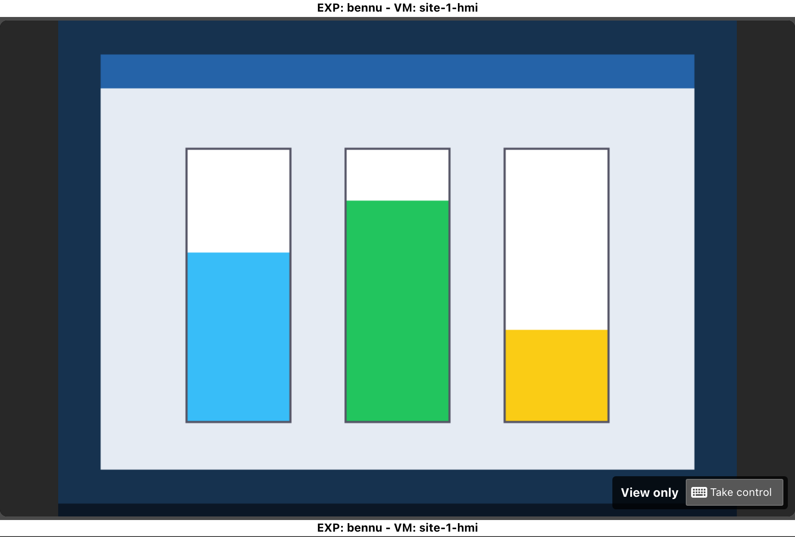{: width=400 .center}

#### VNC Banners

Each pane of the console page and the console of the details window show a
banner above and below the VM's screen. Live tiles show no banners. Both
banners read `EXP: <experiment> - VM: <vm>` unless the VM has a `vncBanner`
annotation:

* A string sets the text of both banners. Each newline in it starts a new
  line.
* A map sets each banner apart. `topBanner` and `bottomBanner` each take a
  `banner` list of lines, a `backgroundColor` and a `textColor`. A banner the
  map leaves out is not shown, and `disabled: true` turns both off.

```yaml
annotations:
  vncBanner:
    topBanner:
      banner:
        - Training range
        - Lab use only
      backgroundColor: "#007a33"
      textColor: white
    bottomBanner:
      banner:
        - Training range
      backgroundColor: "#007a33"
      textColor: white
```

Colors are CSS color names, such as `green`, or hex colors, such as `#007a33`.
Any other color falls back to the default white background or black text.
Banner text is shown exactly as written, so HTML in it appears as text.

### From the Command Line Binary

To reach the VNC console from your computer, add a port forward to it. The
`vnc` value forwards to the VNC console of the VM. Then use
[phenix-tunneler](tunneler.md) to open the forward. The command needs a
running `phenix ui`.

```shell
phenix vm forward add <experiment name> <vm name> vnc
```

`phenix vm forward list` and `phenix vm forward remove` show and remove the
forwards. A forward from the command line has the owner `global-admin`.

To save a PNG image of the screen of a running VM, use the following command.
The command refuses to write the image to a terminal.

```shell
phenix vm screenshot <experiment name> <vm name> -O screen.png
```

## Mount a VM

The VM Mount feature lets you transfer files to and from a running VM directly
through the phēnix Web-UI. It is an optional feature that must be enabled when
starting the phēnix UI with the `vm-mount` feature flag (see
[Enabling VM Mount](#enabling-vm-mount) below).

!!! note

    Mounting a VM requires the minimega command-and-control agent (`miniccc`)
    to be installed and actively running in the VM. If `cc` is not active for a
    VM, the `Mount disk` button is disabled and `phenix vm mount` fails.

### Enabling VM Mount

VM Mount is disabled by default. Enable it by passing the `vm-mount` feature to
the `--features` flag when starting the UI:

```shell
phenix ui --features vm-mount
```

The feature can also be enabled via the `ui.features` configuration key or the
`PHENIX_UI_FEATURES` environment variable. See
[Settings & Configuration](settings.md#settings-reference) for details.

### From the Web-UI

The experiment must be started. Click on the name of a running VM to open its
details card, then click `Mount disk` (the hard-drive icon) in `More actions`.
The button is disabled, with the reason in its tooltip, when the VM is not
running or has no active miniccc agent.

The mount browser modal presents two panes:

* **Local file system** — browse to a file on your local machine and upload it
  into the VM, or download a file from the VM to your local machine. An
  interrupted download resumes when retried from the browser's downloads list.
* **Experiment files** — copy files that already exist on the phēnix server
  into the VM. This option is only available when the
  [experiment file server](settings.md#settings-reference) is enabled (see
  below).

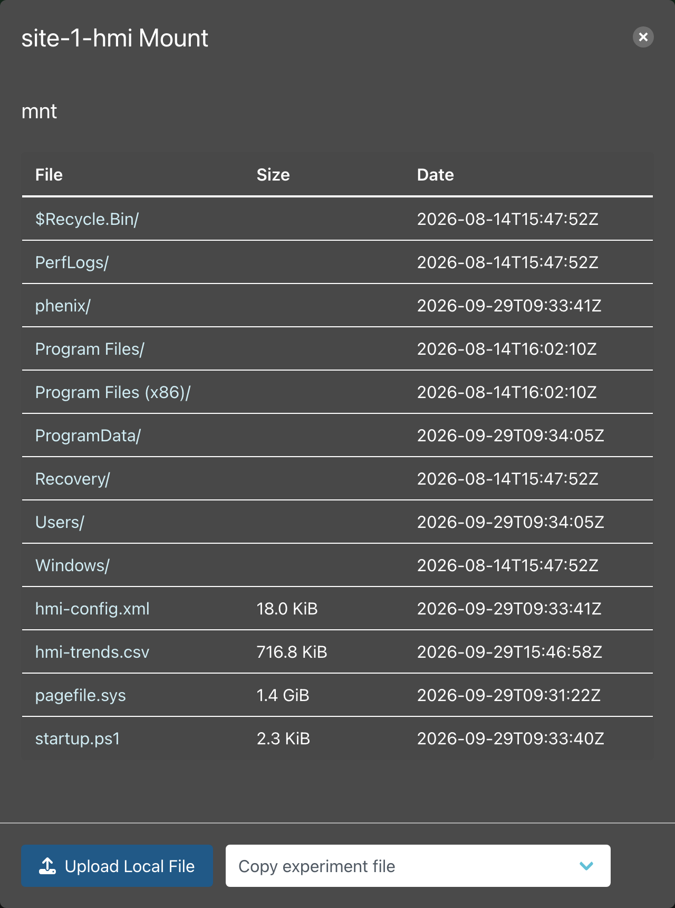{: width=600 .center}

Every path stays inside the VM's file system, so a symbolic link that points
outside it cannot be browsed or written through. Several users can have the
same VM mounted at once, and it is unmounted when the last of them closes the
modal.

### Uploading Experiment Files from the phēnix Server { #uploading-experiment-files-from-the-phenix-server }

phēnix can optionally run a lightweight file server on a port separate from the
main UI. This was added to support environments where the phēnix UI is only
reachable on a private network but files (for example, application installers or
configuration files) need to be uploaded to an experiment from a public network.

When the file server is enabled, the VM Mount modal gains the **Experiment
files** option described above, allowing files that have been uploaded to an
experiment to be copied directly into a VM without going through the user's
local machine.

Enable the file server by passing the `--file-server-endpoint` flag when
starting the UI:

```shell
# Bind to 127.0.0.1 on port 8080 (port-only value binds to localhost)
phenix ui --features vm-mount --file-server-endpoint 8080

# Bind to a specific interface and port
phenix ui --features vm-mount --file-server-endpoint 0.0.0.0:8080
```

The file server presents a simple interface for selecting an experiment and
uploading a file to it. When authentication/authorization is enabled for the
main phēnix UI, it is automatically enforced on the file server as well, so
users must already have valid phēnix credentials to upload files. File upload
permissions are included in the default **Experiment Admin** and **Experiment
User** roles.

See [Settings & Configuration](settings.md#settings-reference) for the
`ui.file-server-endpoint` configuration key.

### From the Command Line Binary

Use `phenix vm mount` to mount a running VM's filesystem to a directory on the
phēnix headnode. Unlike the Web-UI mount browser above, this does not require
the `vm-mount` UI feature flag to be enabled, and the mounted filesystem is
accessed directly on the headnode's filesystem rather than through the
browser.

```shell
phenix vm mount <experiment name> <vm name>
```

The VM is mounted at `<mount-dir>/<experiment name>/<vm name>`, where
`<mount-dir>` defaults to `<base-dir.phenix>/mounts` (see
[`mount-dir`](settings.md#settings-reference)). To use another folder, set
the global `--mount-dir` flag or the `PHENIX_MOUNT_DIR` environment variable.
The command prints the host path once the mount succeeds.

```shell
phenix vm mount my-exp my-vm
# VM my-vm in experiment my-exp mounted at: /phenix/mounts/my-exp/my-vm
```

To unmount the VM's filesystem, run:

```shell
phenix vm unmount <experiment name> <vm name>
```

!!! note

    Mounts are automatically unmounted, and their mount directories removed,
    when the owning experiment is stopped or deleted, so mounts do not
    outlive their experiment.

## Run a Command or Copy a File

### From the Command Line Binary

`phenix vm exec` runs a command in a running VM through its miniccc agent. It
prints the output of the command, and exits with the exit code of the command
when minimega reports it.

```shell
phenix vm exec <experiment name> <vm name> [--] <command> [args...]
```

miniccc runs the command without a shell. To use pipes or redirects, run a
shell. Put `--` before a command that has flags:

```shell
phenix vm exec my-exp host-01 -- sh -c 'ps aux | grep nginx'
```

`phenix vm cp` copies one file into or out of a running VM. Give the VM side
as `<vm name>:<absolute path>`. A path that ends with `/` is a folder.

```shell
phenix vm cp my-exp ./setup.sh host-01:/root/
phenix vm cp my-exp host-01:/var/log/syslog ./syslog
```

Both commands need the miniccc agent in the VM, and wait one minute by
default (`--timeout`). A copy out of the VM works only for a VM on the head
node, and the copy gets the permissions `0600`. phēnix refuses an argument
with a `$` variable or a `file:`, `http:`, `https:` or `tar:` URL, because
minimega would change it on the host.

## Packet Capture

### From the Web-UI

Click on the name of the network tap, or on the IP address, of a running VM in a
started experiment to start a packet capture on that interface. The name of the
network tap will turn green once a packet capture has started. Each interface in
the VM's details card has its own shark-fin button that does the same thing.

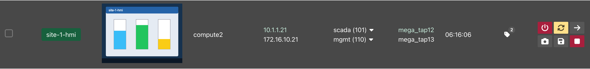{: width=800 .center}

phēnix starts the capture, or stops a running one, without asking you to
confirm. A capture started from the web UI is written to the experiment's
files as `<vm>_<interface>_<time>_<random>.pcap`, so a restarted capture
never replaces an earlier file.

It is possible to start captures on multiple network taps. Stopping the
capture on one interface leaves the VM's other captures running. Use
`Stop all packet captures` to stop them all.

A capture cannot be started on a disconnected interface; phēnix says
`Cannot capture traffic on a disconnected interface.` instead of starting one.

phēnix writes the capture file in pcapng format, and the file name ends in
`.pcapng`. The network menu of the VM table can also
start a capture in pcap format (see
[Starting/Stopping Packet Captures](vm-multi-action.md#startingstopping-packet-captures)).
To capture the traffic of all VMs into one file, see
[Experiment Packet Captures](packet-captures.md).

### From the Command Line Binary

To start a packet capture, run the following command, specifying the target
network interface by its name (as declared in the experiment topology, e.g.
`IF0`) or its zero-based index.

```shell
phenix vm capture start <experiment name> <vm name> <iface name/index> </path/to/out file>
```

The `--format` flag sets the capture file format, `pcapng` (the default) or
`pcap`. phēnix sets the extension of the output file name to match the format.
The `ui.captures.max-size` setting limits the size of the file (see
[Settings](settings.md)).

To stop all packet captures on a running VM, use the following command.

```shell
phenix vm capture stop <experiment name> <vm name>
```

Pass an interface name or index to stop only that interface's capture, leaving
the VM's other captures running.

```shell
phenix vm capture stop <experiment name> <vm name> [iface name/index]
```

To list the running captures of an experiment, or of one VM, use the following
command. `phenix exp captures <experiment name>` gives the same list.

```shell
phenix vm capture list <experiment name> [vm name]
```

A capture continues while its VM is paused.

!!! note
    Stopping the capture on a single interface, from the Web-UI or the command
    line, requires minimega 3.3.0 or later.

To view a capture's packets in the browser, or stream a running capture into a
local Wireshark (`phenix vm capture stream`), see [WebShark](webshark.md).

## Capture All Interfaces

`Capture all interfaces`, in the VM table's
[Actions column](#vm-actions-column) and in the details card's
[Network](#network) section, starts a packet capture on every connected
interface of the VM that does not already have one. It does not ask you to
confirm, and writes one `.pcap` file per interface to the experiment's files.
The button is disabled, with the reason in its tooltip, when the VM is not
running, has no connected interface, or is already capturing every connected
interface. While captures run, a red `Stop all packet captures` button takes
its place and stops them all.

## Kill a VM

### From the Web-UI

Click on the name of a running VM in a started experiment to open its details
card, then click `Kill` in the `Power` section and confirm. The bar of a live
tile and the selection toolbar also ask you to confirm.

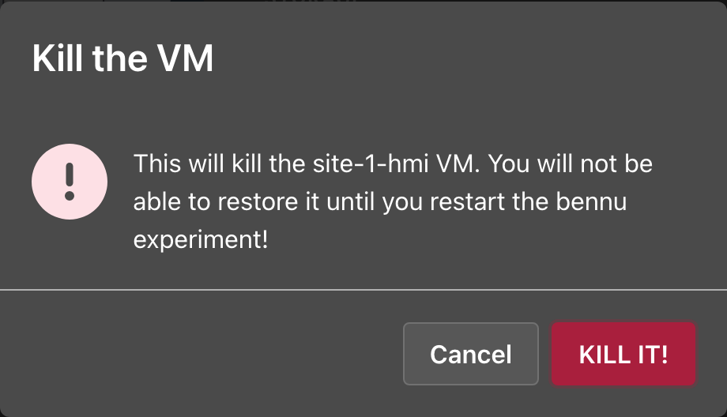{: width=500 .center}

_Note_: if you stop and then start the experiment again, that VM will run again
per the experiment configuration.

### From the Command Line Binary

To kill a VM, run the following command. Add `--dry-run` to show the VMs
that the command would kill.

```shell
phenix vm kill <experiment name> [vm name] [--label <label>]
```

## Modify the Network Connectivity

### From the Web-UI

Click on the network for the desired VM in the Running Component to modify the
settings. Select from a pull down what network you want to switch the VM interface
you clicked on to. To revert back to previous setting, simply repeat selecting the
network interface you wish to change, and select the previous network setting.

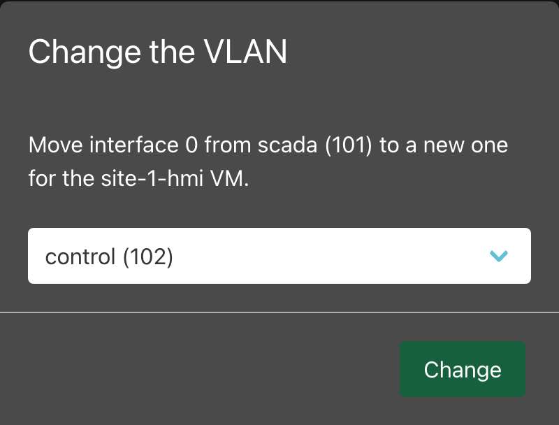{: width=500 .center}

### From the Command Line Binary

To connect a VM network interface to a different network, run the following command.

```shell
phenix vm net connect <experiment name> <vm name> <iface index> <vlan id>
```

To disconnect a VM network interface, run the following command.

```shell
phenix vm net disconnect <experiment name> <vm name> <iface index>
```

`phenix vm set` with `--interface <index>=<vlan>` also connects an
interface, and `--interface <index>=` disconnects it.

## Link Quality

### From the Web-UI

See `Set link quality…` in
[Starting/Stopping Packet Captures](vm-multi-action.md#startingstopping-packet-captures).

### From the Command Line Binary

`phenix vm qos` shows and changes the packet loss, the delay or the rate limit
that minimega applies to the traffic that a VM interface receives. The
experiment must run. Give the interface as an index from 0 or as its name in
the topology.

```shell
phenix vm qos get <experiment name> <vm name> [<interface>]
phenix vm qos set <experiment name> <vm name> <interface> --loss 0.5 --delay 100ms
phenix vm qos set <experiment name> <vm name> <interface> --rate 10mbit
phenix vm qos clear <experiment name> <vm name> [<interface>]
```

A rate cannot go with a loss or a delay. `set` replaces the link quality of
the interface. `clear` without an interface clears each interface.

## Pause a VM

### From the Web-UI

Click on the name of a running VM in a started experiment to open its details
card, then click `Pause` in the `Power` section and confirm. The bar of a live
tile, the selection toolbar and the top bar of the console page also ask you
to confirm.

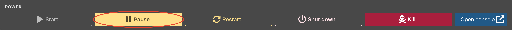{: width=600 .center}

### From the Command Line Binary

To pause a VM, run the following command.

```shell
phenix vm pause <experiment name> [vm name] [--label <label>]
```

To resume a paused VM, run the following command.

```shell
phenix vm resume <experiment name> [vm name] [--label <label>]
```

## Redeploy a VM

### From the Web-UI

Click on the name of a running VM in a started experiment to open its details
card, then click `Redeploy` in `More actions`. The dialog that opens lets you
change the VM's CPUs, memory and disk, and whether the original injections are
replicated, before it is deployed again. Its `Disk` menu works as described in
[Disk Menu](#disk-menu), and the disk changes only when you pick a different
one.

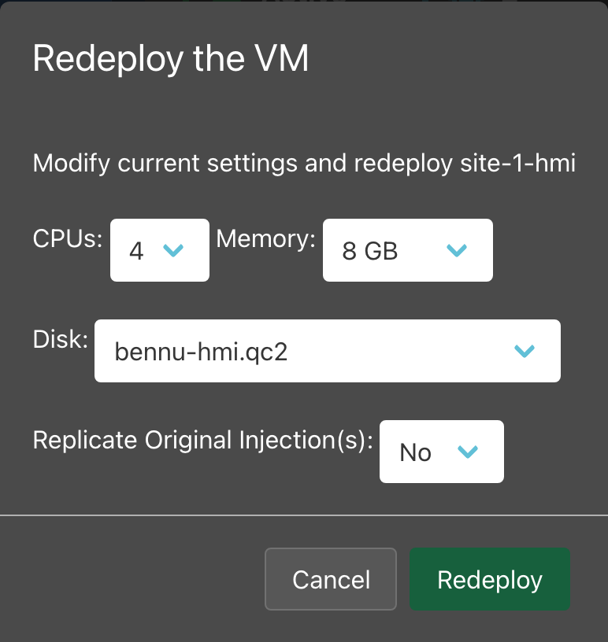{: width=500 .center}

### From the Command Line Binary

To redeploy a VM, run the following command.

```shell
phenix vm redeploy <experiment name> [vm name] [--label <label>]
```

The `-c, --cpu` and `-m, --mem` flags change a value only when you set them.
Without them, the VM keeps its current CPUs and memory. A new disk (`-d, --disk`)
replaces only the first disk of the VM. The other disks do not change.
The disk value is a minimega disk spec, `<path>[,<interface>][,<cache mode>]`,
for example `new.qc2,virtio`. A field that you do not set keeps the value of
the current first disk.

## Reset Disk State

### From the Web-UI

Click on the name of a running VM in a started experiment to open its details
card, then click `Reset disk` in `More actions` and confirm. The button is
disabled when the VM is paused or does not have snapshots enabled, with the
reason in its tooltip, such as `Cannot reset disk: the VM is paused. Resume
paused VMs first`.

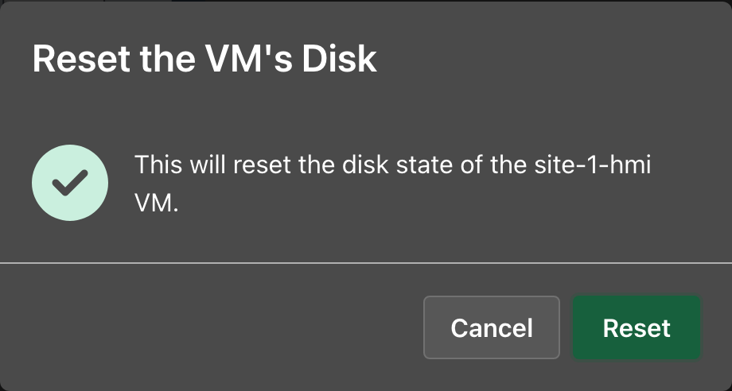{: width=500 .center}

### From the Command Line Binary

To reset the first disk to the initial pre-boot state, run the following command.

```shell
phenix vm reset-disk <experiment name> [vm name] [--label <label>]
```

## Restart a VM

### From the Web-UI

Click on the name of a running VM in a started experiment to open its details
card, then click `Restart` in the `Power` section and confirm. `Restart` is
also in the VM table's [Actions column](#vm-actions-column). The button is
disabled when the VM is not running, with the reason in its tooltip. The bar
of a live tile, the selection toolbar and the console page also ask you to
confirm a restart. Restarting a selection of VMs from the table's toolbar
skips the ones that are not running.

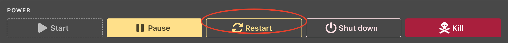{: width=600 .center}

### From the Command Line Binary

To restart a VM, run the following command.

```shell
phenix vm restart <experiment name> [vm name] [--label <label>]
```

## Resume a VM

### From the Web-UI

Click on the name of the paused VM in a started experiment to open its details
card, then click `Resume` in the `Power` section.

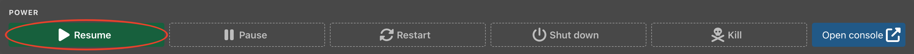{: width=600 .center}

phēnix refuses to start a VM that the topology sets to not boot
(`general.do_not_boot`), because minimega did not launch it. To launch the VM,
redeploy it.

### From the Command Line Binary

To resume a paused VM, run the following command.

```shell
phenix vm resume <experiment name> [vm name] [--label <label>]
```

## Shutdown a VM

### From the Web-UI

Click on the name of a running VM in a started experiment to open its details
card, then click `Shut down` in the `Power` section and confirm. `Shut down` is
also in the VM table's [Actions column](#vm-actions-column), the selection
toolbar, the bar of a live tile and the top bar of the console page. Each one
asks you to confirm.

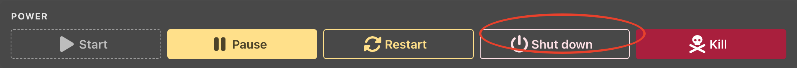{: width=600 .center}

### From the Command Line Binary

To shutdown a VM, run the following command.

```shell
phenix vm shutdown <experiment name> [vm name] [--label <label>]
```

## Modify VM Settings

### From the Web-UI

There are two ways to modify VM settings:

1. Click on a stopped experiment to access the Stopped Component. Its VM table
shows each VM's host and IP address, and lets you edit the following:
    * Host: the cluster host the VM is scheduled on
    * CPUs
    * Memory
    * Disk: the image the VM boots from (see [Disk Menu](#disk-menu))
    * Partition: the disk partition files are injected into
    * Labels
    * Boot: the do-not-boot flag
    * Persistence: `Non-Persistent` (snapshots on) or `Persistent`

    Edit a setting in the row of the VM, or click the VM name to open its
    details card. The card has the same settings, and you can also edit the
    labels and annotations of the VM there. A change saves at once, with no
    dialog. The control spins until the server answers. If the change fails,
    an error message shows and the control shows the previous value. A dot
    next to a setting tells that its value is different from the value that
    the VM had when the experiment was created. `Reset settings` sets all of
    the settings back to those values. Experiments created before this
    version of phēnix have no saved values, so they do not show `Reset
    settings`. The card also lists the port forwards that the
    `phenix/startup-autotunnel` annotation opens when the experiment starts.
    To change them, edit the annotation. The `Select visible columns` button
    shows or hides the columns of the table.
1. From a running experiment, click on the VM name and then `Redeploy` in
`More actions` on its details card. You are able to edit the following:
    * CPUs
    * Memory
    * Disk
    * Replicate Original Injection(s)

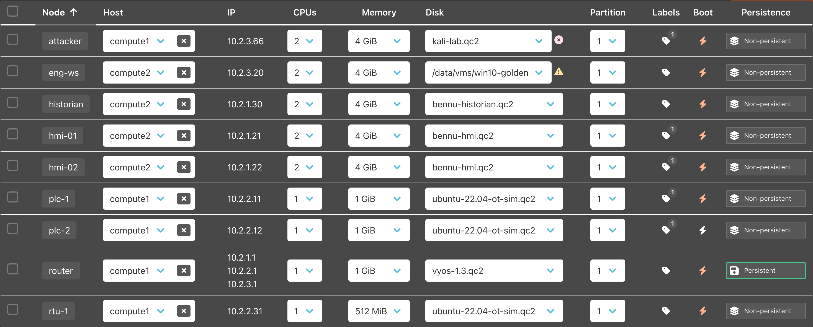{: width=800 .center}

### Disk Menu

The stopped experiment's `Disk` column and the `Redeploy` dialog pick a VM's
disk from the images the experiment can use on the [Disks](disks.md) page.
Images in the minimega files directory are listed by their path within it,
such as `win/win10.qcow2`. Images outside that directory are listed by full
path under `Outside the standard images directory`. On a stopped experiment,
picking an image asks you to confirm, then writes the image's full path into
the topology.

* An image whose path minimega cannot use is disabled and marked
  `(minimega cannot use this name)`.
* A warning icon marks a disk
  [outside the files directory](disks.md#images-outside-the-files-directory).
* A red icon with a cross marks a disk whose
  [backing chain is broken](disks.md#broken-backing-chains).
* A disk the list does not hold, such as a missing image, shows as
  `<full path> (not listed)`.

The menu needs `list` on `disks` to offer other images. Without it, the menu
shows only the VM's current disk.

### CD-ROM

`Insert CD-ROM` in the details card's `More actions` opens the CD-ROM picker
for a running VM. When an ISO image is already inserted, the button reads
`Change CD-ROM` and the picker names the inserted image. The picker lists the
ISO images the [Disks](disks.md) page knows, with those outside the minimega
files directory in a group of their own. If there are none, it says so and
links to the Disks page, where an `.iso` file can be uploaded. `Insert` (or
`Change`) inserts the selected image, and `Eject` removes the inserted one.
From the command line, use
`phenix vm cdrom insert <experiment name> <vm name> <iso path>` and
`phenix vm cdrom eject <experiment name> <vm name>`. minimega reads the ISO
path on the cluster node that runs the VM.

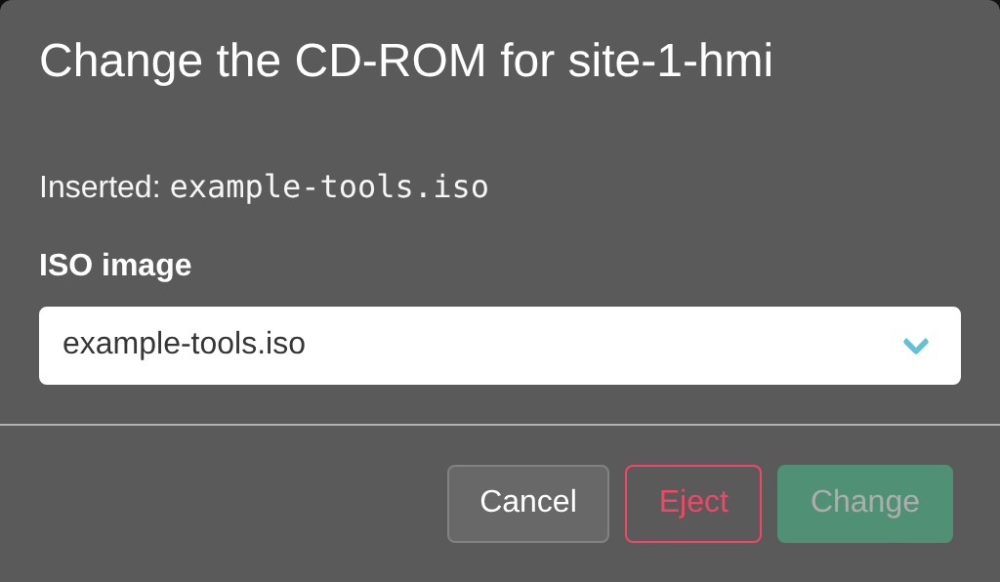{: width=500 .center}

### From the Command Line Binary

To modify VM settings, run the following command, specifying one or more of the
configuration flags described below.

```shell
phenix vm set <experiment name> [<vm name>] [flags]
```

Only the flags that are explicitly provided will be applied; any setting whose
flag is omitted is left unchanged. The following flags are supported:

| Flag                  | Description                                                                                                       |
| --------------------- | ----------------------------------------------------------------------------------------------------------------- |
| `-c, --cpu`           | Number of VM CPUs (1-16 is valid).                                                                                |
| `-m, --mem`           | Amount of memory in megabytes (a multiple of 512 from 512 to 131072).                                             |
| `-d, --disk`          | VM backing disk image.                                                                                            |
| `-p, --partition`     | Partition of the first disk to inject files into. `0` turns off disk injection, so the startup app sends its scripts through miniccc. |
| `--host`              | Cluster host to run the VM on. An empty value lets the scheduler choose the host.                                |
| `--annotation key=value` | VM annotation. May be repeated. Replaces all of the annotations of the VM.                                     |
| `--interface <index>=<vlan>` | Connect the interface to a VLAN alias or ID, or disconnect it with `<index>=`. Running experiments only.   |
| `--do-not-boot`       | Set the do-not-boot flag for the VM.                                                                              |
| `--snapshot`          | Set the snapshot (non-persistent) flag for the VM.                                                                |
| `-L, --label-changes key=value` | VM label to set, in `key=value` form. May be repeated to set multiple labels.                                         |
| `--append-labels`      | Append the provided labels to the VM's existing labels instead of replacing them.                                     |
| `-l, --label`         | Apply the change to every VM whose label matches the provided label (supports glob patterns). Use `all` to select every VM in the experiment. May be repeated. |

A label key or value may not hold a double quote, a backslash, `$`, or a
control character other than a newline or tab, and may not start with
`file:`, `http:`, `https:` or `tar:`. A VLAN an interface connects to may not
hold white space, `'` or `#`.

For example, to set the CPU count to 4 and memory to 2048 MB for a VM named
`my-vm` in an experiment named `my-exp`:

```shell
phenix vm set my-exp my-vm --cpu 4 --mem 2048
```

To set the `role=server` labels on VMs whose existing labels matches
`tier=web*` in the same experiment, without clearing the existing labels:

```shell
phenix vm set my-exp --label "tier=web*" -L role=server --append-labels
```

To set two labels on the VM `my-vm` and replace the existing labels on the VM:

```shell
phenix vm set my-exp my-vm -L val1=true -L val2=roger
```

!!! note
    Only labels, annotations and interface VLAN connections can be modified
    while an experiment is running. Apps read the new annotations when the
    experiment starts again. To change CPU, memory, disk, partition, host,
    do-not-boot, or snapshot settings, the experiment must be stopped. Use
    `--interface` or [`phenix vm net`](#modify-the-network-connectivity) to
    modify interface VLAN connections on a running experiment.

## Applying Actions to Multiple VMs

!!! note
    See [VM Multi Action](vm-multi-action.md) for documentation on applying
    actions to multiple VMs at once.
