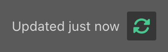
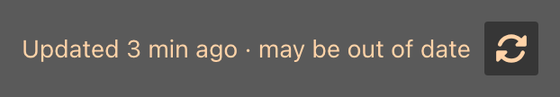
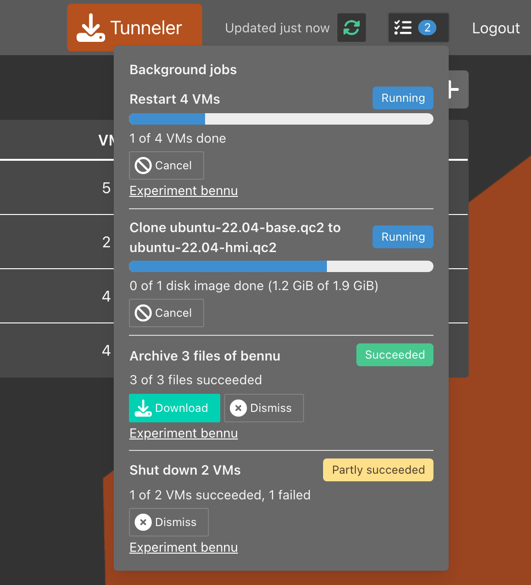
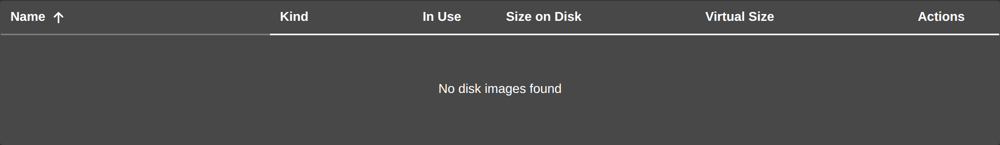

# Using the Web UI

The phēnix web UI is a single page in the browser. Whichever tab you are on,
the banner at the top holds the tabs and the page's freshness status, and the
footer holds a book button that opens this documentation. This page describes
the behavior that is the same everywhere; the pages themselves are described
under [Experiments](experiments.md), [VMs](vms.md), [Disks](disks.md),
[Hosts](hosts.md), and the rest.

## The Navbar

The tabs appear in this order, and only when your role and the server allow
them:

| Tab | Needs |
| :--- | :--- |
| `Experiments` | `list` on `experiments` |
| `Configs` | `list` on `configs` |
| `Disks` | `list` on `disks` |
| `Hosts` | `list` on `hosts` |
| `Users` | any role other than `Disabled` |
| `Logs` | `get` on `logs` |
| `Scorch` | `list` on `experiments` |
| `State of Health` | `list` on `experiments` |
| `Console` | `post` on `miniconsole` |
| `WebShark` | the `webshark` feature, plus `get` on `experiments/files` or `list` on `vms/captures` |
| `Settings` | `update` on `settings` |

When the server has the `tunneler-download` feature, a `Tunneler` button at
the right-hand end of the navbar opens the [Tunneler](tunneler.md) download
page.

The Logs page's Type filter includes `AUDIT`, the security-relevant actions
taken through the web UI and API, and its search matches their fields, such as
`event.action=disk-delete` (see [Audit Events](logging.md#audit-events)). Its
Level column shows each level as a short colored badge, such as `WRN`, and
its buttons download the phēnix and minimega log files (see
[The Logs Page](logging.md#the-logs-page)).

A feature is something the server found at startup, not a permission. The
server reports the `webshark` feature when it finds a WebShark build (see
[WebShark](webshark.md)) and `tunneler-download` when it finds a
`downloads/tunneler` directory to hand tunneler builds out from (see
[Tunneler](tunneler.md)).

The `Console` tab is shown by permission alone, but the console itself works
only when the server was started with `phenix ui --minimega-console`. Without
it, the page reads `Console access is not configured.`, because the server
answers `POST /console` with `405` and `'minimega-console' CLI arg not
enabled`. See
[Attaching to the minimega Console](minimega.md).

## Page Freshness and Refresh

Pages do not hide behind a full-page spinner. Each one shows the data it last
loaded straight away and loads a fresh copy behind it, so the right-hand end
of the navbar says how old what you are looking at is, with a button beside it
(`Refresh this page's data`) that reloads only the page's data.

{: width=500 .center}

The status reads:

* `Loading…` while the page's first load runs.
* `Refreshing…` while a later load runs, with the age of the data on screen
  when it is a minute or more old, such as `Refreshing… (data 3 min old)`.
* `Updated just now`, then `Updated 3 min ago` and so on, checked every 15
  seconds.
* `Updated 10:42:05 AM`, once the data is an hour or more old.
* `Refresh failed` when the last load failed. The page keeps showing what it
  already had.
* `· may be out of date` after the age when phēnix knows the data may no longer
  be current. Hovering over the status says why:
    * `minimega was busy. Showing earlier data`: the server answered with the
      data it read last, as it does while an experiment starts or stops.
    * `changed elsewhere since it loaded`: a live update changed the data while
      you were on another page; the fresh load replaces it.
    * `live updates disconnected`: the page is kept current by live updates,
      and the connection that carries them dropped.
    * `older than 90 s` (or another limit): the data has not been reloaded for
      longer than the page expects, such as the Hosts page's 90 seconds.

{: width=600 .center}

The age is measured from when the server read the data, not from when your
browser received it, so a host list the server reused, or a page kept from an
earlier visit, shows its real age, and a wrong clock on your computer does not
matter.

The button's icon is colored to match: yellow while a load is running, green
after a load succeeded, orange while the data may be out of date, and red after
a load failed. While a load runs, the icon spins and the button cannot be
pressed. Screen readers announce only a failed load and data that may be out
of date, with the reason, and only when that changes, not on each reload or
change of age. A page with nothing to reload, such as `Console`, shows neither
the status nor the button.

The Experiments, Configs, Disks, Hosts, Users, Logs, Scorch, State of Health
and Settings pages, the VM tiles, and each experiment's own page keep the data
they last loaded, so returning to one opens it filled in. An experiment's page
says `Loading experiment…` when nothing has been kept for it yet, and a running
experiment's kept VM rows leave out their screenshots, which show as loading
until the next ones arrive. The kept data is cleared when you log out, so one
user never sees another's, and an experiment's is dropped when it is deleted.
When a live update changes a page you have left, such as an experiment stopped
from another browser, the kept copy is marked out of date and the next visit
loads it again rather than reusing it.

Lists and live updates are ordered by the server, not by your browser's clock:
a list the server read before an update never undoes it, so a VM stopped while
the VM table was loading stays stopped.

After you sign in, the UI loads the Experiments, Configs, Users, Logs, Hosts,
Scorch, State of Health, Settings and Disks tabs in the background, two requests
at a time, so they open with data already in place. Disks is loaded last,
because inspecting disk images is the most expensive listing. The VM tiles are
left out, because they list every running VM.

A page's load finishes even if you leave before it comes back, for up to two
minutes, so the data is ready when you return; a request nothing is waiting on
any more is canceled instead.

## Background Jobs Menu

Next to the refresh status, a button with a checklist icon opens the
[background jobs](jobs.md) you started, such as bulk VM actions, file archives
and disk clones, along with the jobs of other users your role may see. A badge
on the button counts the jobs still running, and its name says how many, as in
`Background jobs (2 jobs running)`.

When jobs have finished since you last opened the menu, the button turns red
with an exclamation icon if any of them failed or only partly succeeded, and
green with a check icon if they all succeeded; canceled jobs do not color it.
Its name and tooltip say why, as in
`Background jobs (0 jobs running; 1 failed job not viewed)`. Opening the menu
counts every finished job it lists as viewed, including jobs that finish while
it is open, and the button goes back to its usual color. The browser remembers
which jobs you have viewed, so a reload does not color the button again; it is
kept per browser, not per account, and forgets jobs the server no longer has.

The menu lists every running or queued job and the ten most recent finished
ones. Each shows its title, its status in words (`Running`, `Partly succeeded`,
`Failed`, ...), a progress bar while it runs, and a line saying how far it got,
which screen readers announce as it changes. A running job you can cancel has a
`Cancel` button, a finished file archive has a `Download` button
(`Download incomplete archive` when some files could not be added, which asks
before downloading), and a finished job has a `Dismiss` button that removes it.
A link under each job of an experiment opens that experiment.

{: width=450 .center}

Jobs keep running when you leave the page that started them, reload, or lose
the connection; the menu catches up when the page reconnects.

## Tables

The `Paginate` toggle sits above its table, on the right, and appears only
when the table has more rows than one page holds. It starts off in a fresh
browser. On a running experiment's page, the VM table's `Paginate` toggle sits
in the toolbar to the left of the search box, after the
[`Hosts` and `Labels` filters](vms.md#filtering-and-sorting-the-vm-table).

Each table remembers its own `Paginate` setting in the browser, not in your
account. The setting is shared by everyone who uses that browser, survives
logging out, and is never sent to the server. In a private window, or with site
data blocked, tables simply start unpaginated.

Sort arrows sit beside the heading they sort by, and a centered heading stays
centered over the values below it.

An empty table says why it is empty rather than assuming you searched for
something. On Disks, for example, it reads `Loading disks…` while the first
load runs, `Could not load disks` when that load failed, `No disk images found`
when there are none, and `No disk images match your search` when the search
ruled them all out. Other tables word the same four cases for what they list.

{: width=600 .center}

A table is only called empty once this visit's own load has come back empty, so
an experiment you know exists is never reported missing while the list is still
on its way.

## Search Boxes

Every page's search box looks and works the same way: it sits at the right
above its table, has a magnifier on its left, and shows its clear button only
once there is something to clear.

The Experiments, Configs, Users, Disks, Logs and SCORCH pages count what they
list in a strip at the left, level with the search box. The counts cover the
whole list, not just the rows the search shows. On the Experiments, Configs and
Disks pages, when the window is too narrow for both, the search box and its
buttons move below the counts.

On an experiment's page, each tab keeps its own search while you look at
another, and the VMs and VNC tabs share one. The address bar names the open tab
and its search, for example `/experiment/demo?tab=files&q=log`, so reloading the
page or sharing the link opens the same tab with the same search.

## Errors

A failure opens a red notification at the top of the page. It stays until you
dismiss it (`Dismiss error`), and it is wide enough that a long server message
does not wrap into a narrow column. Successes and progress show as short
messages that go away by themselves after about 4 seconds, or 6 for longer ones;
an error never does.

Text from the server is escaped and shown as text, never rendered as HTML. When
the server nests one error inside another, the notification splits the chain
into steps: `Error:` and the outermost message first, then each step that led
to it on a line of its own, with the root cause last and in bold. A failure
deep inside a SCORCH run is much easier to read this way than as one long
sentence.

## Permissions

Opening a page your role cannot use — from an old link or a bookmark — would
only show permission errors, so the UI sends you to the first page your role
can use instead, either Experiments or the VM tiles. A role named `Disabled`
goes to the account-disabled page. Buttons and menu items your role cannot use
are hidden or disabled, and a disabled button says why in its tooltip.

For what a role may do, see
[User Authn/Authz in phenix](user-administration.md).

## Refresh Rates

Some pages keep asking the server for fresh data on their own:

| What | How often |
| :--- | :--- |
| The Hosts page | every 30 seconds |
| The VM tiles | every 60 seconds, with screenshots of only the tiles on screen |
| Screenshots of the VMs on a running experiment's page | every 15 seconds, running VMs only |
| The State of Health overview, while a run is in progress | every 15 seconds |

Each of these has the server ask minimega, which runs one command at a time, so
every other request waits behind them. The Hosts, VM tiles and State of Health
pages therefore skip a refresh while the last one is still waiting on the
server, and while their browser tab is hidden. A tab that is showing keeps
refreshing without focus, as on a wall display or a second monitor.

Screenshots work the same way from the other end. The server takes them for the
VMs a running experiment's page is showing, and stops when that page stops
asking. It takes each VM's screenshot once for every page showing it at that
width, and sends a page a screenshot only when the VM's screen changed. Hiding
its browser tab stops them, and they start again, with fresh ones, when you
come back. Leaving the page stops them altogether, which leaves minimega free
for everything else.

## When an Experiment Goes Away

If a running experiment is stopped or deleted somewhere else — from the command
line, another browser window, or another user — its page has nothing left to
show. It says so, for example `The foo experiment was stopped elsewhere.`, and
returns you to the experiment list.
