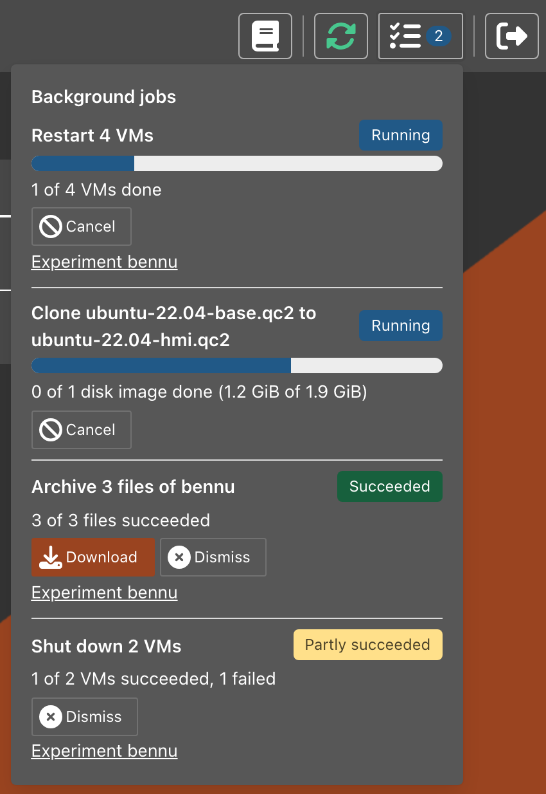
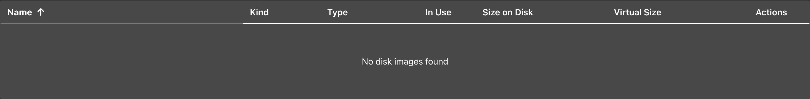

# Using the Web UI

The phēnix web UI is a single page in the browser. Whichever tab you are on,
the banner at the top holds the tabs and the page's freshness status, and the
footer holds a book button that opens this documentation. This page describes
the behavior that is the same everywhere. The pages themselves are described
under [Experiments](experiments.md), [VMs](vms.md), [Disks](disks.md),
[Hosts](hosts.md), and the rest.

## The Navbar

{: width=800 .center}

The tabs appear in this order, and only when your role and the server allow
them:

| Tab | Needs |
| :--- | :--- |
| `Experiments` | `list` on `experiments` |
| `Configs` | `list` on `configs` |
| `Disks` | `list` on `disks` |
| `Hosts` | `list` on `hosts` |
| `Users` | any role other than `Disabled` |
| `Logs` | `get` on `logs` |
| `SCORCH` | `list` on `experiments` |
| `State of Health` | `list` on `experiments` |
| `Console` | `post` on `miniconsole` |
| `WebShark` | the `webshark` feature, plus `get` on `experiments/files` or `list` on `vms/captures` |
| `Settings` | `update` on `settings` |

A feature is something the server found at startup, not a permission: a
WebShark build for `webshark` (see [WebShark](webshark.md)), or a
`downloads/tunneler` directory for `tunneler-download`. With the
`tunneler-download` feature, a `Tunneler` button at the right-hand end of the
navbar opens the [Tunneler](tunneler.md) download page. The `Console` tab
works only when the server runs with `phenix ui --minimega-console` (see
[minimega](minimega.md#from-the-web-ui)).

## Page Freshness and Refresh

Each page shows the data it last loaded straight away, and loads a fresh copy
behind it. The right-hand end of the navbar says how old the data on screen
is, with a button beside it (`Refresh this page's data`) that reloads only the
page's data.

{: width=500 .center}

The status reads:

* `Loading…` while the page's first load runs
* `Refreshing…` while a later load runs
* `Updated just now`, then `Updated 3 min ago`, and the time of day once the
  data is an hour old
* `Refresh failed` when the last load failed. The page keeps what it had.
* `· may be out of date` after the age, when the data may no longer be
  current

Hover over `may be out of date` to see why: minimega was busy, the data
changed while you were on another page, live updates disconnected, or the
page has not reloaded for longer than it expects.

{: width=600 .center}

The button's icon is yellow while a load runs, green after a load succeeded,
orange while the data may be out of date, and red after a load failed. Pages
keep the data they last loaded, so returning to a page opens it filled in
while a fresh copy loads. The kept data is cleared when you log out.

## Background Jobs Menu

Next to the refresh status, a button with a checklist icon opens the
[background jobs](jobs.md) you started, such as bulk VM actions, file archives
and disk clones, along with the jobs of other users your role may see. A badge
on the button counts the jobs still running. When jobs have finished since you
last opened the menu, the button turns red if any of them failed, and green if
they all succeeded.

The menu lists every running or queued job and the ten most recent finished
ones, each with its title, status and progress. A running job has a `Cancel`
button, a finished file archive has a `Download` button, and a finished job
has a `Dismiss` button that removes it. Jobs keep running when you leave the
page, reload or lose the connection, and the menu catches up when the page
reconnects.

{: width=450 .center}

## Tables

The `Paginate` toggle sits above its table, on the right, and appears only
when the table has more rows than one page holds. Each table remembers its own
`Paginate` setting in the browser, not in your account. On a running
experiment's page, the VM table's toggle sits in the toolbar to the left of
the search box.

Click a column heading to sort by it. Tab reaches each sortable heading, and
Enter or Space sorts by it. A table wider than the window scrolls sideways
inside itself.

An empty table says why it is empty. On Disks, for example, it reads
`Loading disks…`, `Could not load disks`, `No disk images found`, or
`No disk images match your search`. Other tables word the same four cases for
what they list.

{: width=600 .center}

## Search Boxes

Every page's search box sits at the right above its table. The Experiments,
Configs, Users, Disks, Logs and SCORCH pages count what they list in a strip
at the left, level with the search box. The counts cover the whole list, not
just the rows the search shows. On an experiment's page, the address bar
names the open tab and its search, for example
`/experiment/demo?tab=files&q=log`, so a shared link opens the same view.

## Timestamps

Times the server records show as an ISO 8601 timestamp with its UTC offset,
followed by how long ago that was, such as `2026-10-28T14:03:22Z (3 hours
ago)`. The age is kept current while the page is open.

## Errors

A failure opens a red notification at the top of the page, which stays until
you dismiss it. Successes and progress show as short messages that go away by
themselves. When the server nests one error inside another, the notification
lists each step on a line of its own, with the root cause last and in bold.

## Permissions

If you open a page your role cannot use, the UI sends you to the first page
your role can use. Buttons and menu items your role cannot use are hidden or
disabled, and a disabled button says why in its tooltip. For what a role may
do, see [User Authn/Authz in phenix](user-administration.md).

## Refresh Rates

Some pages ask the server for fresh data on their own:

| What | How often |
| :--- | :--- |
| The Hosts page | every 30 seconds |
| The VM tiles | every 60 seconds, with screenshots of only the tiles on screen |
| Screenshots of the VMs on a running experiment's page | every 15 seconds, running VMs only |
| The State of Health overview, while a run is in progress | every 15 seconds |

These pages skip a refresh while the last one is still waiting, or while their
browser tab is hidden.

## When an Experiment Goes Away

If a running experiment is stopped or deleted somewhere else, its page says so,
for example `The foo experiment was stopped elsewhere.`, and returns you to
the experiment list.
