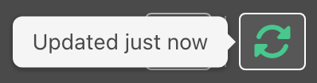
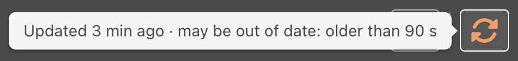

# Using the Web UI

The phēnix web UI is a single page in the browser. Whichever tab you are on,
the banner at the top holds the tabs and the page's freshness status, and the
footer holds a book button that opens this documentation. This page describes
the behavior that is the same everywhere; the pages themselves are described
under [Experiments](experiments.md), [VMs](vms.md), and the rest.

## Page Freshness and Refresh

Pages do not hide behind a full-page spinner. Each one shows the data it last
loaded straight away and loads a fresh copy behind it, so the right-hand end
of the navbar says how old what you are looking at is, with a button beside it
(`Refresh this page's data`) that reloads only the page's data.

{: width=500 .center}

The status reads:

* `Loading…` while the page's first load runs.
* `Refreshing…` while a later load runs, with the age of the data on screen
  when it is a minute or more old, such as `Refreshing… (data 3 min old)`.
* `Updated just now`, then `Updated 3 min ago` and so on, checked every 15
  seconds.
* `Updated 10:42:05 AM`, once the data is an hour or more old.
* `Refresh failed` when the last load failed. The page keeps showing what it
  already had.
* `· may be out of date` after the age when phēnix knows the data may no longer
  be current. Hovering over the status says why:
    * `minimega was busy. Showing earlier data`: the server answered with the
      data it read last, as it does while an experiment starts or stops.
    * `changed elsewhere since it loaded`: a live update changed the data while
      you were on another page; the fresh load replaces it.
    * `live updates disconnected`: the page is kept current by live updates,
      and the connection that carries them dropped.
    * `older than 90 s` (or another limit): the data has not been reloaded for
      longer than the page expects, such as the Hosts page's 90 seconds.

{: width=600 .center}

The age is measured from when the server read the data, not from when your
browser received it, so a host list the server reused, or a page kept from an
earlier visit, shows its real age, and a wrong clock on your computer does not
matter.

The button's icon is colored to match: yellow while a load is running, green
after a load succeeded, orange while the data may be out of date, and red after
a load failed. While a load runs, the icon spins and the button cannot be
pressed. Screen readers announce only a failed load and data that may be out
of date, with the reason, and only when that changes, not on each reload or
change of age. A page with nothing to reload, such as `Console`, shows neither
the status nor the button.

The UI keeps the data each page last loaded, so returning to a page opens it
filled in. The kept data is cleared when you log out, so one user never sees
another's, and an experiment's is dropped when it is deleted. When a live
update changes a page you have left, such as an experiment stopped from
another browser, the kept copy is marked out of date and the next visit loads
it again rather than reusing it.

Lists and live updates are ordered by the server, not by your browser's clock:
a list the server read before an update never undoes it, so a VM stopped while
the VM table was loading stays stopped.

After you sign in, the UI loads the Configs, Users, Logs, Hosts, State of
Health and Settings tabs in the background, two requests at a time, so they
open with data already in place. The VM tiles are not preloaded.

A page's load finishes even if you leave before it comes back, for up to two
minutes, so the data is ready when you return; a request nothing is waiting on
any more is canceled instead.
