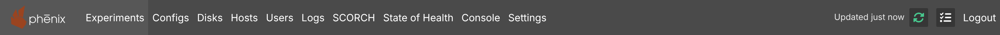
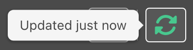
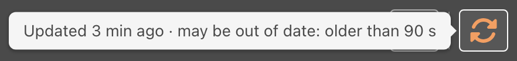
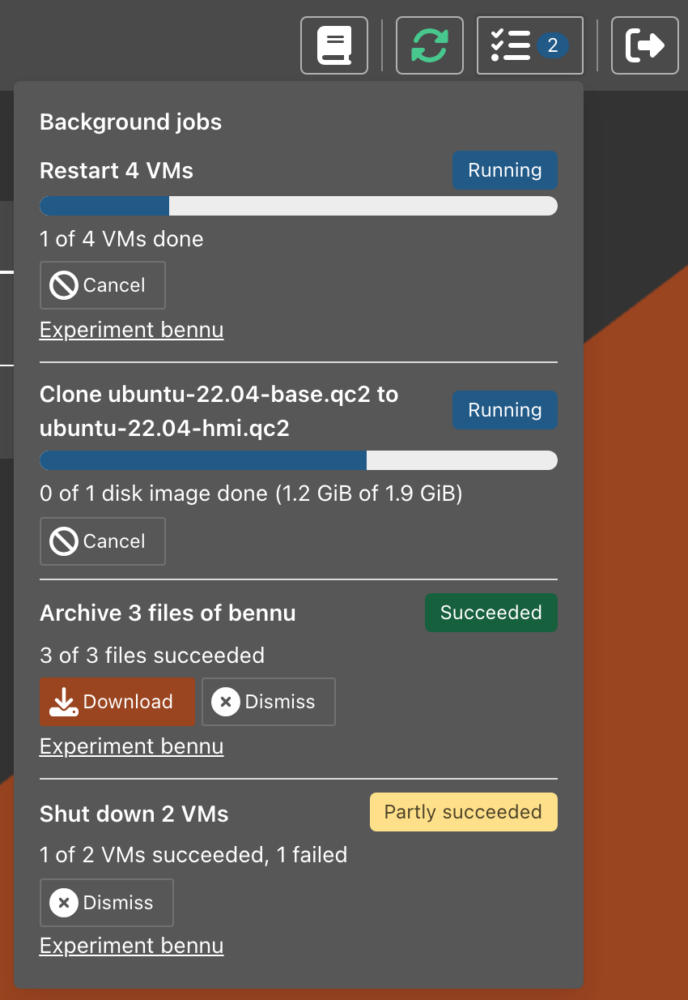
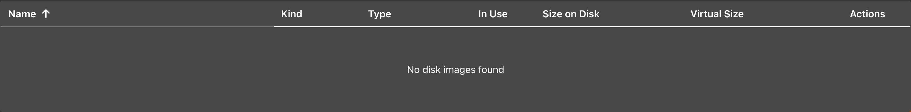
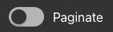
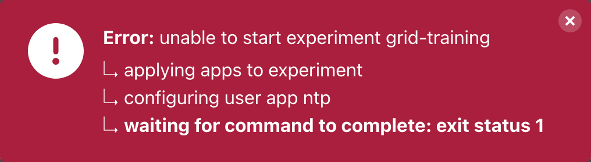
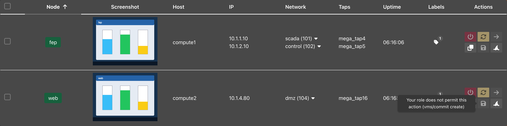

# Using the Web UI

This page explains the basics of using the web UI. The specific pages are described in separate sections in the documentation ([Experiments](experiments.md), [VMs](vms.md), [Disks](disks.md),
[Hosts](hosts.md), [VLANs](vlans.md), etc.).

## The Navbar

{: width=800 .center}

From left to right:

* Home (the experiments page)
* Links and Menus
* phēnix documentation (where you are now!)
* The [refresh button](#page-freshness-and-refresh)
* The [background jobs menu](#background-jobs-menu)
* Logout or Reauthorize (depending on if proxy authentication is enabled)

!!! note
    Some of the buttons in the navbar may not be available, due to your Role's permissions (see [Roles](user-administration.md#roles)) or a missing feature (such as [WebShark](webshark.md) or the [minimega console](minimega.md#web-ui)).

## Page Freshness and Refresh

When navigating to a page, it will load immediately and show you the last data that was cached for that page, while loading fresh data in the background. This improves responsiveness, but can lead to confusion when data isn't what you expect.

{: width=200 .center}

The status of the background load is in the refresh button on the top right. It will spin while loading, show green when data is fresh, and turn more and more orange the more stale a page gets. To refresh, click the button (this eliminates the need to do a browser page refresh).

{: width=400 .center}

## Background Jobs Menu

This menu shows the [background jobs](jobs.md) you started, such as bulk VM actions, file archives, or cloning a disk image (see [Background Jobs](jobs.md#what-runs-as-a-job) for the full list). The menu lists every running or queued job and the ten most recent finished ones. Jobs keep running when you leave the
page, reload or lose the connection.

{: width=450 .center}

## Tables

Tables appear in many places in the phenix UI, such as the VMs for an experiment or experiments on the home page. They can be sorted by clicking on a column, and click again to change the sort order. Most columns are sortable, but some may not.

{: width=600 .center}

If a table is empty or loading, a message will be displayed, e.g. `Loading disks…` or `No disk images found`.

### Search

Most tables will also have a search box located at the top right above the table, which will filter what is shown in the table.

### Pagination

By default, all items in a table are shown, but you can show a limited number at a time with the `Paginate` toggle on the top right of a table. This preference is remembered in your browser.

## Errors

A failure opens a red notification at the top of the page, which stays until
you dismiss it. Successes and progress show as short messages that go away by
themselves. When the server nests one error inside another, the notification
lists each step on a line of its own, with the root cause last and in bold.

{: width=600 .center}

## Permissions

If you open a page your role cannot use, the UI sends you to the first page
your role can use. Buttons and menu items your role cannot use are hidden or
disabled, and a disabled button says why in its tooltip. For what a role may
do, see [User Administration](user-administration.md).

{: width=800 .center}

## Refresh Rates

Some pages ask the server for fresh data on their own:

| What | How often |
| :--- | :--- |
| The Hosts page | every 30 seconds |
| The VM tiles | every 60 seconds, with screenshots of only the tiles on screen |
| Screenshots of the VMs on a running experiment's page | every 15 seconds, running VMs only |
| The State of Health overview, while a run is in progress | every 15 seconds |

These pages skip a refresh while the last one is still waiting, or while their
browser tab is hidden.

## See Also

* [phenix ui](cli/ui.md): start the server, and its flags.
* [Accessibility](accessibility.md): keyboard, screen reader and display notes.
* [Settings](settings.md): the `ui.*` settings.
* [Builder](builder/index.md): draw a topology in the browser.
* [Troubleshooting](troubleshooting.md): fixes for common problems.
