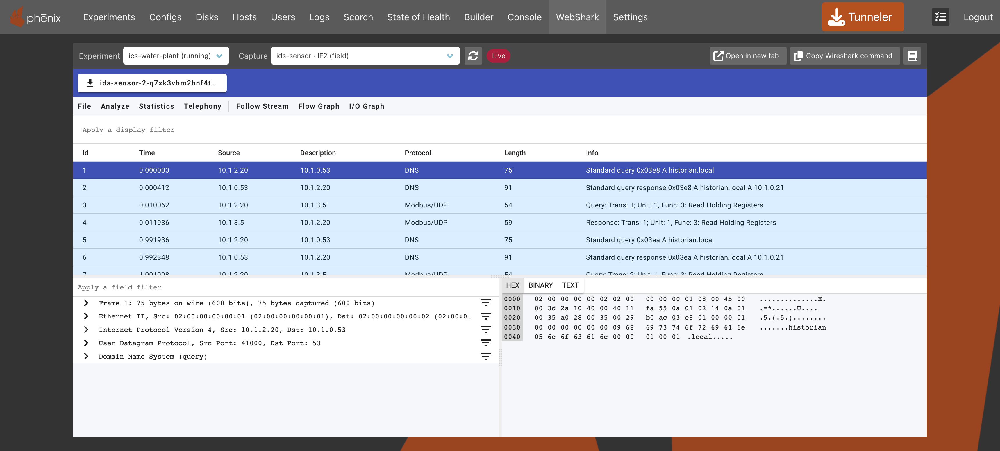
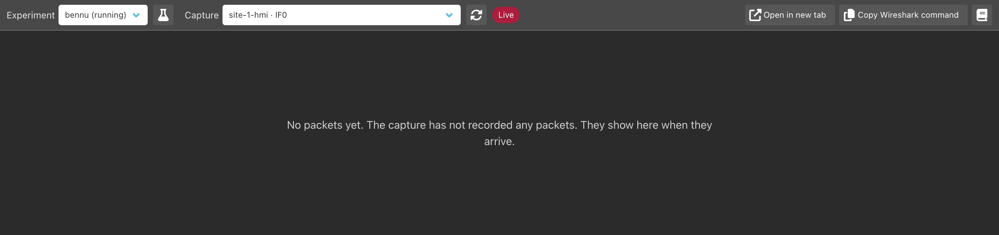

# WebShark

The phēnix UI can show the packets of an experiment's packet captures in
[WebShark](https://github.com/QXIP/webshark), a build of Wireshark that runs in
the browser. It shows both captures that are still running, updating as packets
are captured, and capture files saved in the experiment's files.

phēnix can also stream a running capture to programs outside the browser, such
as a local Wireshark or `tshark`. See
[Streaming a Running Capture](#streaming-a-running-capture).

{: width=800 .center}

## Installing WebShark

The phēnix Docker and Podman images and the Debian package include WebShark
in `/opt/phenix/webshark`. The phēnix server serves it when it finds a
WebShark build there, or in a `webshark` directory in the directory the
server runs from, and logs `Serving WebShark`. Without WebShark, the web UI
has no `WebShark` tab or buttons.

To build WebShark yourself, check out its
[source](https://github.com/QXIP/webshark) and run phēnix's
`docker/build-webshark.sh`. It needs Node.js (22.22.3, 24.15.0 or 26, or a
later release), npm, gzip, wget and python3. Restart the phēnix server
afterwards.

```shell
git clone https://github.com/QXIP/webshark.git
sceptre-phenix/docker/build-webshark.sh webshark /opt/phenix/webshark
```

!!! note
    WebShark is licensed under the GNU Affero General Public License v3.0,
    and its Wireshark build under the GNU General Public License v2.0. The
    build script copies the license and a `NOTICE` into the build.

### Behind a Reverse Proxy

When a reverse proxy serves the phēnix UI under a base path, such as
`https://example.com/phenix/`, WebShark is served under the same base path,
and the proxy needs no route of its own for it. Start the server with the
base path the UI was built with: `phenix ui --base-path /phenix/`. The base
path can use only letters, digits, `-`, `.`, `_`, `~`, `%` and `/`.

WebShark's RTP audio player works only over HTTPS, in a tab of its own.
Behind a proxy that ends HTTPS, the proxy must send an
`X-Forwarded-Proto: https` or `Forwarded: proto=https` header.

## Viewing Captures

Click the `WebShark` tab in the banner near the top of the phēnix UI, pick an
experiment, then pick a capture:

* **Live captures** are the experiment's running captures, by VM and
  interface. WebShark reloads the capture as it grows, and the page shows a
  red `Live` tag.
* **Saved files** are the capture files (`.pcap`, `.pcapng` or `.cap`,
  optionally gzipped) in the experiment's files, newest first.

The page's URL names the experiment and capture, so it can be bookmarked or
shared with other phēnix users. `Open in new tab` opens the capture in a tab
of its own. The flask button after the experiment picker opens the page of
the experiment. Its tooltip tells why it is disabled, for example when no
experiment is picked.

A capture that has no packets yet shows `No packets yet.` in place of
WebShark, and a saved file with no packets shows `<file> has no packets.`.
WebShark opens when the first packets arrive.

{: width=800 .center}

The web UI also opens WebShark from a capture file's name, or its
`Open in WebShark` button, on the experiment's
[Files](experiment-files.md#opening-a-file) tab, and from the
`Open in WebShark` button of a capturing interface in a VM's details. To
start a capture, see [Packet Capture](vms.md#packet-capture).

### Permissions

A role needs `get` on `experiments/files` to open saved capture files, and
`list` on `vms/captures` for the VM to open a running capture. A role with
neither has no `WebShark` tab.

## Streaming a Running Capture

phēnix streams a running capture as a pcap stream: every packet captured so
far, then each new packet as it is captured, until the capture stops or the
reader disconnects. It works whichever cluster node runs the VM.

For a live capture, the `WebShark` tab has a `Copy Wireshark command` button
that copies a command like this one, which streams the capture into a local
Wireshark:

```shell
curl -fsSN --max-redirs 0 -L \
  'https://phenix.example.com/webshark/streams/pcs_<token>' \
  | wireshark -k -i -
```

The command carries a stream token for that one capture instead of your
sign-in token (see [Capture Tokens](#capture-tokens)). Run it within 5
minutes. After that, copy the command again. If phēnix refuses the request,
or a proxy redirects it, curl stops with an error instead of passing
Wireshark a sign-in page.

Behind a sign-in proxy (a UI built with `PHENIX_WEB_AUTH=proxy`), add the
proxy's sign-in cookie to the command as `-b 'NAME=VALUE'`, or stream the
capture with the CLI on the phēnix server, which does not go through the
proxy:

```shell
phenix vm capture stream <exp> <vm> <iface> | wireshark -k -i -
phenix vm capture stream <exp> <vm> <iface> --from-now | tshark -i -
phenix vm capture stream <exp> <vm> <iface> -O copy.pcap
```

`<iface>` is the interface's index or name. `--from-now` skips the packets
captured before the command started. `-O` (`--output-file`) writes the capture
to a file. The command refuses to write the capture to a terminal.

### Stream API

`GET /api/v1/experiments/{exp}/vms/{vm}/captures/{iface}/stream` streams the
capture as `application/vnd.tcpdump.pcap`, and `?from=now` skips the packets
captured before the request. The same URL upgrades to a websocket that sends
the pcap file header, then whole packet records, as binary messages. Both
need the same permissions as a live capture in the `WebShark` tab, and answer
`404` when the interface has no running capture.

## Capture Tokens

WebShark's own requests, and a command run outside the browser, carry no
phēnix sign-in. phēnix gives them a capture token instead: a random token
that reads one capture and is kept only in the server's memory.

* A **WebShark capture name** is the token in a WebShark link. It ends 2
  hours after it was last used, 12 hours after it was given, or when your
  session ends. Open the capture again from the `WebShark` tab for a new one.
* A **stream token** (`pcs_<random>`) streams a running capture as pcap from
  `GET /webshark/streams/<token>`. It starts streams for 5 minutes, and a
  stream it started ends with your session.

Each use checks again that the user may still read the capture, so a role
change takes effect within seconds. A token also ends when its user, its
experiment or its capture file is deleted, and a server restart ends them
all.

The API gives, lists and revokes tokens:

```shell
# a stream token for a running capture
curl -s -H 'X-Phenix-Auth-Token: Bearer <sign-in token>' \
  -d '{"vm":"<vm>","interface":<iface>,"operations":["stream"]}' \
  'https://phenix.example.com/api/v1/experiments/<exp>/captureTokens'

# the stream, from anywhere, with no sign-in token
curl -fsSN 'https://phenix.example.com/webshark/streams/pcs_<token>' \
  | wireshark -k -i -
```

`GET /api/v1/experiments/<exp>/captureTokens` lists your own tokens, and
`DELETE .../captureTokens/<id>` revokes one.

## Limitations

* WebShark loads a whole capture into the browser and parses it there, so large
  captures (hundreds of megabytes) are slow to open, and a live capture is
  downloaded again each time WebShark reloads it. For large captures, stream
  them into a local Wireshark instead.
* A WebShark link that has expired shows WebShark's "not found". Open the
  capture again from the `WebShark` tab (see [Capture Tokens](#capture-tokens)).
