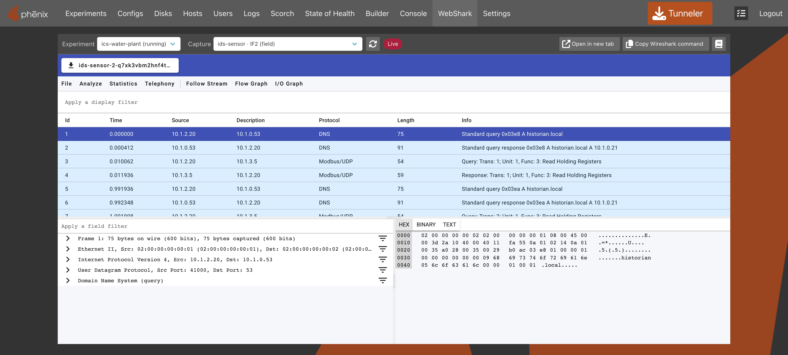
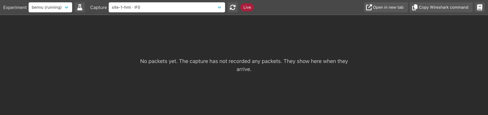

# WebShark

[WebShark](https://github.com/QXIP/webshark) is a build of Wireshark that runs
in the browser. The phēnix UI uses it to show an experiment's packet
captures, both running captures (updating live) and capture files saved in the
experiment's files. If you'd rather use a local Wireshark or `tshark`, you can
[stream a running capture](#streaming-a-running-capture) to it instead.

{: width=800 .center}

## Installing WebShark

The phēnix Docker and Podman images and the Debian package include WebShark
in `/opt/phenix/webshark`. The server also looks for a `webshark` directory in
the directory it runs from, and logs `Serving WebShark` when it finds one.
Without it, the web UI has no `WebShark` tab or buttons.

To build it yourself, you need Node.js (22.22.3, 24.15.0 or 26, or a later
release), npm, gzip, wget and python3. Restart the phēnix server afterwards.

```shell
git clone https://github.com/QXIP/webshark.git
sceptre-phenix/docker/build-webshark.sh webshark /opt/phenix/webshark
```

WebShark is licensed under the AGPL v3.0, and its Wireshark build under the
GPL v2.0.

### Behind a Reverse Proxy

If a reverse proxy serves the phēnix UI under a base path, WebShark is served
under the same path and needs no route of its own. Start the server with the
base path the UI was built with, e.g. `phenix ui --base-path /phenix/` (only
letters, digits, `-`, `.`, `_`, `~`, `%` and `/`). WebShark's RTP audio player
works only over HTTPS, in a tab of its own, so a proxy that ends HTTPS must
send `X-Forwarded-Proto: https` or `Forwarded: proto=https`.

## Viewing Captures

Click the `WebShark` tab in the navbar, pick an experiment, then pick one of
its running captures (by VM and interface) or saved capture files (`.pcap`,
`.pcapng` or `.cap`, optionally gzipped). A running capture gets a red `Live`
tag, and WebShark reloads it as it grows. Until it has packets, you'll see
`No packets yet.` in place of WebShark.

{: width=800 .center}

The URL names the experiment and capture, so you can bookmark it or share it
with other phēnix users. You can also open WebShark from a capture file on the
experiment's [Files](experiments.md#opening-a-file) tab, or from a
capturing interface in a VM's details. To start a capture, see
[Packet Capture](vms.md#packet-capture).

## Streaming a Running Capture

`phenix vm capture stream` writes a running capture as pcap (every packet so
far, then each new one) until the capture stops, from whichever cluster node
runs the VM. Give the interface as its index or name. On the phēnix server, pipe it into Wireshark or `tshark`, or save
it with `-O copy.pcap` (it won't write to a terminal):

```shell
phenix vm capture stream my-exp my-vm 0 | wireshark -k -i -

# only the packets from now on
phenix vm capture stream my-exp my-vm 1 --from-now | tshark -i -
```

From your own machine, click `Copy Wireshark command` on a live capture in the
`WebShark` tab. It copies a command like this one, which you must run within 5
minutes:

```shell
curl -fsSN --max-redirs 0 -L \
  'https://phenix.example.com/webshark/streams/pcs_<token>' \
  | wireshark -k -i -
```

Behind a sign-in proxy (a UI built with `PHENIX_WEB_AUTH=proxy`), add the
proxy's sign-in cookie as `-b 'NAME=VALUE'`, or use `phenix vm capture stream`
on the server. For the API, see [Streaming Endpoints](api.md#streaming-endpoints)
(add `?from=now` to skip the earlier packets).

## Capture Tokens

WebShark and the copied command use a capture token that can read only one
capture, not your sign-in. A WebShark link's token expires 2
hours after it was last used, 12 hours after it was given, or when your
session ends; if it has expired, WebShark says "not found", so open the
capture again from the `WebShark` tab. A stream token (`pcs_<random>`) starts
streams for 5 minutes, and a stream it started ends with your session. A
token also ends when its user, experiment or capture file is deleted, and a
server restart ends every token.

To stream from a machine with no phēnix sign-in, get a stream token from the
API and use it in the `curl` command above:

```shell
curl -s -H 'X-Phenix-Auth-Token: Bearer <sign-in-token>' \
  -d '{"vm":"<vm>","interface":<iface>,"operations":["stream"]}' \
  'https://phenix.example.com/api/v1/experiments/<exp>/captureTokens'
```

`GET` on the same URL lists your tokens, and `DELETE .../captureTokens/<id>`
revokes one.

## Limitations

WebShark loads a whole capture into the browser, so large captures (hundreds
of megabytes) are slow to open, and a live capture downloads again each time
WebShark reloads it. Stream large captures into a local Wireshark instead.

## See Also

* [Packet Captures](packet-captures.md): start captures and what they cost.
* [phenix vm capture](cli/vm.md#phenix-vm-capture): start, stop and stream captures from the command line.
